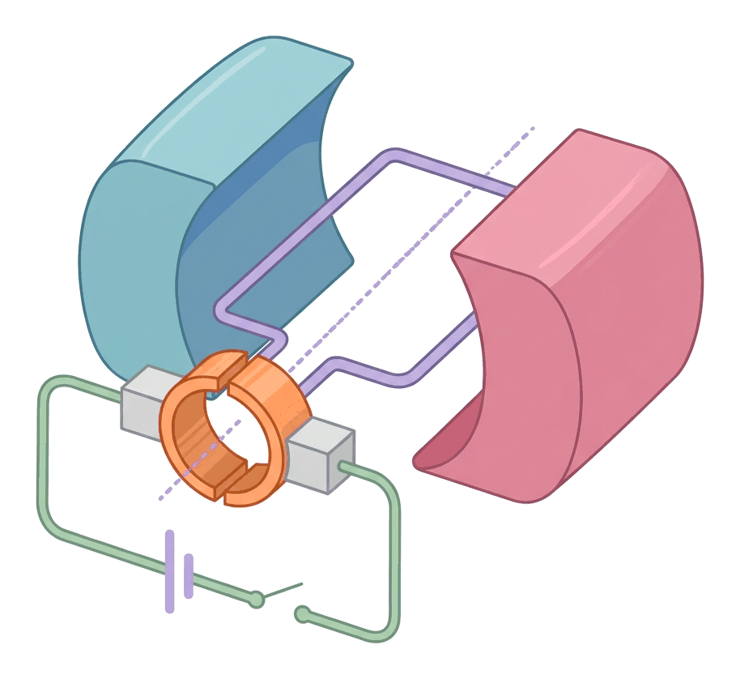

# JAMB Physics Notes: Force on a Current-Carrying Conductor in a Magnetic Field

## What JAMB expects

This topic is covered in Section A of the JAMB Physics syllabus. It examines the magnetic force acting on moving charges and conductors, and how this force is applied in practical instruments and motors. It covers the following content items:

* (i) quantitative treatment of force between two parallel current-carrying conductors;
* (ii) force on a charge moving in a magnetic field;
* (iii) the d. c. motor;
* (iv) electromagnets;
* (v) carbon microphone;
* (vi) moving coil and moving iron instruments;
* (vii) conversion of galvanometers to ammeters and voltmeter using shunts and multipliers;
* (viii) sensitivity of a galvanometer.

By the end of these notes, you should be able to:

1. determine the direction of force on a current carrying conductor using Fleming’s left-hand rule;
2. interpret the attractive and repulsive forces between two parallel current-carrying conductors using diagrams;
3. determine the relationship between the force, magnetic field strength, velocity and the angle through which the charge enters the field;
4. interpret the working of the d. c. motor;
5. analyse the principle of electromagnets and give examples of its application;
6. compare moving iron and moving coil instruments;
7. convert a galvanometer into an ammeter or a voltmeter;
8. identify the factors affecting the sensitivity of a galvanometer.

**Note on the syllabus wording:** In the official JAMB syllabus document, the content numbering skips item (vii), jumping from (vi) straight to (viii) and (ix). However, the topics remain clear. To maintain sequence, these notes cover "conversion of galvanometers" as item vii, and "sensitivity of a galvanometer" as item viii, ensuring every requirement is fully addressed.

## Direction of Force on a Current-Carrying Conductor

**Objective i: determine the direction of force on a current carrying conductor using Fleming’s left-hand rule.**

When a wire carrying an electric current is placed in a magnetic field, it experiences a mechanical force (often called the motor effect). This phenomenon occurs because the magnetic field generated by the moving charges within the wire interacts with the external magnetic field. The resulting force is greatest when the wire is placed perpendicular ($90^\circ$) to the magnetic field, and it is zero if the wire is placed parallel to the magnetic field lines.

To find the exact direction of this mechanical force, we use **Fleming's Left-Hand Rule**. 

If you hold the first three fingers of your **left hand** mutually at right angles to one another:
* The **First finger** points in the direction of the external magnetic **Field** (from the North pole to the South pole).
* The **Second finger** points in the direction of the conventional **Current** (from positive to negative).
* The **Thumb** will then point in the direction of the **Motion** (or the resulting mechanical **Force**).

A common memory aid for this rule is the acronym **FBI**:
* **F** = Force (Thumb)
* **B** = Magnetic Field (First finger)
* **I** = Current (Second finger)

**Common Mistakes:** Students often confuse Fleming's *Left-Hand* Rule with the *Right-Hand* Rule. Remember that the Left-Hand Rule is for the **motor effect** (finding the force on a conductor when current is supplied), while the Right-Hand Rule is used for generators (finding the induced current when a conductor is moved). 

[IMAGE: A diagram showing a left hand with the thumb, first finger, and second finger held at 90 degrees to each other. The thumb is pointing up, labeled "Force / Motion (Thumb)". The first finger is pointing forward, labeled "Magnetic Field (First Finger, N to S)". The second finger is pointing to the right, labeled "Current (Second Finger, + to -)". Clean flat textbook illustration, white background.]

## Force Between Two Parallel Current-Carrying Conductors

**Objective ii: interpret the attractive and repulsive forces between two parallel current-carrying conductors using diagrams.**
**Content item i: Force Between Two Parallel Current-Carrying Conductors**

When two parallel wires carry electric currents, they both produce their own magnetic fields. These fields interact with each other, resulting in a physical force between the two wires. The rule for this interaction is the exact opposite of the rule for static electric charges:
* **Like currents attract:** If the currents in the two parallel wires flow in the **same direction**, the conductors attract each other. This happens because the magnetic field lines between the wires point in opposite directions and cancel each other out, creating a region of weak magnetic flux. The stronger magnetic field on the outside pushes the wires together.
* **Unlike currents repel:** If the currents flow in **opposite directions**, the conductors repel each other. The magnetic field lines between the wires point in the same direction, crowd together, and push the wires apart.

[IMAGE: Two side-by-side diagrams. Left diagram: Two vertical parallel wires with arrows showing current flowing upwards in both. Magnetic field lines around them combine, forming large loops enclosing both wires, and arrows point inwards between the wires labeled "Force of Attraction". Right diagram: Two vertical parallel wires with current flowing upwards in the left wire and downwards in the right wire. The magnetic field lines crowd between them, and arrows point outwards labeled "Force of Repulsion". Clean flat textbook illustration, white background.]

### Quantitative Treatment (Calculations)

The magnitude of the magnetic force $F$ between two parallel wires of length $L$, separated by a distance $d$ in a vacuum or air, carrying currents $I_1$ and $I_2$, is given by the formula:

$$F = \frac{\mu_0 I_1 I_2 L}{2\pi d}$$

Where:
* $F$ = magnetic force between the wires (in Newtons, $\text{N}$)
* $\mu_0$ = permeability of free space (a constant equal to $4\pi \times 10^{-7}\ \text{T m A}^{-1}$)
* $I_1$ and $I_2$ = currents flowing in the two wires (in Amperes, $\text{A}$)
* $L$ = length of the parallel wires experiencing the force (in metres, $\text{m}$)
* $d$ = perpendicular distance between the two wires (in metres, $\text{m}$)

Because $\mu_0 = 4\pi \times 10^{-7}\ \text{T m A}^{-1}$, the term $\frac{\mu_0}{2\pi}$ perfectly simplifies to $2 \times 10^{-7}$. 
Therefore, the working formula for JAMB calculations is usually:
$$F = \frac{2 \times 10^{-7} I_1 I_2 L}{d}$$

Often, questions will ask for the **force per unit length** ($\frac{F}{L}$). The formula rearranges to:
$$\frac{F}{L} = \frac{2 \times 10^{-7} I_1 I_2}{d}$$

### Worked Examples

**Example 1:** Two long parallel straight wires are separated by a distance of $0.1\ \text{m}$ in air. If they carry currents of $5\ \text{A}$ and $10\ \text{A}$ respectively, calculate the force per unit length between them.

**Working:**
1. Identify the given values: $I_1 = 5\ \text{A}$, $I_2 = 10\ \text{A}$, $d = 0.1\ \text{m}$.
2. State the formula for force per unit length: $\frac{F}{L} = \frac{2 \times 10^{-7} I_1 I_2}{d}$
3. Substitute the values: $\frac{F}{L} = \frac{2 \times 10^{-7} \times 5 \times 10}{0.1}$
4. Calculate the numerator: $5 \times 10 = 50$, and $2 \times 10^{-7} \times 50 = 100 \times 10^{-7} = 1.0 \times 10^{-5}$.
5. Divide by the distance: $\frac{1.0 \times 10^{-5}}{0.1} = 1.0 \times 10^{-4}\ \text{N m}^{-1}$.
6. **Answer:** $1.0 \times 10^{-4}\ \text{N m}^{-1}$.

**Example 2:** Two parallel wires $5\ \text{m}$ long and spaced $0.02\ \text{m}$ apart carry currents of $3\ \text{A}$ and $4\ \text{A}$ in opposite directions. Find the magnitude and nature of the force between them.

**Working:**
1. Identify the given values: $I_1 = 3\ \text{A}$, $I_2 = 4\ \text{A}$, $d = 0.02\ \text{m}$, $L = 5\ \text{m}$.
2. State the formula for total force: $F = \frac{2 \times 10^{-7} I_1 I_2 L}{d}$
3. Substitute the values: $F = \frac{2 \times 10^{-7} \times 3 \times 4 \times 5}{0.02}$
4. Calculate the numerator: $2 \times 10^{-7} \times 60 = 120 \times 10^{-7}$
5. Divide by the distance: $F = \frac{120 \times 10^{-7}}{0.02} = 6000 \times 10^{-7} = 6.0 \times 10^{-4}\ \text{N}$.
6. Determine the nature: The currents flow in opposite directions, so the magnetic force is repulsive.
7. **Answer:** $6.0 \times 10^{-4}\ \text{N}$, repulsive.

**Example 3:** The force per unit length between two parallel identical wires carrying the same current and separated by $0.1\ \text{m}$ is $2.0 \times 10^{-5}\ \text{N m}^{-1}$. Calculate the current in each wire.

**Working:**
1. Identify the given values: $\frac{F}{L} = 2.0 \times 10^{-5}\ \text{N m}^{-1}$, $d = 0.1\ \text{m}$, and $I_1 = I_2 = I$.
2. State the formula: $\frac{F}{L} = \frac{2 \times 10^{-7} I^2}{d}$
3. Substitute the values: $2.0 \times 10^{-5} = \frac{2 \times 10^{-7} \times I^2}{0.1}$
4. Multiply both sides by $0.1$: $2.0 \times 10^{-6} = 2 \times 10^{-7} \times I^2$
5. Solve for $I^2$: $I^2 = \frac{2.0 \times 10^{-6}}{2 \times 10^{-7}} = 10$
6. Find $I$: $I = \sqrt{10} \approx 3.16\ \text{A}$.
7. **Answer:** $3.16\ \text{A}$.

## Force on a Charge Moving in a Magnetic Field

**Objective iii: determine the relationship between the force, magnetic field strength, velocity and the angle through which the charge enters the field.**
**Content item ii: Force on a Charge Moving in a Magnetic Field**

Electric current in a wire is simply a flow of moving charges (electrons). Thus, an electrically charged particle moving freely through a magnetic field (like an electron beam in a cathode ray tube) will also experience a magnetic force. 

The magnitude of this force $F$ is given by the formula:
$$F = qvB\sin\theta$$

Where:
* $F$ = magnetic force acting on the charge (in Newtons, $\text{N}$)
* $q$ = magnitude of the electric charge (in Coulombs, $\text{C}$)
* $v$ = velocity of the charge (in metres per second, $\text{m s}^{-1}$)
* $B$ = magnetic field strength, also known as magnetic flux density (in Teslas, $\text{T}$)
* $\theta$ = angle between the velocity vector of the charge and the magnetic field lines.

**Key points about the angle $\theta$:**
* **Maximum force:** If the charge enters at right angles ($90^\circ$) to the field, $\sin(90^\circ) = 1$, so the formula becomes $F = qvB$. The force is at its maximum.
* **Zero force:** If the charge moves exactly parallel to the field ($0^\circ$ or $180^\circ$), $\sin(0^\circ) = 0$, making $F = 0$. A magnetic field cannot exert a force on a charge moving parallel to its lines of flux.
* A **stationary charge** ($v = 0$) experiences zero magnetic force. Only moving charges interact with magnetic fields.

*(Note: The direction of the force on a positive charge is found using Fleming's Left-Hand Rule. For a negative charge, such as an electron, the force acts in the exact opposite direction to what the rule predicts, because conventional current flows opposite to electron flow).*

### Worked Examples

**Example 1:** An electron of charge $1.6 \times 10^{-19}\ \text{C}$ is moving at a velocity of $4 \times 10^5\ \text{m s}^{-1}$ at right angles to a uniform magnetic field of $0.5\ \text{T}$. Calculate the force acting on the electron.

**Working:**
1. Identify the values: $q = 1.6 \times 10^{-19}\ \text{C}$, $v = 4 \times 10^5\ \text{m s}^{-1}$, $B = 0.5\ \text{T}$, $\theta = 90^\circ$.
2. State the formula: $F = qvB\sin\theta$
3. Substitute the values: $F = 1.6 \times 10^{-19} \times 4 \times 10^5 \times 0.5 \times \sin(90^\circ)$
4. Since $\sin(90^\circ) = 1$, calculate: $F = 1.6 \times 10^{-19} \times 2 \times 10^5 \times 1$
5. Result: $F = 3.2 \times 10^{-14}\ \text{N}$.
6. **Answer:** $3.2 \times 10^{-14}\ \text{N}$.

**Example 2:** An alpha particle (charge $= 3.2 \times 10^{-19}\ \text{C}$) moves with a velocity of $1.5 \times 10^4\ \text{m s}^{-1}$ into a magnetic field of $2.0\ \text{T}$ at an angle of $30^\circ$ to the field. Determine the force on it.

**Working:**
1. Identify the values: $q = 3.2 \times 10^{-19}\ \text{C}$, $v = 1.5 \times 10^4\ \text{m s}^{-1}$, $B = 2.0\ \text{T}$, $\theta = 30^\circ$.
2. State the formula: $F = qvB\sin\theta$
3. Substitute the values: $F = 3.2 \times 10^{-19} \times 1.5 \times 10^4 \times 2.0 \times \sin(30^\circ)$
4. Recall that $\sin(30^\circ) = 0.5$: $F = 3.2 \times 10^{-19} \times 1.5 \times 10^4 \times 2.0 \times 0.5$
5. Calculate: $F = 3.2 \times 10^{-19} \times 1.5 \times 10^4 = 4.8 \times 10^{-15}\ \text{N}$.
6. **Answer:** $4.8 \times 10^{-15}\ \text{N}$.

**Example 3:** A proton is projected parallel to a uniform magnetic field of $1.2\ \text{T}$ at a speed of $5 \times 10^6\ \text{m s}^{-1}$. What is the magnetic force on the proton?

**Working:**
1. Identify the condition: It is moving *parallel* to the field, meaning $\theta = 0^\circ$.
2. State the formula: $F = qvB\sin(0^\circ)$
3. Since $\sin(0^\circ) = 0$, $F = 0$.
4. **Answer:** $0\ \text{N}$.

## The D.C. Motor

**Objective iv: interpret the working of the d. c. motor.**
**Content item iii: The D.C. Motor**

A **direct current (d.c.) motor** is a machine that converts electrical energy into mechanical energy. It operates on the fundamental principle that a current-carrying conductor placed in a magnetic field experiences a force. By forming the conductor into a coil, this force becomes a torque (a turning force) that causes the coil to rotate. D.c. motors are found in battery-powered appliances, toys, and electric vehicles.

### Essential Components of a D.C. Motor
1. **Armature:** A rectangular coil of many turns of insulated copper wire wound around a soft iron core. The soft iron core greatly intensifies the magnetic field within the coil.
2. **Field Magnet:** A strong permanent magnet (or an electromagnet in larger motors) with curved pole pieces (North and South) that provides a radial magnetic field across the armature.
3. **Split-ring Commutator:** Two semi-circular halves of a copper ring attached to the ends of the armature coil. It rotates with the coil. **Its vital function is to reverse the direction of current in the coil every half revolution** ($180^\circ$). This ensures that the torque remains in the same direction and the coil continues to rotate uniformly.
4. **Carbon Brushes:** Two fixed pieces of carbon (graphite) that lightly press against the rotating commutator. They conduct direct current from the stationary external battery to the spinning commutator. Graphite is used because it conducts electricity well and acts as a self-lubricant.

### How it works step by step
1. A direct current from a battery enters through the positive brush, flows into one half of the commutator, travels around the armature coil, and exits through the other half of the commutator and the negative brush.
2. According to Fleming's Left-Hand Rule, the side of the coil carrying current upwards (near the North pole) experiences a downward force, while the side carrying current downwards (near the South pole) experiences an upward force.
3. These two equal, parallel, and opposite forces form a *couple*, creating a torque that rotates the coil about its axis.
4. After half a turn ($180^\circ$), the two sides of the coil have swapped positions. If the current direction didn't change, the forces would reverse, and the coil would merely oscillate back and forth.
5. However, at this exact halfway point, the split halves of the commutator swap the brushes they are touching. This automatically reverses the direction of the current flowing in the coil.
6. As a result, the side of the coil now near the North pole still experiences a downward force, and rotation continues smoothly in the same direction.

**Note on Back EMF:** As the armature rotates within the magnetic field, it acts like a generator and induces an electromotive force (EMF) in the coil. By Lenz's Law, this induced EMF opposes the applied voltage from the battery, and is called **back EMF**. It prevents the motor from drawing too much current once it reaches its operating speed.

## Electromagnets and Their Applications

**Objective v: analyse the principle of electromagnets and give examples of its application.**
**Content item iv: Electromagnets and Their Applications**

An **electromagnet** is a temporary magnet made by winding a coil of insulated wire (a solenoid) around a magnetic core. When an electric current flows through the coil, it generates a magnetic field. This field aligns the magnetic domains within the core, turning the entire assembly into a powerful magnet. When the current is switched off, the magnetic field collapses and it loses its magnetism.

**Crucial design point:** The core **must be made of soft iron**, not steel. Soft iron is highly permeable but has low magnetic retentivity—it loses its magnetism completely and instantly when the current is turned off. Steel, on the other hand, would retain the magnetism and become a permanent magnet, which makes it useless for applications where the magnetic effect needs to be actively switched on and off.

Ways to increase the strength of an electromagnet:
1. **Increase the current** flowing through the coil.
2. **Increase the number of turns** of wire in the coil.
3. Use a **soft iron core** to concentrate the magnetic flux.

### Applications of Electromagnets
* **The Electric Bell:** When the switch is closed, current flows and the electromagnet attracts a soft iron armature, pulling the hammer to strike the gong. As the armature moves, it breaks the circuit at a contact screw. The electromagnet instantly loses its magnetism, a spring pulls the armature back, the circuit closes again, and the process repeats rapidly, creating a continuous ringing sound.
* **Magnetic Relay:** A relay is an electromagnetic switch. A very small current operates an electromagnet, which pulls a lever to close a switch on a separate, high-voltage circuit. This is used in cars to safely switch on the heavy current needed for the starter motor.
* **Industrial Cranes:** Huge electromagnets are used in scrapyards in places like Lagos to lift tons of iron or steel scrap. When the crane operator cuts the power, the scrap is instantly released and dropped in the desired location.
* **Loudspeakers and Earpieces:** Electromagnets interact with a permanent magnet to push and pull a diaphragm at varying frequencies, converting electrical audio signals into sound waves.

## Carbon Microphone

**Content item v: Carbon Microphone**

Though mostly replaced by modern condenser and dynamic microphones, the carbon microphone is an important historical application of electricity and acoustics. It converts sound waves into a varying electric current. 

It consists of a thin metal **diaphragm** pressing against a small enclosed cup filled with loosely packed **carbon granules**. 
1. When a person speaks into the microphone, sound waves hit the diaphragm, causing it to vibrate in sympathy with the sound frequencies.
2. When the diaphragm moves inward, it compresses the carbon granules. This tighter packing increases their contact area, lowering their electrical resistance. As a result, a larger current flows through the circuit.
3. When the diaphragm moves outward, the pressure on the granules drops. They become looser, their electrical resistance increases, and the current decreases.
4. The result is a varying direct current that acts as an electrical replica of the original sound waves.

## Moving Coil and Moving Iron Instruments

**Objective vi: compare moving iron and moving coil instruments.**
**Content item vi: Moving Coil and Moving Iron Instruments**

Ammeters and voltmeters rely on magnetic effects to measure electrical current and potential difference. The two primary types of analog measuring instruments are **moving coil** instruments (commonly used in school physics laboratories) and **moving iron** instruments (often used in power stations and industrial settings).

### Moving Coil Instrument
This instrument uses a coil of wire suspended in a strong permanent radial magnetic field. When current flows, the coil experiences a deflecting torque ($\text{Torque} = NIAB$) and rotates against the restoring force of a fine hairspring. The coil comes to rest when the magnetic deflecting torque equals the spring's restoring torque. 
The angle of deflection $\theta$ is directly proportional to the current $I$ ($I \propto \theta$).
* **Linear scale:** Because $I \propto \theta$, the markings on the scale are evenly spaced.
* **Direct Current (d.c.) only:** If alternating current (a.c.) is applied, the rapid change in direction would cause the pointer to simply vibrate around the zero mark. It cannot measure a.c.
* **Eddy current damping:** It must come to rest quickly without oscillating. This is achieved by winding the coil on a light aluminium frame; as the frame moves through the magnetic field, eddy currents are induced in it, which oppose the motion and quickly dampen the pointer's swing.

### Moving Iron Instrument
This instrument relies on the magnetic repulsion between two pieces of soft iron. Two iron rods (one fixed, one attached to a pointer) are placed inside a coil. When current flows through the coil, it magnetises both pieces of iron in the same direction (e.g., both become North poles at the top). They repel each other, moving the pointer. The repulsive force depends on the square of the current ($I^2$).
* **Non-linear scale:** Because the deflection is proportional to $I^2$, the markings on the scale are cramped at the lower end and spaced wider apart at the higher end.
* **Measures both a.c. and d.c.:** Because the force depends on $I^2$, a negative current still produces a positive repulsion ($(-I)^2 = +I^2$). Thus, it can measure alternating current directly.
* **Air friction damping:** It is damped using a light piston moving inside an air chamber. Eddy current damping cannot be used here because introducing an aluminium frame would distort the instrument's delicate operating magnetic field.

### Comparison Table

| Feature | Moving Coil Instrument | Moving Iron Instrument |
| :--- | :--- | :--- |
| **Current measured** | Direct current (d.c.) only | Both alternating (a.c.) and direct (d.c.) |
| **Scale type** | Linear (evenly spaced divisions) | Non-linear (cramped at the bottom) |
| **Operating Principle** | Force on a current-carrying coil in a magnetic field | Repulsion between two similarly magnetised soft iron pieces |
| **Damping method** | Eddy current damping | Air friction (pneumatic) damping |
| **Sensitivity** | Very sensitive and highly accurate | Less sensitive and robust |

## Conversion of Galvanometers to Ammeters and Voltmeters

**Objective vii: convert a galvanometer into an ammeter or a voltmeter.**
**Content item vii: Conversion of Galvanometers to Ammeters and Voltmeters**

A galvanometer is a very sensitive moving coil instrument designed to detect and measure tiny currents (usually in milliamperes, $\text{mA}$, or microamperes, $\mu\text{A}$). Its internal resistance is denoted by $R_g$, and the maximum full-scale deflection current it can safely handle is $I_g$. It can be converted to measure larger currents (acting as an ammeter) or large voltages (acting as a voltmeter) by adding specific resistors.

### Converting to an Ammeter
An ammeter must be connected in series with a circuit, which means it must have a very low total resistance so it does not restrict the current it is trying to measure. 
To convert a galvanometer into an ammeter reading up to a new maximum current $I$, a **very low resistance called a shunt ($S$)** is connected in **parallel** with the galvanometer.

Because they are in parallel, the potential difference across the galvanometer equals the potential difference across the shunt:
$$I_g R_g = (I - I_g) S$$
Rearranging for $S$:
$$S = \frac{I_g R_g}{I - I_g}$$
*(Note: $I - I_g$ is the large bulk of the current that bypasses the sensitive galvanometer and flows safely through the shunt).*

### Converting to a Voltmeter
A voltmeter must be connected in parallel across a component, meaning it must have a very high total resistance so it draws almost no current away from the circuit. 
To convert a galvanometer into a voltmeter reading up to a maximum voltage $V$, a **very high resistance called a multiplier ($R_v$)** is connected in **series** with the galvanometer.

Because they are in series, the total voltage $V$ is the sum of the voltage drops across both parts, and the same tiny current $I_g$ flows through both:
$$V = I_g (R_g + R_v)$$
$$R_g + R_v = \frac{V}{I_g}$$
$$R_v = \frac{V}{I_g} - R_g$$

### Worked Examples

**Example 1 (Ammeter conversion):** A galvanometer has a resistance of $50\ \Omega$ and gives a full-scale deflection for a current of $10\ \text{mA}$. Calculate the resistance of the shunt required to convert it to an ammeter reading up to $2.01\ \text{A}$.

**Working:**
1. Identify values: $R_g = 50\ \Omega$, $I_g = 10\ \text{mA} = 0.01\ \text{A}$, maximum current $I = 2.01\ \text{A}$.
2. State the parallel shunt formula: $S = \frac{I_g R_g}{I - I_g}$
3. Substitute the values: $S = \frac{0.01 \times 50}{2.01 - 0.01}$
4. Calculate the terms: $S = \frac{0.5}{2.00}$
5. Result: $S = 0.25\ \Omega$.
6. **Answer:** $0.25\ \Omega$ connected in parallel.

**Example 2 (Ammeter conversion):** Convert a $20\ \Omega$ galvanometer with a $50\ \text{mA}$ full-scale deflection to an ammeter reading $5.05\ \text{A}$.

**Working:**
1. Identify values: $R_g = 20\ \Omega$, $I_g = 50\ \text{mA} = 0.05\ \text{A}$, $I = 5.05\ \text{A}$.
2. State the formula: $S = \frac{I_g R_g}{I - I_g}$
3. Substitute the values: $S = \frac{0.05 \times 20}{5.05 - 0.05}$
4. Calculate: $S = \frac{1.0}{5.00}$
5. Result: $S = 0.2\ \Omega$.
6. **Answer:** $0.2\ \Omega$ connected in parallel.

**Example 3 (Voltmeter conversion):** A galvanometer has an internal resistance of $100\ \Omega$ and a full-scale deflection of $10\ \text{mA}$. What resistance must be added to convert it into a voltmeter reading up to $10\ \text{V}$?

**Working:**
1. Identify values: $R_g = 100\ \Omega$, $I_g = 10\ \text{mA} = 0.01\ \text{A}$, maximum voltage $V = 10\ \text{V}$.
2. State the series multiplier formula: $R_v = \frac{V}{I_g} - R_g$
3. Substitute the values: $R_v = \frac{10}{0.01} - 100$
4. Calculate: $\frac{10}{0.01} = 1000$. So, $R_v = 1000 - 100 = 900\ \Omega$.
5. **Answer:** $900\ \Omega$ connected in series.

**Example 4 (Voltmeter conversion):** Calculate the value of the multiplier needed to convert a galvanometer of resistance $50\ \Omega$ and maximum current $20\ \text{mA}$ to read up to $100\ \text{V}$.

**Working:**
1. Identify values: $R_g = 50\ \Omega$, $I_g = 20\ \text{mA} = 0.02\ \text{A}$, $V = 100\ \text{V}$.
2. State the formula: $R_v = \frac{V}{I_g} - R_g$
3. Substitute the values: $R_v = \frac{100}{0.02} - 50$
4. Calculate: $\frac{100}{0.02} = 5000$. So, $R_v = 5000 - 50 = 4950\ \Omega$.
5. **Answer:** $4950\ \Omega$ connected in series.

## Factors Affecting the Sensitivity of a Galvanometer

**Objective viii: identify the factors affecting the sensitivity of a galvanometer.**
**Content item viii: Factors Affecting the Sensitivity of a Galvanometer**

The **sensitivity** of a galvanometer is defined as the angle of deflection produced per unit of current ($\frac{\theta}{I}$). A highly sensitive galvanometer will show a very large pointer deflection for a microscopic amount of current. 

In a moving coil galvanometer, the magnetic deflecting torque ($NIAB$) is balanced by the restoring torque of the hairspring ($C\theta$). At equilibrium:
$$NIAB = C\theta$$

Rearranging this gives the equation for sensitivity:
$$\frac{\theta}{I} = \frac{NAB}{C}$$

Where:
* $N$ = Number of turns in the coil
* $A$ = Area of the coil
* $B$ = Magnetic flux density (field strength)
* $C$ = Restoring couple per unit twist (stiffness of the hairspring or suspension)

To **increase** the sensitivity of a galvanometer, you must maximize the variables in the numerator and minimize the denominator:
1. **Increase the number of turns ($N$)** of wire in the coil.
2. **Increase the area ($A$)** of the coil.
3. **Increase the strength of the magnetic field ($B$)**. This is usually done by using very strong permanent magnets and wrapping the coil around a soft iron cylinder to concentrate the flux lines.
4. **Decrease the stiffness ($C$)** of the control spring. Using a weaker, more delicate hairspring or a thin suspension wire ensures that even a small magnetic force causes a large rotation.

## Key terms

| Term | Meaning |
| :--- | :--- |
| **Fleming's Left-Hand Rule** | A rule to find the direction of force on a current-carrying conductor in a magnetic field (Thumb = Force, First finger = Field, Second finger = Current). |
| **D.C. Motor** | A machine that converts electrical energy into mechanical energy using the magnetic force acting on a current-carrying coil. |
| **Commutator** | A split copper ring in a d.c. motor that reverses the direction of current in the coil every half-cycle to ensure continuous rotation. |
| **Electromagnet** | A temporary magnet consisting of a coil of wire wound around a soft iron core, magnetised only when current flows. |
| **Moving Coil Instrument** | An analog instrument measuring d.c. only, with a linear scale, based on the rotation of a current-carrying coil in a magnetic field. |
| **Moving Iron Instrument** | An analog instrument measuring both a.c. and d.c., with a non-linear scale, based on the repulsion of two magnetised iron pieces. |
| **Shunt** | A very low resistance resistor connected in parallel with a galvanometer to convert it into an ammeter. |
| **Multiplier** | A very high resistance resistor connected in series with a galvanometer to convert it into a voltmeter. |
| **Sensitivity** | The angle of deflection per unit current ($\theta/I$) produced in a galvanometer. |

## Exam tips and common mistakes

* **Ammeter vs Voltmeter conversion:** A highly common mistake is confusing the wiring. Always remember: An ammeter has a **low** resistance (shunt) placed in **parallel**. A voltmeter has a **high** resistance (multiplier) placed in **series**.
* **Milliampere conversions:** JAMB will almost always give $I_g$ in milliamperes ($\text{mA}$). You **must** convert it to Amperes ($\text{A}$) by dividing by $1000$ before using the shunt or multiplier formulas. Plugging in $10$ instead of $0.01$ will ruin your entire calculation.
* **Angle in Moving Charge Formula:** In $F = qvB\sin\theta$, $\theta$ is the angle between the velocity and the **magnetic field lines**, not the normal to the field.
* **Parallel wires attraction:** Unlike electrostatic charges (where likes repel), for parallel wires, **like currents (same direction) attract**, and unlike currents (opposite direction) repel.
* **Soft iron core vs Steel:** Electromagnets must use a **soft iron** core because it loses its magnetism instantly. Steel is the wrong material because it retains magnetism (becomes a permanent magnet).

## Quick summary

1. A current-carrying conductor in a magnetic field experiences a mechanical force. The direction is found using Fleming's Left-Hand Rule (Thumb = Force, First finger = Field, Second finger = Current).
2. Two parallel wires carrying current in the same direction attract each other, while currents in opposite directions repel. The force per unit length is $\frac{F}{L} = \frac{2 \times 10^{-7} I_1 I_2}{d}$.
3. A moving charge in a magnetic field experiences a force $F = qvB\sin\theta$. The force is maximum at $90^\circ$ and zero when moving parallel to the field lines.
4. A d.c. motor converts electrical to mechanical energy. The split-ring commutator ensures the coil rotates in one continuous direction by reversing the current every half cycle.
5. Electromagnets (using a soft iron core) are temporary magnets used in electric bells, magnetic relays, and scrapyard cranes. 
6. Moving coil instruments have linear scales and measure only d.c. Moving iron instruments have non-linear scales and measure both a.c. and d.c.
7. To convert a galvanometer to an ammeter, connect a low-resistance shunt in parallel. To convert it to a voltmeter, connect a high-resistance multiplier in series.
8. The sensitivity of a galvanometer ($\theta/I$) is increased by having a stronger magnetic field, more turns, a larger coil area, and a weaker hairspring.

## Practice questions

**1. According to Fleming's Left-Hand Rule, the first finger points in the direction of the**
- A. magnetic field
- B. mechanical force
- C. conventional current
- D. velocity of the conductor

**Answer: A.** 
1. The first finger points in the direction of the external magnetic Field (from North to South). 
2. The second finger indicates the Current.
3. The Thumb indicates the resulting Force (or motion).

**2. Two long straight parallel wires are $0.50\ \text{m}$ apart in a vacuum. If they carry currents of $2.0\ \text{A}$ and $5.0\ \text{A}$ in the same direction, calculate the force per unit length between them and state its nature. (Permeability of free space $\mu_0 = 4\pi \times 10^{-7}\ \text{T m A}^{-1}$)**
- A. $4.0 \times 10^{-6}\ \text{N m}^{-1}$, attractive
- B. $4.0 \times 10^{-6}\ \text{N m}^{-1}$, repulsive
- C. $2.0 \times 10^{-6}\ \text{N m}^{-1}$, attractive
- D. $1.0 \times 10^{-5}\ \text{N m}^{-1}$, repulsive

**Answer: A.** 
1. Identify the given values: $I_1 = 2.0\ \text{A}$, $I_2 = 5.0\ \text{A}$, $d = 0.50\ \text{m}$.
2. State the formula for force per unit length: $\frac{F}{L} = \frac{2 \times 10^{-7} I_1 I_2}{d}$
3. Substitute the values: $\frac{F}{L} = \frac{2 \times 10^{-7} \times 2.0 \times 5.0}{0.50}$
4. Calculate the numerator: $2.0 \times 5.0 = 10$, and $2 \times 10^{-7} \times 10 = 20 \times 10^{-7}$.
5. Divide by distance: $\frac{20 \times 10^{-7}}{0.50} = 40 \times 10^{-7} = 4.0 \times 10^{-6}\ \text{N m}^{-1}$.
6. Determine the nature: Currents flowing in the same direction attract each other.
(Option B is the mistake of assuming like currents repel, which applies to static charges, not parallel wires).

**3. An electron moves at a velocity of $3 \times 10^6\ \text{m s}^{-1}$ at right angles to a uniform magnetic field of $0.4\ \text{T}$. What is the magnitude of the force on the electron? (Charge on an electron = $1.6 \times 10^{-19}\ \text{C}$)**
- A. $4.8 \times 10^{-13}\ \text{N}$
- B. $1.92 \times 10^{-13}\ \text{N}$
- C. $2.13 \times 10^{-26}\ \text{N}$
- D. $1.92 \times 10^{-14}\ \text{N}$

**Answer: B.**
1. State the formula: $F = qvB\sin\theta$
2. Substitute the values: $F = 1.6 \times 10^{-19} \times 3 \times 10^6 \times 0.4 \times \sin(90^\circ)$
3. Calculate: $F = 1.6 \times 10^{-19} \times 1.2 \times 10^6 = 1.92 \times 10^{-13}\ \text{N}$. 
(Option A is a mistake resulting from forgetting to multiply by the $0.4\ \text{T}$ magnetic field strength).

**4. An alpha particle enters a magnetic field of $2.0\ \text{T}$ at a velocity of $1.5 \times 10^5\ \text{m s}^{-1}$ and at an angle of $30^\circ$ to the field. Calculate the magnetic force acting on it. (Charge on a proton = $1.6 \times 10^{-19}\ \text{C}$)**
- A. $9.6 \times 10^{-14}\ \text{N}$
- B. $8.3 \times 10^{-14}\ \text{N}$
- C. $4.8 \times 10^{-14}\ \text{N}$
- D. $2.4 \times 10^{-14}\ \text{N}$

**Answer: C.**
1. An alpha particle consists of two protons (and two neutrons), so its total charge is $q = 2 \times 1.6 \times 10^{-19} = 3.2 \times 10^{-19}\ \text{C}$.
2. State the formula: $F = qvB\sin\theta$
3. Substitute the values: $F = 3.2 \times 10^{-19} \times 1.5 \times 10^5 \times 2.0 \times \sin(30^\circ)$
4. Calculate: $F = 3.2 \times 10^{-19} \times 1.5 \times 10^5 \times 2.0 \times 0.5 = 4.8 \times 10^{-14}\ \text{N}$.
(Option D is the mistake of using the charge of a single proton instead of an alpha particle).

**5. The function of the split-ring commutator in a d.c. motor is to**
- A. increase the strength of the magnetic field
- B. reverse the direction of current in the coil every half-cycle
- C. prevent the coil from rotating too fast
- D. conduct the current directly to the carbon brushes

**Answer: B.** 
1. As the coil rotates, the forces on each side would normally reverse direction every half-turn, causing it to just oscillate.
2. The split-ring commutator reverses the current in the armature coil exactly every $180^\circ$ (half-cycle).
3. This ensures the coil experiences torque in a single, continuous direction.

**6. Which of the following is true about a moving iron instrument?**
- A. It has a linear scale and measures only d.c.
- B. It has a non-linear scale and measures both a.c. and d.c.
- C. It uses eddy current damping.
- D. Its deflection is directly proportional to the current.

**Answer: B.** 
1. Moving iron instruments depend on the repulsion of two magnetised iron rods.
2. This repulsive force is proportional to the square of the current ($I^2$), which causes a non-linear (cramped) scale.
3. This square relationship means the force is always positive regardless of current direction, allowing them to measure both a.c. and d.c.

**7. A galvanometer with an internal resistance of $50\ \Omega$ gives a full-scale deflection with a current of $20\ \text{mA}$. Calculate the resistance of the shunt required to convert it into an ammeter reading up to $5.02\ \text{A}$.**
- A. $5.0\ \Omega$
- B. $0.2\ \Omega$
- C. $0.199\ \Omega$
- D. $12550\ \Omega$

**Answer: B.**
1. Convert current to Amperes: $I_g = 20\ \text{mA} = 0.02\ \text{A}$.
2. State the formula for a shunt: $S = \frac{I_g R_g}{I - I_g}$
3. Substitute the values: $S = \frac{0.02 \times 50}{5.02 - 0.02}$
4. Calculate: $S = \frac{1.0}{5.00} = 0.2\ \Omega$.
(Option A is the mistake of incorrectly inverting the formula to $(I - I_g) / (I_g R_g)$).

**8. What resistance must be connected to a galvanometer of resistance $20\ \Omega$ and full-scale deflection current of $5\ \text{mA}$ to convert it to a voltmeter reading up to $100\ \text{V}$?**
- A. $20020\ \Omega$ in parallel
- B. $19980\ \Omega$ in series
- C. $20020\ \Omega$ in series
- D. $100.1\ \Omega$ in parallel

**Answer: B.**
1. Convert current to Amperes: $I_g = 5\ \text{mA} = 0.005\ \text{A}$.
2. State the formula for a multiplier: $R_v = \frac{V}{I_g} - R_g$
3. Substitute the values: $R_v = \frac{100}{0.005} - 20$
4. Calculate: $R_v = 20000 - 20 = 19980\ \Omega$. 
5. A voltmeter multiplier must always be connected in series.
(Option C is the mistake of adding $R_g$ instead of subtracting it).

**9. The sensitivity of a moving coil galvanometer can be increased by**
- A. increasing the stiffness of the hairspring
- B. decreasing the number of turns in the coil
- C. increasing the area of the coil
- D. using a weaker magnetic field

**Answer: C.** 
1. The formula for galvanometer sensitivity is $\theta/I = NAB/C$.
2. It is increased by increasing the values in the numerator: the number of turns ($N$), the area of the coil ($A$), or the magnetic field strength ($B$).
3. It is also increased by decreasing the value in the denominator: the stiffness of the spring ($C$).

**10. Two straight parallel wires $0.2\ \text{m}$ apart carry currents of $4\ \text{A}$ and $5\ \text{A}$ respectively. Calculate the total force on a $3\ \text{m}$ length of one of the wires. (Permeability of free space $\mu_0 = 4\pi \times 10^{-7}\ \text{T m A}^{-1}$)**
- A. $2.0 \times 10^{-5}\ \text{N}$
- B. $6.0 \times 10^{-5}\ \text{N}$
- C. $1.2 \times 10^{-4}\ \text{N}$
- D. $3.0 \times 10^{-4}\ \text{N}$

**Answer: B.**
1. State the full force formula: $F = \frac{\mu_0 I_1 I_2 L}{2\pi d}$ which simplifies to $F = \frac{2 \times 10^{-7} I_1 I_2 L}{d}$.
2. Substitute the values: $F = \frac{2 \times 10^{-7} \times 4 \times 5 \times 3}{0.2}$
3. Calculate the numerator: $2 \times 10^{-7} \times 60 = 120 \times 10^{-7}$.
4. Divide by distance: $F = \frac{120 \times 10^{-7}}{0.2} = 600 \times 10^{-7} = 6.0 \times 10^{-5}\ \text{N}$. 
(Option A is the mistake of calculating only the force per unit length $F/L$ and completely forgetting to multiply by the given $3\ \text{m}$ length).
