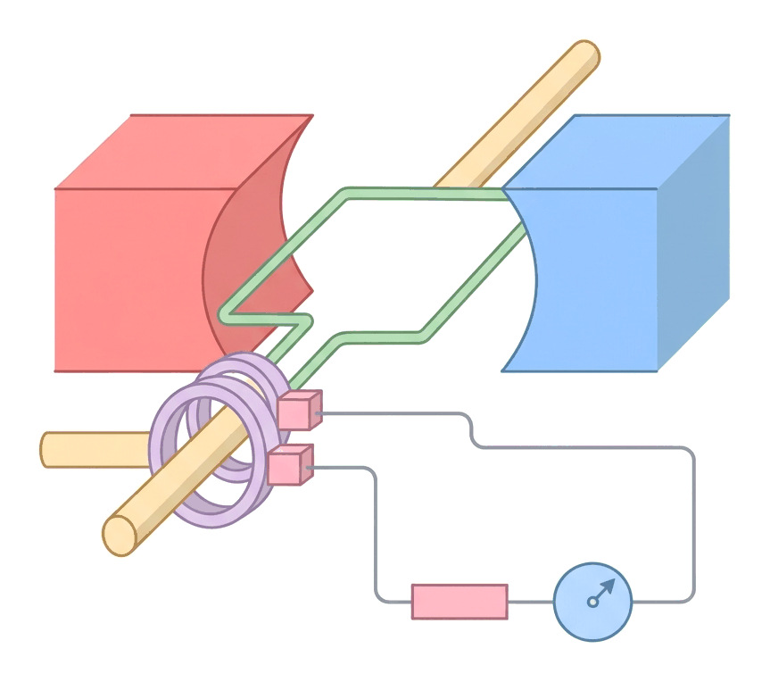
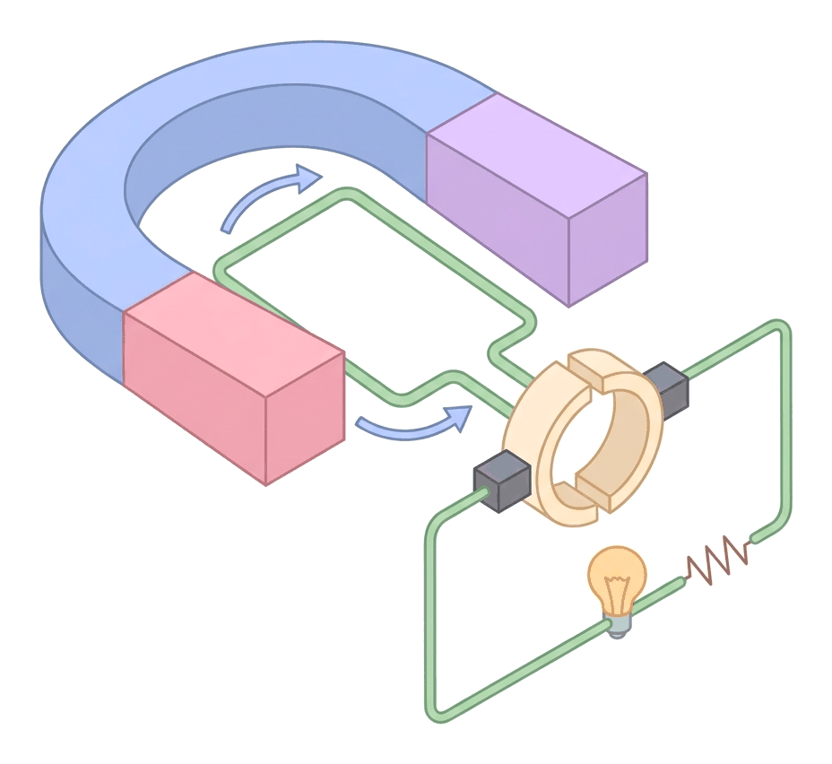
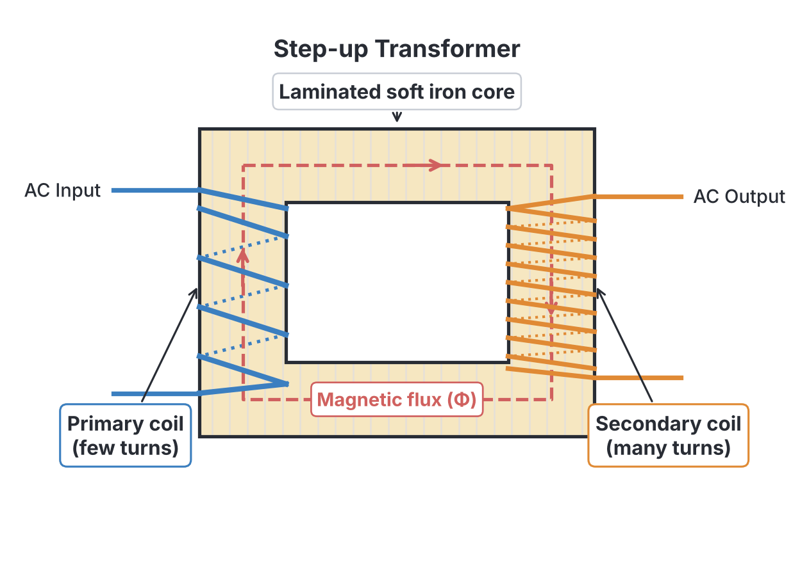
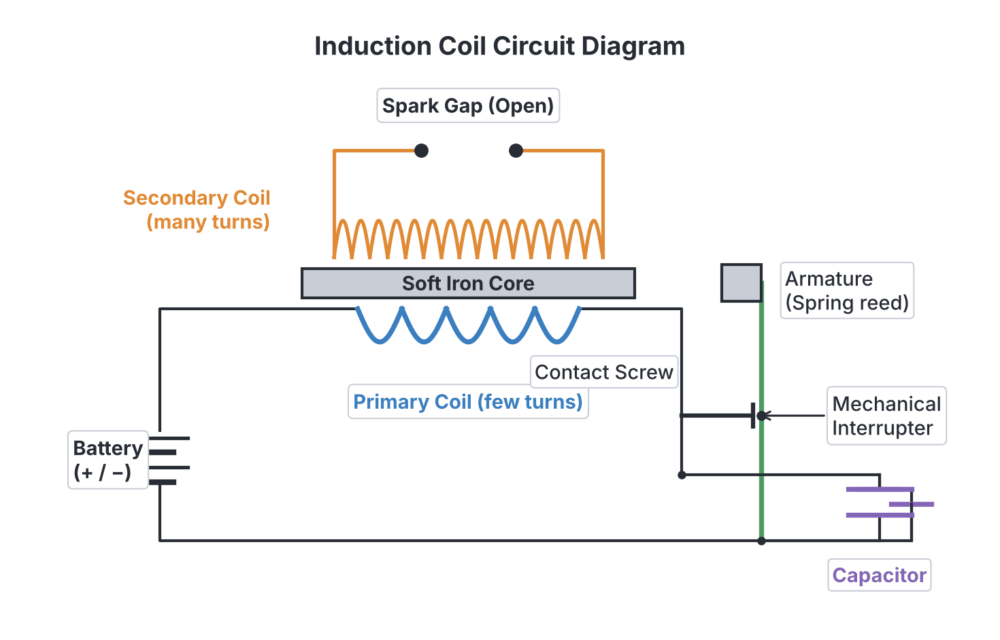

# JAMB Physics Notes: Electromagnetic Induction

## What JAMB expects

This file covers Section A, Topic 35(a) of the JAMB Physics syllabus: Electromagnetic Induction. It covers the following content items:
* (i) Faraday’s laws of electromagnetic induction;
* (ii) Lenz’s law as an illustration of the principle of conservation of energy;
* (iii) factors affecting induced emf;
* (iv) a.c. and d.c generators;
* (v) transformers;
* (vi) the induction coil.

By the end of these notes, you should be able to:
* i. interpret the laws of electromagnetic induction;
* ii. identify factors affecting induced emf;
* iii. recognize how Lenz’s law illustrates the principle of conservation of energy;
* iv. interpret the diagrammatic set up of A. C. generators;
* v. identify the types of transformer;
* vi. examine principles of operation of transformers;
* vii. assess the functions of an induction coil;
* viii. draw some conclusions from the principles of operation of an induction coil.

*Note on the syllabus structure: Electromagnetism is a very large topic. This file covers the core principles of induction, generators, transformers, and induction coils. The related topics of Inductance and Eddy Currents (syllabus items 35b and 35c) are covered in the companion file `A35b-inductance-and-eddy-currents.md`.*

## The Laws of Electromagnetic Induction

**Objective i: interpret the laws of electromagnetic induction.**

In 1820, scientists discovered that an electric current flowing through a wire creates a magnetic field. This led to a huge question: if electricity can create magnetism, can magnetism create electricity? 

In 1831, Michael Faraday in England (and Joseph Henry in America) discovered that the answer is yes. They discovered **electromagnetic induction**, which is the production of an **electromotive force (emf)** (a voltage) in a conductor when there is a change in the magnetic flux cutting across it. If the conductor is part of a closed circuit, this induced emf causes an **induced current** to flow.

To understand induction, we must define **magnetic flux**. Magnetic flux (symbol $\Phi$) is a measure of the total number of magnetic field lines passing through a given area. 
It is calculated as:
$$\Phi = B \times A$$
where:
* $\Phi$ is the magnetic flux, measured in Webers ($\text{Wb}$).
* $B$ is the magnetic flux density (strength of the magnetic field), measured in Tesla ($\text{T}$) or Webers per square metre ($\text{Wb m}^{-2}$).
* $A$ is the area of the coil perpendicular to the magnetic field, measured in square metres ($\text{m}^2$).

There are two fundamental laws that govern how and why electromagnetic induction happens. Faraday's law tells us the *size* (magnitude) of the induced voltage, and Lenz's law tells us its *direction*.

### 1. Faraday's Law of Electromagnetic Induction

**Content item i: Faraday’s laws of electromagnetic induction.**

Faraday's law states that **the magnitude of the induced electromotive force (emf) in a circuit is directly proportional to the rate of change of magnetic flux linking the circuit.**

Whenever there is relative motion between a conductor and a magnetic field (for example, pushing a bar magnet into a coil of wire), the magnetic field lines cut across the wire. The magnetic flux cutting the coil changes, and an emf is induced. If you hold the magnet completely still inside the coil, the flux is constant, so no emf is induced. The induction only happens when the flux is *changing*.

The mathematical formula for Faraday's law is:
$$E = -N \frac{\Delta \Phi}{\Delta t}$$
where:
* $E$ is the induced electromotive force, in Volts ($\text{V}$).
* $N$ is the number of turns in the coil (a unitless count).
* $\Delta \Phi$ is the change in magnetic flux, in Webers ($\text{Wb}$).
* $\Delta t$ is the time taken for the change, in seconds ($\text{s}$).
* $\frac{\Delta \Phi}{\Delta t}$ is the rate of change of magnetic flux, in Webers per second ($\text{Wb s}^{-1}$).
* The negative sign is a mathematical representation of Lenz's law.

[IMAGE: A simple diagram showing a bar magnet with its North pole being pushed toward a solenoid (coil of wire). The coil is connected to a sensitive galvanometer, which has its needle deflected to the right, showing an induced current. Small arrows show the magnetic field lines from the North pole cutting the loops of the coil. Style: Clean flat textbook illustration, white background.]

### 2. Lenz’s Law

**Content item ii: Lenz’s law as an illustration of the principle of conservation of energy.**

Lenz's law states that **the direction of the induced current is always such as to oppose the change producing it.**

Imagine you are holding a bar magnet and pushing its North pole into a coil of wire. According to Faraday's law, a current is induced in the coil. According to Lenz's law, this current will flow in a specific direction so that the end of the coil facing the magnet becomes a **North pole**. Because two North poles repel each other, the coil tries to push the magnet back out. You must use physical force to push the magnet against this magnetic repulsion. 

If you decide to pull the North pole out of the coil, the induced current immediately reverses direction. The end of the coil now becomes a **South pole**. This attracts the retreating North pole, trying to pull the magnet back in. You must use physical force to pull the magnet away against this attraction.

### Lenz's Law and Conservation of Energy

**Objective iii: recognize how Lenz’s law illustrates the principle of conservation of energy.**

Lenz’s law is a direct, practical consequence of the **Principle of Conservation of Energy** (which states that energy cannot be created or destroyed, only changed from one form to another). 

Suppose Lenz's law were false. If you pushed a North pole into a coil, and the coil created a South pole instead, it would attract the incoming North pole. The magnet would be pulled in faster, which would create a larger current, which would pull the magnet in even faster, creating infinite electrical energy out of thin air without you doing any work! This is impossible. 

Because the coil always creates an *opposing* force, you are forced to do **mechanical work** to move the magnet. It is exactly this mechanical work that is converted into the electrical energy (the induced current) appearing in the coil.

## Factors Affecting Induced Emf

**Objective ii: identify factors affecting induced emf.**

If you want to generate a larger voltage (emf) using electromagnetic induction, you must increase the rate at which the magnetic flux is changing, or increase the number of times that flux is captured by the circuit. 

### How to Change the Induced Emf

**Content item iii: factors affecting induced emf.**

The magnitude of the induced emf depends on four primary practical variables:

1. **The rate of relative motion (speed):** Moving the magnet or coil faster decreases the time taken ($\Delta t$), making the rate of change of flux ($\frac{\Delta \Phi}{\Delta t}$) higher.
2. **The number of turns ($N$) in the coil:** A coil with 500 turns will produce 5 times the voltage of a coil with 100 turns, because the emf induced in each individual loop of wire adds up in series.
3. **The strength of the magnetic field ($B$):** Using a stronger permanent magnet or electromagnet increases the total magnetic flux ($\Phi$) passing through the space.
4. **The cross-sectional area of the coil ($A$):** A larger coil area intercepts more magnetic field lines, increasing the total magnetic flux captured by the coil.

### Induced Emf in a Straight Conductor

When a straight wire of length $L$ moves at a velocity $v$ perpendicular to a uniform magnetic field $B$, the magnetic flux is cut continuously. The induced emf can be calculated with a special form of Faraday's law:
$$E = B L v$$
where:
* $E$ is the induced emf in Volts ($\text{V}$).
* $B$ is the magnetic field strength (flux density) in Tesla ($\text{T}$).
* $L$ is the length of the conductor inside the magnetic field in metres ($\text{m}$).
* $v$ is the velocity of the conductor in metres per second ($\text{m s}^{-1}$).

If the conductor moves at an angle $\theta$ to the magnetic field rather than strictly perpendicular to it, the formula becomes $E = B L v \sin \theta$.

---

### Worked Examples on Faraday's Law

**Example 1: Changing flux in a coil**
A coil of wire has 500 turns. The magnetic flux passing through the coil changes from $0.20\ \text{Wb}$ to $0.05\ \text{Wb}$ in $0.10\ \text{s}$. Calculate the magnitude of the induced emf.

**Working:**
1. State the formula for Faraday's law: $E = -N \frac{\Delta \Phi}{\Delta t}$
2. Identify the given values: $N = 500$, Initial flux $\Phi_1 = 0.20\ \text{Wb}$, Final flux $\Phi_2 = 0.05\ \text{Wb}$, Time $\Delta t = 0.10\ \text{s}$.
3. Calculate the change in flux ($\Delta \Phi$): $\Delta \Phi = \Phi_{\text{final}} - \Phi_{\text{initial}} = 0.05\ \text{Wb} - 0.20\ \text{Wb} = -0.15\ \text{Wb}$.
4. Substitute values into the formula: $E = -500 \times \left( \frac{-0.15\ \text{Wb}}{0.10\ \text{s}} \right)$.
5. Calculate the result: $E = -500 \times (-1.5\ \text{Wb s}^{-1}) = 750\ \text{V}$.
The magnitude of the induced emf is **$750\ \text{V}$**.

**Example 2: Aeroplane flying through Earth's magnetic field**
An aeroplane with a wingspan of $20\ \text{m}$ flies horizontally at a speed of $150\ \text{m s}^{-1}$. If the vertical component of the Earth's magnetic field is $4.0 \times 10^{-5}\ \text{T}$, calculate the emf induced across the tips of the wings.

**Working:**
1. Recognise that the wings act as a straight moving conductor cutting a magnetic field. Use the formula: $E = B L v$.
2. Identify the given values: $B = 4.0 \times 10^{-5}\ \text{T}$, $L = 20\ \text{m}$, $v = 150\ \text{m s}^{-1}$.
3. Substitute the values: $E = (4.0 \times 10^{-5}\ \text{T}) \times 20\ \text{m} \times 150\ \text{m s}^{-1}$.
4. Calculate the product of length and velocity: $20 \times 150 = 3000\ \text{m}^2\text{ s}^{-1}$.
5. Final calculation: $E = 4.0 \times 10^{-5} \times 3000 = 12000 \times 10^{-5}\ \text{V} = 0.12\ \text{V}$.
The induced emf is **$0.12\ \text{V}$**.

> **Common Mistakes with Faraday's Law:**
> * **Forgetting that flux change is Final minus Initial:** Students often subtract the wrong way. While this usually just flips the sign, it can cause confusion if you are asked for the directional sign. Always use $\Phi_{\text{final}} - \Phi_{\text{initial}}$.
> * **Ignoring the number of turns:** If the question states a coil has 100 turns, you must multiply the single-loop emf by 100.
> * **Units error in length or time:** Always convert millimetres or centimetres to metres, and minutes to seconds before substituting.

## Generators (A.C. and D.C.)

**Content item iv: a.c. and d.c generators.**

A **generator** is a machine that converts mechanical energy into electrical energy using the principle of electromagnetic induction. When you start a petrol or diesel generator (like the small "I-better-pass-my-neighbour" generators common in Nigeria), the internal combustion engine physically spins a coil of wire inside a strong magnetic field. As the coil spins, it constantly cuts through the magnetic flux, inducing an emf and supplying electricity to your house.

There are two main types of generators: Alternating Current (A.C.) generators and Direct Current (D.C.) generators. Both rely on the same internal physics, but they deliver the current to the outside world differently.

### Diagrammatic Setup of A.C. Generators

**Objective iv: interpret the diagrammatic set up of A. C. generators.**

The A.C. generator (often called an alternator) produces an alternating current—a current that continuously reverses its direction, flowing back and forth.

**Setup of an A.C. Generator:**
An A.C. generator consists of four main parts:
1. **An armature:** A rectangular coil of insulated copper wire wound on a soft iron core (to concentrate the magnetic flux).
2. **Field magnets:** Strong permanent magnets (or electromagnets) with North and South poles providing a uniform magnetic field across the armature.
3. **Slip rings:** Two completely separate, continuous circular metal rings mounted on the axle. One end of the armature coil is permanently welded to the first slip ring, and the other end is welded to the second slip ring. The rings rotate completely as the coil rotates.
4. **Carbon brushes:** Fixed blocks of carbon that press lightly against the spinning slip rings. They act as sliding contacts, conducting the generated current from the spinning rings to the stationary external circuit without the wires getting twisted and snapped.

**How the A.C. generator works:**
1. As the coil is turned mechanically, one side of the coil (say, AB) moves up through the magnetic field while the opposite side (CD) moves down. 
2. They cut the magnetic flux, inducing an emf. By Fleming's Right-Hand Rule (the generator rule), an induced current flows from A to B and C to D.
3. After half a revolution, the coil has flipped over. Side AB is now moving down on the right side, and CD is moving up on the left side. 
4. The direction of the induced current *inside the coil* reverses. 
5. Because each end of the coil is permanently attached to its own continuous slip ring, the current in the external circuit also reverses every half-turn. This produces **alternating current (A.C.)**.

### Setup of a D.C. Generator (Dynamo)
A D.C. generator produces current that flows in only one direction in the external circuit. 

The physical setup is almost exactly the same as the A.C. generator, but with one crucial difference:
Instead of two separate slip rings, it uses a **split-ring commutator**. This is a single copper ring cut into two halves, separated by a thin strip of insulator. Each end of the coil connects to one half of the split ring.

**How the D.C. generator works:**
1. Just like the A.C. generator, an alternating current is generated *inside the spinning coil itself*.
2. However, the split-ring commutator acts as a mechanical rectifier. Every time the coil completes a half-turn and the internal current reverses, the two halves of the commutator physically swap the stationary carbon brush they are touching.
3. Because this swap happens at the exact moment the current reverses, the external circuit always receives the current flowing in the **same direction**.

### Comparison of A.C. and D.C. Generators

| Feature | A.C. Generator (Alternator) | D.C. Generator (Dynamo) |
| :--- | :--- | :--- |
| **Output current** | Reverses direction periodically | Flows in one direction only |
| **Connection rings** | Two continuous **slip rings** | One **split-ring commutator** |
| **Current inside coil** | Alternating | Alternating |
| **Current in outside circuit**| Alternating | Direct |

## Transformers

**Content item v: transformers.**

A **transformer** is an electrical device without moving parts that is used to step up (increase) or step down (decrease) an alternating voltage. 

Transformers are the reason modern power grids use alternating current. In Nigeria's National Grid, electricity is generated at power stations (like the Kainji Dam or Egbin Thermal Station) at a relatively low voltage. A transformer steps this voltage up to extremely high levels (like 330,000 V) for transmission across the country on high-tension wires. This high voltage ensures the current is very small, which drastically reduces the energy lost as heat in the wires over long distances. Once the power reaches a city, smaller street transformers step the voltage back down to 11,000 V, and finally to 240 V for safe use in homes.

### Types of Transformers

**Objective v: identify the types of transformer.**

There are two primary types of transformers:

**1. Step-Up Transformer**
* **Function:** Increases the input voltage.
* **Structure:** The secondary coil has **more turns** than the primary coil ($N_s > N_p$).
* **Effect:** The secondary voltage is higher than the primary voltage ($V_s > V_p$). Because energy is conserved, increasing the voltage means the secondary current is lower than the primary current ($I_s < I_p$).

**2. Step-Down Transformer**
* **Function:** Decreases the input voltage (e.g., from an 11kV street line down to 240V, or inside a phone charger from 240V down to 5V).
* **Structure:** The secondary coil has **fewer turns** than the primary coil ($N_s < N_p$).
* **Effect:** The secondary voltage is lower ($V_s < V_p$), but the secondary current is higher ($I_s > I_p$).

### Principles of Operation of Transformers

**Objective vi: examine principles of operation of transformers.**

Transformers operate strictly on the principle of **mutual induction** between two coils linked by a common magnetic circuit.
1. An alternating voltage is applied to the **primary coil**, causing an alternating current (A.C.) to flow through it.
2. Because it is A.C., the current is constantly reversing, which creates a constantly expanding and collapsing magnetic field around the primary coil.
3. This changing magnetic field is guided by a soft iron core directly into the **secondary coil**.
4. The continuously changing magnetic flux cuts through the secondary coil, inducing an alternating emf (voltage) in it according to Faraday's law.

> **CRITICAL RULE:** Transformers **do not work on Direct Current (D.C.)** like a car battery. A battery creates a steady, constant current, which creates a steady, unmoving magnetic field. Since there is no *change* in flux over time ($\Delta \Phi / \Delta t = 0$), absolutely no voltage is induced in the secondary coil. The output voltage will be zero.

### Transformer Equations

For an ideal transformer (assuming no energy is lost), the ratio of voltages is exactly equal to the ratio of the number of turns:
$$\frac{V_s}{V_p} = \frac{N_s}{N_p}$$

Also, since power is conserved in an ideal transformer ($\text{Power in} = \text{Power out}$), we know that $V_p I_p = V_s I_s$, which gives:
$$\frac{V_s}{V_p} = \frac{I_p}{I_s}$$
*(Notice that the current fraction is flipped—current is inversely proportional to voltage!)*

Where:
* $V_p$ = Primary voltage (input)
* $V_s$ = Secondary voltage (output)
* $N_p$ = Number of turns on primary coil
* $N_s$ = Number of turns on secondary coil
* $I_p$ = Primary current
* $I_s$ = Secondary current

### Energy Losses in Practical Transformers
No real transformer is 100% efficient. Energy is lost as heat through four main ways, and engineers design transformers to minimize them:
1. **Copper losses ($I^2R$ loss):** Heat is generated by the electrical resistance of the copper wires. *Reduced by using very thick copper wires for the specific coil that carries the high current (which is the low voltage side).*
2. **Eddy currents:** The changing magnetic flux induces wasteful, swirling miniature currents (eddy currents) in the solid mass of the iron core itself, causing it to heat up like a hotplate. *Reduced by making the core out of thin, insulated slices of iron glued together (a **laminated core**), which breaks up the paths so the eddy currents cannot flow.*
3. **Hysteresis loss:** Energy is used up continuously magnetising, demagnetising, and re-magnetising the iron core as the A.C. reverses 50 times a second. *Reduced by using a "soft" magnetic material like soft iron, which magnetises and demagnetises very easily with minimal friction.*
4. **Flux leakage:** Some magnetic field lines from the primary coil escape into the surrounding air and fail to reach the secondary coil. *Reduced by winding the secondary coil directly over the top of the primary coil.*

**Transformer Efficiency Formula:**
$$\text{Efficiency} = \frac{\text{Power Output}}{\text{Power Input}} \times 100\% = \frac{V_s I_s}{V_p I_p} \times 100\%$$

---

### Worked Examples on Transformers

**Example 3: Finding secondary turns**
A step-down transformer is used to operate a $12\ \text{V}$ lamp from a $240\ \text{V}$ A.C. mains supply. If the primary coil has 800 turns, how many turns are on the secondary coil?

**Working:**
1. State the transformer equation linking voltage and turns: $\frac{V_p}{V_s} = \frac{N_p}{N_s}$.
2. Identify given values: $V_p = 240\ \text{V}$, $V_s = 12\ \text{V}$, $N_p = 800$.
3. Substitute the values: $\frac{240\ \text{V}}{12\ \text{V}} = \frac{800}{N_s}$.
4. Simplify the fraction on the left: $20 = \frac{800}{N_s}$.
5. Rearrange to solve for $N_s$: $N_s = \frac{800}{20} = 40$.
The secondary coil has **40 turns**.

**Example 4: Calculating efficiency and primary current**
A step-up transformer has a primary voltage of $100\ \text{V}$ and a secondary voltage of $400\ \text{V}$. If it draws a primary current of $5\ \text{A}$ and its efficiency is $80\%$, what is the secondary current?

**Working:**
1. Calculate the total power input ($P_{\text{in}}$): $P_{\text{in}} = V_p \times I_p = 100\ \text{V} \times 5\ \text{A} = 500\ \text{W}$.
2. Apply the efficiency formula to find the useful power output: $P_{\text{out}} = 80\% \text{ of } P_{\text{in}}$.
3. Calculate power output: $P_{\text{out}} = \frac{80}{100} \times 500\ \text{W} = 400\ \text{W}$.
4. Use the power output to find secondary current: $P_{\text{out}} = V_s \times I_s$.
5. Substitute the values: $400\ \text{W} = 400\ \text{V} \times I_s$.
6. Solve for $I_s$: $I_s = \frac{400}{400} = 1\ \text{A}$.
The secondary current is **$1\ \text{A}$**.

> **Common Mistakes with Transformers:**
> * **Mixing up the current ratio:** Remember that $\frac{V_s}{V_p} = \frac{N_s}{N_p}$ but it equals $\frac{I_p}{I_s}$. The current fraction is flipped because a step-up transformer steps *down* the current.
> * **Assuming 100% efficiency automatically:** Always check if the question gives an efficiency percentage. If it is 80%, you cannot use $V_p I_p = V_s I_s$. You must use $0.8 \times V_p I_p = V_s I_s$.

## The Induction Coil

**Content item vi: the induction coil.**

While a transformer requires an A.C. supply, an **induction coil** is a clever device used to produce very high, intermittent alternating voltages from a low-voltage **Direct Current (D.C.)** source, such as a 12V car battery.

### Functions of the Induction Coil

**Objective vii: assess the functions of an induction coil.**

The main function of an induction coil is to step up a low D.C. voltage to a massive voltage (often 10,000 to 50,000 volts) capable of causing an electrical spark to jump across a gap of air. 
It is widely used in internal combustion engines (like cars, generators, or "okadas") as the **ignition coil**. It creates the high-voltage spark sent to the spark plugs to ignite the compressed petrol and air mixture inside the engine cylinder. Historically, it was also used in early X-ray machines and radio transmitters.

**Structure of an Induction Coil:**
An induction coil consists of:
1. A **soft iron core** (usually a bundle of iron wires rather than a solid block, to reduce eddy currents).
2. A **primary coil** consisting of a few turns of thick copper wire.
3. A **secondary coil** consisting of thousands of turns of very fine insulated copper wire wound directly over the primary.
4. An **interrupter (make-and-break contact)** attached to a soft iron armature on a spring. This acts as an automatic switch.
5. A **capacitor (condenser)** connected strictly *in parallel across the contact points* of the interrupter.

### Conclusions from the Operation of an Induction Coil

**Objective viii: draw some conclusions from the principles of operation of an induction coil.**

To understand the conclusions, we must look at how it operates:
1. When the switch is closed, D.C. from the battery flows through the primary coil.
2. The primary coil acts as an electromagnet, magnetising the soft iron core. 
3. The magnetised core attracts the soft iron armature.
4. As the armature is pulled toward the core, it pulls away from the contact screw, **breaking the primary circuit**. The current stops instantly.
5. With no current, the core instantly loses its magnetism. The magnetic field collapses incredibly fast.
6. This rapid collapse of magnetic flux cuts across the thousands of turns of the secondary coil. According to Faraday's law, a very high voltage is induced, causing a spark to jump across the spark gap.
7. Once demagnetised, the spring pulls the armature back to the contact screw, re-making the circuit, and the process repeats continuously, buzzing like a doorbell.

**Key Conclusion: The Need for Rapid Flux Change**
The most important conclusion is that the massive voltage in the secondary coil is achieved not just by a high turns ratio ($N_s / N_p$), but primarily by a **huge rate of change of flux ($d\Phi/dt$)**. The faster the magnetic field collapses when the circuit is broken, the higher the induced voltage.

**Conclusion: The Vital Role of the Capacitor**
When the circuit is broken by the interrupter, self-induction in the primary coil tries to keep the current flowing, which would normally cause a massive, hot spark to jump across the opening interrupter contacts. This spark would:
1. Burn and destroy the expensive metal contacts over time.
2. Delay the collapse of the magnetic field (because current is still leaping across the gap), which would severely reduce the voltage in the secondary coil.

The capacitor provides an alternative, safe place for this rushing current to go, storing the energy instead of allowing it to arc across the air. 
Therefore, the two functions of the capacitor are:
* It **prevents sparking** at the interrupter contacts, reducing wear and tear.
* By stopping the spark, it ensures the primary current falls to zero instantly, causing the magnetic flux to collapse extremely fast. This **greatly increases the induced emf** in the secondary coil.

## Key terms

| Term | Meaning |
| :--- | :--- |
| **Electromagnetic Induction** | Production of an emf in a conductor due to a change in the magnetic flux cutting it. |
| **Magnetic Flux ($\Phi$)** | The total number of magnetic field lines passing through a given area, measured in Webers (Wb). |
| **Faraday's Law** | The magnitude of induced emf is directly proportional to the rate of change of magnetic flux. |
| **Lenz's Law** | The direction of induced current opposes the change in flux that produced it (Conservation of Energy). |
| **Alternator** | An A.C. generator, using continuous slip rings to output alternating current to the external circuit. |
| **Dynamo** | A D.C. generator, using a split-ring commutator to output direct current to the external circuit. |
| **Transformer** | A static device that steps up or steps down alternating voltages using mutual induction. |
| **Step-Up Transformer** | Increases output voltage; has more turns on the secondary coil ($N_s > N_p$). |
| **Laminated Core** | An iron core built from thin insulated sheets to reduce energy loss from eddy currents. |
| **Induction Coil** | A device that produces high voltage sparks from a low voltage D.C. supply using a make-and-break contact. |

## Exam tips and common mistakes

* **Lenz vs Faraday:** Faraday's law tells you the *size* of the voltage; Lenz's law tells you the *direction*.
* **Lenz's Law and Conservation:** A very frequent JAMB question asks what principle Lenz's law illustrates. The answer is always the **Conservation of Energy**.
* **Generators:** The only structural difference between an A.C. generator and a D.C. generator is the connection rings. A.C. uses **slip rings**, D.C. uses a **split-ring commutator**.
* **Transformers and D.C.:** Transformers **do not work on D.C.** (like batteries). If JAMB asks what the output voltage is when a transformer is connected to a 12V D.C. battery, the answer is exactly **0 V**.
* **Step-Up vs Step-Down:** Remember that stepping *up* the voltage steps *down* the current. The total electrical power ($V \times I$) remains roughly the same.
* **Induction coil capacitor:** Always remember the dual purpose of the capacitor: preventing sparks at the interrupter contacts and making the magnetic flux collapse faster to maximize the secondary emf.

## Quick summary

1. Electromagnetic induction is the generation of an electromotive force (emf) due to a changing magnetic flux cutting across a conductor.
2. Faraday's law states that $E \propto \frac{\Delta \Phi}{\Delta t}$. The magnitude depends on the rate of flux change, coil area, magnetic strength, and number of turns.
3. Lenz's law states that the induced current always opposes the change in flux that produced it, perfectly illustrating the Conservation of Energy.
4. A.C. generators use two continuous slip rings to produce alternating current in the external circuit.
5. D.C. generators use a split-ring commutator to ensure the external current flows in one direction only.
6. Transformers use mutual induction to step up or step down A.C. voltages ($V_s / V_p = N_s / N_p$). They only work with changing current (A.C.).
7. Transformer energy losses include copper losses (reduced by thick wires), eddy currents (reduced by a laminated core), and hysteresis (reduced by a soft iron core).
8. An induction coil uses a make-and-break D.C. circuit and a capacitor across the contacts to produce massive spark voltages due to the extremely rapid collapse of the magnetic field.

## Practice questions

**1. Lenz's law of electromagnetic induction is a practical application of the principle of conservation of**
- A. electric charge
- B. linear momentum
- C. mass
- D. energy

**Answer: D.** Lenz's law illustrates the principle of conservation of energy. Mechanical work must be done against the opposing magnetic force, and this work is converted into the electrical energy induced in the coil.

**2. A step-down transformer has 400 turns in the primary coil and 200 turns in the secondary coil. If the primary voltage is $240\ \text{V}$, what is the secondary voltage?**
- A. $480\ \text{V}$
- B. $120\ \text{V}$
- C. $60\ \text{V}$
- D. $12\ \text{V}$

**Answer: B.** The step-by-step working is:
1. Use the equation $\frac{V_p}{V_s} = \frac{N_p}{N_s}$.
2. Substitute the given values: $\frac{240\ \text{V}}{V_s} = \frac{400}{200}$.
3. Simplify the fraction on the right: $\frac{240\ \text{V}}{V_s} = 2$.
4. Rearrange to find $V_s$: $V_s = \frac{240\ \text{V}}{2} = 120\ \text{V}$.
The most tempting wrong option is A, which comes from mistakenly multiplying $240\ \text{V}$ by $2$ instead of dividing, confusing a step-down transformer with a step-up one.

**3. The fundamental difference in construction between an A.C. generator and a D.C. generator is that the D.C. generator contains**
- A. a permanent magnet
- B. slip rings
- C. a split-ring commutator
- D. a soft iron armature

**Answer: C.** The split-ring commutator acts as a mechanical rectifier for the alternating current generated inside the coil, ensuring the output to the external circuit flows in only one direction.

**4. A straight wire of length $0.5\ \text{m}$ moves at a velocity of $10\ \text{m s}^{-1}$ perpendicular to a magnetic field of $0.2\ \text{T}$. Calculate the induced emf in the wire.**
- A. $0.01\ \text{V}$
- B. $1.0\ \text{V}$
- C. $4.0\ \text{V}$
- D. $10.0\ \text{V}$

**Answer: B.** The step-by-step working is:
1. State the formula for a straight conductor in a magnetic field: $E = B L v$.
2. Substitute the values: $E = 0.2\ \text{T} \times 0.5\ \text{m} \times 10\ \text{m s}^{-1}$.
3. Calculate the result: $E = 1.0\ \text{V}$.
The most tempting wrong option is A, which comes from mistakenly dividing by the velocity ($0.2 \times 0.5 / 10 = 0.01\ \text{V}$) instead of multiplying.

**5. Why is the iron core of a transformer laminated?**
- A. To reduce copper losses
- B. To prevent flux leakage
- C. To reduce eddy current losses
- D. To prevent hysteresis loss

**Answer: C.** Lamination involves slicing the iron core into thin insulated sheets. This breaks up the electrical paths for swirling eddy currents, drastically reducing heat loss in the core.

**6. A step-up transformer has a primary voltage of $200\ \text{V}$ and a secondary voltage of $1000\ \text{V}$. If the efficiency of the transformer is $80\%$ and the secondary current is $2\ \text{A}$, calculate the primary current.**
- A. $10.0\ \text{A}$
- B. $8.0\ \text{A}$
- C. $12.5\ \text{A}$
- D. $2.5\ \text{A}$

**Answer: C.** The step-by-step working is:
1. Calculate the output power: $P_{\text{out}} = V_s \times I_s = 1000\ \text{V} \times 2\ \text{A} = 2000\ \text{W}$.
2. Use the efficiency formula: $\text{Efficiency} = \frac{P_{\text{out}}}{P_{\text{in}}} \rightarrow 0.8 = \frac{2000\ \text{W}}{P_{\text{in}}}$.
3. Find the input power: $P_{\text{in}} = \frac{2000\ \text{W}}{0.8} = 2500\ \text{W}$.
4. Find the primary current: $I_p = \frac{P_{\text{in}}}{V_p} = \frac{2500\ \text{W}}{200\ \text{V}} = 12.5\ \text{A}$.
The most tempting wrong option is A, which comes from assuming the transformer is $100\%$ efficient ($200\ \text{V} \times I_p = 2000\ \text{W} \rightarrow I_p = 10.0\ \text{A}$).

**7. Which of the following factors does NOT affect the magnitude of the induced emf in a coil?**
- A. The rate of change of magnetic flux
- B. The number of turns in the coil
- C. The area of the coil
- D. The electrical resistance of the coil

**Answer: D.** According to Faraday's law, the emf depends on flux change, time, turns, and area. The electrical resistance of the coil affects the size of the *induced current* ($I = E/R$), but it has no effect on the *induced emf* itself.

**8. A coil of 100 turns experiences a change in magnetic flux from $5.0 \times 10^{-3}\ \text{Wb}$ to $2.0 \times 10^{-3}\ \text{Wb}$ in $0.05\ \text{s}$. The magnitude of the induced emf is:**
- A. $1.5\ \text{V}$
- B. $6.0\ \text{V}$
- C. $10.0\ \text{V}$
- D. $60.0\ \text{V}$

**Answer: B.** The step-by-step working is:
1. Find the change in flux $\Delta \Phi$: $(2.0 \times 10^{-3}\ \text{Wb}) - (5.0 \times 10^{-3}\ \text{Wb}) = -3.0 \times 10^{-3}\ \text{Wb}$.
2. Use Faraday's law: $E = -N \frac{\Delta \Phi}{\Delta t}$.
3. Substitute the values: $E = -100 \times \left( \frac{-3.0 \times 10^{-3}\ \text{Wb}}{0.05\ \text{s}} \right)$.
4. Calculate the result: $E = -100 \times -0.06\ \text{Wb s}^{-1} = 6.0\ \text{V}$.
The most tempting wrong option is C, which comes from mistakenly using only the initial flux instead of the change in flux ($100 \times \frac{5.0 \times 10^{-3}\ \text{Wb}}{0.05\ \text{s}} = 10.0\ \text{V}$).

**9. The primary function of the capacitor in an induction coil is to**
- A. convert direct current to alternating current
- B. prevent sparking across the interrupter contacts
- C. step up the voltage before it reaches the coil
- D. increase the frequency of the make-and-break cycle

**Answer: B.** The capacitor provides an alternative path for the self-induced current when the circuit breaks. This absorbs the energy, preventing damaging sparks at the contacts and ensuring the magnetic field collapses rapidly to induce a high voltage.

**10. What is the output voltage if a transformer designed to step down $240\ \text{V}$ A.C. to $12\ \text{V}$ A.C. is instead connected across a $24\ \text{V}$ D.C. battery?**
- A. $1.2\ \text{V}$
- B. $12\ \text{V}$
- C. $240\ \text{V}$
- D. $0\ \text{V}$

**Answer: D.** The step-by-step working is:
1. Identify the input source: a $24\ \text{V}$ D.C. battery provides a constant, unchanging current.
2. State the condition for Faraday's law: an induced emf requires a changing magnetic flux ($\frac{\Delta \Phi}{\Delta t} \neq 0$).
3. Since D.C. produces a steady magnetic field, the change in flux over time is zero: $\frac{\Delta \Phi}{\Delta t} = 0$.
4. Calculate the induced secondary voltage: $V_s = -N_s \frac{\Delta \Phi}{\Delta t} = -N_s \times 0 = 0\ \text{V}$.
The most tempting wrong option is A, which comes from wrongly applying the turns ratio to the D.C. voltage ($\frac{24\ \text{V}}{20} = 1.2\ \text{V}$).
