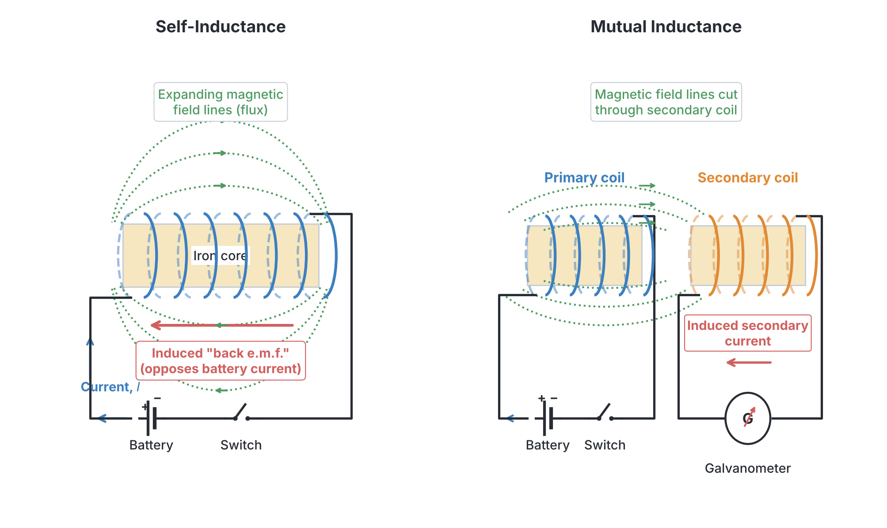
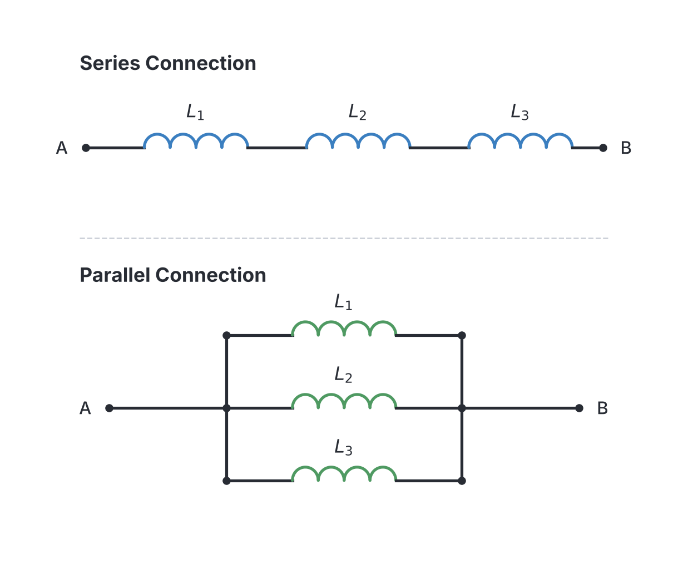
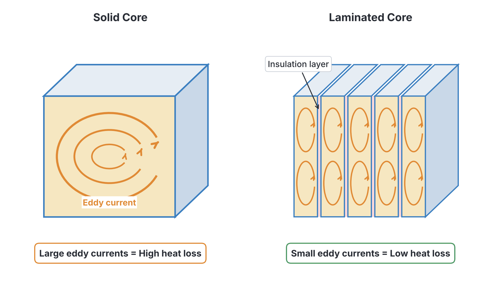

# JAMB Physics Notes: Inductance and Eddy Currents

## What JAMB expects

This topic is a continuation of Electromagnetism. It covers Section A, Topics 35(b) and 35(c) of the JAMB Physics syllabus. (The first part, covering electromagnetic induction, Faraday's laws, and generators, is explained in `A35a-electromagnetic-induction.md`). 

By the end of these notes, you should be able to:
1. Interpret the inductance of an inductor (Explanation of inductance).
2. Recognize units of inductance.
3. Calculate the effective total inductance in series and parallel arrangement.
4. Deduce the expression for the energy stored in an inductor ($E = \frac{1}{2} I^2 L$).
5. Examine the applications of inductors.
6. Describe the method by which eddy current losses can be reduced.
7. Determine ways by which eddy currents can be used, and their effects.

## Explanation of inductance

**Objective ix: interpret the inductance of an inductor.**
**Content item b: Inductance (explanation of inductance).**

**Inductance** is the property of an electrical circuit (usually a coil of wire) that opposes any change in the current flowing through it. It acts like "electrical inertia". 

When current flows through a coil, it creates a magnetic field. If the current changes (for example, when you switch the circuit on or off), the magnetic field also changes. According to **Faraday’s law of electromagnetic induction**, this changing magnetic field induces an electromotive force (e.m.f.) in the coil. According to **Lenz’s law**, this induced e.m.f. will always oppose the change in current that produced it. We call this a **back e.m.f.**

There are two types of inductance:
1. **Self-inductance ($L$):** This occurs when a changing current in a single coil induces a back e.m.f. in that *same* coil. When you close a switch, the back e.m.f. prevents the current from reaching its maximum value instantly. When you open the switch, it tries to keep the current flowing, which can cause a spark across the switch.
2. **Mutual inductance ($M$):** This occurs when a changing current in one coil (the primary coil) creates a changing magnetic field that cuts through a nearby *second* coil (the secondary coil), inducing an e.m.f. in the second coil. This is the principle behind how transformers work.

An electrical component designed specifically to have a known inductance is called an **inductor** (often referred to simply as a coil or a choke).

## Unit of inductance

**Objective x: recognize units of inductance.**

The SI unit of inductance is the **Henry ($\text{H}$)**, named after the American scientist Joseph Henry. 

- A coil has a self-inductance of $1\ \text{H}$ if a current changing at a rate of $1\ \text{A s}^{-1}$ (one ampere per second) induces a back e.m.f. of $1\ \text{V}$ in the coil.

Because one Henry is a very large unit for many everyday electronic circuits, JAMB questions frequently use smaller submultiples. You must convert these to Henries before using them in energy formulas:
- **Millihenry ($\text{mH}$):** $1\ \text{mH} = 10^{-3}\ \text{H}$ (divide by $1,000$)
- **Microhenry ($\mu\text{H}$):** $1\ \mu\text{H} = 10^{-6}\ \text{H}$ (divide by $1,000,000$)

## Calculating effective total inductance (Series and Parallel)

**Objective xi: calculate the effective total inductance in series and parallel arrangement.**

When multiple inductors are connected in a circuit, you calculate their total (effective) inductance using the exact same rules you use for **resistors**. (Do not confuse this with capacitors, which use the opposite rules!) 

*Note: These formulas assume the inductors are spaced far enough apart that their magnetic fields do not interact (no mutual inductance between them).*

### 1. Inductors in Series
When inductors are connected end-to-end, the same current flows through all of them. Their total effective inductance $L_s$ is simply the sum of their individual inductances.
$$L_s = L_1 + L_2 + L_3 + \dots$$

### 2. Inductors in Parallel
When inductors are connected in parallel, the current splits across the branches. The total effective inductance $L_p$ is found using the reciprocal formula:
$$\frac{1}{L_p} = \frac{1}{L_1} + \frac{1}{L_2} + \frac{1}{L_3} + \dots$$

For just **two** inductors in parallel, you can use the shortcut "product over sum":
$$L_p = \frac{L_1 \times L_2}{L_1 + L_2}$$

### Worked Examples: Series and Parallel Inductance

**Example 1: Series connection**
Three inductors of $2\ \text{mH}$, $5\ \text{mH}$, and $3\ \text{mH}$ are connected in series. Calculate the effective inductance of the combination.
1. Identify the arrangement: Series.
2. Write the formula: $L_s = L_1 + L_2 + L_3$.
3. Substitute the values: $L_s = 2\ \text{mH} + 5\ \text{mH} + 3\ \text{mH}$.
4. Calculate the answer: $L_s = 10\ \text{mH}$.

**Example 2: Parallel connection**
Calculate the effective inductance when two coils of $12\ \text{H}$ and $24\ \text{H}$ are connected in parallel.
1. Identify the arrangement: Parallel (two inductors).
2. Write the shortcut formula: $L_p = \frac{L_1 \times L_2}{L_1 + L_2}$.
3. Substitute the values: $L_p = \frac{12 \times 24}{12 + 24}$.
4. Simplify the fraction: $L_p = \frac{288}{36}$.
5. Calculate the answer: $L_p = 8\ \text{H}$.

**Example 3: Mixed circuit (JAMB level)**
Two inductors of $4\ \text{H}$ and $4\ \text{H}$ are connected in parallel. This combination is then connected in series to a $6\ \text{H}$ inductor. Calculate the total inductance in the circuit.
1. First, solve the parallel part: $L_p = \frac{4 \times 4}{4 + 4} = \frac{16}{8} = 2\ \text{H}$.
2. Now, treat this $2\ \text{H}$ equivalent as being in series with the $6\ \text{H}$ inductor.
3. Write the series formula: $L_{\text{total}} = L_p + L_{\text{series}}$.
4. Substitute the values: $L_{\text{total}} = 2\ \text{H} + 6\ \text{H}$.
5. Calculate the final answer: $L_{\text{total}} = 8\ \text{H}$.

## Energy stored in an inductor

**Objective xii: deduce the expression for the energy stored in an inductor.**

While a capacitor stores energy in an electric field, an inductor stores energy in its **magnetic field**. 

To push a steady current $I$ through an inductor, the electrical source (like a battery) must do work to overcome the back e.m.f. produced by the coil as the current builds up. 

**Deduction (Derivation) of the formula:**
1. Let the final steady current be $I$. As the current builds up from $0$ to $I$ in time $t$, the back e.m.f. ($V$) produced is given by Faraday's law: 
   $$V = L \frac{I}{t}$$
   *(where $L$ is the inductance and $\frac{I}{t}$ is the rate of change of current).*
2. Because the current rises steadily from $0$ to its maximum $I$, the **average current** flowing during this time is $\frac{1}{2}I$.
3. The average electrical power ($P$) used to overcome the back e.m.f. is Voltage $\times$ Average Current:
   $$P = \left( L \frac{I}{t} \right) \times \left( \frac{1}{2}I \right)$$
4. The total energy ($E$) or work done is Power $\times$ Time:
   $$E = P \times t = \left( L \frac{I}{t} \times \frac{1}{2}I \right) \times t$$
5. The time $t$ cancels out, leaving the final expression:
   $$E = \frac{1}{2} L I^2$$

Where:
- $E$ is the energy stored, measured in Joules ($\text{J}$).
- $L$ is the inductance, measured in Henries ($\text{H}$).
- $I$ is the current, measured in Amperes ($\text{A}$).

### Worked Examples: Energy Stored

**Example 4: Standard calculation**
Calculate the energy stored in a $4\ \text{H}$ inductor when a current of $3\ \text{A}$ flows through it.
1. Identify given values: $L = 4\ \text{H}$, $I = 3\ \text{A}$.
2. Write the formula: $E = \frac{1}{2} L I^2$.
3. Substitute the values: $E = 0.5 \times 4\ \text{H} \times (3\ \text{A})^2$.
4. Square the current: $E = 0.5 \times 4 \times 9$.
5. Calculate the final answer: $E = 18\ \text{J}$.

**Example 5: Calculation with unit conversion**
An inductor of $50\ \text{mH}$ carries a steady current of $2\ \text{A}$. Calculate the energy stored in its magnetic field.
1. Convert units: $L = 50\ \text{mH} = 50 \times 10^{-3}\ \text{H} = 0.05\ \text{H}$.
2. Identify given values: $L = 0.05\ \text{H}$, $I = 2\ \text{A}$.
3. Write the formula: $E = \frac{1}{2} L I^2$.
4. Substitute the values: $E = 0.5 \times 0.05\ \text{H} \times (2\ \text{A})^2$.
5. Square the current: $E = 0.5 \times 0.05 \times 4$.
6. Calculate the final answer: $E = 0.1\ \text{J}$.

**Example 6: Finding current from energy**
A $2\ \text{H}$ inductor stores $36\ \text{J}$ of energy in its magnetic field. What is the current flowing through it?
1. Identify given values: $E = 36\ \text{J}$, $L = 2\ \text{H}$.
2. Write the formula: $E = \frac{1}{2} L I^2$.
3. Substitute the values: $36\ \text{J} = 0.5 \times 2\ \text{H} \times I^2$.
4. Simplify: $36 = 1 \times I^2$, meaning $I^2 = 36$.
5. Take the square root: $I = \sqrt{36}$.
6. Calculate the final answer: $I = 6\ \text{A}$.

## Applications of inductors

**Objective xiii: examine the applications of inductors.**

Inductors are heavily used in AC (Alternating Current) circuits and radio frequency applications. Their common uses include:

1. **Choke coils:** In fluorescent tubes (often seen in Nigerian homes and shops), an inductor acts as a "choke". Because an inductor opposes changes in AC current, it limits the current flowing through the tube to a safe level. A choke is far better than a resistor because an ideal inductor does not dissipate heat (its average power loss is zero), whereas a resistor would waste a lot of energy as heat.
2. **Tuning circuits:** In radios and televisions, an inductor is connected in parallel with a variable capacitor to form a "tuning circuit". By adjusting the capacitor, the circuit's resonant frequency is changed, allowing you to tune into different radio or TV stations.
3. **Smoothing circuits:** In power supplies (rectifiers), inductors are used alongside capacitors to smooth out fluctuating direct current (D.C.) into a steady D.C. voltage.
4. **Transformers and Motors:** The principle of mutual inductance is the foundation of transformers (used by electricity distribution companies to step up or step down voltages) and electric motors.

## Effects of eddy currents

**Content item c: Eddy Current (effects of eddy current).**

When a solid block or core of metal (such as iron) is placed in a changing magnetic field, the magnetic field induces small, circular, swirling electrical currents entirely *inside* the mass of the metal. Because these currents swirl like whirlpools in a river, they are called **eddy currents**.

Eddy currents produce two major effects, which are often undesirable in electrical machines:
1. **Heat Loss (Power Loss):** Because the metal core has some electrical resistance ($R$), the eddy currents ($I$) generate heat ($I^2R$ loss). In large transformers or generators, this heat wastes a significant amount of electrical energy and can cause the machine to dangerously overheat.
2. **Magnetic Damping:** By Lenz's law, the eddy currents generate their own magnetic field that opposes the original changing magnetic field. This creates a drag or opposing force that tries to stop the motion of the moving parts. 

## Reduction of eddy currents

**Objective xiv: describe the method by which eddy current losses can be reduced.**

To stop transformers and generators from wasting energy through heat, we must reduce the eddy currents. We cannot use plastic cores (we need iron to carry the magnetic field), but we can change the structure of the iron.

The method used to reduce eddy currents is **lamination**.
Instead of using a single solid block of iron for the core, the core is sliced into hundreds of thin sheets (called laminations). Each thin sheet is painted with a thin layer of insulating material (like varnish or lacquer) and then pressed tightly back together.

**How lamination works:** 
The insulating layers prevent electricity from flowing freely between the sheets. This forces the eddy currents to stay within the narrow boundary of each individual sheet. Because the path is so narrow, the electrical resistance increases dramatically, and the size of the eddy currents shrinks. Smaller eddy currents mean much less energy is wasted as heat.

## Applications of eddy currents

**Objective xv: determine ways by which eddy currents can be used.**

Though they are a nuisance in transformers, eddy currents can be incredibly useful when harnessed purposefully:

1. **Induction Furnaces (Induction Heating):** In metallurgy, a high-frequency AC coil surrounds a crucible holding scrap metal. The rapidly changing magnetic field induces massive eddy currents inside the metal. Because the metal has resistance, the eddy currents generate intense heat—enough to completely melt the metal without any physical contact or flame.
2. **Electromagnetic Braking:** High-speed trains and some amusement park rides use eddy current brakes. A powerful electromagnet is turned on near the spinning metal train wheel. The wheel experiences a changing magnetic field, inducing eddy currents inside it. By Lenz's law, the magnetic field of the eddy currents opposes the rotation of the wheel, slowing the train down smoothly without any friction, brake pads, or wear and tear.
3. **Metal Detectors:** Security scanners at the entrance of malls or airports work using eddy currents. The detector emits a varying magnetic field. If you walk through with a metal object (like a belt buckle or keys), eddy currents are induced in the metal. The detector senses the opposing magnetic field created by these eddy currents and triggers an alarm.
4. **Moving-Coil Galvanometers (Damping):** The coil of a sensitive meter is wound on a light aluminium frame. As the coil turns, eddy currents are induced in the aluminium frame. These currents oppose the motion, quickly bringing the needle to rest at its final reading instead of swinging violently back and forth. This is known as "dead-beat" damping.

## Key terms

| Term | Meaning |
| --- | --- |
| **Inductance ($L$)** | The property of a coil to oppose any change in current flowing through it. |
| **Self-inductance** | The induction of a back e.m.f. in a coil due to a changing current within that same coil. |
| **Mutual inductance** | The induction of an e.m.f. in one coil caused by a changing magnetic field from a nearby primary coil. |
| **Henry ($\text{H}$)** | The SI unit of inductance. |
| **Back e.m.f.** | The induced voltage that opposes the change in current (following Lenz's law). |
| **Choke** | An inductor used to block high-frequency AC or limit current without losing energy as heat. |
| **Eddy Currents** | Unwanted circulating loops of electrical current induced within a solid conductor by a changing magnetic field. |
| **Lamination** | Slicing a metal core into thin insulated sheets to increase resistance and reduce eddy currents. |

## Exam tips and common mistakes

- **Mixing up Series/Parallel Rules:** This is the most common mistake. Inductors add up just like resistors! Inductors in series are simply added together ($L_1 + L_2$). Capacitors in series use the reciprocal formula.
- **Forgetting to convert units:** In energy calculations, if the inductance is given in millihenries ($\text{mH}$), you MUST divide by $1,000$ to convert it to Henries ($\text{H}$) before applying the formula.
- **Forgetting to square the current:** When using $E = \frac{1}{2} L I^2$, remember to square the current. A common error is doing $0.5 \times L \times I$. 
- **Confusing energy fields:** Remember that an inductor stores energy in a *magnetic* field, whereas a capacitor stores energy in an *electric* field.
- **Purpose of Lamination:** JAMB often asks why transformers are laminated. The correct answer is **to reduce eddy current losses** (or to reduce energy loss as heat). It does *not* reduce magnetic leakage, and it does *not* reduce copper losses (which are due to the resistance of the wire coils).

## Quick summary

1. Inductance is the ability of an electrical circuit to oppose changes in current by generating a back e.m.f.
2. The SI unit of inductance is the Henry ($\text{H}$).
3. Inductors in series are added directly ($L_{\text{total}} = L_1 + L_2$); inductors in parallel use the reciprocal formula ($\frac{1}{L_{\text{total}}} = \frac{1}{L_1} + \frac{1}{L_2}$).
4. The energy stored in the magnetic field of an inductor is calculated using $E = \frac{1}{2} L I^2$.
5. Inductors are used in choke coils (e.g., in fluorescent tubes), tuning circuits in radios, and in transformers.
6. Eddy currents are circulating currents induced in a solid conductor by a varying magnetic field, causing unwanted heat and magnetic damping.
7. Eddy current losses in transformer cores are reduced by making the core out of thin, insulated sheets (lamination).
8. Eddy currents have useful applications in induction furnaces, electromagnetic braking, metal detectors, and damping in galvanometers.

## Practice questions

**1. The SI unit of inductance is the**
- A. Farad
- B. Henry
- C. Tesla
- D. Weber

**Answer: B.** The Henry ($\text{H}$) is the SI unit of inductance. Farad is for capacitance, Tesla for magnetic flux density, and Weber for magnetic flux.

**2. Which of the following laws best explains why an inductor opposes the change in current flowing through it?**
- A. Coulomb's law
- B. Ohm's law
- C. Lenz's law
- D. Ampere's law

**Answer: C.** Lenz's law states that the direction of an induced e.m.f. is always such as to oppose the change producing it, generating the "back e.m.f." in an inductor.

**3. An inductor has an inductance of $50\ \text{mH}$. If a steady current of $4\ \text{A}$ flows through it, calculate the energy stored in its magnetic field.**
- A. $0.2\ \text{J}$
- B. $0.4\ \text{J}$
- C. $400\ \text{J}$
- D. $1.6\ \text{J}$

**Answer: B.** 
1. Convert inductance to Henries: $L = 50 \times 10^{-3}\ \text{H} = 0.05\ \text{H}$.
2. Apply formula: $E = \frac{1}{2} L I^2$.
3. Substitute: $E = 0.5 \times 0.05 \times (4)^2 = 0.025 \times 16 = 0.4\ \text{J}$.
*Mistake behind A:* Forgetting to square the current ($0.5 \times 0.05 \times 4 = 0.1$, or forgetting the half and getting $0.2$). *Mistake behind C:* Forgetting to convert millihenries to Henries.

**4. Calculate the effective total inductance when two inductors of $12\ \text{H}$ and $24\ \text{H}$ are connected in parallel.**
- A. $36\ \text{H}$
- B. $12\ \text{H}$
- C. $8\ \text{H}$
- D. $0.125\ \text{H}$

**Answer: C.** 
1. Use the parallel rule for inductors (product over sum).
2. $L_p = \frac{12 \times 24}{12 + 24} = \frac{288}{36} = 8\ \text{H}$.
*Mistake behind A:* Adding them as if they were in series or treating them like capacitors in parallel. 

**5. Two inductors of $4\ \text{mH}$ and $4\ \text{mH}$ are connected in parallel. This combination is then connected in series with a $3\ \text{mH}$ inductor. The effective inductance of the circuit is**
- A. $11.0\ \text{mH}$
- B. $5.0\ \text{mH}$
- C. $1.2\ \text{mH}$
- D. $3.5\ \text{mH}$

**Answer: B.** 
1. Parallel part: $L_p = \frac{4 \times 4}{4 + 4} = \frac{16}{8} = 2\ \text{mH}$.
2. Series part: Add the parallel result to the series inductor: $L_{\text{total}} = 2 + 3 = 5\ \text{mH}$.
*Mistake behind A:* Adding all three in series ($4+4+3=11$).

**6. The primary purpose of laminating the iron core of a transformer is to**
- A. reduce eddy current losses
- B. increase the magnetic flux leakage
- C. decrease the resistance of the primary coil
- D. prevent the transformer from vibrating

**Answer: A.** Lamination divides the core into thin, insulated sheets, increasing the resistance of the path and significantly reducing the magnitude of eddy currents and the heat they generate.

**7. In an AC circuit (such as a fluorescent tube setup), an inductor (choke) is preferred to a resistor for controlling current because**
- A. it increases the overall voltage supplied to the circuit
- B. it has zero resistance to direct current
- C. it dissipates zero average power
- D. it converts alternating current to direct current

**Answer: C.** An ideal inductor does not convert electrical energy into heat (its average power dissipation is zero over a full AC cycle). A resistor, by contrast, wastes energy as heat ($I^2R$).

**8. Which of the following devices relies heavily on the application of eddy currents to function?**
- A. The simple AC generator
- B. The induction furnace
- C. The step-down transformer
- D. The capacitor

**Answer: B.** An induction furnace intentionally uses high-frequency varying magnetic fields to induce massive eddy currents in metals, generating enough heat to melt them. In generators and transformers, eddy currents are an unwanted side effect.

**9. If the current flowing through a given inductor is halved, the energy stored in its magnetic field will be**
- A. doubled
- B. halved
- C. reduced to one-quarter of its original value
- D. unchanged

**Answer: C.** The formula for energy is $E = \frac{1}{2} L I^2$. Energy is directly proportional to the *square* of the current ($E \propto I^2$). If the current is halved ($\frac{1}{2}I$), the energy is reduced by the square of a half: $(\frac{1}{2})^2 = \frac{1}{4}$.

**10. A $10\ \text{H}$ inductor stores $20\ \text{J}$ of energy in its magnetic field. Calculate the current flowing through the inductor.**
- A. $2\ \text{A}$
- B. $4\ \text{A}$
- C. $1.4\ \text{A}$
- D. $400\ \text{A}$

**Answer: A.** 
1. Use $E = \frac{1}{2} L I^2$.
2. Substitute values: $20 = 0.5 \times 10 \times I^2$.
3. Simplify: $20 = 5 I^2$.
4. Divide by 5: $I^2 = 4$.
5. Take square root: $I = 2\ \text{A}$.
*Mistake behind B:* Forgetting to take the square root of 4 at the final step.
