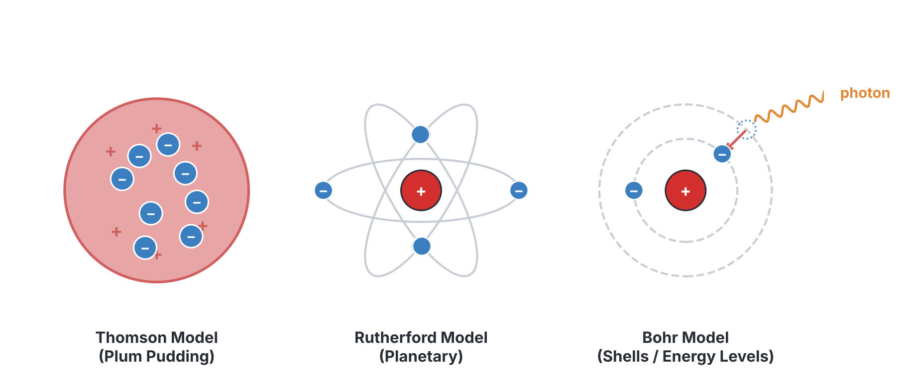
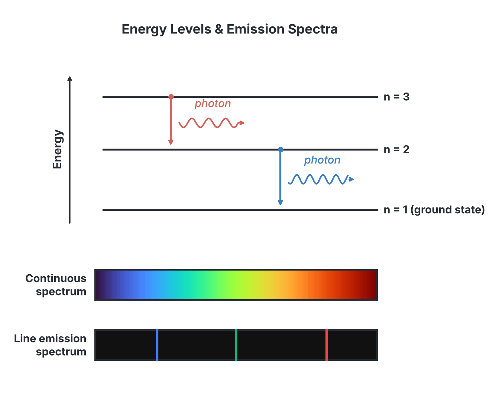
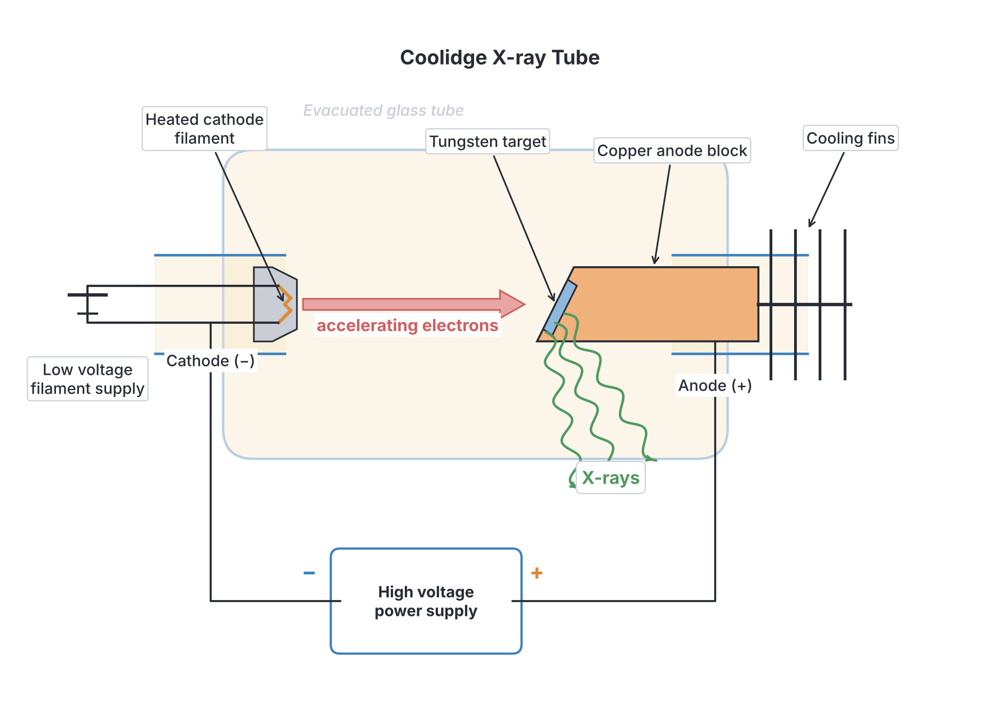

# JAMB Physics Notes: Atomic Structure and Quantum Emissions

## What JAMB expects

This topic is part of Section A, Topic 38 of the JAMB Physics syllabus: Elementary Modern Physics. This file focuses on atomic structure, quantum emissions, and X-rays. (Radioactivity, nuclear physics, and wave-particle duality are covered in `A38b-radioactivity-and-modern-physics.md`).

This file covers the following content items:
- (i) Bohr’s theory, Rutherford’s theory and radioactivity;
- (ii) models of the atom and their limitations;
- (iii) elementary structure of the atom;
- (iv) energy levels and spectra;
- (v) thermionic and photoelectric emissions;
- (vi) Einstein’s equation and stopping potential;
- (vii) applications of thermionic emissions and photoelectric effects;
- (viii) simple method of production of x-rays;
- (ix) properties and applications of alpha, beta and gamma rays.

By the end of these notes, you should be able to:
1. identify the models of the atom and write their limitations;
2. describe elementary structure of the atom;
3. differentiate between the energy levels and spectra of atoms;
4. compare thermionic emission and photoelectric emission;
5. apply Einstein’s equation to solve problems of photoelectric effect;
6. calculate the stopping potential;
7. relate some application of thermionic emission and photoelectric effects;
8. interpret the process involved in the production of x-rays;
9. identify some properties and applications of x-rays.

*(Note on the syllabus wording: The JAMB syllabus has a typo in objective ix, writing "ix dentify" instead of "identify". This has been corrected here. Also, content ix covers alpha, beta, and gamma rays, while objective ix focuses on X-rays. We cover both to ensure complete compliance.)*

## 1. The Atom and Its Structure

### Content iii: Elementary structure of the atom

All matter in the universe, from the sand at Bar Beach in Lagos to the air we breathe, is made of atoms. An atom is the smallest part of an element that can take part in a chemical reaction.

### Objective ii: Describe elementary structure of the atom

The **elementary structure** of an atom consists of a central, heavy **nucleus** surrounded by orbiting **electrons**.

- **The Nucleus:** Located at the exact centre of the atom, it is incredibly tiny but contains almost all of the atom's mass. It is made of two types of particles (collectively called **nucleons**):
  - **Protons:** Positively charged particles.
  - **Neutrons:** Particles with no electrical charge (they are neutral).
- **The Electrons:** Negatively charged particles that revolve around the nucleus in specific paths (often called orbits or shells). They are extremely light compared to protons and neutrons.

Because a stable atom has an equal number of positive protons and negative electrons, it is electrically neutral overall. Most of the atom is actually empty space!

**Common mistake:** Students often confuse the nucleus (the centre of the atom) with a nucleon (a particle inside the nucleus). Remember that a nucleon is either a proton or a neutron.

## 2. Historical Atomic Models

Over time, scientists proposed different models to explain how the atom is structured. JAMB expects you to know the three major models and their specific flaws.

### Content i: Bohr's theory, Rutherford's theory and radioactivity

**1. J.J. Thomson's Plum Pudding Model (1897)**
Thomson discovered the electron. He imagined the atom as a solid sphere of positive charge with negative electrons stuck scattered inside it, like raisins in a plum pudding or seeds in a watermelon.

**2. Rutherford's Planetary Model (1911)**
Ernest Rutherford fired **alpha particles** at a very thin gold foil (known as the alpha-scattering experiment). He observed that most particles passed straight through the foil, but a few were deflected at very large angles, and some even bounced back.
- **Rutherford's Theory:** He concluded that Thomson's solid sphere was wrong. Instead, the atom has a tiny, dense, positively charged centre (the nucleus), and electrons orbit this nucleus at a distance, much like planets orbiting the sun. Most of the atom is empty space.
- **Radioactivity:** Rutherford also studied radioactive decay, which is the spontaneous emission of radiation from an unstable nucleus. This showed that the nucleus itself could break apart or change state, emitting alpha, beta, or gamma rays.

**3. Bohr's Theory (1913)**
Niels Bohr improved Rutherford's model by applying quantum ideas.
- **Bohr's Theory Postulates:**
  1. Electrons orbit the nucleus only in certain allowed, circular orbits without radiating energy.
  2. The angular momentum of an electron in these allowed orbits is **quantized** (it must be a specific multiple of a basic value).
  3. An electron emits or absorbs a photon of light only when it jumps from one allowed orbit to another.

### Content ii: Models of the atom and their limitations

While these models were ground-breaking, they were eventually found to be incomplete. Both Rutherford's and Bohr's models had specific flaws that led to the development of modern quantum mechanics.

### Objective i: Identify the models of the atom and write their limitations

JAMB frequently tests the specific flaws (limitations) of Rutherford's and Bohr's models.

| Model | Key Limitation |
| --- | --- |
| **Thomson's Model** | It could not explain how atoms could contain mostly empty space (proven by Rutherford's scattering experiment). |
| **Rutherford's Model** | **The collapsing atom problem:** According to classical physics, an accelerating electric charge (like an orbiting electron changing direction) must continuously radiate energy. If this happened, the electron would quickly lose energy and spiral into the nucleus, meaning atoms would collapse. It also could not explain why atoms emit light only at specific frequencies (line spectra). |
| **Bohr's Model** | **The hydrogen limitation:** Bohr's model works perfectly for the hydrogen atom (which has only one electron) but fails to accurately predict the spectra of multi-electron atoms. It also could not explain why some spectral lines split into finer lines when placed in a magnetic field (the Zeeman effect) or an electric field (the Stark effect). |

## 3. Atomic Spectra

### Content iv: Energy levels and spectra

According to Bohr, electrons in an atom occupy specific energy states called **energy levels**.

- **Ground State:** The lowest energy level of an atom. Electrons normally reside here because it is the most stable state.
- **Excited State:** If an electron absorbs energy (from heat, an electrical discharge, or a photon), it jumps to a higher energy level. The atom is now excited.
- **Ionization:** If an electron absorbs enough energy to completely escape the attractive pull of the nucleus, the atom becomes a positive ion.

When an electron jumps from a higher energy level ($E_2$) to a lower energy level ($E_1$), it releases the extra energy as a photon of light. The energy of this photon ($\Delta E$) is given by:

$$ \Delta E = E_2 - E_1 = hf $$

Where:
- $\Delta E$ is the energy difference in Joules ($\text{J}$) or electron-volts ($\text{eV}$).
- $h$ is Planck's constant ($6.6 \times 10^{-34}\ \text{J s}$).
- $f$ is the frequency of the emitted light in Hertz ($\text{Hz}$).

### Objective iii: Differentiate between the energy levels and spectra of atoms

**Spectra** are the patterns of light emitted or absorbed by matter. They provide a unique "fingerprint" for identifying chemical elements. While **energy levels** are the invisible internal states of the atom, **spectra** are the visible results of electrons moving between those levels. We differentiate spectra into two main types:

| Feature | Continuous Spectrum | Line Spectrum |
| --- | --- | --- |
| **Appearance** | A smooth, unbroken band of all colours merging into one another (like a rainbow). | Distinct, separate bright lines of specific colours on a dark background. |
| **Source** | Hot, glowing solids or dense liquids (e.g., a tungsten filament bulb, hot metal). | Excited gases or vapours at low pressure (e.g., neon signs, sodium street lamps). |
| **What it shows** | Depends mostly on the temperature of the object, not the specific material. | Shows the exact, quantized **energy levels** unique to the atoms of that specific gas. |

*(Note: There is also an absorption line spectrum, which consists of dark lines on a continuous background, formed when a cool gas absorbs specific frequencies of light passing through it.)*

**Worked Example 1**
An electron in an atom jumps from an energy level of $-1.5\ \text{eV}$ to a lower level of $-4.8\ \text{eV}$. Calculate the frequency of the emitted photon. ($h = 6.6 \times 10^{-34}\ \text{J s}$, $1\ \text{eV} = 1.6 \times 10^{-19}\ \text{J}$)

1. **Identify the energy change in eV:**
   $\Delta E = E_{\text{initial}} - E_{\text{final}} = -1.5\ \text{eV} - (-4.8\ \text{eV}) = 3.3\ \text{eV}$.
2. **Convert the energy to Joules:**
   $3.3\ \text{eV} \times (1.6 \times 10^{-19}\ \text{J/eV}) = 5.28 \times 10^{-19}\ \text{J}$.
3. **Use the formula relating energy and frequency:**
   $\Delta E = hf$.
4. **Calculate the frequency:**
   $f = \frac{\Delta E}{h} = \frac{5.28 \times 10^{-19}\ \text{J}}{6.6 \times 10^{-34}\ \text{J s}} = 8.0 \times 10^{14}\ \text{Hz}$.

**Common mistakes with energy levels:**
- Forgetting to convert electron-volts ($\text{eV}$) to Joules ($\text{J}$) before using $E = hf$. Planck's constant $h$ given in JAMB is usually in $\text{J s}$, so energy *must* be in Joules.
- Making a sign error. An energy level of $-1.5\ \text{eV}$ is *higher* (less negative) than $-4.8\ \text{eV}$. Always subtract the smaller value from the larger one to get a positive photon energy.

## 4. Electron Emission

Metals contain free electrons that can move around inside the material. However, they cannot normally escape the surface because of attractive forces from the positive ions. To escape, an electron must gain a minimum amount of energy called the **work function ($W$)**.

Energy can be supplied to these electrons in different ways.

### Content v: Thermionic and photoelectric emissions

- **Thermionic emission** happens when a metal is heated to a very high temperature. The thermal energy causes the electrons to "boil off" the surface.
- **Photoelectric emission** happens when light (electromagnetic radiation) strikes a metal surface. The light energy is absorbed by the electrons, allowing them to escape.

### Objective iv: Compare thermionic emission and photoelectric emission

| Feature | Thermionic Emission | Photoelectric Emission |
| --- | --- | --- |
| **Source of Energy** | **Heat energy** (thermal energy). | **Light energy** (electromagnetic radiation/photons). |
| **Mechanism** | A metal filament is heated, giving electrons enough kinetic energy to vibrate forcefully and escape the surface. | Photons of light strike the metal surface, transferring their energy to the electrons to knock them out. |
| **Key Requirement** | The temperature must be high enough to provide energy greater than the work function. | The frequency of the light must be greater than the metal's **threshold frequency ($f_0$)**. |
| **Typical Metal Used** | Tungsten (because of its high melting point) often coated with barium oxide to lower the work function. | Metals with low work functions, such as the alkali metals sodium and potassium (zinc also works, but needs ultraviolet light). |
| **Emission Rate depends on** | The temperature of the filament. | The intensity (brightness) of the incident light. |

## 5. Photoelectric Physics

### Content vi: Einstein's equation and stopping potential

When light of a suitable frequency falls on a metal surface, electrons are emitted. This is the **photoelectric effect**, and the emitted electrons are called **photoelectrons**.

Key terms you must know:
- **Work function ($W$):** The minimum energy required to remove an electron from the metal surface.
- **Threshold frequency ($f_0$):** The minimum frequency of incident light required to cause photoelectric emission.
- **Threshold wavelength ($\lambda_0$):** The maximum wavelength of incident light required.

Because $W = hf_0$, if the incident light has a frequency $f$ that is less than $f_0$, no electrons will be emitted, no matter how bright the light is.

Albert Einstein explained this effect using the idea that light consists of particles of energy called **photons**.
The energy of a single photon is $E = hf$.
When a photon hits an electron, it gives all its energy to that one electron immediately.

### Objective v: Apply Einstein's equation to solve problems of photoelectric effect

Einstein's Photoelectric Equation is:
$$ E = W + K_{\text{max}} $$
Which can also be written as:
$$ hf = hf_0 + K_{\text{max}} $$
Where:
- $E = hf$ is the total energy of the incident photon in Joules ($\text{J}$).
- $W = hf_0$ is the work function of the metal in Joules ($\text{J}$).
- $K_{\text{max}}$ is the maximum kinetic energy of the emitted photoelectron in Joules ($\text{J}$).

**Worked Example 2**
A metal has a threshold frequency of $5.0 \times 10^{14}\ \text{Hz}$. Calculate its work function in Joules. ($h = 6.6 \times 10^{-34}\ \text{J s}$)

1. **State the formula for work function:**
   $W = hf_0$.
2. **Substitute the values:**
   $W = (6.6 \times 10^{-34}\ \text{J s}) \times (5.0 \times 10^{14}\ \text{Hz})$.
3. **Calculate the work function:**
   $W = 33.0 \times 10^{-20}\ \text{J} = 3.3 \times 10^{-19}\ \text{J}$.

**Worked Example 3**
Light of frequency $1.5 \times 10^{15}\ \text{Hz}$ falls on a metal surface with a work function of $3.3 \times 10^{-19}\ \text{J}$. Calculate the maximum kinetic energy of the emitted electrons. ($h = 6.6 \times 10^{-34}\ \text{J s}$)

1. **Calculate the energy of the incident photon:**
   $E = hf = (6.6 \times 10^{-34}\ \text{J s}) \times (1.5 \times 10^{15}\ \text{Hz}) = 9.9 \times 10^{-19}\ \text{J}$.
2. **State Einstein's photoelectric equation:**
   $E = W + K_{\text{max}}$.
3. **Rearrange to find kinetic energy:**
   $K_{\text{max}} = E - W$.
4. **Calculate the result:**
   $K_{\text{max}} = 9.9 \times 10^{-19}\ \text{J} - 3.3 \times 10^{-19}\ \text{J} = 6.6 \times 10^{-19}\ \text{J}$.

### Objective vi: Calculate the stopping potential

If we set up an opposing electric voltage (a negative voltage) to repel the emitted electrons, we can stop even the fastest electrons from reaching the other side of the circuit. The exact voltage required to do this is called the **stopping potential ($V_s$)**.

The work done by the electric field equals the maximum kinetic energy of the electrons:
$$ K_{\text{max}} = eV_s $$
Where:
- $K_{\text{max}}$ is the maximum kinetic energy in Joules ($\text{J}$).
- $e$ is the charge of an electron ($1.6 \times 10^{-19}\ \text{C}$).
- $V_s$ is the stopping potential in Volts ($\text{V}$).

*(Note: If $K_{\text{max}}$ is already given in electron-volts (eV), the stopping potential is simply the numerical value of $K_{\text{max}}$ in Volts! For example, if $K_{\text{max}} = 3.5\ \text{eV}$, then $V_s = 3.5\ \text{V}$.)*

**Worked Example 4**
Electrons are emitted from a metal surface with a maximum kinetic energy of $3.2 \times 10^{-19}\ \text{J}$. Calculate the stopping potential. ($e = 1.6 \times 10^{-19}\ \text{C}$)

1. **State the formula relating kinetic energy to stopping potential:**
   $K_{\text{max}} = eV_s$.
2. **Rearrange for stopping potential:**
   $V_s = \frac{K_{\text{max}}}{e}$.
3. **Substitute the values:**
   $V_s = \frac{3.2 \times 10^{-19}\ \text{J}}{1.6 \times 10^{-19}\ \text{C}}$.
4. **Calculate the result:**
   $V_s = 2.0\ \text{V}$.

**Common mistakes in photoelectric math:**
- Confusing $f$ (incident frequency) with $f_0$ (threshold frequency). Incident light energy ($hf$) provides the total energy; the metal demands a "fee" ($hf_0$); the electron keeps the "change" ($K_{\text{max}}$).
- Forgetting that an increase in light **intensity** (brightness) only increases the **number** of electrons emitted per second, not their kinetic energy. Kinetic energy depends only on the **frequency** of the light.

## 6. Applications in Real Life

### Content vii: Applications of thermionic emissions and photoelectric effects

Both thermionic and photoelectric emissions are crucial for many everyday technologies, converting basic energy forms into useful electrical signals or light.

### Objective vii: Relate some application of thermionic emission and photoelectric effects

**Applications of Thermionic Emission:**
- **Cathode Ray Oscilloscope (CRO):** Uses a heated filament to produce an electron beam that draws waveforms on a fluorescent screen. This is used in laboratories to view electrical signals.
- **X-ray tubes:** Uses a heated cathode to generate the fast electrons that will eventually strike a target to produce X-rays (explained in detail below).
- **Old Television Tubes:** The bulky CRT (Cathode Ray Tube) TVs relied on thermionic emission to shoot electrons at the screen to create pictures.

**Applications of the Photoelectric Effect:**
- **Burglar alarms and Automatic doors:** A continuous beam of light shines on a photoelectric cell, generating a steady current. If a person breaks the beam, the current stops, which triggers the alarm or tells a motor to open the door.
- **Solar panels (Photovoltaic cells):** Sunlight strikes the panels on roofs, ejecting electrons and creating a useful electric current to power homes, which is especially useful during NEPA/grid outages in Nigeria.
- **Light meters:** Used in photography and film-making to measure the intensity of light so the camera can adjust its exposure.

## 7. X-Rays Generation

### Content viii: Simple method of production of x-rays

X-rays are high-frequency, high-energy electromagnetic waves discovered by Wilhelm Röntgen in 1895. They are produced in a device called a **Coolidge tube**, which converts the kinetic energy of fast-moving electrons into electromagnetic radiation.

### Objective viii: Interpret the process involved in the production of x-rays

**Step-by-step process of production:**
1. A low voltage heats a tungsten filament (the cathode), causing it to emit electrons by **thermionic emission**.
2. A very high potential difference (thousands of volts) is applied across the tube, which accelerates these electrons to enormous speeds.
3. The fast-moving electrons strike a heavy metal target (the anode, usually tungsten or molybdenum) which is embedded in a copper block.
4. When the electrons hit the target, they are suddenly decelerated (stopped). Their kinetic energy is converted into **heat** (about 99%) and **X-ray photons** (about 1%).
5. Because so much heat is generated, the copper block is fitted with cooling fins or a water-cooling system to prevent the target from melting.

**The Physics of the Production (Formula):**
The maximum energy of the X-ray photon ($E_{\text{max}}$) produced is equal to the kinetic energy gained by the electron from the high voltage ($V$):
$$ eV = hf_{\text{max}} = \frac{hc}{\lambda_{\text{min}}} $$
Where:
- $V$ is the accelerating potential difference in Volts ($\text{V}$).
- $f_{\text{max}}$ is the maximum frequency of the X-rays in Hertz ($\text{Hz}$).
- $\lambda_{\text{min}}$ is the minimum wavelength of the X-rays in metres ($\text{m}$).
- $c$ is the speed of light ($3.0 \times 10^8\ \text{m s}^{-1}$).

**Worked Example 5**
An X-ray tube operates at a potential difference of $33,000\ \text{V}$. Calculate the maximum frequency of the X-rays produced. ($e = 1.6 \times 10^{-19}\ \text{C}$, $h = 6.6 \times 10^{-34}\ \text{J s}$)

1. **Calculate the maximum kinetic energy of the electrons:**
   $E_{\text{max}} = eV = (1.6 \times 10^{-19}\ \text{C}) \times (33,000\ \text{V}) = 5.28 \times 10^{-15}\ \text{J}$.
2. **Relate this energy to the maximum frequency:**
   $E_{\text{max}} = hf_{\text{max}}$.
3. **Rearrange to find frequency:**
   $f_{\text{max}} = \frac{E_{\text{max}}}{h}$.
4. **Calculate the result:**
   $f_{\text{max}} = \frac{5.28 \times 10^{-15}\ \text{J}}{6.6 \times 10^{-34}\ \text{J s}} = 0.8 \times 10^{19}\ \text{Hz} = 8.0 \times 10^{18}\ \text{Hz}$.

## 8. Properties and Applications of X-rays

### Objective ix: Identify some properties and applications of x-rays

X-rays are part of the electromagnetic spectrum.
**Properties of X-rays:**
- They travel in straight lines at the speed of light ($c$).
- They are highly penetrating but can be stopped by dense materials like lead or bone.
- Because they carry no charge, they are **not** deflected by electric or magnetic fields.
- They cause certain materials (like zinc sulphide) to fluoresce (glow).
- They can ionize gases and damage living tissue.

**Hard vs Soft X-rays:**
- **Hard X-rays:** Have high frequency, short wavelength, and very high penetrating power. They are produced by increasing the **accelerating voltage** across the tube.
- **Soft X-rays:** Have lower frequency, longer wavelength, and lower penetrating power.
- **Intensity of X-rays:** The number of X-rays produced depends on the number of electrons hitting the target. This is controlled by varying the **heating current** of the cathode filament.

**Applications of X-rays:**
- **Medicine:** Taking images of broken bones (which absorb X-rays while flesh lets them pass), and in radiation therapy to destroy cancer cells.
- **Industry:** Detecting internal flaws, cracks, or air bubbles in metal castings and welded pipelines.
- **Crystallography:** Studying the atomic structure of crystals using X-ray diffraction.
- **Security:** Scanning luggage at airports.

## 9. Radiation

While fully covered under radioactivity, the syllabus expects a brief comparison of the rays emitted spontaneously by unstable nuclei in this section too.

### Content ix: Properties and applications of alpha, beta and gamma rays

When an unstable nucleus decays, it emits one or more of these radiations:

| Property | Alpha ($\alpha$) rays | Beta ($\beta$) rays | Gamma ($\gamma$) rays |
| --- | --- | --- | --- |
| **Nature** | Helium nucleus (2 protons, 2 neutrons) | Fast-moving electron | High-energy electromagnetic wave |
| **Charge** | $+2$ (positive) | $-1$ (negative) | $0$ (neutral) |
| **Speed** | Slowest (about $10\%$ speed of light) | Fast (up to $90\%$ speed of light) | Speed of light ($c$) |
| **Ionizing Power** | **Highest** (easily knocks electrons off gas molecules) | Moderate | **Lowest** |
| **Penetrating Power**| **Lowest** | Moderate | **Highest** |
| **Stopped by** | A sheet of paper or a few cm of air | A thin sheet of aluminium (few mm) | Thick lead or concrete block |
| **Deflection by fields**| Deflected slightly (due to high mass) | Deflected strongly | Not deflected at all |

**Applications:**
- **Alpha rays:** Used in smoke detectors. The alpha particles ionize the air, creating a small current. Smoke disrupts this current, triggering the alarm.
- **Beta rays:** Used in thickness gauges in paper and metal sheet manufacturing.
- **Gamma rays:** Used to sterilize medical equipment and treat cancer (radiotherapy), as their high penetrating power allows them to reach deep inside tissues or sealed packages.

## Key terms

| Term | Meaning |
| --- | --- |
| Nucleon | A proton or a neutron located in the nucleus. |
| Ground state | The lowest and most stable energy level of an atom. |
| Line spectrum | Distinct coloured lines on a dark background showing specific, quantized energy levels of an excited gas. |
| Thermionic emission | The release of electrons from a metal surface due to heat energy. |
| Photoelectric emission | The release of electrons from a metal surface due to incident light energy. |
| Work function ($W$) | The minimum energy required to remove an electron from a metal surface. |
| Threshold frequency ($f_0$) | The minimum frequency of light required to cause photoelectric emission. |
| Stopping potential ($V_s$) | The negative voltage required to completely stop the fastest photoelectrons. |
| Coolidge tube | The vacuum tube device used to produce X-rays. |
| Hard X-rays | Highly penetrating X-rays produced by a high accelerating voltage. |

## Exam tips and common mistakes

- **Rutherford vs Bohr:** If a JAMB question asks about the planetary model or the discovery of the nucleus, the answer is Rutherford. If it asks about quantized energy levels or fixed orbits, the answer is Bohr.
- **Intensity vs Frequency in the Photoelectric Effect:** Increasing the intensity (brightness) of light increases the *number* of emitted electrons but does NOT change their speed. Increasing the frequency of the light increases the *maximum kinetic energy* of the electrons.
- **X-ray Controls:** Remember that the **accelerating voltage** controls the *hardness/penetration* of X-rays, while the **filament current** controls the *intensity/quantity* of X-rays.
- **Unit Conversions:** Always convert energies in electron-volts ($\text{eV}$) to Joules ($\text{J}$) by multiplying by $1.6 \times 10^{-19}$ before using formulas containing Planck's constant $h$ in $\text{J s}$.
- **Gamma vs X-rays:** Both are high-frequency electromagnetic waves with identical properties. The only difference is their origin: Gamma rays come from the nucleus, while X-rays come from electron transitions outside the nucleus.

## Quick summary

1. The atom has a dense positive nucleus (protons and neutrons) and orbiting negative electrons.
2. Rutherford discovered the nucleus through alpha scattering but couldn't explain why electrons don't crash into the nucleus. Bohr solved this by proposing fixed, quantized energy levels.
3. Electrons jumping down between energy levels release energy as photons, creating a line emission spectrum unique to that element.
4. Thermionic emission uses heat to release electrons (used in CROs and X-ray tubes), while photoelectric emission uses light (used in solar cells and light meters).
5. Einstein's photoelectric equation is $E = W + K_{\text{max}}$. Emission only occurs if the light frequency is above the threshold frequency.
6. X-rays are produced when fast-moving electrons are suddenly stopped by a heavy metal target, converting kinetic energy into X-ray photons and heat.
7. Unstable nuclei emit radiation: Alpha (most ionizing, least penetrating), Beta (moderate), and Gamma (least ionizing, most penetrating).

## Practice questions

**1. Which of the following is a limitation of Rutherford's model of the atom?**
- A. It places electrons in the nucleus.
- B. It cannot explain why the electron does not spiral into the nucleus.
- C. It assumes the atom is a solid positive sphere.
- D. It states that energy levels are quantized.

**Answer: B.** According to classical physics, an orbiting electron in Rutherford's model should radiate energy, slow down, and spiral into the nucleus, meaning the atom would collapse.

**2. An electron jumps from an energy level of $-1.5\ \text{eV}$ to a lower level of $-4.8\ \text{eV}$. Calculate the frequency of the emitted photon. ($h = 6.6 \times 10^{-34}\ \text{J s}, 1\ \text{eV} = 1.6 \times 10^{-19}\ \text{J}$)**
- A. $4.0 \times 10^{14}\ \text{Hz}$
- B. $8.0 \times 10^{14}\ \text{Hz}$
- C. $8.0 \times 10^{15}\ \text{Hz}$
- D. $1.6 \times 10^{15}\ \text{Hz}$

**Answer: B.**
1. Energy difference $\Delta E = 4.8 - 1.5 = 3.3\ \text{eV}$.
2. Convert to Joules: $3.3 \times 1.6 \times 10^{-19} = 5.28 \times 10^{-19}\ \text{J}$.
3. Calculate frequency: $f = \frac{\Delta E}{h} = \frac{5.28 \times 10^{-19}}{6.6 \times 10^{-34}} = 8.0 \times 10^{14}\ \text{Hz}$.
(Option C ($8.0 \times 10^{15}\ \text{Hz}$) comes from a power-of-ten slip in the conversion, using $10^{-18}\ \text{J}$ instead of $10^{-19}\ \text{J}$ for each eV.)

**3. Which of the following statements differentiates thermionic emission from photoelectric emission?**
- A. Thermionic emission releases protons, while photoelectric emission releases electrons.
- B. Thermionic emission relies on heat, while photoelectric emission relies on light.
- C. Photoelectric emission occurs only in gases.
- D. Thermionic emission requires a higher threshold frequency.

**Answer: B.** Thermionic emission boils off electrons using thermal energy, whereas photoelectric emission uses photon energy from light. Both processes emit electrons.

**4. A metal has a threshold frequency of $5.0 \times 10^{14}\ \text{Hz}$. Calculate its work function in Joules. ($h = 6.6 \times 10^{-34}\ \text{J s}$)**
- A. $1.3 \times 10^{-19}\ \text{J}$
- B. $3.3 \times 10^{-19}\ \text{J}$
- C. $6.6 \times 10^{-19}\ \text{J}$
- D. $3.3 \times 10^{-20}\ \text{J}$

**Answer: B.**
1. $W = hf_0$.
2. $W = (6.6 \times 10^{-34}) \times (5.0 \times 10^{14}) = 3.3 \times 10^{-19}\ \text{J}$.
(A common mistake is getting a math error with the indices, resulting in option D).

**5. Light of energy $5.5\ \text{eV}$ falls on a metal surface with a work function of $2.5\ \text{eV}$. What is the stopping potential?**
- A. $2.5\ \text{V}$
- B. $3.0\ \text{V}$
- C. $5.5\ \text{V}$
- D. $8.0\ \text{V}$

**Answer: B.**
1. Max kinetic energy $K_{\text{max}} = E - W = 5.5\ \text{eV} - 2.5\ \text{eV} = 3.0\ \text{eV}$.
2. Since stopping potential $V_s$ in Volts is numerically equal to $K_{\text{max}}$ in electron-volts, $V_s = 3.0\ \text{V}$.
(A common mistake is adding the energies to get $8.0\ \text{V}$, or choosing the work function directly as $2.5\ \text{V}$).

**6. An X-ray tube operates at a potential difference of $33,000\ \text{V}$. What is the maximum frequency of the X-rays produced? ($e = 1.6 \times 10^{-19}\ \text{C}, h = 6.6 \times 10^{-34}\ \text{J s}$)**
- A. $4.0 \times 10^{18}\ \text{Hz}$
- B. $8.0 \times 10^{18}\ \text{Hz}$
- C. $1.6 \times 10^{19}\ \text{Hz}$
- D. $8.0 \times 10^{19}\ \text{Hz}$

**Answer: B.**
1. Max energy $E_{\text{max}} = eV = (1.6 \times 10^{-19}) \times 33,000 = 5.28 \times 10^{-15}\ \text{J}$.
2. Maximum frequency $f_{\text{max}} = \frac{E_{\text{max}}}{h} = \frac{5.28 \times 10^{-15}}{6.6 \times 10^{-34}} = 8.0 \times 10^{18}\ \text{Hz}$.
(Option D ($8.0 \times 10^{19}\ \text{Hz}$) comes from a power-of-ten slip in $E = eV$, for example using $330,000\ \text{V}$ instead of $33,000\ \text{V}$.)

**7. The hardness of X-rays produced in a Coolidge tube is controlled by varying the**
- A. heating current of the filament.
- B. accelerating potential difference across the tube.
- C. material of the glass envelope.
- D. time of exposure.

**Answer: B.** The accelerating voltage dictates the kinetic energy of the electrons, which in turn defines the penetrating power (hardness) of the X-rays. The heating current (A) controls the intensity (quantity) of X-rays.

**8. Which of the following radiations has the highest penetrating power?**
- A. Alpha rays
- B. Beta rays
- C. Gamma rays
- D. X-rays (soft)

**Answer: C.** Gamma rays are high-energy electromagnetic waves from the nucleus. They have no mass and no charge, allowing them to penetrate deep into matter (only stopped by thick lead or concrete).

**9. An atomic emission spectrum consisting of discrete bright lines on a dark background is produced by**
- A. a hot solid object.
- B. an incandescent light bulb.
- C. an excited gas.
- D. thermionic emission.

**Answer: C.** An excited gas produces a line spectrum because its isolated atoms can only emit photons corresponding to specific quantized energy level transitions. Hot solids produce continuous spectra.

**10. A photoelectric application used to prevent elevator doors from closing when someone is in the doorway relies on the fact that**
- A. breaking a light beam stops the emission of photoelectrons, breaking a circuit.
- B. humans emit X-rays that trigger a sensor.
- C. the body's heat causes thermionic emission.
- D. continuous light generates high stopping potentials.

**Answer: A.** In a burglar alarm or automatic door system, a continuous light beam creates a steady photoelectric current. When a person steps in the way, they block the light, stopping the current and triggering the door to open.
