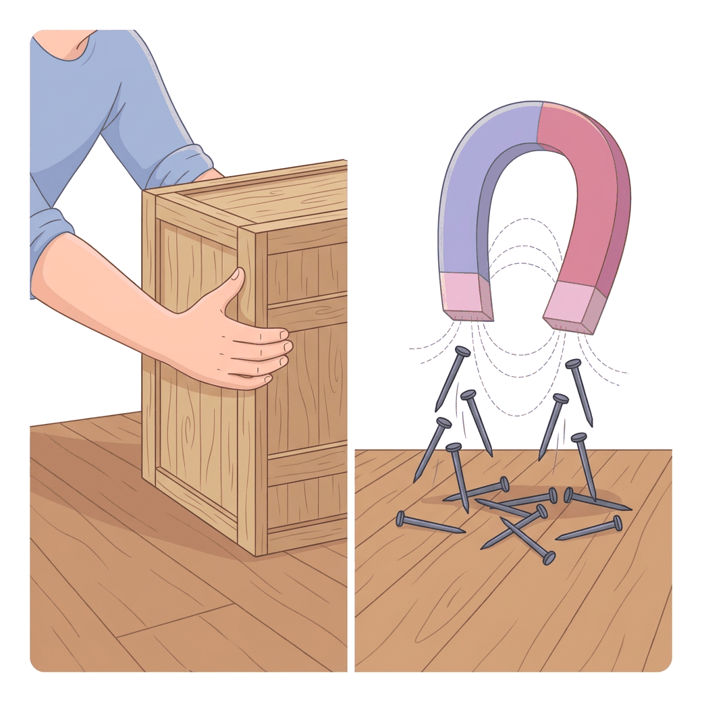
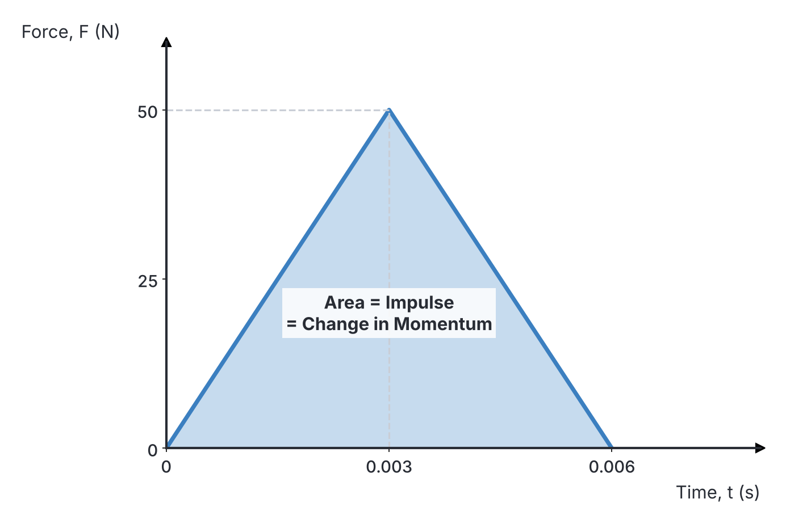

# JAMB Physics Notes: Newton's Laws and Types of Motion

## What JAMB expects

This topic is Part 1 of the Motion syllabus. Motion is a very broad topic, so it is split over several files. This file covers Section A, Topic 3 of the JAMB Physics syllabus, focusing on the fundamental laws and causes of motion. It covers the following content items:

* **(a) Newton's laws of motion:**
  * (i) inertia, mass and force;
  * (ii) relationship between mass and acceleration;
  * (iii) impulse and momentum;
  * (iv) force – time graph;
  * (v) conservation of linear momentum.
* **(b) Types of motion:** translational, oscillatory, rotational, spin and random.
* **(c) Relative motion.**
* **(d) Causes of motion.**
* **(e) Types of force:**
  * (i) contact;
  * (ii) force field.

By the end of these notes, you should be able to:

1. Identify different types of motion (Objective i).
2. Identify force as the cause of motion (Objective iii).
3. Identify push and pull as forms of force (Objective iv).
4. Identify electric and magnetic attractions, and gravitational pull as forms of field forces (Objective v).
5. Solve numerical problems involving impulse and momentum (Objective xiii).
6. Interpret the area under a force – time graph (Objective xiv).
7. Interpret Newton’s laws of motion (Objective xv).
8. Compare inertia, mass and force (Objective xvi).
9. Deduce the relationship between mass and acceleration (Objective xvii).
10. Interpret the law of conservation of linear momentum and its applications (Objective xviii).

*(Note: Linear and projectile motion, circular motion, and simple harmonic motion are covered in `A3b-linear-and-projectile-motion.md` and `A3c-circular-motion-and-shm.md`.)*

## Types of motion

**Objective i: identify different types of motion.**

Motion is the change in the position of an object over time. Depending on how an object moves, its motion can be classified into five main types:

### 1. Translational (Linear) motion
This is motion in a straight line, where every part of the object moves through the same distance in the same time. 
* **Examples:** A car driving along a straight road like the Lagos-Ibadan expressway; an apple falling straight down from a tree.

### 2. Oscillatory (Vibratory) motion
This is a periodic to-and-fro or back-and-forth movement about a fixed central position (the equilibrium position). 
* **Examples:** A swinging pendulum in a grandfather clock; a child on a playground swing; a vibrating guitar string. 

### 3. Rotational motion
This occurs when a rigid body moves in a circular path around a fixed axis outside or inside its body, tracing out a circle.
* **Examples:** The blades of a ceiling fan turning; the hands of a clock; a car moving around a circular roundabout.

### 4. Spin motion
Spin is a special type of rotational motion where the object rotates about an axis that passes directly through its own centre of mass. 
* **Examples:** The Earth spinning on its axis (which gives us day and night); a spinning top.

### 5. Random motion
This is an irregular, zigzag motion with no specific direction or predictable path.
* **Examples:** The movement of a housefly in a room; smoke particles moving in the air (Brownian motion); players moving around a football pitch during a match.

## Relative motion

**Content c: Relative motion**

**Relative motion** is the calculation of the motion of an object with regard to another moving or stationary object. It reminds us that all motion is relative to the observer's frame of reference.

* If you are sitting in a moving bus, you are at rest relative to the person sitting next to you, but you are moving at the speed of the bus relative to a person standing by the roadside.
* **Bodies moving in the same direction:** If Car A travels at $100\ \text{km h}^{-1}$ and Car B travels ahead of it at $80\ \text{km h}^{-1}$, the relative velocity of A to B is $100\ \text{km h}^{-1} - 80\ \text{km h}^{-1} = 20\ \text{km h}^{-1}$. To the driver in Car B, Car A is approaching slowly at $20\ \text{km h}^{-1}$.
* **Bodies moving in opposite directions:** If two cars approach each other, one at $60\ \text{km h}^{-1}$ and the other at $50\ \text{km h}^{-1}$, they seem to pass each other very quickly. Their relative velocity is $60\ \text{km h}^{-1} + 50\ \text{km h}^{-1} = 110\ \text{km h}^{-1}$. 

## Causes of motion

**Objective iii: identify force as cause of motion.**

Motion does not happen by itself. If a stationary object starts moving, or a moving object stops, changes speed, or changes direction, a fundamental physical quantity is responsible. 

**Force** is the fundamental cause of motion. A force is that which changes or tends to change a body's state of rest or its uniform motion in a straight line. Without a net applied force, the state of motion of any object remains completely unchanged. 

## Push and pull as forms of force

**Objective iv: identify push and pull as forms of force.**

Forces can be broadly divided into two categories based on how they act. The first category is contact forces.

**Contact forces** act only when two bodies are physically touching each other. At their most basic level, every contact force is a form of a **push** (forcing an object away from you) or a **pull** (drawing an object towards you).
* **Examples of contact forces:** 
  * **Friction:** A force that opposes motion, acting as a "pull" against the direction of sliding.
  * **Tension:** The pull experienced in a stretched rope, string, or cable.
  * **Applied force:** The push of your hand when you open a door or push a wheelbarrow.
  * **Normal reaction:** The upward push from a table on a book resting on it.

## Field forces

**Objective v: identify electric and magnetic attractions, gravitational pull as forms of field forces.**

The second category of forces does not require physical contact. A **force field** is a region of space where a body experiences a force across a distance.

* **Examples of field forces:**
  * **Gravitational pull (Gravity):** The invisible force of attraction between masses. It pulls a thrown stone back to the ground and keeps the planets orbiting the Sun. It is always an attractive force.
  * **Electric attraction and repulsion:** The force between electric charges. For example, a plastic comb rubbed on dry hair attracts tiny pieces of paper from a distance.
  * **Magnetic attraction and repulsion:** The force exerted by a magnet on magnetic materials (like iron nails) or on other magnets.

## Newton's laws of motion

**Objective xv: interpret Newton’s laws of motion.**

Sir Isaac Newton formulated three fundamental laws that govern the motion of objects. These laws link the forces acting on a body to its resulting motion, acting as the foundation of classical mechanics. 
1. **First Law:** Explains what happens when there is no net force (the body maintains its state of motion).
2. **Second Law:** Explains exactly what happens when there *is* a net force (the body accelerates proportionally to the force).
3. **Third Law:** Explains how forces always come in pairs (action and reaction).

We will examine the specifics of these laws in the following sections.

## Inertia, mass and force

**Objective xvi: compare inertia, mass and force.**

**Newton's First Law of Motion** states that *every object will continue in its state of rest or uniform motion in a straight line unless acted upon by an external (unbalanced) force.*

This law introduces the concept of **inertia**. Inertia is the reluctance of a body to start moving if it is at rest, or to stop moving or change direction if it is already in motion. 
* Have you ever been in a *Danfo* bus that suddenly brakes? You fall forward. This is because your body wants to continue its forward uniform motion due to inertia. 
* Mass is the physical measure of a body's inertia. The heavier a body (the greater its mass), the harder it is to start or stop its motion.

### Comparing Inertia, Mass, and Force

| Feature | Inertia | Mass | Force |
| :--- | :--- | :--- | :--- |
| **Definition** | The property of a body to resist changes to its state of motion. | The quantity of matter in a body. It is the numerical measure of a body's inertia. | An influence (push or pull) that changes or tends to change a body's state of motion. |
| **Type of Quantity** | A property of matter (not a measurable physical quantity by itself). | A fundamental scalar quantity. | A derived vector quantity (has magnitude and direction). |
| **SI Unit** | None (it is a conceptual property). | Kilogram ($\text{kg}$) | Newton ($\text{N}$) |
| **Role in Motion** | Tries to keep motion unchanged. | Determines how much inertia the object has. | Causes the change in motion (overcomes inertia). |

## Relationship between mass and acceleration

**Objective xvii: deduce the relationship between mass and acceleration.**

**Newton's Second Law of Motion** states that *the rate of change of momentum of a body is directly proportional to the applied force, and takes place in the direction of the force.*

This law gives us the exact mathematical relationship between mass and acceleration. Let us deduce it:
1. Momentum ($p$) is mass ($m$) multiplied by velocity ($v$).
2. Change in momentum is $\Delta p = m(v - u)$, where $v$ is final velocity and $u$ is initial velocity.
3. Rate of change of momentum is $\frac{m(v - u)}{t}$.
4. Since acceleration $a = \frac{v - u}{t}$, the rate of change of momentum becomes $ma$.
5. From the second law, Force $F \propto ma$.
6. Mathematically, $F = kma$, where $k$ is a constant of proportionality.
7. One Newton ($1\ \text{N}$) is defined as the force required to give a mass of $1\ \text{kg}$ an acceleration of $1\ \text{m s}^{-2}$. This specific definition forces $k$ to be exactly $1$.
8. Therefore, the formula becomes:
   $$F = ma$$
   where $F$ is force in Newtons ($\text{N}$), $m$ is mass in kilograms ($\text{kg}$), and $a$ is acceleration in metres per second squared ($\text{m s}^{-2}$).

**Common mistakes in calculations:** 
Using non-SI units for mass (like grams) when calculating force. 
*Wrong working:* Mass = $50\ \text{g}$, $a = 2\ \text{m s}^{-2}$. $F = 50 \times 2 = 100\ \text{N}$. 
*Corrected version:* Convert mass to $\text{kg}$ first. Mass = $50\ \text{g} = 0.05\ \text{kg}$. $F = 0.05\ \text{kg} \times 2\ \text{m s}^{-2} = 0.1\ \text{N}$.

### Worked Examples on $F = ma$

**Example 1:**
A *Danfo* bus of mass $1200\ \text{kg}$ accelerates from rest at $3\ \text{m s}^{-2}$. Calculate the force provided by its engine (ignoring friction).

**Working:**
1. State the knowns: mass $m = 1200\ \text{kg}$, acceleration $a = 3\ \text{m s}^{-2}$.
2. State the formula: $F = ma$.
3. Substitute with units: $F = 1200\ \text{kg} \times 3\ \text{m s}^{-2}$.
4. Calculate the answer: $F = 3600\ \text{N}$.

**Example 2:**
A car of mass $800\ \text{kg}$ is travelling at $25\ \text{m s}^{-1}$. The brakes are applied, and it slows down to $5\ \text{m s}^{-1}$ in $4\ \text{s}$. Find the retarding force of the brakes.

**Working:**
1. State the knowns: $m = 800\ \text{kg}$, initial velocity $u = 25\ \text{m s}^{-1}$, final velocity $v = 5\ \text{m s}^{-1}$, time $t = 4\ \text{s}$.
2. Find the acceleration: $a = \frac{v - u}{t}$.
3. Substitute with units: $a = \frac{5\ \text{m s}^{-1} - 25\ \text{m s}^{-1}}{4\ \text{s}} = \frac{-20\ \text{m s}^{-1}}{4\ \text{s}} = -5\ \text{m s}^{-2}$ (the negative sign shows it is decelerating).
4. State the force formula: $F = ma$.
5. Substitute with units: $F = 800\ \text{kg} \times (-5\ \text{m s}^{-2}) = -4000\ \text{N}$.
6. State the final answer: The retarding force is $4000\ \text{N}$ (the negative sign simply means the force opposes the initial motion).

## Impulse and momentum

**Objective xiii: solve numerical problems involving impulse and momentum.**

### Linear Momentum
Linear **momentum** ($p$) is defined as the product of a body's mass and its velocity. It represents the "quantity of motion" a body possesses.
$$p = mv$$
where $p$ is momentum in kilogram metres per second ($\text{kg m s}^{-1}$), $m$ is mass in kilograms ($\text{kg}$), and $v$ is velocity in metres per second ($\text{m s}^{-1}$). Momentum is a vector quantity.

### Impulse
**Impulse** ($I$) is the product of a force and the very short time interval during which it acts. It is often seen when a bat hits a ball or a hammer strikes a nail.
$$I = F \Delta t$$
where $I$ is impulse in Newton-seconds ($\text{N s}$), $F$ is force in Newtons ($\text{N}$), and $\Delta t$ is the time interval in seconds ($\text{s}$).

**The Impulse-Momentum Theorem:**
From Newton's second law, $F = \frac{m(v - u)}{t}$. Rearranging this gives:
$$F \times t = mv - mu$$
This means: **Impulse = Change in Momentum**.
The unit of impulse ($\text{N s}$) is perfectly equivalent to the unit of momentum ($\text{kg m s}^{-1}$).

**Common mistakes in calculations:** 
Failing to account for the direction change when an object rebounds. 
*Wrong working for a $2\ \text{kg}$ ball hitting a wall at $10\ \text{m s}^{-1}$ and bouncing back at $8\ \text{m s}^{-1}$:* Change in velocity = $10\ \text{m s}^{-1} - 8\ \text{m s}^{-1} = 2\ \text{m s}^{-1}$. Impulse = $2\ \text{kg} \times 2\ \text{m s}^{-1} = 4\ \text{N s}$. 
*Corrected version:* Velocity is a vector. If striking is $+10\ \text{m s}^{-1}$, bouncing back is $-8\ \text{m s}^{-1}$. Change in velocity = $-8\ \text{m s}^{-1} - 10\ \text{m s}^{-1} = -18\ \text{m s}^{-1}$. Magnitude of Impulse = $2\ \text{kg} \times 18\ \text{m s}^{-1} = 36\ \text{N s}$.

### Worked Example on Impulse and Momentum

**Example 3:**
A football player kicks a stationary ball of mass $0.45\ \text{kg}$, giving it a velocity of $30\ \text{m s}^{-1}$. If the foot was in contact with the ball for $0.05\ \text{s}$, calculate the impulse and the average force exerted on the ball.

**Working:**
1. State the knowns: $m = 0.45\ \text{kg}$, $u = 0\ \text{m s}^{-1}$, $v = 30\ \text{m s}^{-1}$, $t = 0.05\ \text{s}$.
2. State the formula for impulse: $I = m(v - u)$.
3. Substitute with units: $I = 0.45\ \text{kg} \times (30\ \text{m s}^{-1} - 0\ \text{m s}^{-1})$.
4. Calculate impulse: $I = 13.5\ \text{N s}$.
5. State the formula for average force: $F = \frac{I}{t}$.
6. Substitute with units: $F = \frac{13.5\ \text{N s}}{0.05\ \text{s}}$.
7. Calculate force: $F = 270\ \text{N}$.

## Force-time graphs

**Objective xiv: interpretation of area under force – time graph.**

If a force acting on a body is plotted against time on a graph, **the area under the force-time graph is mathematically equal to the impulse** (and therefore equal to the change in momentum of the body). 
* For a constant force, the graph is a rectangle. Area = length $\times$ breadth = $F \times t$.
* For a varying force that rises to a peak and drops to zero (like a kick or a punch), the graph forms a triangle. Area = $\frac{1}{2} \times \text{base} \times \text{height} = \frac{1}{2} \times t \times F_{\text{max}}$.

### Worked Example on Graph Interpretation

**Example 4:**
A force acts on an object. On a force-time graph, the force increases uniformly from $0\ \text{N}$ to $50\ \text{N}$ in $3\ \text{ms}$ (milliseconds) and then drops uniformly to $0\ \text{N}$ in another $3\ \text{ms}$. Calculate the impulse given to the object.

**Working:**
1. Recognize the shape: The graph forms a triangle with base time $t$ and height peak force $F$.
2. Calculate total base time: $3\ \text{ms} + 3\ \text{ms} = 6\ \text{ms}$.
3. Convert time to seconds: $t = 6 \times 10^{-3}\ \text{s} = 0.006\ \text{s}$.
4. Identify height of triangle: $F = 50\ \text{N}$.
5. State the relationship: Impulse = Area under force-time graph.
6. Calculate area: $\text{Area} = \frac{1}{2} \times \text{base} \times \text{height}$.
7. Substitute with units: $\text{Impulse} = \frac{1}{2} \times 0.006\ \text{s} \times 50\ \text{N}$.
8. Final answer: Impulse $= 0.15\ \text{N s}$.

## Conservation of linear momentum

**Objective xviii: interpret the law of conservation of linear momentum and application.**

This principle arises directly from **Newton's Third Law**, which states that *for every action, there is an equal and opposite reaction.* If bodies A and B collide, the force A exerts on B is equal and opposite to the force B exerts on A. Since they are in contact for the same time, their impulses are equal and opposite, meaning their momentum changes cancel out.

The **Law of Conservation of Linear Momentum** states that *in a closed system of colliding bodies, the total momentum before collision is equal to the total momentum after collision, provided no external forces act on the system.*

This principle is widely used to solve problems involving **collisions** and **explosions (recoils)**.

### Types of Collisions
1. **Elastic collision:** Both momentum and kinetic energy are conserved. The bodies bounce off each other perfectly without losing energy (e.g. ideal billiard balls, gas molecules). 
2. **Inelastic collision:** Momentum is conserved, but kinetic energy is **not** conserved (some is lost as heat, sound, or deformation work). If the bodies stick together and move with a common velocity after the impact, it is a *perfectly inelastic* collision. (Note: JAMB states the coefficient of restitution is not necessary, so we focus purely on momentum conservation).

**Formula for Inelastic Collision (Bodies sticking together):**
$$m_1u_1 + m_2u_2 = (m_1 + m_2)v$$
where $m_1, m_2$ are the masses in kilograms ($\text{kg}$), $u_1, u_2$ are their initial velocities in metres per second ($\text{m s}^{-1}$), and $v$ is their common final velocity in metres per second ($\text{m s}^{-1}$).

### Explosions and Recoil
When a gun is fired, the forward momentum of the bullet must be balanced by the backward momentum of the gun, because the initial momentum of the stationary system was zero. This backward movement of the gun is called **recoil**.
$$\text{Momentum of bullet} + \text{Momentum of gun} = 0$$
$$m_b v_b + m_g v_g = 0$$
$$v_g = -\frac{m_b v_b}{m_g}$$
The negative sign shows that the gun moves in the opposite direction to the bullet. We usually just calculate the magnitude.

**Common mistakes in calculations:** 
Adding velocities directly instead of maintaining the momentum products. 
*Wrong working:* $v = \frac{u_1 + u_2}{2}$ for sticking bodies. 
*Corrected version:* You must multiply by the masses first! Use $m_1u_1 + m_2u_2 = (m_1+m_2)v$.

### Worked Examples on Conservation of Momentum

**Example 5 (Recoil of a gun):**
A hunter fires a bullet of mass $20\ \text{g}$ from a rifle of mass $5\ \text{kg}$. If the bullet leaves the muzzle with a velocity of $300\ \text{m s}^{-1}$, find the recoil velocity of the rifle.

**Working:**
1. State the knowns: Mass of rifle $M = 5\ \text{kg}$, mass of bullet $m = 20\ \text{g} = 0.02\ \text{kg}$, velocity of bullet $v_b = 300\ \text{m s}^{-1}$.
2. State the principle: Initial momentum = Final momentum. Since both were at rest, total initial momentum = $0\ \text{kg m s}^{-1}$.
3. Set up the equation: $0 = M v_r + m v_b$, where $v_r$ is the recoil velocity.
4. Rearrange for magnitude: $M v_r = m v_b \implies v_r = \frac{m v_b}{M}$.
5. Substitute with units: $v_r = \frac{0.02\ \text{kg} \times 300\ \text{m s}^{-1}}{5\ \text{kg}}$.
6. Calculate the answer: $v_r = \frac{6\ \text{kg m s}^{-1}}{5\ \text{kg}} = 1.2\ \text{m s}^{-1}$.

**Example 6 (Inelastic collision):**
A car of mass $2000\ \text{kg}$ moving at $15\ \text{m s}^{-1}$ collides with a stationary minibus of mass $1000\ \text{kg}$. If they lock together and move forward, calculate their common velocity immediately after the collision.

**Working:**
1. State the knowns: $m_1 = 2000\ \text{kg}$, $u_1 = 15\ \text{m s}^{-1}$, $m_2 = 1000\ \text{kg}$, $u_2 = 0\ \text{m s}^{-1}$.
2. State the formula: $m_1u_1 + m_2u_2 = (m_1 + m_2)v$.
3. Substitute with units: $(2000\ \text{kg} \times 15\ \text{m s}^{-1}) + (1000\ \text{kg} \times 0\ \text{m s}^{-1}) = (2000\ \text{kg} + 1000\ \text{kg})v$.
4. Simplify: $30000\ \text{kg m s}^{-1} = 3000\ \text{kg} \times v$.
5. Calculate common velocity: $v = \frac{30000\ \text{kg m s}^{-1}}{3000\ \text{kg}} = 10\ \text{m s}^{-1}$.

## Key terms

| Term | Meaning |
| :--- | :--- |
| **Translational motion** | Motion of an object in a straight line where all parts move the same distance. |
| **Oscillatory motion** | Periodic to-and-fro motion about a fixed equilibrium point (e.g. a pendulum). |
| **Contact force** | A push or pull requiring physical contact (e.g. friction, tension). |
| **Field force** | A force that acts across empty space without physical contact (e.g. gravity, magnetism). |
| **Inertia** | The reluctance of a body to change its state of rest or uniform motion. |
| **Newton's First Law** | A body remains at rest or uniform motion unless acted on by an external force. |
| **Newton's Second Law** | Force is directly proportional to the rate of change of momentum ($F = ma$). |
| **Newton's Third Law** | To every action, there is an equal and opposite reaction. |
| **Momentum** | The product of an object's mass and its velocity ($p = mv$). |
| **Impulse** | The product of force and time, equal to the change in momentum ($I = F \Delta t$). |
| **Recoil** | The backward momentum of a gun when a bullet is fired forward. |

## Exam tips and common mistakes

* **Wrong units or forgetting to convert:** A very common JAMB trick is to give mass in grams (e.g., a $50\ \text{g}$ bullet) or time in milliseconds. Always convert mass to $\text{kg}$ (divide by 1000) and time to seconds before calculating $F=ma$ or momentum!
* **Signs and direction (Rebounding objects):** If a ball hits a wall at $10\ \text{m s}^{-1}$ and rebounds at $8\ \text{m s}^{-1}$, the change in velocity is NOT $10 - 8 = 2$. It is $-8 - 10 = -18\ \text{m s}^{-1}$ because velocity is a vector and opposite directions have opposite signs. Forgetting this sign change will lead you straight to a wrong option.
* **Inertia is NOT a force:** Do not select options that call inertia a force. It is simply a property of matter tied to its mass.
* **Elastic vs Inelastic collisions:** Remember that momentum is conserved in BOTH types, but kinetic energy is ONLY conserved in perfectly elastic collisions. If bodies stick together, it is inelastic.
* **Graph Area:** If JAMB asks for impulse or change in momentum from a force-time graph, simply calculate the mathematical area under the shape (usually a triangle or rectangle). Do not try to plug values into a linear equation blindly.

## Quick summary

1. Motion can be translational (linear), oscillatory (to-and-fro), rotational, spin, or random.
2. Force is the fundamental cause of motion. Forces are categorized into contact forces (pushes/pulls) and force fields (gravity, electric, magnetic forces).
3. Newton's First Law defines inertia, which is measured by an object's mass, and states bodies resist changes in motion.
4. Newton's Second Law links force to acceleration through the formula $F = ma$. It also shows that Force equals the rate of change of momentum.
5. Impulse is the product of force and time ($F \Delta t$) and is exactly equal to the change in momentum. On a force-time graph, impulse is the area under the curve.
6. Newton's Third Law asserts that action and reaction forces are always equal and opposite.
7. The law of conservation of linear momentum states that in a closed system, total momentum before collision or explosion equals total momentum after.

## Practice questions

**1. A car of mass $1500\ \text{kg}$ accelerates uniformly from rest to a speed of $20\ \text{m s}^{-1}$ in $10\ \text{s}$. What is the magnitude of the force producing this acceleration?**
- A. $300\ \text{N}$
- B. $1500\ \text{N}$
- C. $3000\ \text{N}$
- D. $30000\ \text{N}$

**Answer: C.**
1. Calculate acceleration: $a = \frac{v - u}{t} = \frac{20\ \text{m s}^{-1} - 0\ \text{m s}^{-1}}{10\ \text{s}} = 2\ \text{m s}^{-2}$.
2. Calculate force using $F = ma$: $F = 1500\ \text{kg} \times 2\ \text{m s}^{-2} = 3000\ \text{N}$.
*Mistake behind D:* Multiplying mass by velocity directly instead of finding acceleration first ($1500 \times 20 = 30000$).

**2. A constant force of $200\ \text{N}$ acts on a body of mass $5\ \text{kg}$ for $0.2\ \text{s}$. What is the change in velocity of the body?**
- A. $0.8\ \text{m s}^{-1}$
- B. $8.0\ \text{m s}^{-1}$
- C. $10.0\ \text{m s}^{-1}$
- D. $40.0\ \text{m s}^{-1}$

**Answer: B.**
1. Impulse = Change in momentum: $F \times t = m \times \Delta v$.
2. Substitute with units: $200\ \text{N} \times 0.2\ \text{s} = 5\ \text{kg} \times \Delta v$.
3. $40\ \text{N s} = 5\ \text{kg} \times \Delta v$.
4. $\Delta v = \frac{40\ \text{N s}}{5\ \text{kg}} = 8.0\ \text{m s}^{-1}$.
*Mistake behind D:* Dividing force by mass to get $40$, but entirely forgetting to multiply by the time interval of $0.2\ \text{s}$.

**3. A body of mass $3\ \text{kg}$ moving at $4\ \text{m s}^{-1}$ collides with a stationary body of mass $1\ \text{kg}$. If they stick together after the collision, what is their common velocity?**
- A. $1.3\ \text{m s}^{-1}$
- B. $2.0\ \text{m s}^{-1}$
- C. $3.0\ \text{m s}^{-1}$
- D. $4.0\ \text{m s}^{-1}$

**Answer: C.**
1. Conservation of momentum: $m_1 u_1 + m_2 u_2 = (m_1 + m_2) v$.
2. Substitute with units: $(3\ \text{kg} \times 4\ \text{m s}^{-1}) + (1\ \text{kg} \times 0\ \text{m s}^{-1}) = (3\ \text{kg} + 1\ \text{kg}) v$.
3. $12\ \text{kg m s}^{-1} = 4\ \text{kg} \times v$.
4. $v = \frac{12\ \text{kg m s}^{-1}}{4\ \text{kg}} = 3.0\ \text{m s}^{-1}$.
*Mistake behind D:* Dividing the total initial momentum by only the moving body's mass of $3\ \text{kg}$ instead of the newly combined mass of $4\ \text{kg}$ ($12 / 3 = 4$).

**4. A boy fires a $0.05\ \text{kg}$ bullet from a $2\ \text{kg}$ rifle. If the bullet leaves the muzzle at $200\ \text{m s}^{-1}$, calculate the recoil velocity of the rifle.**
- A. $0.5\ \text{m s}^{-1}$
- B. $5.0\ \text{m s}^{-1}$
- C. $10.0\ \text{m s}^{-1}$
- D. $100.0\ \text{m s}^{-1}$

**Answer: B.**
1. Momentum of bullet = Momentum of rifle (in magnitude).
2. $m_b v_b = M v_r \implies 0.05\ \text{kg} \times 200\ \text{m s}^{-1} = 2\ \text{kg} \times v_r$.
3. $10\ \text{kg m s}^{-1} = 2\ \text{kg} \times v_r$.
4. $v_r = \frac{10\ \text{kg m s}^{-1}}{2\ \text{kg}} = 5.0\ \text{m s}^{-1}$.
*Mistake behind C:* Multiplying mass by velocity correctly to get 10, but failing to divide by the rifle's mass to find the velocity.

**5. On a force-time graph, a force starts at $10\ \text{N}$ and remains constant for $4\ \text{s}$, then decreases uniformly to $0\ \text{N}$ in the next $2\ \text{s}$. What is the total impulse given to the body?**
- A. $40\ \text{N s}$
- B. $50\ \text{N s}$
- C. $60\ \text{N s}$
- D. $100\ \text{N s}$

**Answer: B.**
1. The area under the graph consists of a rectangle (base $4\ \text{s}$, height $10\ \text{N}$) and a triangle (base $2\ \text{s}$, height $10\ \text{N}$).
2. Area of rectangle = $4\ \text{s} \times 10\ \text{N} = 40\ \text{N s}$.
3. Area of triangle = $\frac{1}{2} \times 2\ \text{s} \times 10\ \text{N} = 10\ \text{N s}$.
4. Total area (Impulse) = $40\ \text{N s} + 10\ \text{N s} = 50\ \text{N s}$.
*Mistake behind C:* Treating the entire $6\ \text{s}$ width as a uniform rectangle without recognizing the triangular drop-off at the end ($6 \times 10 = 60$).

**6. A ball of mass $0.2\ \text{kg}$ hits a solid wall perpendicularly at a speed of $10\ \text{m s}^{-1}$ and rebounds at $8\ \text{m s}^{-1}$. Calculate the magnitude of the change in momentum of the ball.**
- A. $0.4\ \text{N s}$
- B. $1.6\ \text{N s}$
- C. $2.0\ \text{N s}$
- D. $3.6\ \text{N s}$

**Answer: D.**
1. Momentum is a vector quantity. Let initial direction be positive: $u = 10\ \text{m s}^{-1}$. Rebound direction is negative: $v = -8\ \text{m s}^{-1}$.
2. Change in velocity $\Delta v = v - u = -8\ \text{m s}^{-1} - 10\ \text{m s}^{-1} = -18\ \text{m s}^{-1}$.
3. Magnitude of change in momentum = $m \times |\Delta v| = 0.2\ \text{kg} \times 18\ \text{m s}^{-1} = 3.6\ \text{N s}$.
*Mistake behind A:* Subtracting the speeds directly ($10 - 8 = 2$) and multiplying by mass ($0.2 \times 2 = 0.4$), completely ignoring the sign change for opposite directions.

**7. Which of the following is a field force?**
- A. Tension
- B. Friction
- C. Electrostatic attraction
- D. Normal reaction

**Answer: C.** Electrostatic attraction is a field force because it acts over a distance without physical contact. Tension, friction, and normal reaction are contact forces requiring physical touching.

**8. The reluctance of a body to change its state of rest or uniform motion in a straight line is called:**
- A. Momentum
- B. Inertia
- C. Weight
- D. Impulse

**Answer: B.** Inertia is defined as the natural reluctance (or resistance) of a body to any change in its state of motion. Mass is the quantitative measure of this inertia.

**9. Which type of motion is exhibited by a spinning top?**
- A. Spin motion
- B. Random motion
- C. Oscillatory motion
- D. Translational motion

**Answer: A.** A spinning top rotates about an axis that passes directly through its own internal centre of mass, which is the specific definition of spin motion.

**10. Which of Newton's laws is primarily applied in calculating the recoil of a gun?**
- A. Newton's First Law
- B. Newton's Second Law
- C. Newton's Third Law
- D. Newton's Law of Universal Gravitation

**Answer: C.** The recoil of a gun is a direct demonstration of Newton's Third Law (action and reaction). The forward force driving the bullet out (action) creates an equal and opposite backward force on the gun (reaction), leading to momentum conservation.
