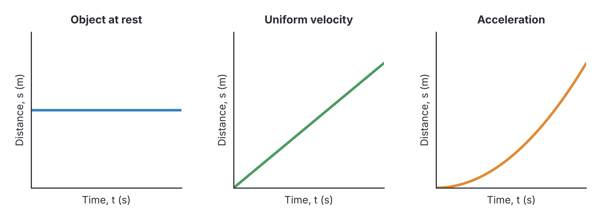
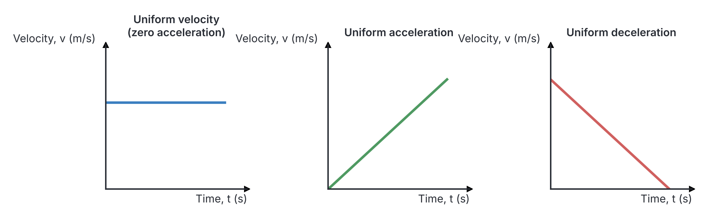
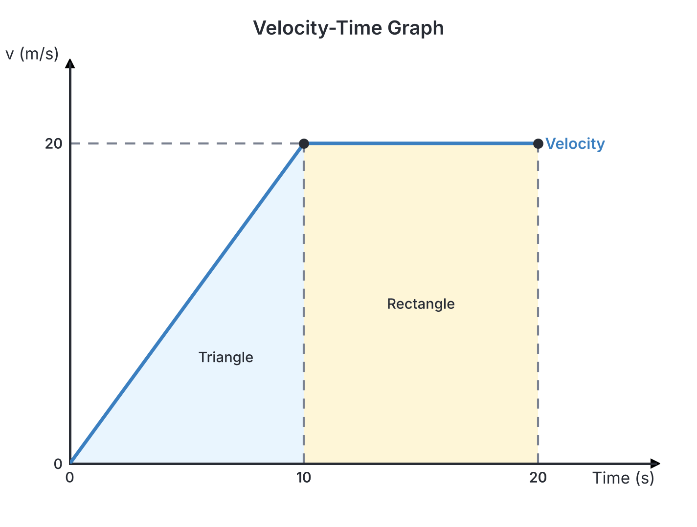
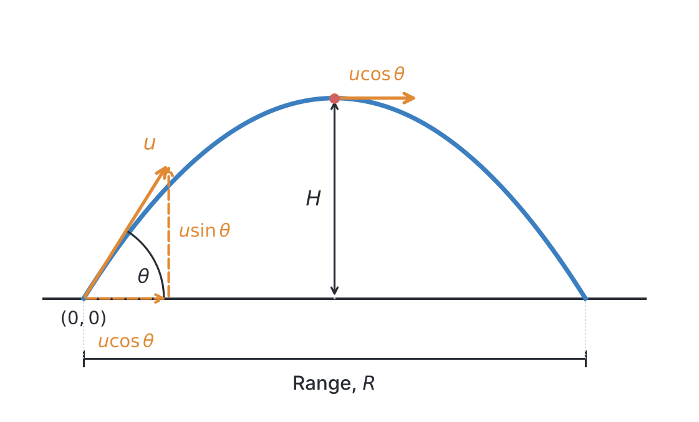
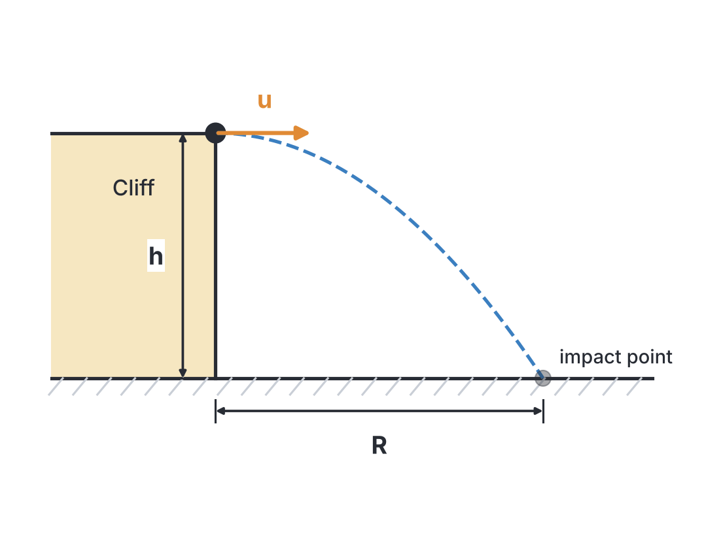

# JAMB Physics Notes: Linear and Projectile Motion

## What JAMB expects

This topic is part of Section A, Topic 3 of the JAMB Physics syllabus: Motion. It focuses specifically on linear kinematics and projectiles. It covers the following content items:

*   **f. Linear motion:**
    *   (i) speed, velocity and acceleration;
    *   (ii) equations of uniformly accelerated motion;
    *   (iii) motion under gravity;
    *   (iv) distance-time graph and velocity time graph;
    *   (v) instantaneous velocity and acceleration.
*   **g. Projectiles:**
    *   (i) calculation of range, maximum height and time of flight from the ground and a height;
    *   (ii) applications of projectile motion.

By the end of these notes, you should be able to:
*   ii. solve numerical problem on collinear motion;
*   vi. differentiate between speed, velocity and acceleration;
*   vii. deduce equations of uniformly accelerated motion;
*   viii. solve problems of motion under gravity;
*   ix. interpret distance-time graph and velocity-time graph;
*   x. compute instantaneous velocity and acceleration;
*   xi. establish expressions for the range, maximum height and time of flight of projectiles, rockets, missles;
*   xii. solve problems involving projectile motion.

**Note on the syllabus wording and split topic:** Motion is a vast topic in physics. JAMB groups many concepts under "Motion". To provide the necessary depth, this topic is split. Fundamentals and laws of motion are in `A3a-newtons-laws-and-types-of-motion.md`, while circular motion and simple harmonic motion are in `A3c-circular-motion-and-shm.md`. Additionally, objective xi contains a typo in the official syllabus ("missles" instead of "missiles"); we use the correct spelling in the text.

## Differentiating Between Speed, Velocity and Acceleration

**Objective vi: differentiate between speed, velocity and acceleration.**
**Content f(i): speed, velocity and acceleration.**

To understand motion, we must distinguish clearly between how far an object travels, how fast it travels, and how quickly its speed or direction changes. 

### Speed
**Speed** is the rate of change of distance with time. It tells us how fast an object is moving, but it does not tell us the direction. 
*   **Formula:** $\text{Speed} = \frac{\text{Distance}}{\text{Time}}$
*   **Unit:** Metres per second ($ \text{m s}^{-1} $)
*   **Type of quantity:** Scalar (magnitude only).
*   **Example:** A Danfo bus travelling at $ 80\ \text{km h}^{-1} $ on the Lagos-Ibadan expressway is displaying its speed. 

### Velocity
**Velocity** is the rate of change of displacement with time. It is speed in a specified direction. 
*   **Formula:** $v = \frac{s}{t}$ (where $s$ is displacement, $t$ is time)
*   **Unit:** Metres per second ($ \text{m s}^{-1} $)
*   **Type of quantity:** Vector (magnitude and direction).
*   **Example:** A bus travelling at $ 80\ \text{km h}^{-1} $ *due North* has a specified velocity. If the bus travels at constant speed on a curved road, its velocity is constantly changing because its direction is changing.

### Acceleration
**Acceleration** is the rate of change of velocity with time. An object accelerates if it speeds up, slows down, or changes direction. 
*   **Formula:** $a = \frac{v - u}{t}$ (where $v$ is final velocity, $u$ is initial velocity, $t$ is time)
*   **Unit:** Metres per second squared ($ \text{m s}^{-2} $)
*   **Type of quantity:** Vector.
*   **Deceleration (Retardation):** This is negative acceleration. It occurs when an object is slowing down (e.g., a car applying brakes).

### Comparison Table

| Feature | Speed | Velocity | Acceleration |
| --- | --- | --- | --- |
| **Definition** | Rate of change of distance | Rate of change of displacement | Rate of change of velocity |
| **Formula** | Distance / Time | Displacement / Time | Change in Velocity / Time |
| **Quantity type** | Scalar (no direction) | Vector (has direction) | Vector (has direction) |
| **SI Unit** | $ \text{m s}^{-1} $ | $ \text{m s}^{-1} $ | $ \text{m s}^{-2} $ |
| **Can it be negative?**| No (always positive) | Yes (negative implies opposite direction) | Yes (negative implies slowing down or reversing) |

## Computing Instantaneous Velocity and Acceleration

**Objective x: compute instantaneous velocity and acceleration.**
**Content f(v): instantaneous velocity and acceleration.**

In real life, velocity is rarely constant. A car driving through a busy Lagos market constantly stops and starts. 

*   **Average velocity** is the total displacement divided by the total time. 
*   **Instantaneous velocity** is the velocity of an object at one specific, exact moment in time (like what a car's speedometer reads right now). 
*   **Instantaneous acceleration** is the acceleration at one exact moment.

### The Calculus Approach
When JAMB asks you to compute instantaneous velocity or acceleration, they give you an equation where displacement ($s$) or velocity ($v$) is a polynomial function of time ($t$). You must use **differentiation** (calculus) to find the answer.

The core rules you need:
1.  **Velocity is the derivative of displacement:** $v = \frac{ds}{dt}$
2.  **Acceleration is the derivative of velocity:** $a = \frac{dv}{dt} = \frac{d^2s}{dt^2}$

**How to differentiate basic polynomials (Power Rule):**
If $y = A t^n$, then the derivative $\frac{dy}{dt} = n \times A t^{n-1}$.
*   The derivative of $t^3$ is $3t^2$.
*   The derivative of $4t^2$ is $2 \times 4t^{1} = 8t$.
*   The derivative of $5t$ is $5$.
*   The derivative of any constant number (like $10$) is $0$.

### Worked Examples

**Example 1: Finding instantaneous velocity**
The displacement of an object is given by the equation $s = 3t^2 - 2t + 5$ (where $s$ is in metres and $t$ is in seconds). Find its instantaneous velocity at $t = 2\ \text{s}$.

1.  **Write the equation:** $s = 3t^2 - 2t + 5$
2.  **Differentiate to find velocity ($v = \frac{ds}{dt}$):**
    *   Derivative of $3t^2 = 2 \times 3t^{2-1} = 6t$
    *   Derivative of $-2t = -2$
    *   Derivative of $5 = 0$
    *   Equation for velocity: $v = 6t - 2$
3.  **Substitute the time ($t = 2$):**
    *   $v = 6(2) - 2$
4.  **Calculate the answer:**
    *   $v = 12 - 2 = 10\ \text{m s}^{-1}$.

**Example 2: Finding instantaneous acceleration from velocity**
The velocity of a particle is given by $v = 4t^3 + 2t$. Calculate its acceleration at $t = 1\ \text{s}$.

1.  **Write the equation:** $v = 4t^3 + 2t$
2.  **Differentiate to find acceleration ($a = \frac{dv}{dt}$):**
    *   Derivative of $4t^3 = 3 \times 4t^{3-1} = 12t^2$
    *   Derivative of $2t = 2$
    *   Equation for acceleration: $a = 12t^2 + 2$
3.  **Substitute the time ($t = 1$):**
    *   $a = 12(1^2) + 2$
4.  **Calculate the answer:**
    *   $a = 12 + 2 = 14\ \text{m s}^{-2}$.

**Example 3: Finding velocity and acceleration from displacement**
The position of a moving body is given by $s = t^3 - 4t^2 + 10$. Find its velocity and acceleration at $t = 3\ \text{s}$.

1.  **Write the position equation:** $s = t^3 - 4t^2 + 10$
2.  **Find velocity ($v = \frac{ds}{dt}$):**
    *   $v = 3t^2 - 8t$
    *   At $t = 3$: $v = 3(3^2) - 8(3) = 3(9) - 24 = 27 - 24 = 3\ \text{m s}^{-1}$.
3.  **Find acceleration ($a = \frac{dv}{dt}$):**
    *   Differentiate the velocity equation: $a = \frac{d}{dt}(3t^2 - 8t) = 6t - 8$.
    *   At $t = 3$: $a = 6(3) - 8 = 18 - 8 = 10\ \text{m s}^{-2}$.

## Deducing Equations of Uniformly Accelerated Motion

**Objective vii: deduce equations of uniformly accelerated motion.**
**Content f(ii): equations of uniformly accelerated motion.**

When an object travels in a straight line with a **constant (uniform) acceleration**, its motion can be perfectly described by four standard equations, often called the kinematic equations of motion. 

The symbols used are:
*   $u = \text{initial velocity}\ (\text{m s}^{-1})$
*   $v = \text{final velocity}\ (\text{m s}^{-1})$
*   $a = \text{uniform acceleration}\ (\text{m s}^{-2})$
*   $t = \text{time taken}\ (\text{s})$
*   $s = \text{distance or displacement covered}\ (\text{m})$

### Algebraic Deduction of the Four Equations

**1. First Equation (Velocity-Time Relation)**
By definition, acceleration is the rate of change of velocity:
$$a = \frac{v - u}{t}$$
Multiply both sides by $t$:
$$at = v - u$$
Rearrange to make $v$ the subject:
$$v = u + at \quad \text{--- (Equation 1)}$$

**2. Second Equation (Displacement-Time Relation using average velocity)**
If acceleration is constant, the average velocity over time $t$ is exactly halfway between the initial and final velocity:
$$\text{Average velocity} = \frac{u + v}{2}$$
Since $\text{Displacement} = \text{Average velocity} \times \text{time}$:
$$s = \left( \frac{u + v}{2} \right) t \quad \text{--- (Equation 2)}$$

**3. Third Equation (Displacement-Time Relation without final velocity)**
Substitute Equation 1 ($v = u + at$) into Equation 2:
$$s = \left( \frac{u + (u + at)}{2} \right) t$$
$$s = \left( \frac{2u + at}{2} \right) t$$
Distribute the $t$ and divide by $2$:
$$s = ut + \frac{1}{2}at^2 \quad \text{--- (Equation 3)}$$

**4. Fourth Equation (Velocity-Displacement Relation without time)**
From Equation 1, make $t$ the subject: $t = \frac{v - u}{a}$.
Substitute this $t$ into Equation 2:
$$s = \left( \frac{v + u}{2} \right) \left( \frac{v - u}{a} \right)$$
Using the mathematical rule for the difference of two squares ($(x+y)(x-y) = x^2 - y^2$):
$$s = \frac{v^2 - u^2}{2a}$$
Multiply both sides by $2a$:
$$2as = v^2 - u^2$$
Rearrange to make $v^2$ the subject:
$$v^2 = u^2 + 2as \quad \text{--- (Equation 4)}$$

*(Note: These equations can also be deduced graphically by finding the slope and area of a velocity-time graph, which we will explore in the graphing section).*

## Solving Numerical Problems on Collinear Motion

**Objective ii: solve numerical problem on collinear motion.**

**Collinear motion** simply means motion along a single straight line. Because the motion is in 1D, we can treat vectors (velocity, displacement, acceleration) as positive or negative scalars. Usually, the forward direction is positive, and backward (or slowing down) is negative.

**Problem-solving strategy:**
1. Write down the values given in the question (e.g., $u, a, t$). If a body "starts from rest", $u = 0$. If it "comes to a halt", $v = 0$.
2. Identify the unknown variable you are asked to find.
3. Select the kinematic equation that contains the three knowns and the one unknown.
4. Substitute the values with their units in mind.

### Worked Examples

**Example 4: Finding final velocity**
A motorcyclist (okada rider) starts with an initial velocity of $15\ \text{m s}^{-1}$ and accelerates uniformly at $2\ \text{m s}^{-2}$ for $10\ \text{s}$. Calculate his final velocity.

1.  **Identify givens:** $u = 15\ \text{m s}^{-1}$, $a = 2\ \text{m s}^{-2}$, $t = 10\ \text{s}$.
2.  **Identify unknown:** $v = ?$
3.  **Choose equation:** $v = u + at$ (Equation 1).
4.  **Substitute:** $v = 15 + (2 \times 10)$.
5.  **Calculate:** $v = 15 + 20 = 35\ \text{m s}^{-1}$.

**Example 5: Finding displacement from rest**
A car starts from rest and accelerates uniformly at $4\ \text{m s}^{-2}$. Find the distance it covers in $5\ \text{s}$.

1.  **Identify givens:** $u = 0\ \text{m s}^{-1}$ (started from rest), $a = 4\ \text{m s}^{-2}$, $t = 5\ \text{s}$.
2.  **Identify unknown:** $s = ?$
3.  **Choose equation:** $s = ut + \frac{1}{2}at^2$ (Equation 3).
4.  **Substitute:** $s = (0 \times 5) + \frac{1}{2}(4)(5^2)$.
5.  **Calculate:** $s = 0 + \frac{1}{2}(4)(25) = 2 \times 25 = 50.0\ \text{m}$.

**Example 6: Finding displacement without time**
A train increases its velocity from $10\ \text{m s}^{-1}$ to $30\ \text{m s}^{-1}$ with a uniform acceleration of $2\ \text{m s}^{-2}$. Calculate the distance covered during this acceleration.

1.  **Identify givens:** $u = 10\ \text{m s}^{-1}$, $v = 30\ \text{m s}^{-1}$, $a = 2\ \text{m s}^{-2}$.
2.  **Identify unknown:** $s = ?$ (Note: time $t$ is not given).
3.  **Choose equation:** $v^2 = u^2 + 2as$ (Equation 4).
4.  **Substitute:** $30^2 = 10^2 + 2(2)s$.
5.  **Calculate:** 
    *   $900 = 100 + 4s$
    *   $4s = 900 - 100 = 800$
    *   $s = \frac{800}{4} = 200.0\ \text{m}$.

## Solving Problems of Motion Under Gravity

**Objective viii: solve problems of motion under gravity.**
**Content f(iii): motion under gravity.**

When an object falls freely near the surface of the Earth, the only force acting on it is the Earth's gravitational pull (ignoring air resistance). This causes a constant acceleration called the **acceleration due to gravity ($g$)**. 
*   In reality, $g \approx 9.8\ \text{m s}^{-2}$.
*   **JAMB standard:** Unless stated otherwise, JAMB questions expect you to use **$g = 10\ \text{m s}^{-2}$** to make calculations easier without a calculator.

Because it is a form of uniformly accelerated motion, we use the same four kinematic equations, simply replacing $a$ with $g$, and $s$ (distance) with $h$ (height).

### Sign Convention (Crucial for JAMB)
Gravity always pulls downwards. Therefore:
*   **When dropping an object downwards:** The object is speeding up in the direction of gravity. We use **positive $g$** ($+10\ \text{m s}^{-2}$). Initial velocity $u = 0$.
*   **When throwing an object vertically upwards:** The object is moving against gravity and slowing down (decelerating). We use **negative $g$** ($-10\ \text{m s}^{-2}$). At maximum height, its final velocity $v = 0$.

### Worked Examples

**Example 7: Object dropped from a height**
A mango falls from a tree branch and takes $4\ \text{s}$ to hit the ground. Calculate the height of the branch and the velocity just before it hits the ground. ($g = 10\ \text{m s}^{-2}$)

1.  **Identify givens:** $u = 0\ \text{m s}^{-1}$ (dropped), $t = 4\ \text{s}$, $a = 10\ \text{m s}^{-2}$ (moving down, so positive).
2.  **Find height ($h$):** Use $h = ut + \frac{1}{2}gt^2$.
    *   $h = (0 \times 4) + \frac{1}{2}(10)(4^2)$
    *   $h = 0 + 5(16) = 80.0\ \text{m}$.
3.  **Find final velocity ($v$):** Use $v = u + gt$.
    *   $v = 0 + (10 \times 4) = 40\ \text{m s}^{-1}$.

**Example 8: Object thrown vertically upwards**
A stone is thrown vertically upwards with an initial velocity of $40\ \text{m s}^{-1}$. Calculate the time taken to reach its maximum height, and the maximum height reached. ($g = 10\ \text{m s}^{-2}$)

1.  **Identify givens:** $u = 40\ \text{m s}^{-1}$, $v = 0\ \text{m s}^{-1}$ (it stops momentarily at the peak), $a = -10\ \text{m s}^{-2}$ (moving up against gravity).
2.  **Find time to max height ($t_{\text{max}}$):** Use $v = u - gt$.
    *   $0 = 40 - 10t$
    *   $10t = 40 \implies t = \frac{40}{10} = 4.0\ \text{s}$.
3.  **Find max height ($h_{\text{max}}$):** Use $v^2 = u^2 - 2gh$.
    *   $0^2 = 40^2 - 2(10)h$
    *   $0 = 1600 - 20h$
    *   $20h = 1600 \implies h = \frac{1600}{20} = 80.0\ \text{m}$.

**Example 9: Total time of flight**
A ball is thrown vertically upwards with a speed of $25\ \text{m s}^{-1}$. What is the total time it takes to return to the thrower's hand? ($g = 10\ \text{m s}^{-2}$)

1.  **Concept:** Time to go up equals time to come down (in a vacuum). Total time $T = 2 \times t_{\text{up}}$.
2.  **Find time to max height ($t$):** $v = u - gt \implies 0 = 25 - 10t \implies 10t = 25 \implies t = 2.5\ \text{s}$.
3.  **Calculate total time:** $T = 2 \times 2.5 = 5.0\ \text{s}$.

## Interpreting Distance-Time and Velocity-Time Graphs

**Objective ix: interpret distance-time graph and velocity-time graph.**
**Content f(iv): distance-time graph and velocity-time graph.**

Graphs are a visual way to describe motion. JAMB frequently tests your ability to calculate slope (gradient) and area from these graphs.

### Distance-Time (or Displacement-Time) Graphs
*   **Y-axis:** Distance or Displacement ($s$)
*   **X-axis:** Time ($t$)
*   **The Slope (Gradient):** Represents **Velocity** (or speed). $\text{Slope} = \frac{\Delta s}{\Delta t} = v$.
*   **Horizontal line:** The object is stationary (at rest). Velocity is zero.
*   **Straight diagonal line:** The object is moving with a constant (uniform) velocity.
*   **Curved line:** The velocity is changing (the object is accelerating).

### Velocity-Time Graphs
*   **Y-axis:** Velocity ($v$)
*   **X-axis:** Time ($t$)
*   **The Slope (Gradient):** Represents **Acceleration**. $\text{Slope} = \frac{\Delta v}{\Delta t} = a$.
*   **The Area Under the Graph:** Represents **Total Distance** or Displacement covered.
*   **Horizontal line:** The object is moving at a constant (uniform) velocity. Acceleration is zero.
*   **Straight diagonal line sloping up:** Constant (uniform) acceleration.
*   **Straight diagonal line sloping down:** Constant deceleration (retardation).

### Worked Example on Graphs
Look at the hypothetical velocity-time graph described below to calculate values:
A car accelerates uniformly from rest to $20\ \text{m s}^{-1}$ in $10\ \text{s}$. It then maintains this constant velocity of $20\ \text{m s}^{-1}$ for another $10\ \text{s}$.

1.  **Calculate the acceleration during the first 10s:**
    *   $\text{Acceleration} = \text{Slope} = \frac{\text{Change in velocity}}{\text{Time taken}}$
    *   $a = \frac{20 - 0}{10 - 0} = \frac{20}{10} = 2\ \text{m s}^{-2}$.
2.  **Calculate the total distance covered in the 20s:**
    *   $\text{Total distance} = \text{Area under the graph}$. The shape is a trapezium, or we can split it into a triangle and a rectangle.
    *   $\text{Area of Triangle (0 to 10s)} = \frac{1}{2} \times \text{base} \times \text{height} = \frac{1}{2} \times 10 \times 20 = 100\ \text{m}$.
    *   $\text{Area of Rectangle (10 to 20s)} = \text{length} \times \text{breadth} = (20 - 10) \times 20 = 10 \times 20 = 200\ \text{m}$.
    *   $\text{Total distance} = 100 + 200 = 300\ \text{m}$.

## Expressions for Projectiles, Rockets and Missiles

**Objective xi: establish expressions for the range, maximum height and time of flight of projectiles, rockets, missles.**
*(Note: "missles" is spelled exactly as in the JAMB syllabus, but we will use "missiles" going forward).*

A **projectile** is any object thrown into space upon which the only acting force is gravity. Examples include a kicked football, a stone thrown from a cliff, or an unpowered rocket/missile in its free-flight phase. 

The path of a projectile is called its **trajectory**, and it takes the shape of a **parabola**. 

Projectile motion is essentially **two independent motions occurring at the same time**:
1.  **Horizontal motion:** Uniform velocity (no acceleration, $a_x = 0$) because gravity does not pull sideways.
2.  **Vertical motion:** Uniformly accelerated motion under gravity ($a_y = -g$).

If a projectile is launched from the ground with an initial velocity $u$ at an angle $\theta$ to the horizontal, we must resolve (split) the velocity into two components:
*   Horizontal initial velocity: $u_x = u \cos \theta$
*   Vertical initial velocity: $u_y = u \sin \theta$

### Establishing the Expressions

**1. Time to reach Maximum Height ($t$)**
At the maximum height, the vertical velocity becomes zero ($v_y = 0$).
Using $v_y = u_y - gt$:
$$0 = u \sin \theta - gt$$
$$gt = u \sin \theta$$
$$t = \frac{u \sin \theta}{g}$$

**2. Total Time of Flight ($T$)**
The total time spent in the air is twice the time taken to reach the maximum height (assuming it lands on the same horizontal plane).
$$T = 2t = \frac{2u \sin \theta}{g}$$

**3. Maximum Height ($H$)**
This is the highest vertical distance reached. Using $v_y^2 = u_y^2 - 2gH$:
At maximum height, $v_y = 0$.
$$0 = (u \sin \theta)^2 - 2gH$$
$$2gH = u^2 \sin^2 \theta$$
$$H = \frac{u^2 \sin^2 \theta}{2g}$$

**4. Horizontal Range ($R$)**
The Range is the total horizontal distance covered. Since horizontal velocity is constant ($u_x = u \cos \theta$) and distance = speed $\times$ time:
$$R = u_x \times T$$
$$R = (u \cos \theta) \times \left( \frac{2u \sin \theta}{g} \right)$$
$$R = \frac{u^2 (2 \sin \theta \cos \theta)}{g}$$
From trigonometry, $2 \sin \theta \cos \theta = \sin 2\theta$. Therefore:
$$R = \frac{u^2 \sin 2\theta}{g}$$

**Condition for Maximum Range:**
To get the maximum possible distance for a given launch speed, $\sin 2\theta$ must be exactly $1$ (its maximum value). 
If $\sin 2\theta = 1$, then $2\theta = 90^\circ$, which means **$\theta = 45^\circ$**. 
Therefore, maximum range ($R_{\text{max}}$) is achieved when an object is launched at $45^\circ$, giving the formula:
$$R_{\text{max}} = \frac{u^2}{g}$$

**Application to Rockets and Missiles:**
When a military missile or a space rocket finishes burning its fuel, the engines cut off. From that point on, it is in "free flight" and behaves exactly like a projectile. By determining the velocity ($u$) and angle ($\theta$) at the exact moment of engine cutoff, military engineers use the formulas for $R$ and $H$ to predict exactly where the missile will land.

## Solving Problems Involving Projectile Motion

**Objective xii: solve problems involving projectile motion.**
**Content g(i): calculation of range, maximum height and time of flight from the ground and a height.**

### Case A: Projection from the Ground
Here, we apply the established formulas directly.

**Example 10: Standard ground projection**
A projectile is fired with an initial velocity of $50\ \text{m s}^{-1}$ at an angle of $30^\circ$ to the horizontal. Calculate the time of flight, the maximum height, and the range. ($g = 10\ \text{m s}^{-2}$)

1.  **Identify givens:** $u = 50\ \text{m s}^{-1}$, $\theta = 30^\circ$, $g = 10\ \text{m s}^{-2}$. Note that $\sin 30^\circ = 0.5$.
2.  **Calculate Time of flight ($T$):**
    *   $T = \frac{2u \sin \theta}{g} = \frac{2(50) \sin 30^\circ}{10}$
    *   $T = \frac{100(0.5)}{10} = \frac{50}{10} = 5\ \text{s}$.
3.  **Calculate Maximum height ($H$):**
    *   $H = \frac{u^2 \sin^2 \theta}{2g} = \frac{50^2 (\sin 30^\circ)^2}{2(10)}$
    *   $H = \frac{2500(0.5)^2}{20} = \frac{2500(0.25)}{20} = \frac{625}{20} = 31.25\ \text{m}$.
4.  **Calculate Range ($R$):**
    *   $R = \frac{u^2 \sin 2\theta}{g} = \frac{50^2 \sin(2 \times 30^\circ)}{10} = \frac{2500 \sin 60^\circ}{10}$
    *   Since $\sin 60^\circ = \frac{\sqrt{3}}{2}$:
    *   $R = 250 \times \frac{\sqrt{3}}{2} = 125\sqrt{3}\ \text{m}$ (or approx. $216.5\ \text{m}$).

**Example 11: Maximum Range**
A golf ball is struck such that it achieves its maximum possible range for an initial speed of $40\ \text{m s}^{-1}$. Calculate this range. ($g = 10\ \text{m s}^{-2}$)

1.  **Identify givens:** $u = 40\ \text{m s}^{-1}$. For max range, $\theta = 45^\circ$.
2.  **Use formula:** $R_{\text{max}} = \frac{u^2}{g}$
3.  **Calculate:** $R_{\text{max}} = \frac{40^2}{10} = \frac{1600}{10} = 160.0\ \text{m}$.

### Case B: Horizontal Projection from a Height
Sometimes a body is projected perfectly horizontally from a cliff, a roof, or a moving airplane. 
In this case:
*   Initial angle $\theta = 0^\circ$.
*   Initial horizontal velocity $u_x = u$.
*   Initial vertical velocity $u_y = 0$ (it is not thrown upwards or downwards, just forwards).
*   The time it takes to hit the ground depends *only* on the vertical drop.

Using vertical motion equation $h = u_y t + \frac{1}{2}gt^2$:
$$h = 0 + \frac{1}{2}gt^2 \implies t = \sqrt{\frac{2h}{g}}$$
The horizontal range (distance from the base of the cliff) is:
$$R = u_x \times t = u \sqrt{\frac{2h}{g}}$$

**Example 12: Projecting from a height**
A stone is thrown horizontally with a velocity of $20\ \text{m s}^{-1}$ from the top of a tower $45\ \text{m}$ high. Calculate the time it takes to reach the ground and the horizontal distance from the base of the tower. ($g = 10\ \text{m s}^{-2}$)

1.  **Identify givens:** $u_x = 20\ \text{m s}^{-1}$, $h = 45\ \text{m}$, $g = 10\ \text{m s}^{-2}$.
2.  **Calculate Time to reach ground ($t$):**
    *   $t = \sqrt{\frac{2h}{g}} = \sqrt{\frac{2(45)}{10}} = \sqrt{\frac{90}{10}}$
    *   $t = \sqrt{9} = 3.0\ \text{s}$.
3.  **Calculate Range ($R$):**
    *   $R = u_x \times t = 20 \times 3.0 = 60.0\ \text{m}$.

*(Note: To find the final resultant velocity when it hits the ground, you would use Pythagoras' theorem on the final horizontal velocity ($v_x = 20$) and final vertical velocity ($v_y = gt = 10 \times 3 = 30$). $v = \sqrt{20^2 + 30^2} = \sqrt{1300} = 10\sqrt{13}\ \text{m s}^{-1}$.)*

## Applications of Projectile Motion

**Content g(ii): applications of projectile motion.**

Projectile physics is not just abstract mathematics; it governs many real-world activities:
1.  **Sports:** A footballer taking a free-kick, a javelin thrower, or a basketball player shooting a hoop must instinctively adjust the initial velocity and launch angle ($\theta$) to achieve the required range and height. To throw a javelin the furthest, the athlete aims close to $45^\circ$.
2.  **Military and Artillery:** The trajectories of artillery shells, unguided rockets, and ballistic missiles are calculated using projectile equations to ensure they hit specific target coordinates.
3.  **Aviation Drop Supplies:** When an airplane drops food relief supplies or a bomb, the package acts as a projectile launched horizontally from a height. The pilot must release it well *before* flying directly over the target, because the package continues to move forward horizontally at the plane's speed while falling.
4.  **Water Fountains:** The water jets in decorative fountains are streams of liquid projectiles tracing perfect parabolic paths. 

## Key terms

| Term | Meaning |
| --- | --- |
| **Speed** | The rate of change of distance with time (scalar quantity). |
| **Velocity** | The rate of change of displacement with time (vector quantity). |
| **Acceleration** | The rate of change of velocity with time (vector quantity). |
| **Uniform acceleration** | When velocity changes by equal amounts in equal time intervals. |
| **Collinear motion** | Motion strictly along a single straight line. |
| **Instantaneous velocity** | The exact velocity of an object at one specific moment in time (found via calculus as $ds/dt$). |
| **Acceleration due to gravity ($g$)** | The constant uniform acceleration of a body falling freely under Earth's gravity (approx $10\ \text{m s}^{-2}$). |
| **Projectile** | An object thrown into space subject only to the force of gravity. |
| **Trajectory** | The curved, parabolic path followed by a projectile. |
| **Time of flight ($T$)** | The total time a projectile spends in the air. |
| **Range ($R$)** | The total horizontal distance covered by a projectile. |

## Exam tips and common mistakes

*   **Check the units!** If a question gives velocity in $\text{km h}^{-1}$, you MUST convert it to $\text{m s}^{-1}$ before applying kinematics formulas (multiply by $\frac{5}{18}$ or $\frac{1000}{3600}$).
*   **The Zero Trap:** Remember that "starts from rest" means $u = 0$, and "brakes to a halt" or "at maximum height" means $v = 0$.
*   **Sign Errors under Gravity:** When an object is thrown *upwards*, it is decelerating. You must use $a = -g$ (or $-10$). If you use positive $g$, your time and height calculations will be wildly incorrect.
*   **Calculus check:** Differentiating a constant (a plain number with no $t$) gives zero. e.g., if $s = 4t + 7$, then $v = 4$, not $4t + 7$.
*   **Don't confuse Maximum Height with Range formulas:** Range has $\sin 2\theta$ and divides by $g$. Max height has $\sin^2 \theta$ and divides by $2g$. Memorise the difference!
*   **Projectile from a height:** When dropping or throwing an object horizontally from a cliff, horizontal velocity ($u_x$) does *not* affect the time it takes to hit the ground. A bullet fired perfectly horizontally and a bullet dropped from the same height hit the ground at exactly the same time.

## Quick summary

1.  Speed is a scalar indicating how fast an object moves, whereas velocity is a vector including direction. Acceleration is the rate of change of velocity.
2.  Instantaneous velocity is the derivative of displacement with respect to time ($v = ds/dt$), and instantaneous acceleration is the derivative of velocity ($a = dv/dt$).
3.  The four equations of uniformly accelerated collinear motion are: $v = u + at$, $s = (\frac{u+v}{2})t$, $s = ut + \frac{1}{2}at^2$, and $v^2 = u^2 + 2as$.
4.  Motion under gravity uses the same kinematic equations, replacing acceleration $a$ with $g$ ($10\ \text{m s}^{-2}$ downward, or $-10\ \text{m s}^{-2}$ when moving upward).
5.  On a distance-time graph, the slope equals velocity. On a velocity-time graph, the slope equals acceleration and the area under the curve equals distance.
6.  A projectile follows a parabolic trajectory because it has constant horizontal velocity but uniformly accelerated vertical motion due to gravity.
7.  For projectiles launched at an angle $\theta$, Time of flight $T = \frac{2u \sin \theta}{g}$, Max height $H = \frac{u^2 \sin^2 \theta}{2g}$, and Range $R = \frac{u^2 \sin 2\theta}{g}$. Maximum range occurs at $45^\circ$.
8.  For projectiles launched horizontally from a height $h$, time to fall is $t = \sqrt{\frac{2h}{g}}$ and Range $R = u \sqrt{\frac{2h}{g}}$.

## Practice questions

**1. A car accelerates uniformly from $10\ \text{m s}^{-1}$ to $30\ \text{m s}^{-1}$ over a distance of $200\ \text{m}$. What is the acceleration of the car?**

- A. $0.05\ \text{m s}^{-2}$
- B. $0.1\ \text{m s}^{-2}$
- C. $2.0\ \text{m s}^{-2}$
- D. $2.5\ \text{m s}^{-2}$

**Answer: C.** Using $v^2 = u^2 + 2as$. $30^2 = 10^2 + 2(a)(200) \implies 900 = 100 + 400a \implies 800 = 400a \implies a = 2.0\ \text{m s}^{-2}$. Option B is a mistake where the student might have erroneously divided the change in velocity by distance as if it were time ($20/200 = 0.1$).

**2. A stone is dropped from the top of an $80\ \text{m}$ high building. How long does it take to hit the ground? (Assume $g = 10\ \text{m s}^{-2}$ and ignore air resistance)**

- A. $2.0\ \text{s}$
- B. $4.0\ \text{s}$
- C. $8.0\ \text{s}$
- D. $16.0\ \text{s}$

**Answer: B.** Since it is dropped, $u=0$. $s = \frac{1}{2}gt^2 \implies 80 = \frac{1}{2}(10)t^2 \implies 80 = 5t^2 \implies t^2 = 16 \implies t = \sqrt{16} = 4.0\ \text{s}$. Option D is the mistake of forgetting to take the square root of $16$.

**3. The displacement $s$ (in metres) of a particle after time $t$ (in seconds) is given by $s = 5t^3 - 4t$. Calculate its instantaneous velocity at $t = 2\ \text{s}$.**

- A. $16\ \text{m s}^{-1}$
- B. $32\ \text{m s}^{-1}$
- C. $56\ \text{m s}^{-1}$
- D. $60\ \text{m s}^{-1}$

**Answer: C.** Differentiate $s$ to get $v$. $v = \frac{ds}{dt} = 15t^2 - 4$. At $t = 2$, $v = 15(2^2) - 4 = 15(4) - 4 = 60 - 4 = 56\ \text{m s}^{-1}$. Option B is the mistake of substituting $t=2$ directly into the displacement equation instead of differentiating ($5(8) - 4(2) = 32$).

**4. A projectile is fired from the ground with an initial speed of $100\ \text{m s}^{-1}$ at an angle of $30^\circ$ to the horizontal. Calculate its maximum height. ($g = 10\ \text{m s}^{-2}$)**

- A. $1.25\ \text{m}$
- B. $125\ \text{m}$
- C. $250\ \text{m}$
- D. $500\ \text{m}$

**Answer: B.** $H = \frac{u^2 \sin^2 \theta}{2g} = \frac{100^2 (\sin 30^\circ)^2}{2(10)} = \frac{10000(0.5)^2}{20} = \frac{10000(0.25)}{20} = \frac{2500}{20} = 125\ \text{m}$. Option C is the mistake of forgetting to divide by $2g$ (using $g$ instead, resulting in $250$).

**5. A ball is thrown horizontally from the roof of a $20\ \text{m}$ tall building with a velocity of $15\ \text{m s}^{-1}$. What is the horizontal range? ($g = 10\ \text{m s}^{-2}$)**

- A. $20.0\ \text{m}$
- B. $21.0\ \text{m}$
- C. $22.5\ \text{m}$
- D. $30.0\ \text{m}$

**Answer: D.** First find time to fall: $t = \sqrt{\frac{2h}{g}} = \sqrt{\frac{2(20)}{10}} = \sqrt{4} = 2\ \text{s}$. Range $R = u_x \times t = 15 \times 2 = 30\ \text{m}$. Option C is the mistake of using the max range formula for ground launch ($u^2/g = 225/10 = 22.5$).

**6. The velocity-time graph of a car shows a straight diagonal line from $(0\ \text{s}, 0\ \text{m s}^{-1})$ to $(10\ \text{s}, 20\ \text{m s}^{-1})$, followed by a horizontal line from $10\ \text{s}$ to $20\ \text{s}$. What is the total distance covered in the $20\ \text{s}$?**

- A. $100\ \text{m}$
- B. $200\ \text{m}$
- C. $300\ \text{m}$
- D. $400\ \text{m}$

**Answer: C.** Area under V-T graph = distance. Area of triangle (0 to 10s) $= \frac{1}{2} \times 10 \times 20 = 100\ \text{m}$. Area of rectangle (10 to 20s) $= 10 \times 20 = 200\ \text{m}$. Total = $300\ \text{m}$. Option D is the mistake of treating the whole graph as a rectangle ($20 \times 20 = 400$).

**7. A velocity-time graph shows an object's velocity increasing uniformly from $5\ \text{m s}^{-1}$ to $25\ \text{m s}^{-1}$ over a period of $4\ \text{s}$. What is the acceleration of the object?**

- A. $0.2\ \text{m s}^{-2}$
- B. $5.0\ \text{m s}^{-2}$
- C. $6.25\ \text{m s}^{-2}$
- D. $7.5\ \text{m s}^{-2}$

**Answer: B.** Acceleration is the slope of the V-T graph: $a = \frac{v - u}{t} = \frac{25 - 5}{4} = \frac{20}{4} = 5.0\ \text{m s}^{-2}$. Option C is the mistake of just dividing final velocity by time ($25/4 = 6.25$).

**8. A missile is launched with an initial velocity of $50\ \text{m s}^{-1}$ at an angle of $60^\circ$ to the horizontal. Calculate the total time of flight. ($g = 10\ \text{m s}^{-2}$)**

- A. $2.5\sqrt{3}\ \text{s}$
- B. $5.0\ \text{s}$
- C. $5\sqrt{3}\ \text{s}$
- D. $10.0\ \text{s}$

**Answer: C.** $T = \frac{2u \sin \theta}{g} = \frac{2(50) \sin 60^\circ}{10} = \frac{100(\frac{\sqrt{3}}{2})}{10} = \frac{50\sqrt{3}}{10} = 5\sqrt{3}\ \text{s}$. Option A is the mistake of calculating time to maximum height ($u \sin \theta / g$) instead of total flight time.

**9. A train travelling at $40\ \text{m s}^{-1}$ applies its brakes and comes to a uniform stop in $8\ \text{s}$. What distance does it cover before stopping?**

- A. $5\ \text{m}$
- B. $80\ \text{m}$
- C. $160\ \text{m}$
- D. $320\ \text{m}$

**Answer: C.** Using $s = (\frac{u+v}{2})t$, we get $s = (\frac{40+0}{2}) \times 8 = 20 \times 8 = 160\ \text{m}$. Alternatively, $a = \frac{0-40}{8} = -5\ \text{m s}^{-2}$, then $s = 40(8) + \frac{1}{2}(-5)(64) = 320 - 160 = 160\ \text{m}$. Option D is the mistake of using distance = speed $\times$ time without accounting for deceleration ($40 \times 8 = 320$).

**10. A stone is projected at an angle of $15^\circ$ to the horizontal with a velocity of $20\ \text{m s}^{-1}$. Calculate the range of the stone. ($g = 10\ \text{m s}^{-2}$)**

- A. $2.7\ \text{m}$
- B. $10.0\ \text{m}$
- C. $10.4\ \text{m}$
- D. $20.0\ \text{m}$

**Answer: D.** $R = \frac{u^2 \sin 2\theta}{g} = \frac{20^2 \sin(2 \times 15^\circ)}{10} = \frac{400 \sin 30^\circ}{10} = \frac{400(0.5)}{10} = \frac{200}{10} = 20.0\ \text{m}$. Option C ($10.4\ \text{m}$) is the mistake of using $\sin \theta$ instead of $\sin 2\theta$ ($40 \times 0.2588$).
