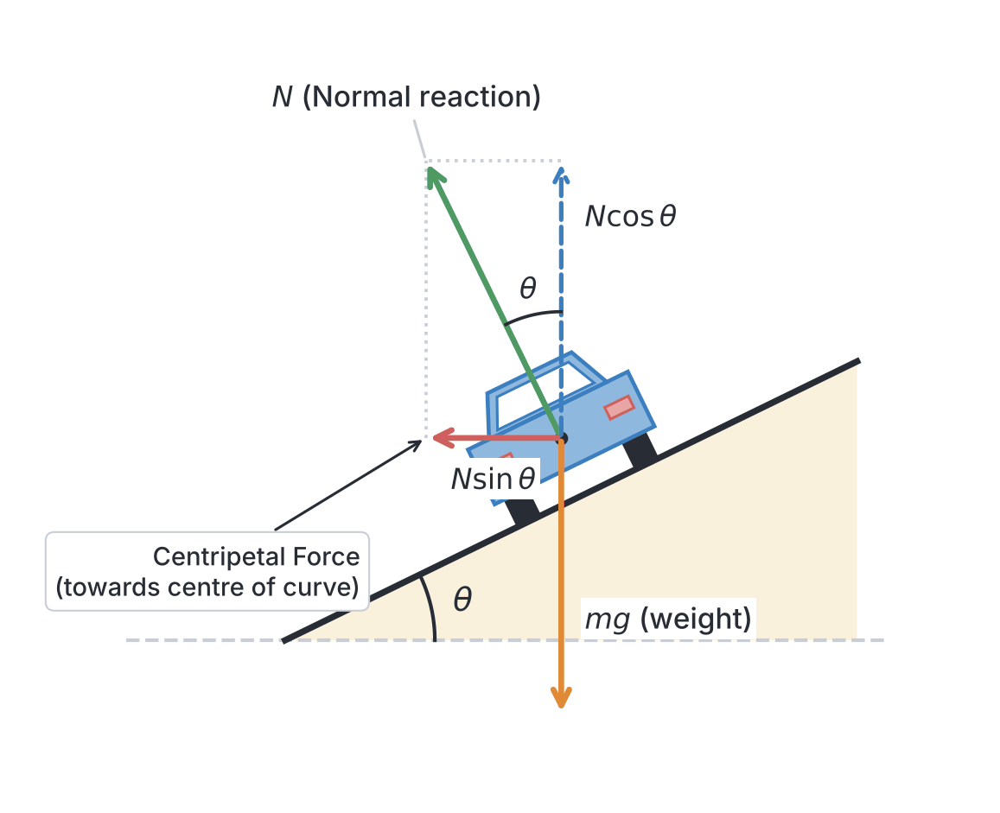
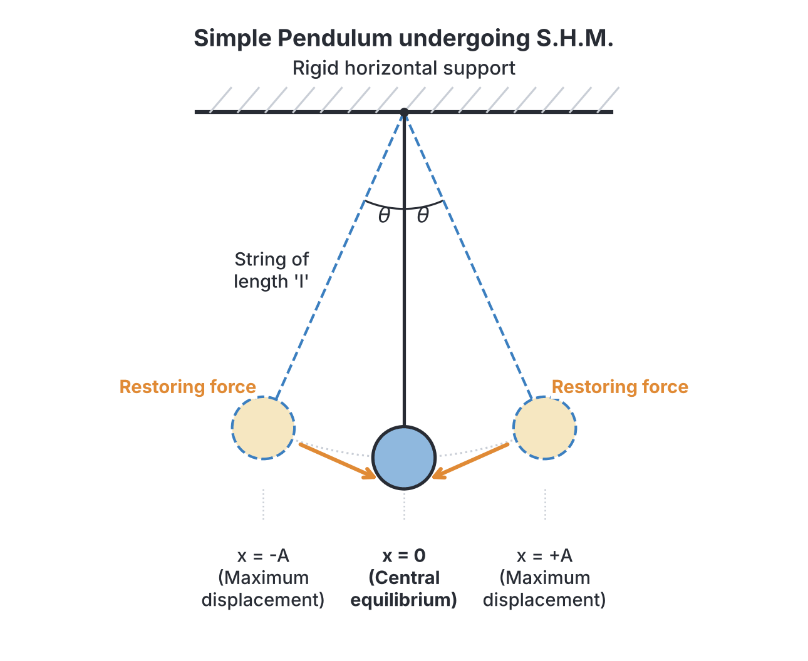
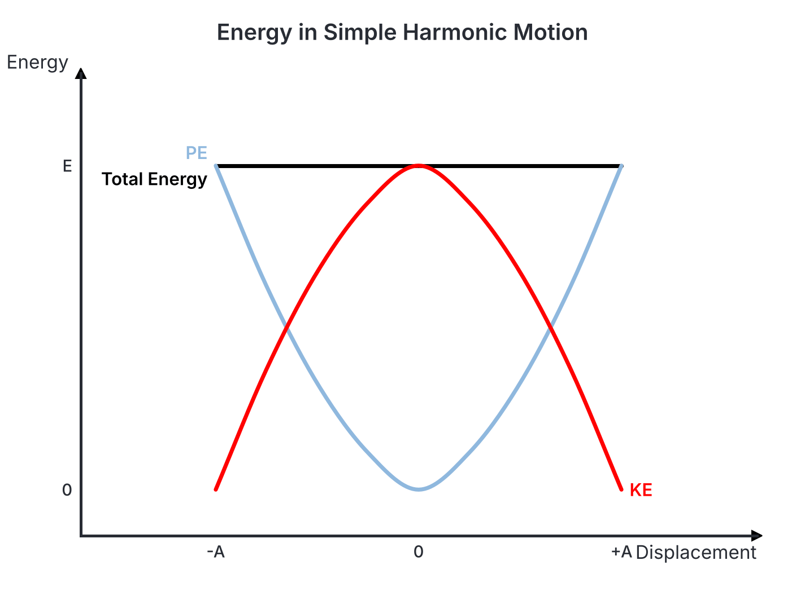

# JAMB Physics Notes: Circular Motion and Simple Harmonic Motion

## What JAMB expects

This topic is part of Section A (Motion) of the JAMB Physics syllabus. Because "Motion" is a massive topic that covers everything from basic kinematics to advanced mechanics, it has been split across several files. These notes focus purely on objects moving in circles and systems that oscillate back and forth. 

This file covers the following content items:
* **(h) Motion in a circle:** angular velocity and angular acceleration, centripetal and centrifugal forces, and applications.
* **(i) Simple Harmonic Motion (S.H.M):** definition, examples, period, frequency, amplitude, velocity, acceleration, energy changes, forced vibration, and resonance.

By the end of these notes, you should be able to:
1. Establish expression for angular velocity, angular acceleration and centripetal force. (Objective xix)
2. Solve numerical problems involving motion in a circle. (Objective xx)
3. Establish the relationship between period and frequency. (Objective xxi)
4. Analyse the energy changes occurring during S.H.M. (Objective xxii)
5. Identify different types of forced vibration. (Objective xxiii)
6. Enumerate applications of resonance. (Objective xxiv)

**Note on the syllabus wording:** The JAMB syllabus contains a small typo in the S.H.M section, spelling it "force vibration". The correct physics term is **forced vibration**, which is what you will see throughout these notes. Additionally, the syllabus numbering in Section 3(i) Simple Harmonic Motion restarts from (i) and (ii) for energy changes and forced vibration; we follow the logical progression. For foundational motion types, Newton's Laws, and linear kinematics, please refer to `A3a-newtons-laws-and-types-of-motion.md` and `A3b-linear-and-projectile-motion.md`.

## Motion in a Circle (Content h)

When an object moves along a circular path, it is undergoing **circular motion**. Examples include a car turning a corner, a stone tied to a string being whirled around, the Moon orbiting the Earth, or the spinning blades of a generator. Even if the object is moving at a steady, constant speed, its **velocity is constantly changing**. Why? Because velocity is a vector quantity (it has both magnitude and direction). As the object moves around the circle, its direction of motion is constantly changing at every point. Since velocity changes, the object is continuously **accelerating**.

### Key Concepts and Linear Equivalents
In linear motion, we talk about distance ($s$), linear velocity ($v$), and linear acceleration ($a$). In circular motion, we use angular equivalents to describe the motion more naturally:
* **Angular displacement ($\theta$):** The angle swept out by an object moving in a circle. It is typically measured in radians ($\text{rad}$). One complete circle (revolution) is $360^\circ$ or $2\pi\ \text{rad}$.
* **Radius ($r$):** The constant distance from the centre of the circular path to the object.
* **Relationship:** The linear distance or arc length ($s$) travelled along the edge of the circle is related to the angular displacement by the formula:
  $$s = r\theta$$
  *(where $s$ is the arc length in meters, $r$ is the radius in meters, and $\theta$ is the angle in radians).*

## Angular Velocity, Angular Acceleration and Centripetal Force

**Objective xix: establish expression for angular velocity, angular acceleration and centripetal force.**

### 1. Angular Velocity ($\omega$)
**Angular velocity** is defined as the time rate of change of angular displacement. In simple terms, it tells us how fast an object is sweeping through angles (e.g., how many radians it turns through every second).
* **Symbol:** $\omega$ (the lowercase Greek letter omega)
* **Formula:** 
  $$\omega = \frac{\theta}{t}$$
* **Unit:** Radians per second ($\text{rad s}^{-1}$)

**Relationship to Linear Velocity ($v$):**
If a particle moves from one point to another along the circle in time $t$, its linear speed is $v = \frac{s}{t}$.
From our angular displacement formula, we know $s = r\theta$. Substituting this into the speed formula gives:
$$v = \frac{r\theta}{t}$$
Since $\omega = \frac{\theta}{t}$, we can replace it to get the very important fundamental relationship:
$$v = \omega r$$
*(where $v$ is linear velocity in $\text{m s}^{-1}$, $\omega$ is angular velocity in $\text{rad s}^{-1}$, and $r$ is the radius in meters).*

### 2. Angular Acceleration ($\alpha$)
**Angular acceleration** is the time rate of change of angular velocity. If a ceiling fan is switched on, its spinning gets faster and faster—it is undergoing angular acceleration.
* **Symbol:** $\alpha$ (the Greek letter alpha)
* **Formula:** 
  $$\alpha = \frac{\Delta \omega}{\Delta t} = \frac{\omega_2 - \omega_1}{t}$$
* **Unit:** Radians per second squared ($\text{rad s}^{-2}$)

Just as linear velocity and angular velocity are connected by $v = \omega r$, linear acceleration (along the tangent) is connected to angular acceleration by $a_t = \alpha r$.

### 3. Centripetal Acceleration ($a_c$)
Because the direction of the velocity vector is constantly changing towards the centre, there is a continuous acceleration directed towards the centre of the circle. This is called **centripetal acceleration** (from the Latin for "centre-seeking").
* **Formula:** 
  $$a_c = \frac{v^2}{r}$$

We can also express this in terms of angular velocity. Since we know that $v = \omega r$, we can substitute $v$ into the formula:
$$a_c = \frac{(\omega r)^2}{r} = \frac{\omega^2 r^2}{r} = \omega^2 r$$
Both forms ($a_c = \frac{v^2}{r}$ and $a_c = \omega^2 r$) are frequently used in JAMB problems.

### 4. Centripetal Force ($F_c$)
According to Newton's Second Law of Motion ($F = ma$), acceleration does not happen on its own; there must be a net force causing it. Therefore, if there is an acceleration towards the centre, there must be a force pulling the object towards the centre. This vital force is the **centripetal force**. 
Without centripetal force, a moving object would obey Newton's First Law (inertia) and fly off in a straight line at a tangent to the circle.

* **Formula:** $F_c = m a_c$
Substituting the expressions for centripetal acceleration, we establish the standard formulas for centripetal force:
$$F_c = \frac{m v^2}{r}$$
$$F_c = m \omega^2 r$$
*(where $m$ is mass in $\text{kg}$, $v$ is linear speed in $\text{m s}^{-1}$, $\omega$ is angular velocity in $\text{rad s}^{-1}$, and $r$ is radius in meters).*

---

## Centripetal and Centrifugal Forces

It is important to differentiate clearly between centripetal and centrifugal forces, as JAMB often tests this conceptually to see if you understand reference frames.

| Feature | Centripetal Force | Centrifugal Force |
|---|---|---|
| **Meaning** | "Centre-seeking" force | "Centre-fleeing" force |
| **Direction** | Acts **inwards**, directed towards the exact centre of the circular path. | Acts **outwards**, directed away from the centre. |
| **Nature** | A **real** physical force (e.g., tension in a string, gravity keeping the Moon in orbit, or friction on car tires). | A **fictitious (pseudo) force**. It is an apparent force that only exists when observed from within a rotating (non-inertial) frame of reference. |
| **Example** | The gravitational pull of the Earth keeping a satellite in orbit. | The sensation of being pushed outwards against the door of a "danfo" bus when it takes a sharp turn at a roundabout. |

**Textbook Variation Note:** Some older secondary school physics textbooks incorrectly describe centrifugal force as a real "reaction" to centripetal force based on Newton's Third Law. This is false. The Third Law reaction to the Earth pulling a satellite inwards is the satellite pulling the Earth outwards, not a force acting on the satellite itself. Modern physics strictly defines centrifugal force as a fictitious force resulting from a body's inertia in a rotating frame. For JAMB, always identify **centripetal force** as the real, physical force responsible for circular motion.

---

## Applications of Circular Motion

There are several everyday applications of circular motion dynamics, primarily focusing on how the necessary centripetal force is generated.

### 1. Banking of Roads and Railway Tracks
When a vehicle (like a car or an okada) takes a corner on a flat, horizontal road, the only force providing the inward centripetal pull is the friction between the tires and the road surface. If the car travels too fast, or if the road is wet or sandy, the friction may be insufficient, causing the vehicle to skid outwards.
To prevent this, engineers design curved roads and racing tracks to be **banked**—that is, the outer edge of the road is raised higher than the inner edge. 

When the road is banked at an angle $\theta$, the normal reaction force ($N$) from the road (which is perpendicular to the road surface) is tilted inwards. This normal reaction now has two components:
1. A vertical component ($N \cos \theta$) which balances the vehicle's weight ($mg$).
2. A horizontal component ($N \sin \theta$) which points directly towards the centre of the curve and provides the needed centripetal force.

**The Banking Angle Formula:**
For a vehicle moving at speed $v$ on a curved track of radius $r$, the ideal angle of banking ($\theta$) where no lateral friction is needed to stay on the track is derived by dividing the horizontal component by the vertical component:
$$\frac{N \sin \theta}{N \cos \theta} = \frac{\frac{mv^2}{r}}{mg}$$
$$\tan \theta = \frac{v^2}{r g}$$
*(where $v$ is velocity in $\text{m s}^{-1}$, $r$ is radius in meters, and $g$ is acceleration due to gravity, usually $10\ \text{m s}^{-2}$).*
If a vehicle travels at this exact "design speed," it will not skid even if the road is perfectly smooth or covered in oil.

### 2. The Conical Pendulum
A conical pendulum consists of a mass (bob) attached to a string of length $l$, which is whirled in a horizontal circle. As it spins, the string sweeps out the shape of a cone. 
The tension ($T$) in the string provides both the upward force to balance gravity and the inward force for circular motion:
* Vertical component: $T \cos \theta = mg$
* Horizontal component: $T \sin \theta = \frac{mv^2}{r}$

Just like the banked road, dividing the two equations gives $\tan \theta = \frac{v^2}{rg}$.

### 3. Centrifuges
A centrifuge is an essential device in medicine and industry that spins mixtures at high speeds to separate substances of different densities (like separating red blood cells from blood plasma in a Nigerian hospital lab).
As the centrifuge spins, the more massive particles require a greater centripetal force to maintain the tight circular path. The liquid cannot supply this massive force, so the denser particles exhibit their inertia and travel in a straight line (outwards relative to the spinning tube) until they hit the bottom of the test tube.

---

## Solving Numerical Problems Involving Motion in a Circle

**Objective xx: solve numerical problems involving motion in a circle.**

Here are step-by-step examples showing how to tackle standard JAMB calculation questions.

**Example 1: Calculating Centripetal Force from Angular Velocity**
A stone of mass $0.5\ \text{kg}$ is whirled in a horizontal circle at the end of a string $2\ \text{m}$ long. If the angular velocity is $4\ \text{rad s}^{-1}$, calculate the tension in the string.
1. **Understand the physics:** The tension in the string is providing the centripetal force. 
2. **Identify the given variables:** $m = 0.5\ \text{kg}$, $r = 2\ \text{m}$, $\omega = 4\ \text{rad s}^{-1}$.
3. **State the formula:** Since we are given angular velocity ($\omega$), we use the formula $F_c = m \omega^2 r$.
4. **Substitute with units:** $F_c = 0.5\ \text{kg} \times (4\ \text{rad s}^{-1})^2 \times 2\ \text{m}$.
5. **Calculate:** 
   $F_c = 0.5 \times 16 \times 2$
   $F_c = 16\ \text{N}$.
6. **State the final answer:** The tension in the string is $16\ \text{N}$.

**Example 2: Frequency, Angular Velocity, and Linear Speed Conversion**
A grinding wheel in a metal workshop rotates at $120$ revolutions per minute ($\text{rpm}$). If the radius of the wheel is $0.1\ \text{m}$, calculate the linear speed of a point on its outer edge. (Take $\pi = 3.14$).
1. **Convert to standard units:** The frequency must be in revolutions per second (Hertz). 
   $f = \frac{120\ \text{rev}}{60\ \text{s}} = 2\ \text{Hz}$ (or $2\ \text{rev s}^{-1}$).
2. **Calculate angular velocity:** 
   The relationship between angular velocity and frequency is $\omega = 2\pi f$.
   $\omega = 2 \times 3.14 \times 2 = 12.56\ \text{rad s}^{-1}$.
3. **State the formula for linear speed:** $v = \omega r$.
4. **Substitute and calculate:** 
   $v = 12.56\ \text{rad s}^{-1} \times 0.1\ \text{m}$
   $v = 1.256\ \text{m s}^{-1}$.
5. **State the final answer:** The linear speed is approximately $1.26\ \text{m s}^{-1}$.

**Example 3: Calculating the Banking Angle**
A motorist travels around a curved horizontal track of radius $40\ \text{m}$ at a steady speed of $20\ \text{m s}^{-1}$. Calculate the angle of banking of the track required to prevent skidding without relying on friction. (Take $g = 10\ \text{m s}^{-2}$).
1. **Identify the given variables:** $r = 40\ \text{m}$, $v = 20\ \text{m s}^{-1}$, $g = 10\ \text{m s}^{-2}$.
2. **State the formula:** $\tan \theta = \frac{v^2}{r g}$.
3. **Substitute the values:** 
   $\tan \theta = \frac{(20)^2}{40 \times 10}$
4. **Calculate:** 
   $\tan \theta = \frac{400}{400}$
   $\tan \theta = 1$
5. **Find the angle:** The angle whose tangent is $1$ is $45^\circ$ ($\theta = \tan^{-1}(1) = 45^\circ$).
6. **State the final answer:** The correct banking angle is $45^\circ$.

---

## Simple Harmonic Motion (Content i)

While circular motion describes objects going in circles, **oscillatory (or vibratory) motion** describes objects moving back and forth over the same path. A very specific, highly mathematical form of oscillatory motion is known as **Simple Harmonic Motion (S.H.M)**.

Not all back-and-forth oscillations are Simple Harmonic Motion. A bouncing ball or a swinging door is not S.H.M. For an oscillation to be strictly classified as Simple Harmonic, it must obey a specific physical law regarding its acceleration.

**Definition of S.H.M:**
Simple Harmonic Motion is a periodic motion in which the acceleration of a body is always directly proportional to its displacement from a fixed equilibrium position, and is always directed towards that equilibrium position.

Mathematically, this crucial definition is written as:
$$a \propto -x$$
$$a = -\omega^2 x$$
*(where $a$ is the acceleration in $\text{m s}^{-2}$, $x$ is the displacement from the centre in meters, and the constant of proportionality is $\omega^2$, the square of the angular frequency. The **negative sign** is vital—it mathematically states that the acceleration vector always points in the opposite direction to the displacement, constantly pulling or pushing the object back to the centre).*

### Examples of Systems that Execute S.H.M
1. **A Simple Pendulum:** A small heavy bob swinging on an inextensible string, provided the angle of swing is small (less than $10^\circ$). If the angle is large, the motion is oscillatory but no longer strictly S.H.M.
2. **A Loaded Spring (Mass-Spring System):** A mass attached to a helical elastic spring bouncing up and down, or sliding horizontally back and forth on a frictionless table.
3. **Liquid in a U-tube:** When a liquid column is pushed down on one side of a U-shaped tube and released, the liquid levels will oscillate up and down in S.H.M before settling.
4. **A Loaded Test Tube:** A test tube weighted with sand floating upright in water; if pushed down and released, it bobs up and down in S.H.M.
5. **A Tuning Fork:** The metal prongs vibrate back and forth in S.H.M when struck.

---

## Relationship Between Period and Frequency

**Objective xxi: establish the relationship between period and frequency.**

To properly measure and describe Simple Harmonic Motion, we use specific terminology:
* **Equilibrium Position:** The central resting position where the net force on the object is zero.
* **Displacement ($x$):** The distance of the object from the equilibrium position at any given moment.
* **Amplitude ($A$):** The maximum possible displacement of the particle from the equilibrium position. It is the distance from the centre to the extreme edge. Unit: meters ($\text{m}$).
* **Period ($T$):** The time taken to complete one full oscillation (e.g., from the extreme left, all the way to the extreme right, and back to the extreme left). Unit: seconds ($\text{s}$).
* **Frequency ($f$):** The number of complete oscillations the system makes in one second. Unit: Hertz ($\text{Hz}$) or $\text{s}^{-1}$.

### The Fundamental Relationship
The relationship between Period and Frequency is inversely proportional. They are reciprocals of each other. For instance, if a pendulum takes $0.5\ \text{s}$ to complete one swing ($T = 0.5\ \text{s}$), it will logically complete $2$ swings in one second ($f = 2\ \text{Hz}$).
$$T = \frac{1}{f} \quad \text{and} \quad f = \frac{1}{T}$$

We can also express period and frequency in terms of the angular frequency ($\omega$) of the motion. Just like in circular motion where one cycle is $2\pi$ radians:
$$\omega = \frac{2\pi}{T} = 2\pi f$$
*(where $\omega$ is the angular frequency in $\text{rad s}^{-1}$).*

### Period Formulas for Specific Systems
JAMB expects you to know the formulas that determine the period for specific S.H.M systems.
1. **The Simple Pendulum:** 
   $$T = 2\pi \sqrt{\frac{l}{g}}$$
   *(where $l$ is the length of the string in meters and $g$ is acceleration due to gravity).*
   **Crucial Note:** Notice that the mass ($m$) of the bob is completely absent from this formula. This means the period of a simple pendulum is **independent of its mass**. A $10\ \text{kg}$ bob and a $100\ \text{g}$ bob on strings of the same length will swing with exactly the same period.

2. **The Loaded Spring (Mass-Spring System):**
   $$T = 2\pi \sqrt{\frac{m}{k}}$$
   *(where $m$ is the mass in $\text{kg}$ and $k$ is the elastic force constant or stiffness of the spring in $\text{N m}^{-1}$).*
   Here, a larger mass increases the period (slows down the oscillation), and a stiffer spring (higher $k$) decreases the period (speeds up the oscillation).

---

## Velocity and Acceleration of S.H.M

An object in S.H.M is constantly changing its speed. Picture a swinging pendulum: as it swings outwards, it slows down until it stops for a split second at the highest point. Then it falls back, speeding up until it reaches its maximum speed as it passes through the dead centre.

1. **Velocity ($v$):**
   The velocity of a particle in S.H.M at any displacement $x$ from the centre is given by:
   $$v = \pm \omega \sqrt{A^2 - x^2}$$
   *   **Maximum velocity ($v_{max}$):** This occurs when the object passes through the equilibrium position ($x = 0$). Plugging $x = 0$ into the formula gives: **$v_{max} = \omega A$**.
   *   **Minimum velocity ($v = 0$):** This occurs at the extreme turning points ($x = \pm A$), where the object stops momentarily to reverse direction.

2. **Acceleration ($a$):**
   The acceleration at any displacement $x$ defines S.H.M:
   $$a = -\omega^2 x$$
   *   **Maximum acceleration ($a_{max}$):** This occurs at the extreme positions ($x = \pm A$), where the pull back to the centre is strongest. Ignoring the directional negative sign, the magnitude is **$a_{max} = \omega^2 A$**.
   *   **Minimum acceleration ($a = 0$):** This occurs at the equilibrium position ($x = 0$), because at the very centre, there is momentarily no restoring force acting on the object.

---

## Energy Changes Occurring During S.H.M

**Objective xxii: analyse the energy changes occurring during S.H.M.**

During Simple Harmonic Motion, there is a continuous transformation of energy between **Kinetic Energy** (the energy of movement) and **Potential Energy** (stored energy). If the system is ideal—meaning there is no friction or air resistance—the **Total Mechanical Energy remains perfectly constant** (Law of Conservation of Energy).

1. **Potential Energy (PE):** 
   Work must be done against a restoring force to pull the object away from its equilibrium point. This work is stored as potential energy. For a spring, $PE = \frac{1}{2} k x^2$. Since $k = m\omega^2$, we write it as:
   $$PE = \frac{1}{2} m \omega^2 x^2$$
   *   *At the centre ($x = 0$):* Displacement is zero, so $PE = 0$.
   *   *At the extremes ($x = \pm A$):* Displacement is maximum, so $PE$ reaches its maximum value: $PE_{max} = \frac{1}{2} m \omega^2 A^2$.

2. **Kinetic Energy (KE):** 
   Kinetic energy is related to velocity. Since $KE = \frac{1}{2} m v^2$ and we know $v^2 = \omega^2(A^2 - x^2)$, we get:
   $$KE = \frac{1}{2} m \omega^2 (A^2 - x^2)$$
   *   *At the centre ($x = 0$):* Velocity is maximum, so $KE$ reaches its maximum value: $KE_{max} = \frac{1}{2} m \omega^2 A^2$.
   *   *At the extremes ($x = \pm A$):* Velocity is zero, so $KE = 0$.

3. **Total Energy (E):**
   The total mechanical energy is the sum of the Kinetic and Potential energy at any point in the oscillation.
   $$E = PE + KE$$
   $$E = \left( \frac{1}{2} m \omega^2 x^2 \right) + \left( \frac{1}{2} m \omega^2 (A^2 - x^2) \right)$$
   $$E = \frac{1}{2} m \omega^2 A^2$$
   Notice how the $x$ terms completely cancel out. The total energy formula has no $x$ in it. This mathematically proves that the total energy is a constant value, totally independent of the object's position.

### S.H.M Calculations (Worked Examples)

**Example 4: Period of a Mass-Spring System**
A body of mass $0.4\ \text{kg}$ is suspended from a vertical spring, causing it to oscillate. If the force constant of the spring is $10\ \text{N m}^{-1}$, calculate the period of oscillation. (Leave your answer in terms of $\pi$).
1. **Identify variables:** $m = 0.4\ \text{kg}$, $k = 10\ \text{N m}^{-1}$.
2. **State formula:** $T = 2\pi \sqrt{\frac{m}{k}}$.
3. **Substitute:** $T = 2\pi \sqrt{\frac{0.4}{10}}$.
4. **Simplify fraction:** $T = 2\pi \sqrt{0.04}$.
5. **Calculate root:** The square root of $0.04$ is $0.2$.
6. **Final calculation:** $T = 2\pi \times 0.2 = 0.4\pi\ \text{s}$. (This is approximately $1.26\ \text{s}$).

**Example 5: Calculating S.H.M Velocity at a Specific Point**
An object undergoes S.H.M with an amplitude of $0.05\ \text{m}$ and an angular frequency of $10\ \text{rad s}^{-1}$. Calculate its speed when it is at a displacement of $0.03\ \text{m}$ from the equilibrium position.
1. **Identify variables:** $A = 0.05\ \text{m}$, $\omega = 10\ \text{rad s}^{-1}$, $x = 0.03\ \text{m}$.
2. **State formula:** $v = \omega \sqrt{A^2 - x^2}$.
3. **Substitute:** $v = 10 \sqrt{(0.05)^2 - (0.03)^2}$.
4. **Calculate squares:** $v = 10 \sqrt{0.0025 - 0.0009}$.
5. **Subtract:** $v = 10 \sqrt{0.0016}$.
6. **Calculate root:** $v = 10 \times 0.04$.
7. **Final calculation:** $v = 0.4\ \text{m s}^{-1}$.

---

## Different Types of Forced Vibration

**Objective xxiii: identify different types of forced vibration.**

When a system like a pendulum is given an initial push and then left alone, it oscillates freely and steadily dies down due to air resistance. The frequency at which it oscillates on its own is called its **natural frequency**. This is a **free vibration**.

However, if an external, rhythmic driving force is continuously applied to the system, it will be forced to vibrate not at its own natural frequency, but at the frequency of the external force. This is called a **forced vibration**.

JAMB classifies forced vibrations based on the medium transmitting the force:
1. **Mechanical Forced Vibrations:** Occurs when solid physical structures are forced to vibrate by direct mechanical contact. For example, a "danfo" bus engine running at a certain RPM causing the dashboard to vibrate violently, or a tuning fork pressed against a wooden table, forcing the entire table to vibrate and amplify the sound.
2. **Acoustic (Sound) Forced Vibrations:** Occurs when sound waves traveling through the air force an object to vibrate. For example, loud bass from a nightclub speaker pushing through the air and causing the glass windows of a nearby house to rattle.
3. **Electromagnetic Forced Vibrations:** Occurs when electrical circuits are forced to oscillate by an external alternating voltage or incoming electromagnetic wave. This principle is heavily used in radio, television, and mobile phone receivers.

---

## Applications of Resonance

**Objective xxiv: enumerate applications of resonance.**

**Resonance** is a highly specific and dramatic phenomenon that occurs during forced vibration. It happens when the frequency of the external driving force exactly matches the natural frequency of the oscillating system. 
* **The Result:** The system readily absorbs maximum energy from the driving force and begins to oscillate with **maximum possible amplitude**. 

Resonance can be tremendously useful, but it can also be incredibly destructive. 

### Useful Applications of Resonance
1. **Tuning a Radio or Television:** When you turn the dial on an FM radio, you are adjusting the natural frequency of an internal electrical circuit (an LC circuit). When the circuit's frequency exactly matches the frequency of the incoming broadcast radio wave from a station (say, 99.3 MHz), electrical resonance occurs. That specific station's signal oscillates with maximum amplitude and is heard loudly and clearly over all others.
2. **Musical Instruments:** Almost all musical instruments rely on resonance to amplify sound. The wooden body of an acoustic guitar, or the air column in a flute, acts as a resonator. When a string is plucked, the sound forces the wood and air to vibrate. Because the design allows for resonance, the sound is greatly amplified.
3. **Microwave Ovens:** Microwaves are emitted into the food at a frequency of about 2.45 GHz. Water molecules are dipoles, so they rapidly flip back and forth to line up with the alternating electric field of the microwaves. This rapid motion creates molecular friction and heat that cooks the food (dielectric heating). Many school textbooks simplify this as 'resonance', but 2.45 GHz is not an exact natural frequency of water; the absorption is broad-band.

### Disadvantages and Dangers (Destructive Resonance)
1. **Bridge Collapse:** If a company of soldiers marches in unison (in step) across a suspension bridge, and their stepping frequency happens to match the natural swaying frequency of the bridge, resonance can cause the bridge to sway violently and eventually collapse. (This is why soldiers are historically ordered to "break step" when crossing bridges).
2. **Shattering Glass:** If a trained opera singer sings a continuous, loud note at the exact natural frequency of a wine glass, acoustic resonance will cause the glass to vibrate with increasing amplitude until the glass shatters.
3. **Automotive and Aircraft Parts:** Engine vibrations can cause loose bolts, panels, or wings to vibrate wildly and snap off if the engine's RPM hits the part's resonant frequency. Engineers must carefully test vehicles to ensure parts do not share natural frequencies with typical engine speeds.

---

## Key terms

| Term | Meaning |
|---|---|
| **Angular Velocity ($\omega$)** | The rate of change of angular displacement with respect to time. Measured in $\text{rad s}^{-1}$. |
| **Angular Acceleration ($\alpha$)** | The rate of change of angular velocity with respect to time. Measured in $\text{rad s}^{-2}$. |
| **Centripetal Force ($F_c$)** | A real, physical force directed towards the centre of a circle that is required to keep an object moving in a circular path. |
| **Centrifugal Force** | A fictitious (pseudo) outward force perceived by an observer located inside a rotating, non-inertial frame of reference. |
| **Simple Harmonic Motion (S.H.M)** | A type of periodic motion where acceleration is directly proportional to displacement and is constantly directed towards the equilibrium position ($a = -\omega^2 x$). |
| **Amplitude ($A$)** | The maximum displacement of an oscillating particle from its equilibrium position. |
| **Period ($T$)** | The time required to complete one full cycle of oscillation. |
| **Frequency ($f$)** | The number of complete cycles of oscillation completed in one second. Measured in Hertz ($\text{Hz}$). |
| **Forced Vibration** | The vibration of a system caused by an external periodic force, making the system oscillate at the frequency of that external force. |
| **Resonance** | A phenomenon occurring when an external driving frequency matches a system's natural frequency, resulting in the system oscillating with maximum amplitude. |

## Exam tips and common mistakes

* **Mixing up $v_{max}$ and $a_{max}$ in S.H.M:** Memorise the extremes! At the centre (equilibrium), velocity is maximum but acceleration is zero. At the ends (extremes), the object momentarily stops (velocity is zero), but the restoring pull is strongest (acceleration is maximum).
* **Forgetting to square velocity or omega in circular motion:** The centripetal force formula is $F = \frac{mv^2}{r}$ or $F = m\omega^2r$. A very common mistake under exam pressure is writing $F = \frac{mv}{r}$, which will lead you directly to a distractor option designed to catch this specific error.
* **Mass of a simple pendulum:** JAMB frequently tests this concept by asking how doubling or tripling the mass of a simple pendulum bob affects its period. The answer is always: **it has no effect**. The formula $T = 2\pi \sqrt{\frac{l}{g}}$ depends only on length and gravity.
* **Angular velocity ($\omega$) vs Frequency ($f$):** Ensure you read the question carefully. If a wheel rotates at $10\ \text{Hz}$, then $f = 10$, but $\omega = 2\pi(10) = 20\pi\ \text{rad s}^{-1}$. Do not plug $f$ into a formula where $\omega$ is required.
* **Converting minutes to seconds:** If rotation is given in revolutions per minute ($\text{rpm}$), always divide by $60$ to convert it to Hertz (revolutions per second) before doing any further calculations.

## Quick summary

1. In circular motion, an object is always accelerating because its direction is constantly changing. The angular velocity $\omega = \frac{\theta}{t}$, and it relates to linear velocity via $v = \omega r$.
2. Centripetal force ($F_c = \frac{mv^2}{r}$) is the real inward force required for circular motion. Centrifugal force is merely a fictitious outward force experienced in the rotating frame of reference.
3. The ideal banking angle for a curved track without relying on friction is found using the formula $\tan \theta = \frac{v^2}{rg}$.
4. Simple Harmonic Motion (S.H.M) is strictly defined by the condition $a = -\omega^2 x$. This means acceleration is directly proportional to displacement but acts in the opposite direction (towards the centre).
5. In S.H.M, Period ($T$) and Frequency ($f$) are inversely related: $T = \frac{1}{f}$. The period of a simple pendulum depends only on its length and gravity, not its mass.
6. Energy in S.H.M transforms back and forth. Kinetic energy is maximum at the equilibrium point, while Potential energy is maximum at the extreme points. The Total mechanical energy remains perfectly constant.
7. Resonance happens when an external driving frequency matches a system's natural frequency, resulting in oscillations of very large (maximum) amplitude. It is useful in tuning radios but dangerous to structures like bridges.

## Practice questions

**1. A grinding wheel rotates at $120$ revolutions per minute. What is its angular velocity?**
- A. $2\pi\ \text{rad s}^{-1}$
- B. $4\pi\ \text{rad s}^{-1}$
- C. $60\pi\ \text{rad s}^{-1}$
- D. $240\pi\ \text{rad s}^{-1}$

**Answer: B.** 
1. First, convert revolutions per minute to revolutions per second (frequency): $f = \frac{120}{60} = 2\ \text{Hz}$.
2. Angular velocity formula is $\omega = 2\pi f$. 
3. $\omega = 2\pi(2) = 4\pi\ \text{rad s}^{-1}$.
(Mistake D occurs if you forget to divide by $60$ to convert minutes to seconds, and instead just multiply $120$ by $2\pi$).

**2. A stone of mass $0.2\ \text{kg}$ is whirled in a horizontal circle of radius $0.5\ \text{m}$ at a constant speed of $3\ \text{m s}^{-1}$. Calculate the centripetal force required to keep it in orbit.**
- A. $0.9\ \text{N}$
- B. $1.2\ \text{N}$
- C. $1.8\ \text{N}$
- D. $3.6\ \text{N}$

**Answer: D.** 
1. Use the centripetal force formula: $F_c = \frac{m v^2}{r}$
2. Substitute the values: $F_c = \frac{0.2 \times (3)^2}{0.5}$
3. $F_c = \frac{0.2 \times 9}{0.5} = \frac{1.8}{0.5} = 3.6\ \text{N}$. 
(Mistake B comes from forgetting to square the velocity, calculating $F_c = \frac{0.2 \times 3}{0.5} = 1.2\ \text{N}$, which is a common error).

**3. Which of the following conditions correctly defines Simple Harmonic Motion?**
- A. Acceleration is constant and directed away from the equilibrium position.
- B. Velocity is directly proportional to displacement.
- C. Acceleration is proportional to displacement and directed towards the equilibrium position.
- D. Total mechanical energy varies continuously with displacement.

**Answer: C.** By definition, S.H.M requires acceleration to be directly proportional to displacement ($a \propto x$) and always directed towards the centre/equilibrium position (represented by the negative sign in $a = -\omega^2 x$).

**4. A simple pendulum has a period of $2.0\ \text{s}$. If the length of the pendulum string is quadrupled (multiplied by 4), what will be the new period of oscillation?**
- A. $1.0\ \text{s}$
- B. $2.0\ \text{s}$
- C. $4.0\ \text{s}$
- D. $8.0\ \text{s}$

**Answer: C.** 
1. From $T = 2\pi \sqrt{\frac{l}{g}}$, we know that $T \propto \sqrt{l}$. 
2. If $l$ becomes $4l$, the new period becomes $\sqrt{4} = 2$ times the original period. 
3. New period $= 2 \times 2.0\ \text{s} = 4.0\ \text{s}$. 
(Mistake D comes from incorrectly assuming period is directly proportional to length, multiplying the period by 4 instead of taking the square root of 4).

**5. An object undergoes Simple Harmonic Motion with an amplitude of $0.1\ \text{m}$ and an angular frequency of $5\ \text{rad s}^{-1}$. Calculate its speed when it is at a displacement of $0.08\ \text{m}$ from the equilibrium position.**
- A. $0.1\ \text{m s}^{-1}$
- B. $0.3\ \text{m s}^{-1}$
- C. $0.4\ \text{m s}^{-1}$
- D. $0.5\ \text{m s}^{-1}$

**Answer: B.** 
1. Use the velocity formula: $v = \omega \sqrt{A^2 - x^2}$
2. Substitute: $v = 5 \sqrt{(0.1)^2 - (0.08)^2}$
3. $v = 5 \sqrt{0.01 - 0.0064} = 5 \sqrt{0.0036}$
4. $v = 5 \times 0.06 = 0.3\ \text{m s}^{-1}$.
(Mistake A is using $\omega(A - x) = 5 \times 0.02 = 0.1\ \text{m s}^{-1}$. Mistake C is using $\omega x = 5 \times 0.08 = 0.4\ \text{m s}^{-1}$. Mistake D is calculating the maximum velocity $v_{max} = \omega A = 0.5\ \text{m s}^{-1}$, rather than the velocity at the specific displacement of $0.08\ \text{m}$).

**6. At which point during a full cycle of Simple Harmonic Motion is the kinetic energy of an object at its maximum?**
- A. At the maximum amplitude.
- B. At exactly half the amplitude.
- C. At the equilibrium position.
- D. Kinetic energy remains constant throughout the motion.

**Answer: C.** Kinetic energy is proportional to the square of velocity. Velocity is highest as the object rushes past the central equilibrium position. At the maximum amplitude (extremes), the object momentarily stops, so kinetic energy is zero there.

**7. A mass of $0.4\ \text{kg}$ is suspended from a vertical spring, oscillating with a period of $0.4\pi\ \text{s}$. What is the force constant of the spring?**
- A. $0.1\ \text{N m}^{-1}$
- B. $2.5\ \text{N m}^{-1}$
- C. $10.0\ \text{N m}^{-1}$
- D. $40.0\ \text{N m}^{-1}$

**Answer: C.**
1. Use the mass-spring period formula: $T = 2\pi \sqrt{\frac{m}{k}}$
2. Substitute the given values: $0.4\pi = 2\pi \sqrt{\frac{0.4}{k}}$
3. Divide both sides by $2\pi$: $0.2 = \sqrt{\frac{0.4}{k}}$
4. Square both sides to remove the root: $0.04 = \frac{0.4}{k}$
5. Rearrange to solve for $k$: $k = \frac{0.4}{0.04} = 10.0\ \text{N m}^{-1}$. 
(Mistake A happens if a student incorrectly calculates $0.04 \div 0.4$ instead of $0.4 \div 0.04$).

**8. Which of the following statements provides the best description of resonance?**
- A. An object moving in a circle with a constant angular velocity.
- B. A system freely oscillating with an amplitude that decreases steadily over time due to friction.
- C. A system driven by an external force at its natural frequency, causing it to oscillate with maximum amplitude.
- D. The breakdown of a solid material under a strong restoring force.

**Answer: C.** Resonance happens exactly when the frequency of an external driving force perfectly matches the system's own inherent natural frequency, transferring maximum energy and causing huge amplitudes.

**9. A car takes a horizontal circular curve of radius $40\ \text{m}$ at a steady speed of $20\ \text{m s}^{-1}$. Calculate the ideal banking angle of the road needed to prevent skidding without relying on friction. (Take $g = 10\ \text{m s}^{-2}$).**
- A. $30^\circ$
- B. $45^\circ$
- C. $60^\circ$
- D. $90^\circ$

**Answer: B.**
1. Use the banking formula: $\tan \theta = \frac{v^2}{r g}$
2. Substitute the values: $\tan \theta = \frac{(20)^2}{40 \times 10} = \frac{400}{400} = 1$
3. Find the angle: $\theta = \tan^{-1}(1) = 45^\circ$.
(Mistake A or C can occur if values are misplaced or simple arithmetic errors are made leading to standard trigonometric tangents like $\frac{1}{\sqrt{3}}$ or $\sqrt{3}$).

**10. Which of the following forces in circular motion is considered a fictitious or pseudo force?**
- A. Centripetal force
- B. Gravitational force
- C. Centrifugal force
- D. Frictional force

**Answer: C.** Centrifugal force is considered a fictitious force because it is an apparent, outward-pushing force that results purely from a person's inertia when they are observing the motion from inside the rotating (non-inertial) frame of reference. The only real, physical force creating the circle is the inward centripetal force.
