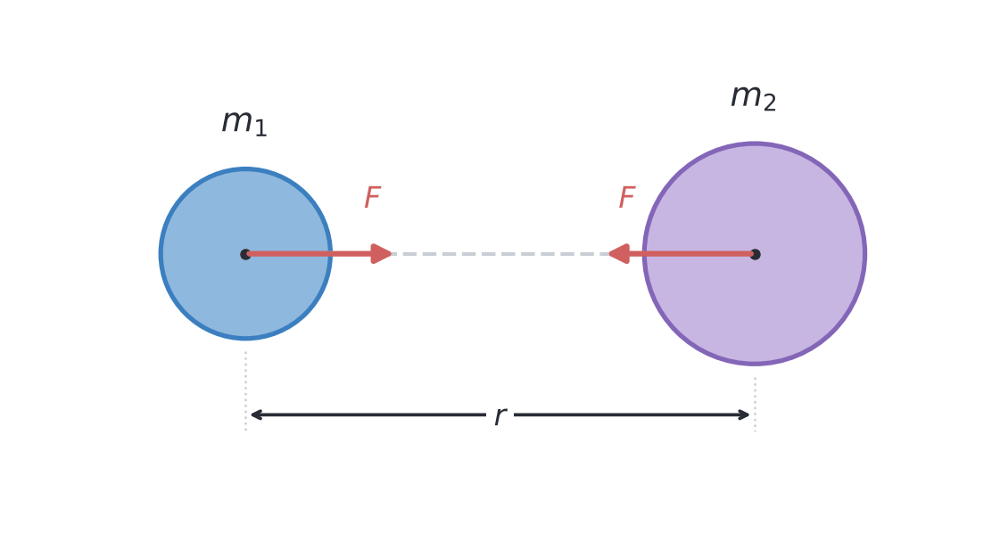
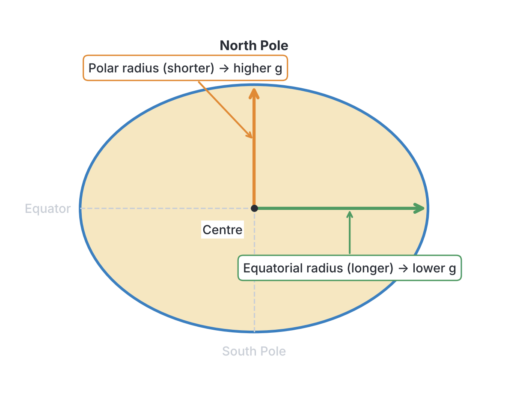
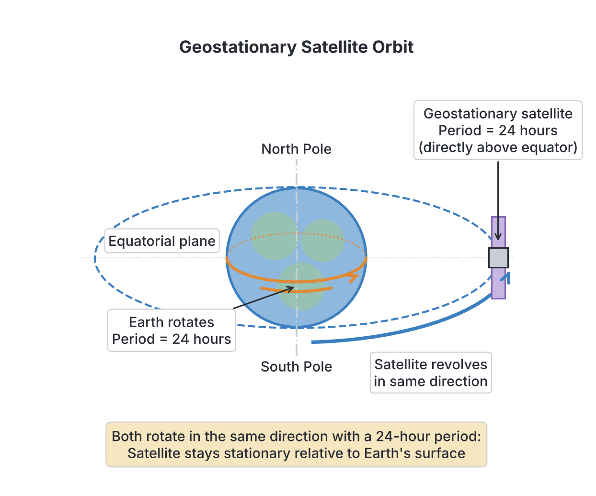

# JAMB Physics Notes: Gravitational Field

## What JAMB expects

This topic is Section A, Topic 4 of the JAMB Physics syllabus: Gravitational Field. It covers the fundamentals of gravity, how it acts across space, and its effects on planets and satellites. 

The syllabus includes the following content items:
* (i) Newton’s law of universal gravitation;
* (ii) gravitational potential;
* (iii) conservative and non-conservative fields;
* (iv) acceleration due to gravity;
* (v) variation of g on the earth’s surface;
* (vi) distinction between mass and weight escape velocity;
* (vii) parking orbit and weightlessness.

By the end of these notes, you should be able to:
* i. identify the expression for gravitational force between two bodies;
* ii. apply Newton’s law of universal gravitation;
* iii. give examples of conservative and non-conservative fields;
* iv. deduce the expression for gravitational field potentials;
* v. identify the causes of variation of g on the earth’s surface;
* vi. differentiate between mass and weight;
* vii. determine escape velocity;
* viii. Relate the expression for gravitational force between two bodies;
* ix. Apply Newton’s law of Universal gravitation.

**Note on the syllabus wording:** 
1. Content item (vi) is printed as "distinction between mass and weight escape velocity" without a comma. This is a typing error in the syllabus. It means two separate concepts: "distinction between mass and weight" and "escape velocity". We will treat them clearly as separate concepts.
2. Objectives (viii) and (ix) are word-for-word repeats of objectives (i) and (ii). To ensure we cover every single line JAMB expects, they have been given their own specific focus sections below. 

---

## Newton's Law of Universal Gravitation

Sir Isaac Newton realized that the same force causing an *agbalumo* (African star apple) to fall from a tree is the same force keeping the Moon in orbit around the Earth. He proposed that gravity is a universal phenomenon.

### The Expression for Gravitational Force

**Objective i: identify the expression for gravitational force between two bodies.**

Newton's Law of Universal Gravitation states that **every particle in the universe attracts every other particle with a force that is directly proportional to the product of their masses and inversely proportional to the square of the distance between their centres.**

Mathematically, if you have two masses $m_1$ and $m_2$ separated by a distance $r$, the gravitational force $F$ between them is given by the expression:

$$F = \frac{G m_1 m_2}{r^2}$$

**Where:**
*   $F$ = Gravitational force of attraction (unit: Newtons, $\text{N}$)
*   $m_1, m_2$ = Masses of the two bodies (unit: kilograms, $\text{kg}$)
*   $r$ = Distance between the centres of the two masses (unit: metres, $\text{m}$)
*   $G$ = Universal Gravitational Constant (unit: $\text{N m}^2 \text{kg}^{-2}$)

**The Universal Gravitational Constant ($G$)** has a very small value, determined experimentally by Henry Cavendish:
$$G = 6.67 \times 10^{-11}\ \text{N m}^2 \text{kg}^{-2}$$

Because $G$ is so small, you do not feel the gravitational pull between yourself and a car parked next to you. Gravity only becomes noticeably strong when at least one of the objects is massive, like a planet or a star.

### Relating the Gravitational Force Expression

**Objective viii: Relate the expression for gravitational force between two bodies.**

The expression $F = \frac{G m_1 m_2}{r^2}$ is an **inverse square law**. This relationship means that the force drops off very quickly as objects move further apart. 
*   If you **double** the distance ($2r$), the force becomes $\frac{1}{2^2} = \frac{1}{4}$ of its original value.
*   If you **triple** the distance ($3r$), the force becomes $\frac{1}{3^2} = \frac{1}{9}$ of its original value.
*   If you **halve** the distance ($\frac{1}{2}r$), the force becomes $4$ times stronger.

Also, the forces the two masses exert on each other are **equal and opposite** (Newton's Third Law). The Earth pulls on you with a force equal to your weight, and you pull back on the Earth with the exact same force!

### Applying Newton's Law of Universal Gravitation

**Objective ii: apply Newton’s law of universal gravitation.**

Let us see how JAMB tests standard calculations using this formula.

**Worked Example 1**
Find the gravitational force of attraction between two students of masses $50\ \text{kg}$ and $80\ \text{kg}$ standing $2\ \text{m}$ apart. ($G = 6.67 \times 10^{-11}\ \text{N m}^2 \text{kg}^{-2}$)

**Solution:**
1. **Identify the given values:**
   Mass of first student, $m_1 = 50\ \text{kg}$
   Mass of second student, $m_2 = 80\ \text{kg}$
   Distance between their centres, $r = 2\ \text{m}$
   Gravitational constant, $G = 6.67 \times 10^{-11}\ \text{N m}^2 \text{kg}^{-2}$
2. **State the formula:**
   $$F = \frac{G m_1 m_2}{r^2}$$
3. **Substitute the values:**
   $$F = \frac{6.67 \times 10^{-11} \times 50 \times 80}{2^2}$$
4. **Calculate the numerator and denominator:**
   Numerator: $50 \times 80 = 4000$
   Denominator: $2^2 = 4$
   $$F = \frac{6.67 \times 10^{-11} \times 4000}{4}$$
5. **Simplify and state the final answer with units:**
   $\frac{4000}{4} = 1000$
   $$F = 6.67 \times 10^{-11} \times 1000 = 6.67 \times 10^{-8}\ \text{N}$$
   The gravitational force is $6.67 \times 10^{-8}\ \text{N}$. (Notice how incredibly small this force is!)

### Further Calculations Using Newton's Law

**Objective ix: Apply Newton’s law of Universal gravitation.**

JAMB often tests your ability to apply the law without needing a calculator by asking for ratios or new values when parameters change.

**Worked Example 2 (JAMB Shortcut for Ratios)**
Two planets attract each other with a force $F$. If the mass of one planet is doubled and the distance between their centres is halved, what is the new force of attraction in terms of $F$?

**Solution:**
1. **State the initial relationship:**
   Let the initial masses be $m_1$ and $m_2$, and the distance be $r$.
   $$F = \frac{G m_1 m_2}{r^2}$$
2. **Set up the new parameters:**
   New mass for the first planet = $2m_1$
   New distance = $\frac{r}{2}$
3. **Substitute into the formula to find the new force ($F_{new}$):**
   $$F_{new} = \frac{G (2m_1) m_2}{\left(\frac{r}{2}\right)^2}$$
4. **Simplify the denominator and the expression:**
   $\left(\frac{r}{2}\right)^2 = \frac{r^2}{4}$
   $$F_{new} = \frac{2 G m_1 m_2}{\frac{r^2}{4}}$$
   When you divide by a fraction, you multiply by its reciprocal:
   $$F_{new} = 2 \times 4 \times \frac{G m_1 m_2}{r^2}$$
5. **State the final answer:**
   $$F_{new} = 8 \times \left(\frac{G m_1 m_2}{r^2}\right) = 8F$$
   The new force is $8F$ (it becomes 8 times stronger).

---

## Gravitational Potential

In physics, when you move a mass against a gravitational field, you do work, storing energy. 

### Expression for Gravitational Field Potentials

**Objective iv: deduce the expression for gravitational field potentials.**

**Gravitational potential ($V$)** at a point in a gravitational field is defined as the work done per unit mass in moving a test mass from infinity to that point. 

The expression for the gravitational potential at a distance $r$ from a body of mass $M$ is:
$$V = -\frac{GM}{r}$$

**Where:**
*   $V$ = Gravitational potential (unit: Joules per kilogram, $\text{J kg}^{-1}$)
*   $G$ = Universal Gravitational Constant ($\text{N m}^2 \text{kg}^{-2}$)
*   $M$ = Mass of the planet or body creating the field ($\text{kg}$)
*   $r$ = Distance from the centre of the body to the point ($\text{m}$)

**Why is it negative?**
By convention, the gravitational potential at an infinite distance away is taken to be zero ($0\ \text{J kg}^{-1}$). Because gravity is an *attractive* force, as an object falls from infinity towards a planet, the field itself does work on the object, reducing its potential energy. Therefore, the potential at any point closer than infinity must be less than zero. It is always a **negative value**, increasing towards zero as you move infinitely far away.

---

## Conservative and Non-Conservative Fields

Fields can be classified based on whether mechanical energy is conserved when moving an object through them.

### Examples of Conservative and Non-Conservative Fields

**Objective iii: give examples of conservative and non-conservative fields.**

A **conservative field** is a field in which the work done in moving a body between two points is completely independent of the path taken. In a conservative field, if you move an object in a closed loop (starting and ending at the exact same point), the total work done is zero. Mechanical energy (kinetic + potential) is conserved.

A **non-conservative field** is one where the work done *does* depend on the path taken. Moving through a longer path will result in more energy being lost (usually dissipated as heat). Mechanical energy is not conserved.

| Feature | Conservative Fields | Non-Conservative Fields |
| :--- | :--- | :--- |
| **Path dependence** | Work done is independent of the path taken. | Work done depends on the path taken. |
| **Closed loop** | Total work done in a closed loop is exactly zero. | Total work done in a closed loop is NOT zero. |
| **Energy** | Mechanical energy is conserved. | Mechanical energy is dissipated (lost as heat). |
| **Examples** | 1. **Gravitational field** 2. **Electrostatic field** 3. **Magnetic field** | 1. **Frictional forces** (e.g., tyres on a road) 2. **Air resistance** 3. **Viscous drag** in liquids |

---

## Acceleration Due to Gravity

If we apply Newton's second law ($F = mg$) to a falling object of mass $m$ on the surface of a planet (mass $M$, radius $R$), the force causing the acceleration is the gravitational pull of the planet.

Equating the two force formulas:
$$mg = \frac{GMm}{R^2}$$

Cancel out the small mass $m$ on both sides to get the expression for acceleration due to gravity:
$$g = \frac{GM}{R^2}$$

**Where:**
*   $g$ = Acceleration due to gravity (unit: $\text{m s}^{-2}$ or $\text{N kg}^{-1}$)
*   $M$ = Mass of the planet
*   $R$ = Radius of the planet

Notice that $g$ does **not** depend on the mass of the falling object ($m$). This is why a heavy stone and a light feather will fall at exactly the same rate in a vacuum where there is no air resistance.

---

## Variation of g on the Earth's Surface

The value of $g$ on Earth is typically taken as $10\ \text{m s}^{-2}$ (or $9.8\ \text{m s}^{-2}$ depending on the textbook or exam question). However, $g$ is not perfectly constant everywhere.

### Causes of Variation of g on the Earth's Surface

**Objective v: identify the causes of variation of g on the earth’s surface.**

The value of $g$ varies slightly from place to place due to four main factors:

1.  **The Shape of the Earth:** 
    The Earth is not a perfect sphere. It is an **oblate spheroid**—it bulges slightly at the equator and is flattened at the poles. Because the equatorial radius is larger than the polar radius, a point on the equator is further from the Earth's centre. Since $g \propto \frac{1}{R^2}$, **$g$ is maximum at the poles (approx. $9.83\ \text{m s}^{-2}$) and minimum at the equator (approx. $9.78\ \text{m s}^{-2}$)**.
2.  **The Rotation of the Earth:**
    As the Earth spins, it creates an outward centrifugal force that acts exactly opposite to gravity. This effect is strongest at the equator (where the rotational speed is highest) and zero at the poles, further reducing the effective value of $g$ at the equator.
3.  **Altitude (Height above the surface):**
    As you go higher up a mountain or into space, your distance from the Earth's centre ($r = R + h$) increases. Since $g \propto \frac{1}{r^2}$, the acceleration due to gravity **decreases with altitude**.
4.  **Depth (Distance below the surface):**
    If you go deep into a mine, you might think $g$ increases because you are closer to the centre. However, the mass of the Earth *above* you pulls upwards, cancelling out some of the downward pull. Ultimately, $g$ **decreases with depth** and becomes exactly zero at the centre of the Earth.

---

## Mass and Weight

In everyday language, people use "mass" and "weight" interchangeably. In Physics, they are completely different quantities.

### Distinguishing Between Mass and Weight

**Objective vi: differentiate between mass and weight.**

*   **Mass ($m$)** is the quantity of matter contained in a body.
*   **Weight ($W$)** is the gravitational force exerted on a body by the Earth (or another planet).

Because weight is a force, it is calculated using $W = mg$.

| Feature | Mass | Weight |
| :--- | :--- | :--- |
| **Definition** | Amount of matter in an object. | The gravitational pull on an object. |
| **Type of quantity** | Scalar quantity (has only magnitude). | Vector quantity (has magnitude and direction, pointing downwards). |
| **SI Unit** | Kilogram ($\text{kg}$) | Newton ($\text{N}$) |
| **Constancy** | Constant everywhere in the universe. | Varies from place to place depending on $g$. |
| **Measuring Instrument** | Beam balance, chemical balance. | Spring balance. |
| **Zero value?** | Can never be zero for an object. | Is zero in deep space or at the centre of a planet (where $g = 0$). |

---

## Escape Velocity

If you throw a ball upwards, it slows down, stops, and falls back down. If you throw it harder, it goes higher. Is there a speed at which it will never come back down? Yes.

### Determining Escape Velocity

**Objective vii: determine escape velocity.**

**Escape velocity ($v_e$)** is the minimum initial velocity required by an object to just overcome the gravitational pull of a planet permanently and escape into space.

**Derivation:**
To escape, the object's initial kinetic energy at the planet's surface must be at least equal to the gravitational potential energy it needs to overcome to reach infinity (where potential energy is zero).
$$\text{Kinetic Energy} = \text{Gravitational Potential Energy}$$
$$\frac{1}{2}mv_e^2 = \frac{GMm}{R}$$

Cancel the mass of the object ($m$) from both sides:
$$v_e^2 = \frac{2GM}{R}$$
$$v_e = \sqrt{\frac{2GM}{R}}$$

Since we established earlier that $g = \frac{GM}{R^2}$, it follows that $GM = gR^2$. Substituting this into the escape velocity equation gives the most common JAMB formula:
$$v_e = \sqrt{\frac{2(gR^2)}{R}}$$
$$v_e = \sqrt{2gR}$$

**Where:**
*   $v_e$ = Escape velocity (unit: $\text{m s}^{-1}$)
*   $g$ = Acceleration due to gravity ($\text{m s}^{-2}$)
*   $R$ = Radius of the planet ($\text{m}$)

**Worked Example 3**
Calculate the escape velocity from the surface of the Earth. (Take the Earth's radius $R = 6400\ \text{km}$ and acceleration due to gravity $g = 10\ \text{m s}^{-2}$)

**Solution:**
1. **Identify and convert values to SI units:**
   Radius of Earth, $R = 6400\ \text{km} = 6400 \times 10^3\ \text{m} = 6.4 \times 10^6\ \text{m}$
   Gravity, $g = 10\ \text{m s}^{-2}$
2. **State the formula for escape velocity:**
   $$v = \sqrt{2gR}$$
3. **Substitute the values:**
   $$v = \sqrt{2 \times 10 \times (6.4 \times 10^6)}$$
4. **Calculate the value inside the root:**
   $$2 \times 10 = 20$$
   $$20 \times 6.4 \times 10^6 = 128 \times 10^6$$
5. **Find the square root and state the final answer with units:**
   $$\sqrt{128 \times 10^6} = \sqrt{128} \times 10^3$$
   Since $11^2 = 121$ and $12^2 = 144$, $\sqrt{128}$ is roughly $11.3$.
   $$v \approx 11.3 \times 10^3\ \text{m s}^{-1} = 11.3\ \text{km s}^{-1}$$
   The escape velocity from Earth is approximately $11.3\ \text{km/s}$. 
   *(Note: If a JAMB question specifies $g = 9.8\ \text{m s}^{-2}$, the answer will be exactly $11.2\ \text{km/s}$)*.

---

## Parking Orbit and Weightlessness

Satellites, like Nigeria's NIGCOMSAT, are launched into specific orbits to serve purposes like communication and weather tracking.

**Parking Orbit (Geostationary Orbit):**
A parking orbit is a special circular orbit around the Earth's equator where a satellite has an orbital period of **exactly 24 hours**. Because the Earth also takes 24 hours to rotate on its axis, a satellite in a parking orbit appears to be completely stationary (parked) relative to a specific point on the Earth's surface. This is vital for satellite dishes on your roof; if the satellite moved relative to your house, you would have to constantly move your dish to track it!

**Weightlessness:**
When you see astronauts floating in the International Space Station, it is **not** because there is zero gravity in space. Gravity is what keeps the station in orbit! 
They float because of **weightlessness**. In orbit, both the spacecraft and the astronauts inside it are falling towards the Earth at the exact same rate (continuous free fall). Because the floor of the spaceship is falling away from the astronaut at the same speed the astronaut is falling, the floor cannot push back up on the astronaut. The normal reaction force is zero, meaning their **apparent weight is zero**, and they experience weightlessness.

---

## Key terms

| Term | Meaning |
| :--- | :--- |
| **Universal Gravitation** | The law stating every mass attracts every other mass with a force proportional to the product of their masses and inversely proportional to the square of the distance between them. |
| **Conservative field** | A field where the work done in moving a mass is independent of the path taken (e.g., gravity). |
| **Gravitational potential ($V$)** | The work done per unit mass in moving a test mass from infinity to a point in the field. It is always negative. |
| **Weight** | The gravitational force acting on a body ($W=mg$). |
| **Escape velocity ($v_e$)** | The minimum initial velocity required to completely escape a planet's gravitational field. |
| **Parking orbit** | A geostationary orbit where a satellite's period matches the Earth's rotation (24 hours). |
| **Weightlessness** | The state of apparent zero weight caused by continuous free fall in orbit. |

---

## Exam tips and common mistakes

*   **Forgetting to square the distance ($r$):** The most common mistake in calculating gravitational force is using $r$ instead of $r^2$ in the denominator. Always double-check your formula: $F = \frac{GMm}{r^2}$.
*   **Mixing up $G$ and $g$:** $G$ is the Universal Gravitational Constant (same everywhere in the universe). $g$ is the local acceleration due to gravity (varies with altitude, depth, and latitude).
*   **Unit errors:** Always convert radii and distances given in kilometres ($\text{km}$) to metres ($\text{m}$) before substituting into formulas like $v = \sqrt{2gR}$.
*   **Misunderstanding weightlessness:** A very popular JAMB trap is offering an option that says "weightlessness occurs because there is no gravity in space". This is **false**. It occurs because the object is in continuous free fall.
*   **Missing the negative sign:** Gravitational potential is **always negative** ($V = -GM/r$). Do not ignore the minus sign if it appears in the options.

---

## Quick summary

1.  Newton's Law of Universal Gravitation formula is $F = \frac{G m_1 m_2}{r^2}$.
2.  The gravitational field is a conservative field because work done is independent of the path taken.
3.  Gravitational potential is the work done per unit mass to bring an object from infinity, given by $V = -\frac{GM}{r}$, and is always negative.
4.  Acceleration due to gravity is $g = \frac{GM}{R^2}$. It decreases as you go to higher altitudes or deeper underground.
5.  $g$ is greater at the poles (where the Earth is flat) and smaller at the equator (where the Earth bulges).
6.  Mass is constant everywhere and measured in $\text{kg}$; weight varies with gravity ($W = mg$) and is measured in $\text{N}$.
7.  Escape velocity is the minimum speed needed to break free from a planet, calculated as $v = \sqrt{2gR}$.
8.  A parking orbit (geostationary orbit) has a period of 24 hours. Astronauts inside experience weightlessness due to continuous free fall.

---

## Practice questions

**1. Which of the following equations correctly represents Newton's law of universal gravitation?**
- A. $F = G \frac{m_1 m_2}{r}$
- B. $F = G \frac{m_1 m_2}{r^2}$
- C. $F = g \frac{m_1 m_2}{r^2}$
- D. $F = G \frac{m_1 + m_2}{r^2}$

**Answer: B.** Newton's law states that force is directly proportional to the product of the masses ($m_1 m_2$) and inversely proportional to the square of the distance between them ($r^2$). The constant is $G$, not $g$.

**2. If the distance between two masses is tripled, the gravitational force between them**
- A. increases by a factor of 9
- B. decreases by a factor of 3
- C. decreases by a factor of 9
- D. remains unchanged

**Answer: C.** Force is inversely proportional to the square of the distance ($F \propto 1/r^2$).
1. Initial distance is $r$, so force is proportional to $1/r^2$.
2. New distance is $3r$.
3. New force is proportional to $1/(3r)^2 = 1/9r^2$.
Therefore, it decreases by a factor of $3^2 = 9$.

**3. Two objects of mass $50\ \text{kg}$ and $40\ \text{kg}$ are placed $2\ \text{m}$ apart. Calculate the gravitational force of attraction between them. ($G = 6.67 \times 10^{-11}\ \text{N m}^2 \text{kg}^{-2}$)**
- A. $3.34 \times 10^{-8}\ \text{N}$
- B. $6.67 \times 10^{-8}\ \text{N}$
- C. $1.33 \times 10^{-7}\ \text{N}$
- D. $1.33 \times 10^{-10}\ \text{N}$

**Answer: A.** 
1. Formula: $F = \frac{G m_1 m_2}{r^2}$
2. Substitute: $F = \frac{6.67 \times 10^{-11} \times 50 \times 40}{2^2}$
3. Simplify: $F = \frac{6.67 \times 10^{-11} \times 2000}{4} = 6.67 \times 10^{-11} \times 500$
4. Result: $F = 3335 \times 10^{-11}\ \text{N} = 3.335 \times 10^{-8}\ \text{N}$, which rounds to $3.34 \times 10^{-8}\ \text{N}$. 
*Option B is the trap if you forget to square the distance $r$ ($2$ instead of $4$).*

**4. Calculate the escape velocity from a planet where acceleration due to gravity is $8\ \text{m s}^{-2}$ and the radius is $4000\ \text{km}$.**
- A. $8\ \text{km s}^{-1}$
- B. $64\ \text{km s}^{-1}$
- C. $4\ \text{km s}^{-1}$
- D. $253\ \text{m s}^{-1}$

**Answer: A.** 
1. Convert radius to metres: $R = 4000\ \text{km} = 4 \times 10^6\ \text{m}$.
2. Formula: $v = \sqrt{2gR}$
3. Substitute: $v = \sqrt{2 \times 8 \times 4,000,000} = \sqrt{64,000,000}$
4. Result: $v = 8,000\ \text{m s}^{-1} = 8\ \text{km s}^{-1}$.
*Option D is the trap if you forget to convert kilometres to metres before calculating.*

**5. Which of the following is an example of a non-conservative field?**
- A. Gravitational field
- B. Magnetic field
- C. Frictional field (Viscous drag)
- D. Electrostatic field

**Answer: C.** A frictional force like viscous drag dissipates energy (as heat), meaning the total mechanical energy is not conserved, and the work done depends on the path taken. Gravity, magnetism, and electrostatics form conservative fields.

**6. The gravitational potential at a point distance $r$ from a planet of mass $M$ is represented by:**
- A. $\frac{GM}{r}$
- B. $-\frac{GM}{r}$
- C. $\frac{GM}{r^2}$
- D. $-\frac{GM}{r^2}$

**Answer: B.** Gravitational potential is the work done per unit mass. It is a scalar quantity and is always negative because work is done *by* the attractive gravitational field as a mass approaches from infinity. The formula is $V = -\frac{GM}{r}$.

**7. An object weighs $200\ \text{N}$ on the surface of the Earth. What will it weigh at a height $h = R$ (where $R$ is the radius of the Earth) above the Earth's surface?**
- A. $100\ \text{N}$
- B. $50\ \text{N}$
- C. $200\ \text{N}$
- D. $0\ \text{N}$

**Answer: B.** 
1. Gravity is inversely proportional to the square of the distance from the centre ($g \propto 1/r^2$).
2. On the surface, distance from centre is $r_1 = R$. Weight is $200\ \text{N}$.
3. At height $h = R$, the new distance from the centre is $r_2 = R + R = 2R$.
4. Since distance is doubled, gravity (and therefore weight) becomes $1/2^2 = 1/4$ of its original value.
5. New weight = $200\ \text{N} / 4 = 50\ \text{N}$.
*Option A is the trap if you just divide by 2 instead of squaring the 2.*

**8. Acceleration due to gravity ($g$) is greater at the poles than at the equator because**
- A. the Earth rotates faster at the poles
- B. the polar radius is smaller than the equatorial radius
- C. there is less atmosphere at the poles
- D. the poles are covered in heavy ice

**Answer: B.** The Earth is an oblate spheroid, bulging at the equator. Because the poles are closer to the centre of the Earth (smaller radius $R$), the value of $g$ is larger there ($g \propto 1/R^2$).

**9. A satellite in a parking orbit is designed to have an orbital period of**
- A. 12 hours
- B. 24 hours
- C. 1 month
- D. 365 days

**Answer: B.** A parking orbit (geostationary orbit) matches the rotation of the Earth so that the satellite remains fixed over one spot on the equator. Therefore, its period must be exactly 24 hours.

**10. An astronaut inside a satellite orbiting the Earth experiences weightlessness mainly because**
- A. there is no gravitational force in space
- B. the satellite is in a vacuum
- C. the astronaut and satellite are in continuous free fall towards the Earth
- D. the magnetic field of the Earth cancels out gravity

**Answer: C.** The astronaut and the spaceship are accelerating towards the Earth at the same rate due to gravity (free fall). Because the floor is falling away just as fast as the astronaut is falling, there is no upward reaction force, making the astronaut's apparent weight zero. Gravity is definitely still present (Option A is a common misconception).
