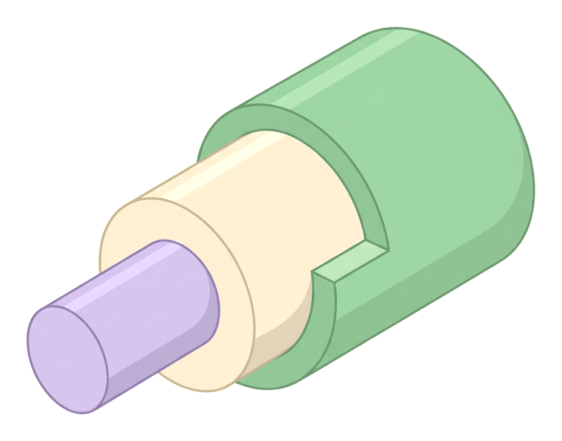
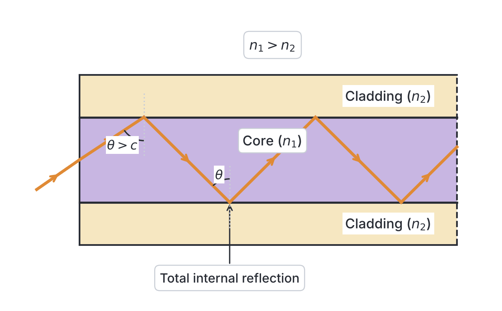

# JAMB Physics Notes: Introduction to Fibre Optics and Lasers

## What JAMB expects

This topic is Topic 40 of the JAMB Physics syllabus: Introduction to fibre optics and lasers. It introduces modern optics and covers two main sections:

*   **a. fibre optics**
*   **b. Lasers**

By the end of these notes, you should be able to:
1. explain the concept of fibre optics;
2. understand the principle of transmission of light through an optical fibre;
3. apply the principle of fibre optics in Local Area Network (LAN), medicine, laser beam etc;
4. understand the meaning of laser;
5. understand the various types of lasers (solid state, gas, liquid and semiconductor lasers);
6. apply the knowledge of lasers in scientific research, communication, medicine, military technology, holograms etc; 
7. identify the dangers involved in using lasers.

**Note on the syllabus wording:** In the official JAMB syllabus, the list of objectives is split into two by a repeated "Candidates should be able to;" phrase, causing the Roman numeral numbering to restart at (i) for the laser section. These notes cover every objective logically from start to finish. This topic relies heavily on the concepts of refraction and total internal reflection, which are covered in detail in `A25a-refraction-at-plane-surfaces.md`.

## Fibre optics

**Content item a: fibre optics.**

### Explain the concept of fibre optics

Fibre optics is a revolutionary technology that uses extremely thin, flexible threads of highly transparent glass or plastic to transmit light over long distances. Instead of using electrical currents running through thick copper wires (which can lose energy and suffer from interference), fibre optics uses **pulses of light** to carry information.

An **optical fibre** is structured in three essential layers to ensure light stays trapped inside it:
1. **The Core:** The central, innermost part of the fibre where the light actually travels. It is made of very pure, dense glass or plastic and has a relatively **high refractive index**.
2. **The Cladding:** The layer immediately surrounding the core. It is made of a slightly less dense glass or plastic with a **lower refractive index** than the core. This difference in optical density is the entire secret to how fibre optics work.
3. **The Buffer Coating (Jacket):** A tough, flexible plastic outer layer that protects the delicate inner glass from moisture, physical damage, and crushing. 

When you see workers digging trenches along Nigerian highways (like the Lagos-Ibadan expressway) to lay thick cables for MTN, Glo, or Airtel, they are burying bundles of these optical fibres. These cables carry thousands of times more data than copper cables and make high-speed internet possible.

### Principle of transmission of light through an optical fibre

Light normally travels in straight lines, so how does it travel through an optical fibre that bends around corners? The answer is **Total Internal Reflection (TIR)**.

When a ray of light travels from an optically denser medium (the core) toward an optically less dense medium (the cladding), it bends away from the normal. If the light hits the boundary at a very shallow angle—specifically, an angle of incidence greater than the **critical angle**—the light cannot pass into the cladding. Instead, it acts exactly as if it hit a perfect mirror and bounces entirely back into the core. 

For total internal reflection to occur in an optical fibre, two critical conditions **MUST** be met:
1. Light must travel from a medium with a **higher refractive index** to one with a **lower refractive index** (from the core to the cladding).
2. The angle of incidence at the core-cladding boundary must be **greater than the critical angle** ($c$).

The critical angle ($c$) can be calculated using the absolute refractive indices of the two materials:
$$\sin c = \frac{n_{\text{cladding}}}{n_{\text{core}}}$$

where:
*   $c$ = critical angle (in degrees, $^\circ$)
*   $n_{\text{cladding}}$ = refractive index of the cladding (no unit)
*   $n_{\text{core}}$ = refractive index of the core (no unit)

Because refractive index is inversely proportional to the speed of light in a medium ($n = \frac{c_0}{v}$), JAMB questions sometimes provide the speed of light instead of the refractive index. The formula then becomes:
$$\sin c = \frac{v_{\text{core}}}{v_{\text{cladding}}}$$
where $v$ is the speed of light in the respective part of the fibre, measured in $\text{m s}^{-1}$.

As long as the light enters the fibre at the correct angle, it will repeatedly undergo total internal reflection, zigzagging its way down the length of the fibre with almost zero energy loss, even if the fibre is looped or tied in a loose knot.

**Common Mistakes:** Students often forget which part of the fibre must have the higher refractive index. Remember: the light must be trapped in the **core**, so the core must be the **denser** medium (higher refractive index) and light must travel **slower** in it.

#### Worked Example 1: Critical Angle from Refractive Indices
An optical fibre has a glass core with a refractive index of $1.50$ and a cladding with a refractive index of $1.45$. Calculate the critical angle at the core-cladding boundary.

**Working:**
1. Identify the given variables: $n_{\text{core}} = 1.50$, $n_{\text{cladding}} = 1.45$.
2. State the formula for the critical angle: $\sin c = \frac{n_{\text{cladding}}}{n_{\text{core}}}$
3. Substitute the values: $\sin c = \frac{1.45}{1.50}$
4. Calculate the ratio: $\sin c = 0.9667$
5. Find the inverse sine to get the angle: $c = \sin^{-1}(0.9667) = 75.16^\circ \approx 75.2^\circ$
**Answer:** The critical angle is $75.2^\circ$.

#### Worked Example 2: Speed of Light in the Core
The speed of light in a vacuum is $3.0 \times 10^8\ \text{m s}^{-1}$. Calculate the speed of light travelling through the core of an optical fibre if the core has an absolute refractive index of $1.50$.

**Working:**
1. Identify the variables: $c_0 = 3.0 \times 10^8\ \text{m s}^{-1}$ (speed in vacuum), $n_{\text{core}} = 1.50$.
2. Use the absolute refractive index formula: $n = \frac{c_0}{v}$
3. Rearrange to solve for the speed in the medium ($v$): $v = \frac{c_0}{n}$
4. Substitute the values: $v = \frac{3.0 \times 10^8}{1.50}$
5. Calculate the result: $v = 2.0 \times 10^8\ \text{m s}^{-1}$
**Answer:** The speed of light in the core is $2.0 \times 10^8\ \text{m s}^{-1}$.

#### Worked Example 3: Finding Cladding Index from Critical Angle
An optical fibre has a core with a refractive index of $1.60$. If the critical angle for total internal reflection at the core-cladding boundary is $60.0^\circ$, calculate the refractive index of the cladding.

**Working:**
1. Identify the variables: $n_{\text{core}} = 1.60$, $c = 60.0^\circ$.
2. State the formula: $\sin c = \frac{n_{\text{cladding}}}{n_{\text{core}}}$
3. Rearrange to make the cladding index the subject: $n_{\text{cladding}} = n_{\text{core}} \times \sin c$
4. Substitute the values: $n_{\text{cladding}} = 1.60 \times \sin(60^\circ)$
5. Calculate: $1.60 \times 0.8660 = 1.3856$
**Answer:** The refractive index of the cladding is $1.39$ (to two decimal places).

#### Worked Example 4: Critical Angle from Speeds
The speed of light in the core of an optical fibre is $1.95 \times 10^8\ \text{m s}^{-1}$, and the speed of light in its cladding is $2.05 \times 10^8\ \text{m s}^{-1}$. Calculate the critical angle.

**Working:**
1. Identify the variables: $v_{\text{core}} = 1.95 \times 10^8\ \text{m s}^{-1}$, $v_{\text{cladding}} = 2.05 \times 10^8\ \text{m s}^{-1}$.
2. State the speed-based formula: $\sin c = \frac{v_{\text{core}}}{v_{\text{cladding}}}$
3. Substitute the values: $\sin c = \frac{1.95 \times 10^8}{2.05 \times 10^8}$
4. Calculate the ratio: $\sin c = 0.9512$
5. Find the inverse sine: $c = \sin^{-1}(0.9512) = 72.03^\circ$
**Answer:** The critical angle is $72.0^\circ$.

### Applications of fibre optics in LAN, medicine and laser beams

Because they are lightweight, flexible, and transmit light efficiently, optical fibres have numerous applications:

1. **Local Area Networks (LAN) and Telecommunications:** 
   Fibre optic cables are replacing copper cables to transmit phone calls, internet data, and cable television signals. Massive submarine cables (like the MainOne and Glo-1 cables that land in Lagos) connect Nigeria's internet to the rest of the world. Fibre optics have an enormous bandwidth (carrying massive amounts of data), do not lose signal strength quickly, and are entirely immune to electromagnetic interference from power lines or lightning.
2. **Medicine (Endoscopy):**
   An **endoscope** is a vital medical instrument containing bundles of flexible optical fibres. Doctors pass it through a patient's mouth or tiny incisions to look inside organs like the stomach or lungs without performing major open surgery. Light is sent down one bundle to illuminate the dark organ, and the reflected light travels back up a neatly arranged (coherent) bundle to form a clear image for the doctor.
3. **Delivery of Laser Beams:**
   In manufacturing and surgery, flexible optical fibres are used to safely guide powerful laser beams to precise targets. For instance, an optical fibre can guide a laser to vaporise a kidney stone deep inside a patient's body without damaging surrounding healthy tissue, or to weld metal parts in an automotive factory.

## Lasers

**Content item b: Lasers.**

While normal light (like from a lightbulb, a torchlight, or the sun) spreads out in all directions and contains a messy mixture of many colours, a laser is a highly controlled, incredibly pure type of light.

### Meaning of laser

The word **LASER** is an acronym that stands for:
**L**ight **A**mplification by **S**timulated **E**mission of **R**adiation.

Laser light possesses three unique characteristics that make it completely different from ordinary white light:
1. **Monochromatic:** It consists of exactly one pure colour (a single wavelength or frequency). Ordinary white light is a blend of the seven colours of the visible spectrum.
2. **Coherent:** All the light waves in a laser beam are perfectly in phase with each other. Their peaks and troughs line up exactly in space and time, reinforcing each other to produce immense, stable power.
3. **Collimated (Highly Directional):** Laser light travels in a very narrow, tight beam that barely spreads out (diverges), even over vast distances. A laser beam fired from Earth to the Moon only spreads out by a few kilometres.

### Types of lasers

Lasers are classified based on their "active medium"—the material inside the device that is stimulated to produce the light.

| Type of Laser | Active Medium | Description and Common Uses |
| --- | --- | --- |
| **Solid-State Lasers** | A solid crystal or glass rod doped with special atoms. | Examples include the **Ruby laser** (the first laser built in 1960) and the **Nd:YAG laser**. They produce high-power pulses used in heavy metal cutting, welding, and tattoo removal. |
| **Gas Lasers** | A pure gas or a mixture of gases enclosed in a glass tube. | Examples include the **Helium-Neon (He-Ne) laser** (produces a common red beam) and the **Carbon (IV) oxide ($CO_2$) laser**. $CO_2$ lasers produce extremely powerful invisible infrared beams used in industrial cutting and surgery. |
| **Liquid (Dye) Lasers** | Complex organic dyes dissolved in a liquid solvent. | These are special because they are "tunable"—scientists can adjust them to produce different colours of light. Used widely in complex scientific research. |
| **Semiconductor (Diode) Lasers** | A tiny electronic p-n junction (similar to a standard LED). | These are the most common, smallest, and cheapest lasers. They are found in laser presentation pointers, supermarket barcode scanners, DVD/CD drives, and fibre optic data transmission networks. |

### Applications of lasers in research, communication, medicine and military

Because of their extreme intensity, pinpoint precision, and pure colour, lasers have transformed modern technology:

1. **Scientific Research:** 
   Lasers are used in spectroscopy to identify the exact chemical composition of unknown substances. They measure tiny distances with extreme precision (interferometry) and are even used to trap and cool atoms down to near absolute zero in advanced physics laboratories.
2. **Communication:**
   Semiconductor diode lasers flash on and off billions of times a second to generate the pulses of light that carry global internet data through fibre optic cables.
3. **Medicine:**
   Lasers act as highly precise, perfectly sterile "light scalpels." They are used in eye surgery (LASIK) to reshape the cornea and correct vision, to shatter kidney stones, to remove skin tumours, and to cauterise (heat-seal) blood vessels during surgery to prevent bleeding.
4. **Military Technology:**
   The military uses lasers for range-finding (calculating the exact distance to a target by timing how long a laser pulse takes to bounce back), laser sights on firearms, target designation to guide "smart bombs", and developing directed-energy weapons capable of shooting down drones.
5. **Holograms (Holography):**
   A hologram is a true three-dimensional (3D) image. It is created by splitting a coherent laser beam: one part shines directly on a photographic plate, and the other part bounces off the object before hitting the plate. When the two beams meet, their interference pattern records a 3D image. Simple reflection holograms are used on JAMB examination slips, bank ATM cards, and currency notes to prevent counterfeiting.

### Dangers involved in using lasers

Because lasers concentrate high energy into a microscopic area and do not spread out like ordinary light, they are extremely dangerous if misused. Lasers are divided into Safety Classes (from Class 1, which is safe under normal conditions, to Class 4, which is extremely hazardous).

1. **Eye Hazards (Retinal Damage):** This is the most significant danger. Because laser light is perfectly parallel (collimated), the lens of the human eye focuses the entire beam into a microscopic, intensely hot dot on the retina at the back of the eye. Even a fraction of a second of accidental exposure to a moderately powerful laser can cause permanent blind spots or total blindness.
2. **Skin Burns:** High-power lasers, especially industrial $CO_2$ lasers or medical surgical lasers, can instantly cut through flesh or cause severe thermal (heat) burns.
3. **Fire Hazards:** A high-power laser beam pointed at flammable materials (paper, clothing, plastics, or wood) can rapidly heat them up and ignite a fire.

*Safety Precautions:* Anyone working with industrial or medical lasers must wear special laser safety goggles designed to completely filter out the specific wavelength (colour) of the laser being used.

## Key terms

| Term | Meaning |
| --- | --- |
| **Optical Fibre** | A thin, flexible strand of transparent glass or plastic used to guide light pulses over long distances. |
| **Core** | The central part of an optical fibre where light travels; it has a higher refractive index than the cladding. |
| **Cladding** | The outer layer of an optical fibre with a lower refractive index, enabling total internal reflection. |
| **Total Internal Reflection** | The complete reflection of a light ray back into a denser medium when the angle of incidence exceeds the critical angle. |
| **Critical Angle** | The angle of incidence in the denser medium for which the angle of refraction is exactly $90^\circ$. |
| **LASER** | Light Amplification by Stimulated Emission of Radiation. |
| **Coherent** | Light waves that are exactly in phase with one another, reinforcing each other. |
| **Monochromatic** | Light that consists of a single, pure wavelength or colour. |
| **Collimated** | A light beam whose rays are perfectly parallel and do not spread out (low divergence). |
| **Endoscope** | A medical tool made of bundles of optical fibres used to look inside the body without open surgery. |
| **Hologram** | A three-dimensional image created using the interference pattern of coherent laser light. |

## Exam tips and common mistakes

*   **Refractive Index rule:** For an optical fibre to work, the **core must have a higher refractive index** than the cladding. A common JAMB trick is to swap these in the options.
*   **Speeds rule:** Because the core has a higher refractive index, the **speed of light in the core is slower** than the speed of light in the cladding. 
*   **Meaning of LASER:** Memorise every single word carefully: Light Amplification by **Stimulated** Emission of Radiation. The "S" does not stand for Spontaneous or Simulated.
*   **Laser properties:** Remember that laser light is **monochromatic**, **coherent**, and **collimated**. It is NOT easily scattered or highly divergent. Ordinary light is divergent and incoherent.
*   **Calculations:** When finding the speed of light in a fibre given its refractive index, ensure you divide the speed of light in a vacuum ($c_0 = 3.0 \times 10^8\ \text{m s}^{-1}$) by the refractive index. Never multiply them.

## Quick summary

1. An optical fibre uses total internal reflection to transmit light pulses over enormous distances with minimal energy loss.
2. For total internal reflection to occur, light must attempt to move from a denser medium (the core) toward a less dense medium (the cladding) at an angle strictly greater than the critical angle.
3. Fibre optics are widely used in telecommunications networks (LAN and internet), medicine (endoscopy), and the precise delivery of laser beams in surgery.
4. LASER stands for Light Amplification by Stimulated Emission of Radiation.
5. Laser light is completely unique because it is monochromatic (a single pure colour), coherent (waves are in phase), and highly collimated (travels in a tight beam without spreading).
6. Lasers are classified into solid-state (Ruby, Nd:YAG), gas ($CO_2$, He-Ne), liquid (dyes), or semiconductor (diodes) types. They are used in everything from fibre-optic communication to holography.
7. Lasers pose severe safety risks, primarily causing permanent eye damage (retinal burns), severe skin burns, and fire hazards.

## Practice questions

**1. Which of the following describes the underlying physical principle by which optical fibres transmit light?**
- A. Refraction
- B. Diffraction
- C. Total internal reflection
- D. Polarization

**Answer: C.** Optical fibres rely entirely on total internal reflection to keep light bouncing within the core without escaping through the sides of the cable.

**2. The acronym LASER stands for:**
- A. Light Amplification by Spontaneous Emission of Radiation
- B. Light Amplification by Stimulated Emission of Radiation
- C. Light Alternation by Stimulated Emission of Rays
- D. Light Absorption by Stimulated Emission of Radiation

**Answer: B.** The correct expansion is Light Amplification by Stimulated Emission of Radiation. The word "Stimulated" is key to the quantum process of how lasers amplify light.

**3. In an optical fibre, for total internal reflection to occur, the refractive index of the core must be:**
- A. Equal to that of the cladding
- B. Lower than that of the cladding
- C. Higher than that of the cladding
- D. Equal to that of air

**Answer: C.** Total internal reflection only occurs when light travels from an optically denser medium (higher refractive index) to a less dense medium (lower refractive index). Therefore, the core must have a higher index than the cladding.

**4. Calculate the critical angle for a ray of light travelling from the core of an optical fibre (refractive index $1.50$) to the cladding (refractive index $1.45$).**
- A. $41.8^\circ$
- B. $43.6^\circ$
- C. $75.2^\circ$
- D. $90.0^\circ$

**Answer: C.** 
1. Use the formula: $\sin c = \frac{n_{\text{cladding}}}{n_{\text{core}}}$
2. Substitute the values: $\sin c = \frac{1.45}{1.50} = 0.9667$
3. Find the angle: $c = \sin^{-1}(0.9667) = 75.2^\circ$
*(Mistake note: Option A comes from wrongly calculating the critical angle of the core against air, $\sin c = \frac{1}{1.50} = 0.666 \rightarrow 41.8^\circ$.)*

**5. An optical fibre has a core with a refractive index of $1.60$. If the critical angle at the core-cladding boundary is $60.0^\circ$, what is the refractive index of the cladding?**
- A. $0.80$
- B. $1.39$
- C. $1.85$
- D. $2.10$

**Answer: B.**
1. Use the formula: $\sin c = \frac{n_{\text{cladding}}}{n_{\text{core}}}$
2. Rearrange: $n_{\text{cladding}} = n_{\text{core}} \times \sin c$
3. Substitute: $n_{\text{cladding}} = 1.60 \times \sin(60^\circ) = 1.60 \times 0.8660 = 1.3856 \approx 1.39$.
*(Mistake note: Option C comes from using the wrong formula $\sin c = \frac{n_{\text{core}}}{n_{\text{cladding}}}$, resulting in division $1.60 / 0.8660 = 1.847$ instead of multiplication.)*

**6. The speed of light in a vacuum is $3.0 \times 10^8\ \text{m s}^{-1}$. Calculate the speed of light in the core of an optical fibre whose absolute refractive index is $1.50$.**
- A. $1.50 \times 10^8\ \text{m s}^{-1}$
- B. $2.00 \times 10^8\ \text{m s}^{-1}$
- C. $3.00 \times 10^8\ \text{m s}^{-1}$
- D. $4.50 \times 10^8\ \text{m s}^{-1}$

**Answer: B.**
1. Use the formula: $v = \frac{c_0}{n}$
2. Substitute: $v = \frac{3.0 \times 10^8}{1.50}$
3. Calculate: $v = 2.00 \times 10^8\ \text{m s}^{-1}$.
*(Mistake note: Option D comes from wrongly multiplying $c_0$ and $n$, giving $3.0 \times 1.50 = 4.50$.)*

**7. A medical instrument that uses bundles of optical fibres to visually examine the internal organs of the human body without major open surgery is called:**
- A. A microscope
- B. A stethoscope
- C. An endoscope
- D. A periscope

**Answer: C.** An endoscope uses fibre optics to transmit light into the body and carry the visual image back out to the doctor.

**8. Which of the following types of lasers uses a crystal like Ruby or Nd:YAG as its active amplifying medium?**
- A. Gas laser
- B. Semiconductor laser
- C. Liquid laser
- D. Solid-state laser

**Answer: D.** Solid-state lasers use a solid matrix, such as a ruby crystal or glass rod, as their active amplifying medium.

**9. The primary danger of looking directly into a laser beam is that it can cause:**
- A. Skin cancer
- B. Permanent retinal damage
- C. Instant deafness
- D. Severe electrical shocks

**Answer: B.** The lens of the eye focuses the perfectly parallel, collimated rays of the laser directly onto a microscopic spot on the retina, causing severe, permanent thermal damage (blind spots) in a fraction of a second. 

**10. The production of three-dimensional images called holograms relies heavily on the use of:**
- A. White light
- B. Ultrasonic waves
- C. Laser light
- D. X-rays

**Answer: C.** Holography requires coherent light to form the necessary, stable interference patterns on a photographic film that record a 3D image, making lasers absolutely essential.
