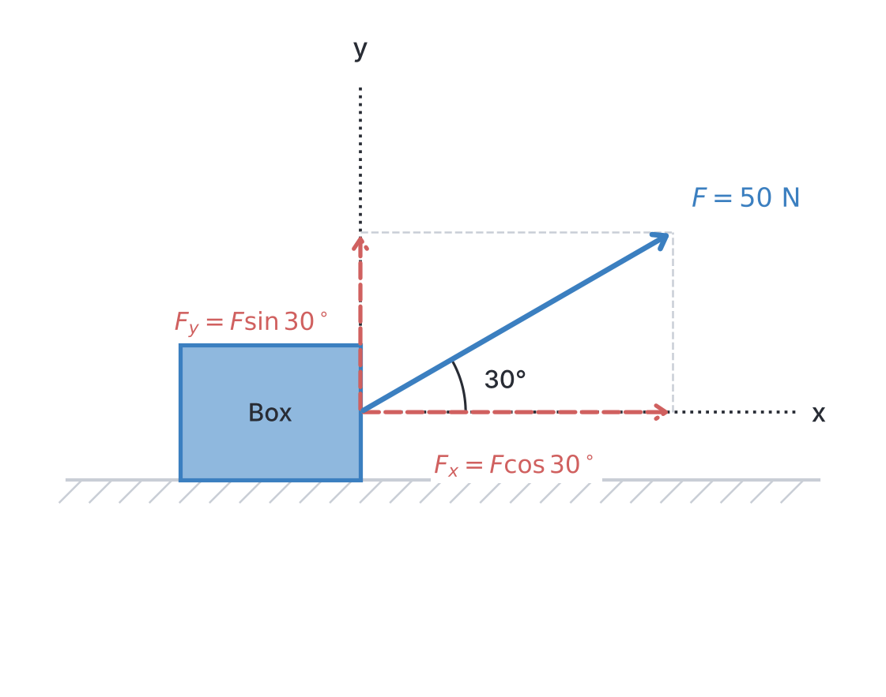
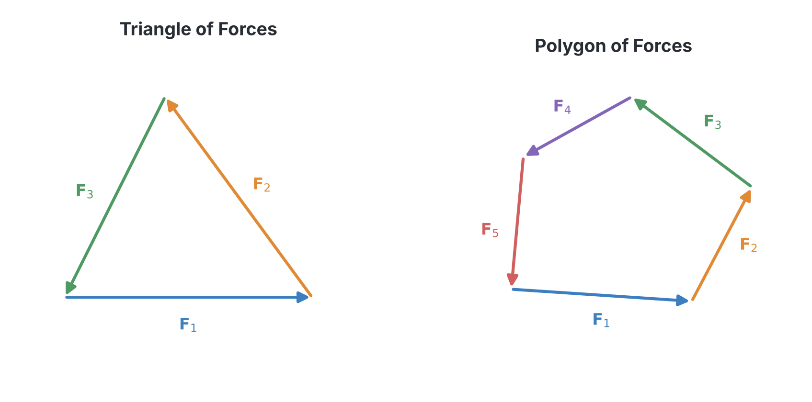
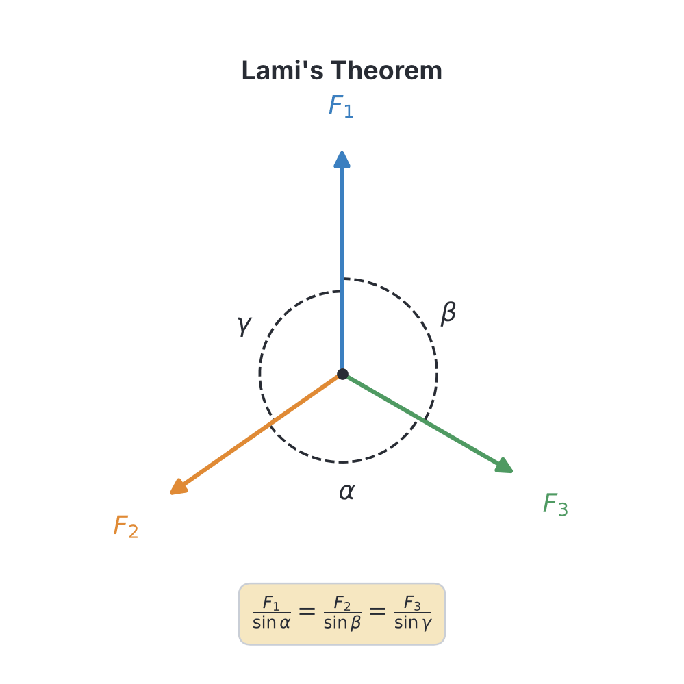
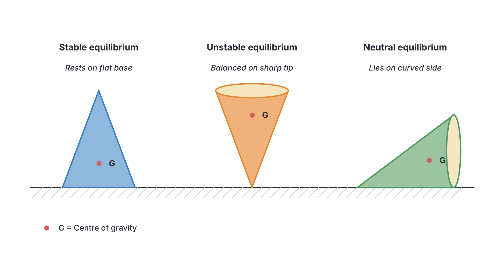

# JAMB Physics Notes: Equilibrium of Forces

## What JAMB expects

This topic is Section A, Topic 5 of the JAMB Physics syllabus: Equilibrium of Forces. It covers the following content areas:
* (a) equilibrium of particles: (i) equilibrium of coplanar forces; (ii) triangles and polygon of forces; (iii) Lami’s theorem.
* (b) principles of moments: (i) moment of a force; (ii) simple treatment and moment of a couple (torque); (iii) applications.
* (c) conditions for equilibrium of rigid bodies under the action of parallel and non-parallel forces: (i) resolution and composition of forces in two perpendicular directions; (ii) resultant and equilibrant.
* (d) centre of gravity and stability: (i) stable, unstable and neutral equilibra.

By the end of these notes, you should be able to:
1. apply the conditions for the equilibrium of coplanar forces to solve problems
2. use triangle and polygon laws of forces to solve equilibrium problems
3. use Lami’s theorem to solve problems
4. analyse the principle of moment of a force
5. determine moment of a force and couple
6. describe some applications of moment of a force and couple
7. apply the conditions for the equilibrium of rigid bodies to solve problems
8. resolve forces into two perpendicular directions
9. determine the resultant and equilibrant of forces
10. differentiate between stable, unstable and neutral equilibra.

**Note on the syllabus wording:** The syllabus uses the word "equilibra" in content section (d) and objective x. This is a typographical error for **equilibria**, which is the correct plural of equilibrium. We will use the correct spelling in our explanations, but the original spelling is preserved in the headings below to match the syllabus exact requirements. 

---

## Resolution and composition of forces in two perpendicular directions

**Objective viii: resolve forces into two perpendicular directions.**

Forces are vectors, meaning they have both magnitude (size) and direction. When a single force acts at an angle, it can be broken down—or **resolved**—into two separate parts that act at right angles to each other. We usually resolve a force into a **horizontal component** ($F_x$) and a **vertical component** ($F_y$). 

If a force $F$ acts at an angle $\theta$ to the horizontal axis:
* The horizontal component is given by: $$F_x = F \cos \theta$$
* The vertical component is given by: $$F_y = F \sin \theta$$

This process is incredibly useful in physics because perpendicular components do not affect each other. You can solve complex problems by looking at all the horizontal forces completely separately from the vertical forces.

### Worked Example 1: Resolving a force
A boy pulls a heavy generator across the floor using a rope. The tension in the rope is $50\ \text{N}$ and it is inclined at an angle of $30^\circ$ to the horizontal. Calculate the horizontal and vertical components of the pull.

**Working:**
1. **Identify the given values:** Force $F = 50\ \text{N}$, angle $\theta = 30^\circ$.
2. **Calculate the horizontal component:** Use the formula $F_x = F \cos \theta$.
3. **Substitute the values:** $F_x = 50 \times \cos 30^\circ = 50 \times 0.866$.
4. **State the horizontal answer:** $F_x = 43.3\ \text{N}$. (This is the force actually moving the generator forward).
5. **Calculate the vertical component:** Use the formula $F_y = F \sin \theta$.
6. **Substitute the values:** $F_y = 50 \times \sin 30^\circ = 50 \times 0.5$.
7. **State the vertical answer:** $F_y = 25.0\ \text{N}$. (This is the force trying to lift the generator off the ground).

**Common Mistake:** A very common JAMB trap is giving the angle to the *vertical* instead of the horizontal. If the question says a force acts at $30^\circ$ to the vertical, you must either use $90^\circ - 30^\circ = 60^\circ$ as your horizontal angle, or swap your sine and cosine formulas. Always draw a quick sketch!

---

## Resultant and equilibrant

**Objective ix: determine the resultant and equilibrant of forces.**

When two or more forces act on an object, their combined effect is called the **resultant**. The resultant is a single force that can replace all the other forces and produce the exact same effect. 

If you have two perpendicular forces, $F_x$ and $F_y$, you can find the magnitude of their resultant $R$ using Pythagoras' theorem:
$$R = \sqrt{F_x^2 + F_y^2}$$

The direction of the resultant is found using trigonometry:
$$\tan \theta = \frac{F_y}{F_x}$$
where $\theta$ is the angle the resultant makes with the horizontal $x$-axis.

The **equilibrant** is a force that, when applied to the object, brings the system into perfect equilibrium (balance). 
* The equilibrant has the **exact same magnitude** as the resultant.
* The equilibrant acts in the **exact opposite direction** ($180^\circ$) to the resultant.

### Worked Example 2: Finding resultant and equilibrant
Two perpendicular forces of $30\ \text{N}$ East and $40\ \text{N}$ North act on a particle. Find the magnitude and direction of their resultant, and state the equilibrant.

**Working:**
1. **Find the magnitude of the resultant:** Use $R = \sqrt{F_x^2 + F_y^2}$.
2. **Substitute values:** $R = \sqrt{30^2 + 40^2} = \sqrt{900 + 1600} = \sqrt{2500}$.
3. **Calculate the magnitude:** $R = 50\ \text{N}$.
4. **Find the direction:** $\tan \theta = \frac{F_y}{F_x} = \frac{40}{30} = 1.333$.
5. **Calculate the angle:** $\theta = \tan^{-1}(1.333) \approx 53.1^\circ$ North of East.
6. **State the equilibrant:** The equilibrant has the same magnitude, so it is $50\ \text{N}$. Its direction is perfectly opposite, which is $53.1^\circ$ South of West.

---

## Equilibrium of particles

**Content a: equilibrium of particles.**

A particle is in **equilibrium** if it is at rest, or if it is moving with a constant velocity. According to Newton's First Law, this means that the net force (resultant force) acting on the particle must be zero. The equilibrant of the system of forces is therefore already present in the system, cancelling everything else out.

### Equilibrium of coplanar forces

**Objective i: apply the conditions for the equilibrium of coplanar forces to solve problems.**

**Coplanar forces** are forces that all act in the same flat plane (like drawn on a single sheet of paper). For a particle to be in equilibrium under coplanar forces, the sum of the components of the forces in *any* direction must be zero. 

Practically, we resolve all forces into horizontal ($x$) and vertical ($y$) directions. The mathematical conditions for equilibrium are:
1. The sum of all horizontal components must be zero: $\sum F_x = 0$
2. The sum of all vertical components must be zero: $\sum F_y = 0$

### Triangles and polygon of forces

**Objective ii: use triangle and polygon laws of forces to solve equilibrium problems.**

When multiple forces act on a particle and keep it in equilibrium, they can be represented graphically.

**Triangle of Forces:**
If three coplanar forces acting on a particle are in equilibrium, they can be represented in magnitude and direction by the three sides of a closed triangle taken in order (head-to-tail).
* If you draw the three vectors head-to-tail and they form a perfect, closed triangle, the resultant is zero, meaning the object is in equilibrium.
* This allows us to use geometric rules (like Pythagoras, sine rule, and cosine rule) to find unknown forces.

**Polygon of Forces:**
This is simply the extension of the triangle of forces for more than three forces. If a particle is in equilibrium under the action of four or more coplanar forces, the vectors representing these forces, when drawn head-to-tail, will form a closed polygon.

### Lami's theorem

**Objective iii: use Lami’s theorem to solve problems.**

Lami's Theorem is a powerful mathematical shortcut for solving problems involving exactly **three coplanar concurrent forces in equilibrium** (concurrent means they all meet at a single point). 

**Lami's Theorem states:** If three forces act at a point and are in equilibrium, each force is proportional to the sine of the angle between the other two forces.

If forces $F_1$, $F_2$, and $F_3$ are in equilibrium, and the angle opposite $F_1$ is $\alpha$, the angle opposite $F_2$ is $\beta$, and the angle opposite $F_3$ is $\gamma$, then:
$$\frac{F_1}{\sin \alpha} = \frac{F_2}{\sin \beta} = \frac{F_3}{\sin \gamma}$$

### Worked Example 3: Using Lami's theorem
A load of $100\ \text{N}$ hangs from a ceiling via a string. It is pulled aside by a horizontal force $H$ such that the supporting string makes an angle of $60^\circ$ with the vertical. Calculate the tension in the string $T$ and the horizontal force $H$.

**Working:**
1. **Identify the three forces and the angles between them:**
   * Weight $W = 100\ \text{N}$ acts strictly downwards.
   * Force $H$ acts strictly horizontally (let's say to the right). The angle between $W$ (down) and $H$ (right) is $90^\circ$.
   * The string tension $T$ pulls upwards and leftwards at $60^\circ$ to the vertical. The angle between $T$ and $W$ is $180^\circ - 60^\circ = 120^\circ$.
   * Since angles in a circle add up to $360^\circ$, the angle between $T$ and $H$ is $360^\circ - (90^\circ + 120^\circ) = 150^\circ$.
2. **Apply Lami's theorem:** 
   $$\frac{W}{\sin 150^\circ} = \frac{H}{\sin 120^\circ} = \frac{T}{\sin 90^\circ}$$
3. **Solve for $T$:** 
   $\frac{100}{\sin 150^\circ} = \frac{T}{\sin 90^\circ}$
   Substitute the sines ($\sin 150^\circ = 0.5$, $\sin 90^\circ = 1$):
   $\frac{100}{0.5} = \frac{T}{1}$
   $T = 200\ \text{N}$.
4. **Solve for $H$:** 
   $\frac{100}{0.5} = \frac{H}{\sin 120^\circ}$
   $200 = \frac{H}{0.866}$
   $H = 200 \times 0.866 = 173.2\ \text{N}$.

---

## Principles of moments

**Content b: principles of moments.**

When forces act on a body, they do not only push or pull it in a straight line; they can also cause it to spin or rotate. 

### Moment of a force

**Objective iv: analyse the principle of moment of a force.**

The **moment of a force** (also called torque in some contexts) is the turning effect of that force about a pivot or axis. 

The magnitude of the moment is defined as the product of the force and the **perpendicular distance** from the pivot to the line of action of the force.
$$M = F \times d$$
where:
* $M$ is the moment in Newton-metres ($\text{N m}$).
* $F$ is the force in Newtons ($\text{N}$).
* $d$ is the perpendicular distance in metres ($\text{m}$).

**The Principle of Moments** states that for a body to be in rotational equilibrium, the sum of the clockwise moments about any point must equal the sum of the anticlockwise moments about that same point.
$$\text{Sum of clockwise moments} = \text{Sum of anticlockwise moments}$$

[IMAGE: A uniform metre rule balanced on a triangular wedge (pivot) exactly at the 50 cm mark. A block labeled "60 g" hangs from the 30 cm mark. A block labeled "40 g" hangs from the 80 cm mark. Curved arrows show the counter-clockwise moment on the left and clockwise moment on the right. White background.]

### Worked Example 4: Principle of moments on a metre rule
A uniform metre rule is balanced perfectly on a pivot at the $50\ \text{cm}$ mark. A load of mass $60\ \text{g}$ is suspended at the $30\ \text{cm}$ mark. At what mark on the rule must a mass of $40\ \text{g}$ be suspended to restore balance?

**Working:**
1. **Note the pivot position:** The pivot is at $50\ \text{cm}$. Because the rule is uniform, its own weight acts at the $50\ \text{cm}$ mark, so it creates no moment (distance = $0$).
2. **Calculate the distance for the first mass:** The $60\ \text{g}$ mass is at $30\ \text{cm}$. Its distance from the pivot $d_1 = 50 - 30 = 20\ \text{cm}$. (Note: In pure ratios, we can use masses in grams and distances in cm without converting to standard SI, because gravity $g$ and conversion factors cancel out on both sides).
3. **Set up the Principle of Moments equation:** 
   Anticlockwise Moment = Clockwise Moment
   $m_1 \times d_1 = m_2 \times d_2$
4. **Substitute the values:** 
   $60 \times 20 = 40 \times d_2$
   $1200 = 40 \times d_2$
5. **Solve for $d_2$:** 
   $d_2 = \frac{1200}{40} = 30\ \text{cm}$ from the pivot.
6. **Find the mark on the rule:** The balancing mass must be on the opposite side of the pivot. 
   Mark = $50\ \text{cm} + 30\ \text{cm} = 80\ \text{cm}$. It must be placed at the $80\ \text{cm}$ mark.

### Simple treatment and moment of a couple (torque)

**Objective v: determine moment of a force and couple.**

A **couple** consists of two parallel forces that are equal in magnitude but opposite in direction, and do not act along the same straight line. A couple produces pure rotation with zero translational (moving forward) force.

The moment of a couple is commonly referred to as **torque** ($\tau$). It is calculated by multiplying the magnitude of one of the forces ($F$) by the perpendicular distance ($s$) between their lines of action.
$$\tau = F \times s$$
where $s$ is the total distance between the two parallel forces.

### Worked Example 5: Calculating the moment of a couple
A driver turns a steering wheel of diameter $40\ \text{cm}$ by applying a force of $15\ \text{N}$ tangentially with each hand on perfectly opposite sides of the wheel. Calculate the torque of the couple.

**Working:**
1. **State the torque formula:** $\tau = F \times s$.
2. **Find the perpendicular distance ($s$):** The forces act at opposite edges of the wheel, so $s$ is the diameter of the wheel. 
   Convert to SI units: $s = 40\ \text{cm} = 0.4\ \text{m}$.
3. **Substitute the values:** $\tau = 15\ \text{N} \times 0.4\ \text{m}$.
4. **Calculate the torque:** $\tau = 6.0\ \text{N m}$.

### Applications of moments

**Objective vi: describe some applications of moment of a force and couple.**

Moments and couples are applied extensively in everyday life and engineering:
* **Levers:** Using a crowbar to lift a heavy stone, or a wheelbarrow to carry sand. A small force applied far from the pivot generates a huge turning moment.
* **Spanners:** A vulcaniser uses a long wheel spanner to loosen tough wheel nuts on a car. A longer handle increases the distance $d$, increasing the moment for the same applied force.
* **Steering Wheels and Taps:** These rely on couples. When you turn a steering wheel or a tap handle, your hands apply equal and opposite forces on opposite sides, creating a pure turning effect.

---

## Conditions for equilibrium of rigid bodies under the action of parallel and non-parallel forces

**Content c: conditions for equilibrium of rigid bodies under the action of parallel and non-parallel forces.**

Unlike a particle (which is just a point), a rigid body has shape and size, meaning it can both move in a straight line and rotate. 

### Applying conditions for equilibrium of rigid bodies

**Objective vii: apply the conditions for the equilibrium of rigid bodies to solve problems.**

For a rigid body to be in perfect equilibrium, it must satisfy **two** conditions:
1. **Translational equilibrium:** The resultant of all the forces acting on the body must be zero. (Sum of upward forces = sum of downward forces, $\sum F = 0$).
2. **Rotational equilibrium:** The resultant moment of all the forces about any point must be zero. (Clockwise moments = anticlockwise moments, $\sum M = 0$).

When rigid bodies are subjected to **three non-parallel coplanar forces**, there is an additional rule: for equilibrium, the lines of action of all three forces **must intersect at a single point** (they must be concurrent). If they don't, the forces will create a couple and cause the body to spin.

### Worked Example 6: Parallel forces on a rigid body
A uniform wooden bridge plank of length $10\ \text{m}$ and weight $200\ \text{N}$ rests horizontally on two supports, A and B, placed exactly at its ends. A boy weighing $800\ \text{N}$ stands $3\ \text{m}$ from support A. Calculate the upward reaction forces provided by the supports at A and B.

**Working:**
1. **Apply the first condition ($\sum F = 0$):** 
   Upward forces = Downward forces
   $R_A + R_B = \text{Weight of plank} + \text{Weight of boy}$
   $R_A + R_B = 200 + 800 = 1000\ \text{N}$. (Equation 1)
2. **Apply the second condition ($\sum M = 0$):** Take moments about support A.
   * Clockwise moment from the boy: $800\ \text{N} \times 3\ \text{m} = 2400\ \text{N m}$.
   * Clockwise moment from the plank's weight: Because the plank is uniform, its weight acts at its centre of gravity, which is at the $5\ \text{m}$ mark. Moment = $200\ \text{N} \times 5\ \text{m} = 1000\ \text{N m}$.
   * Total clockwise moments = $2400 + 1000 = 3400\ \text{N m}$.
   * Anticlockwise moment from $R_B$: The support B pushes up from a distance of $10\ \text{m}$. Moment = $R_B \times 10$.
3. **Equate the moments:** 
   $R_B \times 10 = 3400$
   $R_B = 340\ \text{N}$.
4. **Find $R_A$:** Substitute $R_B$ into Equation 1.
   $R_A + 340 = 1000$
   $R_A = 1000 - 340 = 660\ \text{N}$.

---

## Centre of gravity and stability

**Content d: centre of gravity and stability.**

The **Centre of Gravity (CG)** of a body is the point through which its entire weight is considered to act. For a uniform, regular object (like a ruler or a cylinder), the CG is perfectly at its geometric centre. 

An object's stability depends entirely on the height of its centre of gravity and the width of its base. To make a vehicle like a Danfo bus or a sports car more stable, engineers design it with a wide wheelbase and place heavy components (like the engine) as low to the ground as possible.

### Stable, unstable and neutral equilibra

**Objective x: differentiate between stable, unstable and neutral equilibra.**

*(Note: The JAMB syllabus refers to "equilibra", which is a typing error for "equilibria".)*

There are three states of equilibrium, which describe what happens to an object when it is slightly tilted or displaced:

1. **Stable Equilibrium:** If an object is given a slight push, it tends to return to its original position. 
   * **Why?** Tilting the object raises its centre of gravity. When released, gravity pulls it back down.
   * **Example:** A cone resting solidly on its flat circular base.
2. **Unstable Equilibrium:** If an object is given a slight push, it topples completely and moves into a new position. 
   * **Why?** Tilting the object lowers its centre of gravity. The weight of the object now creates a turning moment that pushes it further away from its original position.
   * **Example:** A cone balancing precariously upside down on its sharp tip.
3. **Neutral Equilibrium:** If an object is given a push, it simply rolls and comes to rest in a new position without tending to return or topple further.
   * **Why?** The height of the centre of gravity remains exactly the same as it moves.
   * **Example:** A cone lying horizontally on its curved side, or a perfectly round ball on a flat table.

---

## Key terms

| Term | Meaning |
| --- | --- |
| **Coplanar forces** | Forces that act in the same plane. |
| **Resultant** | A single force that produces the exact same effect as two or more forces acting together. |
| **Equilibrant** | A force equal in magnitude but opposite in direction to the resultant, which brings a system into equilibrium. |
| **Lami's Theorem** | For three concurrent forces in equilibrium, each force is proportional to the sine of the angle between the other two. |
| **Moment of a force** | The turning effect of a force; the product of the force and the perpendicular distance from the pivot. |
| **Couple** | Two equal, opposite, parallel forces not acting along the same line. |
| **Torque** | The turning effect produced by a couple; calculated as one force multiplied by the perpendicular distance between the forces. |
| **Centre of Gravity** | The point through which the entire weight of an object appears to act. |
| **Concurrent forces** | Forces whose lines of action all intersect at a single, common point. |

---

## Exam tips and common mistakes

* **Wrong Trig Functions:** When resolving forces, students mistakenly assume $F_x$ is *always* cosine and $F_y$ is *always* sine. This is only true if the angle is given relative to the horizontal. Always draw a triangle and check.
* **Forgetting the Weight of the Plank:** In moment problems involving a "uniform plank" or "uniform rule", students often focus only on the objects placed on it and forget that the plank itself has weight acting at its geometric centre. 
* **Units Mismatch:** Force must be in Newtons ($N$) and distance in metres ($m$) to calculate moments in $\text{N m}$. A very common JAMB trick is giving the distance in cm. Divide by 100 first! (Though if you are equating two moments like $m_1d_1 = m_2d_2$, the cm unit can cancel out safely).
* **Couple Distance:** When calculating the torque of a couple on a steering wheel, the distance $s$ is the total diameter between your hands, not the radius.

---

## Quick summary

1. Forces acting at an angle can be resolved into horizontal ($F \cos \theta$) and vertical ($F \sin \theta$) components.
2. The equilibrant of a system of forces is equal in magnitude but acts perfectly opposite ($180^\circ$) to the resultant force.
3. For a particle to be in equilibrium, the vector sum of all forces acting on it must be zero ($\sum F_x = 0$ and $\sum F_y = 0$).
4. Three coplanar forces in equilibrium can be represented graphically as a closed triangle (Triangle of Forces) and can be analysed mathematically using Lami's theorem.
5. The Principle of Moments states that for a body in rotational equilibrium, total clockwise moments equal total anticlockwise moments.
6. A couple consists of two equal and opposite parallel forces that produce rotation. Their torque is the product of one force and the perpendicular distance between them.
7. A rigid body requires both translational equilibrium ($\sum F = 0$) and rotational equilibrium ($\sum M = 0$). If three non-parallel forces act on it, they must intersect at one point.
8. Stability depends on the position of the centre of gravity. Stable equilibria return to normal after a tilt, unstable equilibria topple, and neutral equilibria roll to a new rest state.

---

## Practice questions

**1. A lawnmower is pushed with a force of $200\ \text{N}$ directed along its handle, which is inclined at $60^\circ$ to the horizontal. What is the horizontal component of the force?**
- A. $100.0\ \text{N}$
- B. $173.2\ \text{N}$
- C. $200.0\ \text{N}$
- D. $115.5\ \text{N}$

**Answer: A.** 
1. The horizontal component is $F_x = F \cos \theta$. 
2. $F_x = 200 \cos 60^\circ = 200 \times 0.5 = 100.0\ \text{N}$. 
(Common mistake: Using sine (Option B), which gives the vertical component).

**2. A uniform plank $4.0\ \text{m}$ long and weighing $300\ \text{N}$ rests on a pivot positioned $1.5\ \text{m}$ from one end. What downward force must be applied at this nearest end to keep the plank completely horizontal?**
- A. $200.0\ \text{N}$
- B. $100.0\ \text{N}$
- C. $150.0\ \text{N}$
- D. $50.0\ \text{N}$

**Answer: B.** 
1. The plank is uniform, so its weight acts at its centre (the $2.0\ \text{m}$ mark). 
2. The pivot is at $1.5\ \text{m}$. The distance from the pivot to the weight is $2.0 - 1.5 = 0.5\ \text{m}$.
3. Clockwise moment of the plank's weight = $300\ \text{N} \times 0.5\ \text{m} = 150\ \text{N m}$.
4. A downward force $F$ is applied at the nearest end (the $0.0\ \text{m}$ mark). Its distance to the pivot is $1.5\ \text{m}$.
5. Anticlockwise moment = $F \times 1.5$.
6. Equating moments: $F \times 1.5 = 150 \implies F = 100\ \text{N}$.

**3. Three coplanar forces of magnitudes $F_1$, $F_2$, and $150\ \text{N}$ are in perfect equilibrium. If the angle between $F_1$ and $150\ \text{N}$ is $90^\circ$, and the angle between $F_2$ and $150\ \text{N}$ is $150^\circ$, what is the magnitude of $F_1$?**
- A. $86.6\ \text{N}$
- B. $150.0\ \text{N}$
- C. $75.0\ \text{N}$
- D. $100.0\ \text{N}$

**Answer: A.** 
1. The angles around a point sum to $360^\circ$. The third angle (between $F_1$ and $F_2$) is $360^\circ - (90^\circ + 150^\circ) = 120^\circ$.
2. By Lami's theorem, $F_1 / \sin 150^\circ = 150 / \sin 120^\circ$.
3. $\sin 150^\circ = 0.5$ and $\sin 120^\circ = 0.866$ (or $\frac{\sqrt{3}}{2}$).
4. $F_1 = 150 \times (0.5 / 0.866) = 150 \times 0.577 = 86.6\ \text{N}$. 

**4. A cone resting on its tip on a horizontal table is in a state of:**
- A. Stable equilibrium
- B. Neutral equilibrium
- C. Unstable equilibrium
- D. Dynamic equilibrium

**Answer: C.** An object in unstable equilibrium lowers its centre of gravity when tilted slightly, creating a moment that causes it to topple over. A cone on its tip fits this description perfectly.

**5. The resultant of two forces $8\ \text{N}$ and $6\ \text{N}$ acting at right angles to each other is $10\ \text{N}$. What is the magnitude of their equilibrant?**
- A. $2\ \text{N}$
- B. $14\ \text{N}$
- C. $10\ \text{N}$
- D. $100\ \text{N}$

**Answer: C.** The equilibrant is the exact force required to keep a system in balance. It always has the exact same magnitude as the resultant (but acts in the opposite direction). Therefore, it is $10\ \text{N}$.

**6. If a rigid body is in equilibrium under the action of three non-parallel coplanar forces, which of the following MUST be true?**
- A. The forces must be equal in magnitude.
- B. Their lines of action must intersect at a single point.
- C. They must all act at the centre of gravity of the body.
- D. The forces must be perpendicular to one another.

**Answer: B.** For a rigid body under three non-parallel forces to be in rotational equilibrium without turning, their lines of action must be concurrent (they must intersect at a single point) so they do not produce a couple.

**7. A driver applies two equal and opposite forces of $30\ \text{N}$ tangentially on opposite sides of a steering wheel of diameter $40\ \text{cm}$. What is the torque of the couple?**
- A. $12.0\ \text{N m}$
- B. $1200\ \text{N m}$
- C. $6.0\ \text{N m}$
- D. $24.0\ \text{N m}$

**Answer: A.** 
1. Convert the distance between the hands (the diameter) to metres: $40\ \text{cm} = 0.4\ \text{m}$.
2. The torque of a couple $\tau = F \times s$.
3. $\tau = 30\ \text{N} \times 0.4\ \text{m} = 12.0\ \text{N m}$.
(Common mistake: multiplying by the radius instead of the diameter gives Option C).

**8. Which of the following conditions is strictly required for the complete equilibrium of a rigid body?**
- A. The sum of upward forces must equal the sum of the moments.
- B. The algebraic sum of all forces and the algebraic sum of their moments must both be zero.
- C. The forces must all intersect at the centre of gravity.
- D. The resultant of the forces must be equal to the largest force.

**Answer: B.** Complete equilibrium requires both translational equilibrium ($\sum F = 0$) and rotational equilibrium ($\sum M = 0$).

**9. When a particle is in equilibrium under the action of five coplanar forces, the forces can be represented in magnitude and direction by the sides of a closed:**
- A. Triangle
- B. Rectangle
- C. Polygon
- D. Circle

**Answer: C.** Just as three forces in equilibrium form a closed triangle of forces, four or more forces in equilibrium will form a closed polygon when drawn head-to-tail. 

**10. A $50\ \text{N}$ force is applied to the handle of a door perpendicularly. If the handle is $0.8\ \text{m}$ away from the hinges (the pivot), calculate the moment of the force.**
- A. $400.0\ \text{N m}$
- B. $62.5\ \text{N m}$
- C. $40.0\ \text{N m}$
- D. $50.8\ \text{N m}$

**Answer: C.** 
1. Moment $M = F \times d$.
2. $M = 50\ \text{N} \times 0.8\ \text{m} = 40.0\ \text{N m}$.
