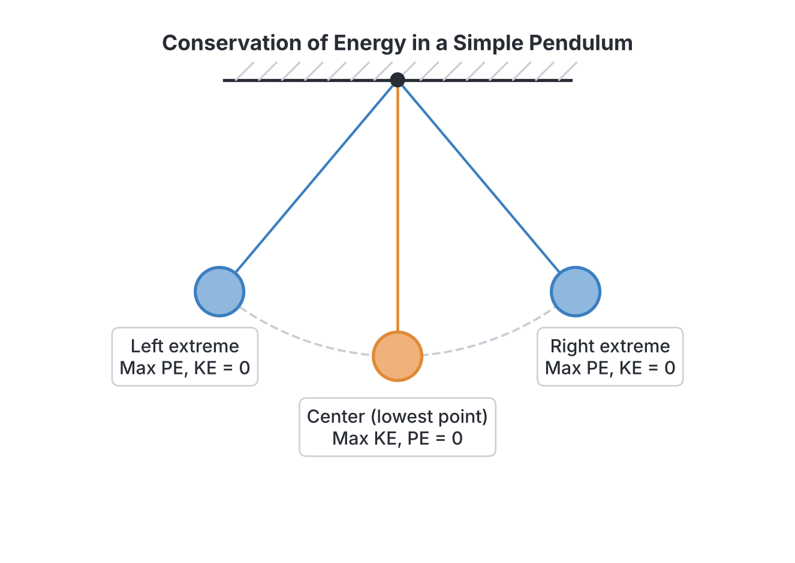
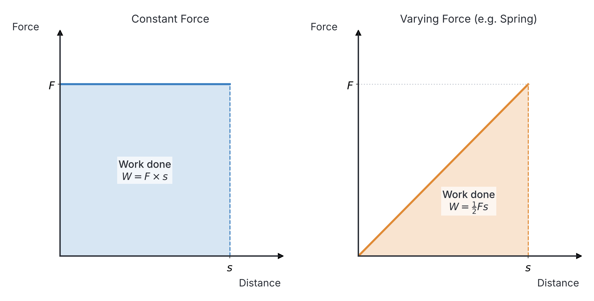

# JAMB Physics Notes: Work, Energy and Power

## What JAMB expects

This topic is Section A, Topic 7(a) of the JAMB Physics syllabus. It covers the fundamental mechanics of work, energy, and power. 

This is part 1 of a split topic. To maintain a reasonable file length, the societal aspects (such as renewable/non-renewable energy, dams, solar panels, and nuclear energy) are covered in the second part: `A7b-energy-sources-and-society.md`.

In this file, we cover the following content items:
- (i) definition of work, energy and power;
- (ii) forms of energy;
- (iii) conservation of energy;
- (iv) qualitative treatment between different forms of energy;
- (v) interpretation of area under the force-distance curve.

By the end of these notes, you should be able to:
1. differentiate between work, energy and power;
2. compare different forms of energy, giving examples;
3. apply the principle of conservation of energy;
4. examine the transformation between different forms of energy;
5. interpret the area under the force–distance curve;
6. solve numerical problems in work, energy and power.

## Differentiating Between Work, Energy and Power

*(Covers Objective i and Content i)*

In everyday English, "work", "energy", and "power" are often used to mean the same thing. In Physics, they have very specific, different meanings.

### 1. Work ($W$)
**Work** is done when a force moves an object through a distance in the direction of the force. If you push a heavy wall and it does not move, you might get tired, but in Physics, you have done **zero work** because the distance moved is zero.
- **Formula:** $W = F \times s$ (where $F$ is force and $s$ is distance or displacement in the direction of the force).
- **SI Unit:** Joule ($\text{J}$).
- **Nature:** It is a scalar quantity.

### 2. Energy ($E$)
**Energy** is defined as the capacity or ability to do work. An object must possess energy to do work, and doing work on an object transfers energy to it.
- **Formula:** Varies depending on the form of energy (e.g., $PE = mgh$).
- **SI Unit:** Joule ($\text{J}$).
- **Nature:** It is a scalar quantity.

### 3. Power ($P$)
**Power** is the time rate of doing work or the rate at which energy is transferred. It tells us how *fast* work is being done. A generator that pumps water into an overhead tank in 5 minutes is more powerful than one that takes 20 minutes to pump the same amount of water.
- **Formula:** $P = \frac{W}{t}$ or $P = \frac{E}{t}$ (where $W$ is work, $E$ is energy, and $t$ is time).
- **SI Unit:** Watt ($\text{W}$), which is equivalent to Joules per second ($\text{J s}^{-1}$).
- **Nature:** It is a scalar quantity.

### Summary Comparison

| Feature | Work | Energy | Power |
| :--- | :--- | :--- | :--- |
| **Definition** | Product of force and distance moved in the direction of the force | The capacity or ability to do work | The rate at which work is done or energy is transferred |
| **Formula** | $W = F \times s$ | Varies (e.g., $mgh$, $\frac{1}{2}mv^2$) | $P = \frac{W}{t}$ |
| **SI Unit** | Joule ($\text{J}$) | Joule ($\text{J}$) | Watt ($\text{W}$) |
| **Scalar/Vector**| Scalar | Scalar | Scalar |

## Comparing Different Forms of Energy

*(Covers Objective ii and Content ii)*

Energy exists in many different forms. All these forms can be grouped into broad categories, but the syllabus requires you to compare and identify them.

| Form of Energy | Description | Common Examples |
| :--- | :--- | :--- |
| **Mechanical Energy** | The energy of an object due to its motion (Kinetic) or its position/state (Potential). | A moving okada (Kinetic), water stored in a high overhead tank (Potential), a stretched catapult (Potential). |
| **Thermal (Heat) Energy** | The internal energy of an object due to the random motion of its particles. | A hot pressing iron, boiling water for garri, a blazing fire. |
| **Chemical Energy** | Energy stored in the chemical bonds of substances. | Food (like yam and rice), petrol, diesel, and the acid in a car battery. |
| **Electrical Energy** | Energy resulting from the flow of electric charges (electrons). | Current from the national grid (NEPA/PHCN), energy from a generator or battery. |
| **Radiant (Light) Energy**| Energy carried by electromagnetic waves. | Sunlight, light from an electric bulb, X-rays. |
| **Sound Energy** | Energy transferred through a medium by the vibration of particles. | A beating talking drum, a loudspeaker, the human voice. |
| **Nuclear Energy** | Energy stored in the nucleus of an atom, released during nuclear fission or fusion. | Energy produced in the Sun (fusion), nuclear power stations. |

## The Principle of Conservation of Energy

*(Covers Objective iii and Content iii)*

The **Principle of Conservation of Energy** states that *energy can neither be created nor destroyed, but it can only be transformed from one form to another*. 

This means that in an isolated (closed) system, the **total energy remains constant**. 

### Mechanical Energy Conservation
For mechanical systems where no energy is lost to friction or air resistance, the sum of Kinetic Energy ($KE$) and Potential Energy ($PE$) is constant:
$$Total\ Mechanical\ Energy = PE + KE = \text{Constant}$$

**Example 1: A Falling Object**
When a mango falls from a tree, its potential energy at the top (maximum $PE$, zero $KE$) is gradually converted into kinetic energy as it falls. Just before it hits the ground, its $PE$ is zero and its $KE$ is maximum. The total energy at any point during the fall is the same.

**Example 2: A Simple Pendulum**
As a pendulum swings back and forth:
- At the **highest points** (extreme ends), it stops momentarily. Here, velocity is zero, so $KE = 0$. The energy is entirely **Potential Energy**.
- At the **lowest point** (the centre), it moves fastest. Here, height is minimum (usually taken as zero), so $PE = 0$. The energy is entirely **Kinetic Energy**.
- In between, the energy is a mixture of $PE$ and $KE$, but their sum is always constant.

## Examining Transformations Between Forms of Energy

*(Covers Objective iv and Content iv)*

Because of the conservation of energy, energy is constantly being transformed from one form to another in everyday devices. Understanding these qualitative transformations is a common JAMB requirement.

- **Petrol Generator:** Chemical energy (in petrol) $\rightarrow$ Thermal energy (burning fuel) $\rightarrow$ Mechanical energy (rotating the engine shaft) $\rightarrow$ Electrical energy.
- **Electric Pressing Iron:** Electrical energy $\rightarrow$ Thermal (Heat) energy.
- **Loudspeaker:** Electrical energy $\rightarrow$ Sound energy.
- **Microphone:** Sound energy $\rightarrow$ Electrical energy.
- **Electric Motor (e.g., in a fan or water pump):** Electrical energy $\rightarrow$ Mechanical energy.
- **Photosynthesis in Plants:** Radiant (Light) energy from the Sun $\rightarrow$ Chemical energy (stored in the plant).
- **A Battery-powered Torchlight:** Chemical energy (in the battery) $\rightarrow$ Electrical energy $\rightarrow$ Radiant (Light) energy + Thermal (Heat) energy (as the bulb gets warm).

## Interpreting the Area Under the Force-Distance Curve

*(Covers Objective v and Content v)*

The formula $W = F \times s$ is easy to use when the force is constant. However, in many real-life situations, the force changes (varies) as the object moves—for example, stretching a rubber band requires more force the further you stretch it.

To find the work done when the force is not constant, we plot a graph of **Force (on the y-axis)** against **Distance (on the x-axis)**. 

**The area under the Force-Distance curve is equal to the Work Done.**

1. **Constant Force:** If a constant force of $10\ \text{N}$ is applied over $5\ \text{m}$, the graph is a horizontal straight line. The shape under the line is a **rectangle**.
   $$Work\ Done = Area\ of\ rectangle = \text{base} \times \text{height} = s \times F$$
2. **Uniformly Varying Force:** If you stretch a spring from $0\ \text{m}$ to $5\ \text{m}$ and the force increases steadily from $0\ \text{N}$ to $10\ \text{N}$, the graph is a diagonal straight line starting from the origin. The shape under the line is a **triangle**.
   $$Work\ Done = Area\ of\ triangle = \frac{1}{2} \times \text{base} \times \text{height} = \frac{1}{2} \times s \times F$$

## Solving Numerical Problems in Work, Energy and Power

*(Covers Objective vi)*

### 1. Calculations Involving Work Done

If a force is applied at an angle $\theta$ to the direction of motion, only the component of the force *in the direction of motion* does work. 
$$W = (F \cos\theta) \times s$$
where $W$ is work ($\text{J}$), $F$ is force ($\text{N}$), $\theta$ is the angle to the horizontal, and $s$ is distance ($\text{m}$).

**Worked Example 1:**
A boy pulls a block with a force of $50\ \text{N}$ at an angle of $60^\circ$ to the horizontal over a distance of $10\ \text{m}$. Calculate the work done.

**Solution:**
1. **Write the formula:** $W = F \cos\theta \times s$
2. **Substitute the values:** $F = 50\ \text{N}$, $\theta = 60^\circ$, $s = 10\ \text{m}$.
3. **Calculate:** $W = 50 \times \cos(60^\circ) \times 10$
   Since $\cos(60^\circ) = 0.5$:
   $W = 50 \times 0.5 \times 10 = 25 \times 10$
4. **State the answer:** The work done is $250\ \text{J}$.

### 2. Calculations Involving Energy

- **Gravitational Potential Energy:** $PE = mgh$
- **Kinetic Energy:** $KE = \frac{1}{2}mv^2$

Where $m$ is mass in $\text{kg}$, $g$ is acceleration due to gravity ($10\ \text{m s}^{-2}$ in JAMB unless otherwise stated), $h$ is height in $\text{m}$, and $v$ is velocity in $\text{m s}^{-1}$.

**Worked Example 2:**
A mango of mass $0.2\ \text{kg}$ falls from a tree $5\ \text{m}$ high. Calculate its kinetic energy just before hitting the ground. (Take $g = 10\ \text{m s}^{-2}$).

**Solution:**
1. **Apply the principle of conservation of energy:** Total $PE$ at the top is completely converted to $KE$ at the bottom (ignoring air resistance).
2. **Calculate the $PE$ at the top:** $PE = mgh$
3. **Substitute the values:** $PE = 0.2\ \text{kg} \times 10\ \text{m s}^{-2} \times 5\ \text{m}$
4. **Calculate:** $PE = 2 \times 5 = 10\ \text{J}$
5. **State the answer:** Since $KE$ at the bottom equals $PE$ at the top, the kinetic energy is $10\ \text{J}$.

### 3. Calculations Involving Power

$$P = \frac{W}{t} = \frac{E}{t}$$
If an object is moving at a constant velocity $v$ under a constant force $F$, power can also be written as:
$$P = \frac{F \times s}{t} = F \times \left(\frac{s}{t}\right) = F \times v$$

**Worked Example 3:**
A borehole pump lifts $200\ \text{kg}$ of water through a vertical height of $15\ \text{m}$ in $1\ \text{minute}$. Calculate the power of the pump. (Take $g = 10\ \text{m s}^{-2}$).

**Solution:**
1. **Write the formula for power:** $P = \frac{W}{t}$. The work done is against gravity, so $W = mgh$.
2. **Convert time to SI units (seconds):** $t = 1\ \text{minute} = 60\ \text{s}$. *(A common mistake is dividing by 1 instead of 60).*
3. **Calculate the work done:** $W = 200 \times 10 \times 15 = 30000\ \text{J}$.
4. **Calculate power:** $P = \frac{30000}{60} = 500\ \text{W}$.
5. **State the answer:** The power of the pump is $500\ \text{W}$.

## Key terms

| Term | Meaning |
| :--- | :--- |
| **Work** | The product of a force and the distance moved in the direction of the force ($W = F \times s$). |
| **Energy** | The capacity or ability to do work. |
| **Power** | The time rate of doing work or transferring energy ($P = \frac{W}{t}$). |
| **Kinetic Energy ($KE$)** | The energy possessed by a body due to its motion ($KE = \frac{1}{2}mv^2$). |
| **Potential Energy ($PE$)** | The energy possessed by a body due to its position or state ($PE = mgh$). |
| **Conservation of Energy** | The principle that energy cannot be created or destroyed, only transformed from one form to another. |
| **Joule ($\text{J}$)** | The SI unit of work and energy. |
| **Watt ($\text{W}$)** | The SI unit of power, equivalent to one Joule per second. |

## Exam tips and common mistakes

- **Wrong Time Unit in Power:** A very common mistake is using time in minutes. Always convert time to seconds ($t$ in seconds) before calculating power.
- **Forgetting $g$ in Work against Gravity:** When lifting an object, the force is its weight ($W = mg$), not just its mass. Do not forget to multiply the mass by gravity ($10\ \text{m s}^{-2}$) when finding work done or potential energy.
- **Squaring the Velocity in $KE$:** When calculating Kinetic Energy ($KE = \frac{1}{2}mv^2$), remember to square the velocity *before* multiplying by the mass and dividing by two.
- **Work at an Angle:** Remember that work is only done by the component of force in the direction of motion. If you pull at an angle $\theta$, use $W = F \cos\theta \times s$. If a question says a man carries a load and walks *horizontally*, the work done *against gravity* is zero because the displacement is perpendicular to the force of gravity.
- **Force-Distance Graphs:** Always check the shape. If it starts from the origin and slopes up (a triangle), do not forget the $\frac{1}{2}$ in your area calculation!

## Quick summary

1. Work is done when a force moves an object. It is the product of force and distance in the direction of the force ($W = F \times s$).
2. Energy is the capacity to do work. Both work and energy are measured in Joules ($\text{J}$).
3. Power is the rate of doing work ($P = \frac{W}{t}$). It is measured in Watts ($\text{W}$).
4. The Principle of Conservation of Energy states that energy is neither created nor destroyed, only transformed. In a closed system, Total Mechanical Energy ($PE + KE$) is constant.
5. In a swinging pendulum, Potential Energy is maximum at the highest points, while Kinetic Energy is maximum at the lowest point.
6. The area under a Force-Distance graph represents the work done. For a constant force it is a rectangle ($F \times s$), and for a uniformly varying force it is a triangle ($\frac{1}{2} \times F \times s$).
7. Energy exists in many forms (mechanical, thermal, chemical, electrical, sound, light, nuclear) and devices like generators and motors exist to transform it between these forms.

## Practice questions

**1. Which of the following statements correctly differentiates between work, energy, and power?**

- A. Work is the rate of doing energy, while power is the capacity to do work.
- B. Work and energy are measured in Joules, but power is the rate of transferring energy, measured in Watts.
- C. Energy is a vector quantity, while work and power are scalar quantities.
- D. Power is the product of force and distance, while work is power divided by time.

**Answer: B.** Work is the transfer of energy (measured in Joules), energy is the capacity to do work (Joules), and power is the rate at which this work is done (measured in Watts). All three are scalar quantities.

**2. Which of the following forms of energy is stored in the chemical bonds of a piece of roasted yam?**

- A. Thermal energy
- B. Mechanical energy
- C. Chemical energy
- D. Radiant energy

**Answer: C.** Food, fuels, and batteries store chemical energy, which is released during chemical reactions (like digestion or burning).

**3. A simple pendulum swings back and forth. At its highest point (the extreme ends), its energy is:**

- A. entirely kinetic.
- B. entirely potential.
- C. a mixture of kinetic and potential with kinetic being maximum.
- D. zero.

**Answer: B.** At the highest point of the swing, the pendulum comes to a momentary stop (velocity is zero, so $KE = 0$), meaning all its energy is potential energy.

**4. A device that converts electrical energy into mechanical energy is a:**

- A. electric generator.
- B. solar cell.
- C. electric motor.
- D. microphone.

**Answer: C.** An electric motor takes in electrical energy and outputs mechanical energy (rotation). A generator does the exact opposite.

**5. The area under a force-distance graph represents:**

- A. acceleration.
- B. power.
- C. momentum.
- D. work done.

**Answer: D.** Multiplying force (y-axis) by distance (x-axis) gives the area under the curve, which equals the work done ($W = F \times s$).

**6. A horizontal force of $40\ \text{N}$ is used to push a wheelbarrow over a distance of $15\ \text{m}$. What is the work done?**

- A. $2.67\ \text{J}$
- B. $55\ \text{J}$
- C. $300\ \text{J}$
- D. $600\ \text{J}$

**Answer: D.** 
1. Formula: $W = F \times s$
2. Substitute: $W = 40\ \text{N} \times 15\ \text{m}$
3. Calculate: $W = 600\ \text{J}$
Option C ($300\ \text{J}$) is a common mistake if a student incorrectly assumes the force is varying and applies the area of a triangle formula ($\frac{1}{2}bh$).

**7. A stone of mass $2\ \text{kg}$ is thrown vertically upwards with a velocity of $20\ \text{m s}^{-1}$. Calculate the maximum height reached. (Take $g = 10\ \text{m s}^{-2}$)**

- A. $10\ \text{m}$
- B. $20\ \text{m}$
- C. $40\ \text{m}$
- D. $400\ \text{m}$

**Answer: B.** 
1. Initial $KE = \frac{1}{2}mv^2$
2. $KE = \frac{1}{2} \times 2 \times (20)^2 = 400\ \text{J}$.
3. At maximum height, all $KE$ is converted to $PE$. So, $PE = 400\ \text{J}$.
4. $PE = mgh \implies 400 = 2 \times 10 \times h$.
5. $20h = 400 \implies h = 20\ \text{m}$.
Option C ($40\ \text{m}$) is a common mistake resulting from forgetting the $\frac{1}{2}$ in the Kinetic Energy formula ($2 \times 400 = 800$, leading to $h = 40$).

**8. Calculate the power of an engine that performs $2400\ \text{J}$ of work in $2\ \text{minutes}$.**

- A. $20\ \text{W}$
- B. $40\ \text{W}$
- C. $1200\ \text{W}$
- D. $4800\ \text{W}$

**Answer: A.** 
1. Convert time to seconds: $t = 2\ \text{minutes} = 120\ \text{s}$.
2. Formula: $P = \frac{W}{t}$
3. Calculate: $P = \frac{2400}{120} = 20\ \text{W}$.
Option C ($1200\ \text{W}$) is the result of the very common mistake of failing to convert minutes into seconds (dividing by 2 instead of 120).

**9. A force-distance graph is a right-angled triangle with a base of $10\ \text{m}$ and a height of $20\ \text{N}$. The work done is:**

- A. $2\ \text{J}$
- B. $100\ \text{J}$
- C. $150\ \text{J}$
- D. $200\ \text{J}$

**Answer: B.** 
1. Work done is the area of the triangle: $Area = \frac{1}{2} \times \text{base} \times \text{height}$.
2. Calculate: $W = \frac{1}{2} \times 10\ \text{m} \times 20\ \text{N} = 100\ \text{J}$.
Option D ($200\ \text{J}$) is the result of forgetting the $\frac{1}{2}$ and incorrectly treating the varying force like a constant force rectangle.

**10. A generator uses a motor to lift a $50\ \text{kg}$ load through a vertical distance of $4\ \text{m}$ in $5\ \text{s}$. Calculate the useful power output. (Take $g = 10\ \text{m s}^{-2}$)**

- A. $40\ \text{W}$
- B. $100\ \text{W}$
- C. $400\ \text{W}$
- D. $2000\ \text{W}$

**Answer: C.** 
1. Calculate work done against gravity: $W = mgh = 50 \times 10 \times 4 = 2000\ \text{J}$.
2. Calculate power: $P = \frac{W}{t} = \frac{2000}{5} = 400\ \text{W}$.
Option A ($40\ \text{W}$) is a common mistake where a student forgets to multiply the mass by gravity to find the weight ($W = \frac{50 \times 4}{5}$). Option D ($2000\ \text{W}$) incorrectly stops after calculating the work done, confusing energy with power.
