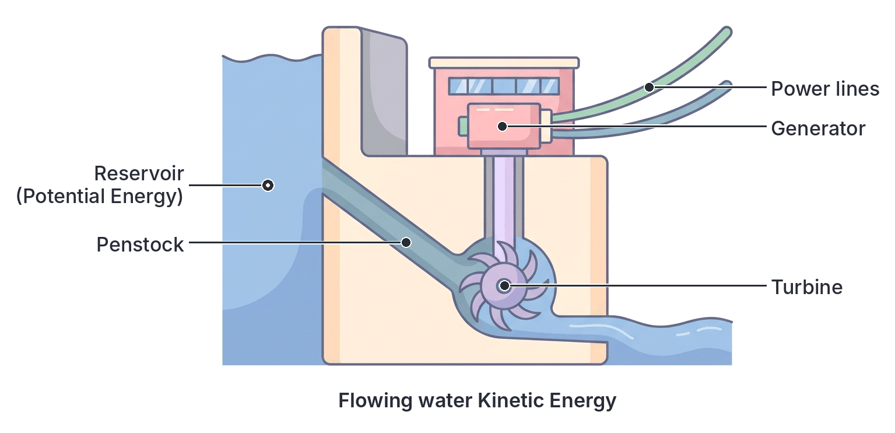
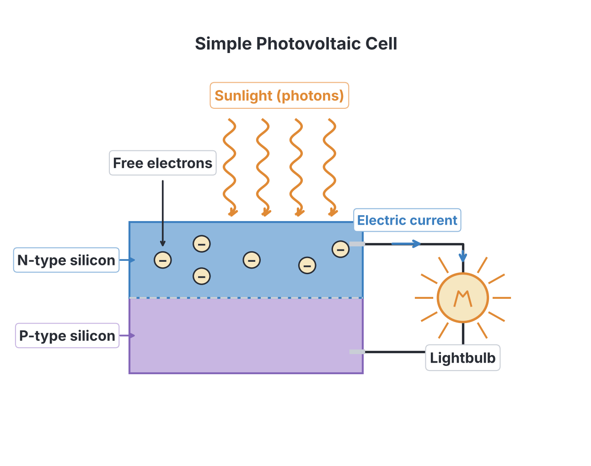

# JAMB Physics Notes: Energy Sources and Society

## What JAMB expects

This topic is Section A, Topic 7 (parts b, c, d and e) of the JAMB Physics syllabus: Work, Energy and Power. It covers the societal, environmental, and technological aspects of energy, as well as the photoelectric effect. 

This is part two of a split topic. The foundational mechanics (definitions of work, power, kinetic and potential energy, conservation of energy, and the force-distance curve) are fully explained in the first part: `A7a-work-energy-and-power.md`. 

**This file covers the following content items:**
* (b) Energy and society
* (c) Dams and energy production
* (d) nuclear energy
* (e) solar energy

**By the end of these notes, you should be able to:**
* vii. itemize the sources of energy;
* viii. distinguish between renewable and non-renewable energy, examples should be given;
* ix. identify methods of energy transition;
* x. explain the importance of energy in the development of the society;
* xi. analyze the effect of energy use to the environment;
* xii. identify the impact of energy on the environment;
* xiii. identify energy sources that are friendly or hazardous to the environment;
* xiv. identify energy uses in their immediate environment;
* xv. suggests ways of safe energy use;
* xvi. state different forms of energy conversion;
* xvii. Photovoltaic cells;
* xviii. Work function ($\phi = hf$);
* xix. Planck’s constant.

**Note on the syllabus wording:** The syllabus lists the formula for work function as "$\phi = hf$". This is a typographical error common in textbooks; the correct notation is $\phi = hf_0$, where $f_0$ is the *threshold frequency*, while $f$ is reserved for the frequency of the incident light. In Topic 7(b)(ii), the text "coal, crude oil sun, wind etc." is missing a comma after "crude oil". The syllabus also lists "Photovoltaic cells", "Work function", and "Planck's constant" as objectives (xvii, xviii, xix), but they function as content topics to be understood and calculated.

## Energy and Society

Energy exists in various forms and is the backbone of human civilization. The way a society generates, distributes, and consumes energy dictates its technological advancement, economy, and environmental health. 

### Sources of energy

To harness energy for societal use, we rely on specific natural resources. Most of the energy available on Earth ultimately comes from the **Sun**. The Sun's radiant energy drives weather systems, ocean currents, and the water cycle. It is also responsible for the growth of plants (via photosynthesis), which over millions of years fossilize into fuels like coal and crude oil. 

The primary sources of energy can be itemized as follows:
1. **Solar energy:** Direct radiation from the sun.
2. **Fossil fuels:** Crude oil (petroleum), natural gas, and coal.
3. **Hydroelectricity:** Energy from flowing or falling water.
4. **Wind energy:** Moving air masses turning wind turbines.
5. **Biomass:** Organic matter like firewood, agricultural waste, and animal dung.
6. **Geothermal energy:** Heat from deep inside the Earth.
7. **Nuclear energy:** Energy released from splitting or fusing atomic nuclei.
8. **Tidal and Wave energy:** Energy generated by the gravitational pull of the moon and the movement of ocean waters.

### Renewable and non-renewable energy

Energy sources are broadly classified based on whether they can be naturally replenished within a human lifetime. 

*   **Renewable energy** sources are those that are continuously replenished by nature and will not run out as long as the Earth and Sun exist. Examples include solar, wind, hydroelectricity, tidal, and geothermal energy.
*   **Non-renewable energy** sources are finite. They take millions of years to form and are consumed much faster than nature can replace them. Examples include coal, crude oil (petroleum), natural gas, and nuclear fuels (like uranium).

**Textbook variation:** Some textbooks classify biomass as strictly renewable, but note that if trees are cut down faster than they are replanted (deforestation), firewood acts like a non-renewable resource in practice.

| Feature | Renewable Energy | Non-Renewable Energy |
| --- | --- | --- |
| **Replenishment** | Replaced naturally in a short time. | Cannot be replaced once used up. |
| **Availability** | Abundant and essentially infinite. | Finite and depleting (limited reserves). |
| **Environmental impact** | Generally "clean" with low carbon emissions. | High pollution and carbon emissions. |
| **Examples** | Sun (solar), wind, water (hydro), tides. | Coal, crude oil (petroleum), natural gas. |

### Uses of energy in the immediate environment

In our daily lives in Nigeria, we interact with energy constantly across several sectors:
1. **Cooking (Residential):** Using chemical energy from firewood, charcoal, kerosene, or liquefied petroleum gas (LPG or "cooking gas").
2. **Transportation:** Burning petrol (PMS) or diesel (AGO) in commercial buses (danfo), tricycles (keke), motorcycles (okada), and personal vehicles.
3. **Lighting and Appliances:** Using electrical energy from the national grid (NEPA/PHCN) or petrol-powered generators to run bulbs, fans, televisions, and charge mobile phones.
4. **Heating and Cooling:** Using electricity for air conditioners during the hot dry season or boiling water.
5. **Commercial and Agricultural:** Powering grinding machines in local markets, running irrigation pumps for dry-season farming, and cooling beverages in shops.

### Energy and development

Energy is directly linked to the economic and social development of a society. 
*   **Industrialization:** Factories cannot operate without reliable power. A stable energy supply lowers the cost of producing goods, creating jobs and wealth.
*   **Healthcare:** Hospitals require continuous electricity to power life-saving equipment, incubators, and refrigerators for storing vaccines.
*   **Education:** Lighting allows students to study at night, while power enables the use of computers and the internet in schools.

A society lacking reliable energy (energy poverty) struggles to grow. In Nigeria, the reliance on expensive and polluting diesel generators increases the cost of doing business, which slows down economic development. Transitioning to reliable, large-scale energy infrastructure is essential for lifting communities out of poverty and improving living standards.

### Safe energy use

Because energy can be powerful and dangerous, safe practices are crucial:
1. **Electrical safety:** Avoid overloading sockets. Ensure appliances are properly earthed. Never touch electrical switches with wet hands to prevent electrocution. Use proper fuses or circuit breakers.
2. **Gas safety:** Keep LPG (cooking gas) cylinders outdoors or in highly ventilated areas. Check for leaks regularly using soapy water, not a matchstick!
3. **Generator safety:** Never operate a petrol or diesel generator indoors. Generators produce carbon (II) oxide (carbon monoxide), a colorless, odorless gas that can cause death by suffocation.
4. **Fire safety:** Keep flammable materials like kerosene and petrol away from open flames and heat sources.

### Energy crises and energy diversification

An **energy crisis** occurs when there is a significant bottleneck or shortfall in the supply of energy resources to an economy. In Nigeria, this frequently manifests as periodic fuel scarcity (long queues at filling stations) or frequent collapses of the national electricity grid. Globally, energy crises are often caused by wars, pipeline vandalism, or geopolitical tensions.

**Energy diversification** is the strategy of using a wide variety of energy sources rather than relying heavily on just one. For example, if a country depends entirely on hydroelectric dams, a severe drought will cause a massive power crisis. By diversifying the energy mix to include solar, wind, and natural gas alongside hydro, the country ensures continuous power even if one source fails.

### Methods of energy transition

Energy transition is the global shift from fossil-based energy systems to sustainable, renewable energy sources. Methods to achieve this include:
1. **Adopting electric vehicles (EVs):** Moving away from petrol-powered cars to battery-powered vehicles.
2. **Scaling up renewables:** Building large solar farms and wind turbine parks instead of coal or gas power plants.
3. **Policy changes:** Governments introducing "carbon taxes" or removing fossil fuel subsidies to encourage people to use cleaner energy.
4. **Improving energy efficiency:** Designing buildings and appliances (like LED bulbs) that consume far less power.

### Analyzing the effect of energy use on the environment

When we analyze energy use, we must look at the entire lifecycle—from extraction to consumption. Fossil fuels require mining or drilling, which destroys habitats. Transporting them carries the risk of spills. Finally, burning them releases particulate matter (smoke) that causes respiratory diseases, and sulfur dioxide which leads to acid rain. 

A major global effect is the **greenhouse effect** and **global warming**. Burning fossil fuels releases large amounts of carbon (IV) oxide (CO₂) and other greenhouse gases. These gases trap the sun's heat in the Earth's atmosphere, raising the average global temperature. This leads to climate change, melting ice caps, and extreme weather events.

### Identifying the impact of energy on the environment

Specific negative impacts of unchecked energy use include:
1. **Habitat destruction:** Flooding large areas of land to build hydroelectric dams or clearing forests for firewood.
2. **Water pollution:** Oil spills (such as those in the Niger Delta from pipeline vandalism or accidents) coating aquatic animals in toxic sludge, killing fish, and destroying the livelihoods of fishermen.
3. **Air pollution:** Fumes from generators and vehicles causing heavy smog and respiratory health crises in crowded cities like Lagos.

### Friendly and hazardous energy sources

*   **Friendly (Green) Sources:** Solar, wind, and tidal energy are considered friendly. They produce no greenhouse gases during operation, do not spill toxic chemicals, and have minimal environmental footprints once built.
*   **Hazardous Sources:** Coal (produces the most carbon and toxic ash), crude oil (high risk of spillage and air pollution), and nuclear energy (if poorly managed, can release highly dangerous radioactive waste).

### Conversion of energy

The Principle of Conservation of Energy states that energy can neither be created nor destroyed, but only converted from one form to another. All energy devices operate on this principle, taking in one form of energy and outputting a more useful form (along with some wasted energy, usually heat, due to friction or electrical resistance).

Here are common examples of energy conversions happening in everyday life:

| Device | Initial Energy Form | Final Energy Form (Useful) |
| --- | --- | --- |
| **Electric Motor** | Electrical | Mechanical (Kinetic) |
| **Generator (Dynamo)**| Mechanical | Electrical |
| **Electric Iron / Heater**| Electrical | Heat (Thermal) |
| **Loudspeaker** | Electrical | Sound |
| **Microphone** | Sound | Electrical |
| **Light Bulb** | Electrical | Light |
| **Dry Cell (Battery)** | Chemical | Electrical |
| **Solar Panel (PV cell)**| Light (Solar) | Electrical |

### Devices used in energy production

Several key devices are engineered specifically to produce electrical power on a small or large scale:
*   **Generators (Alternators):** Use electromagnetic induction to turn the mechanical rotation of an engine or turbine into alternating current (AC).
*   **Batteries and Cells:** Use chemical reactions to push electrons through a circuit, providing direct current (DC).
*   **Solar Panels:** Use semiconductor materials to convert sunlight directly into electricity.
*   **Turbines:** Large bladed devices spun by steam, wind, or water, which in turn spin a generator.

## Dams and Energy Production

Hydroelectric dams require specific geographical features. They are usually built across large, fast-flowing rivers in valleys or gorges. The location must allow for a massive reservoir (artificial lake) to form behind the dam without excessive flooding of human settlements. In Nigeria, major dams are located in the northern and central regions where large rivers flow:
*   **Kainji Dam:** Located on the River Niger in Niger State.
*   **Shiroro Dam:** Located on the Kaduna River in Niger State.
*   **Jebba Dam:** Located on the River Niger, downstream of Kainji.

**Energy Production in a Dam:**
Hydroelectricity relies on the mechanical energy of water. 
1. Water stored high in a reservoir possesses **gravitational potential energy**. 
2. When the dam gates open, water rushes down large pipes (penstocks). The potential energy is converted to **kinetic energy**.
3. The rushing water strikes the blades of a **turbine**, causing it to spin, converting the kinetic energy to **mechanical energy**.
4. The spinning turbine turns a **generator**, which uses electromagnetic induction to produce **electrical energy**.

## Nuclear Energy

Nuclear energy involves changes in the very dense core (nucleus) of atoms. It yields millions of times more energy per kilogram of fuel than burning fossil fuels. There are two types:
*   **Nuclear Fission:** A heavy, unstable nucleus (like Uranium-235) is split into two lighter nuclei by a slow-moving neutron. This releases immense heat and more neutrons, triggering a chain reaction. This heat is used to boil water into steam to turn turbines in nuclear power plants.
*   **Nuclear Fusion:** Two light nuclei (like isotopes of hydrogen) combine at extremely high temperatures and pressures to form a heavier nucleus (like helium), releasing massive energy. This is the process that powers the Sun and all stars. It is not yet viable for controlled energy production on Earth.

## Solar Energy

Solar energy is the abundant radiation emitted by the Sun. It can be harnessed in two primary ways: by trapping it as heat or by converting it directly into electricity.

### Solar collectors

A solar collector is a device that absorbs sunlight and converts it into **heat (thermal energy)**. They are often used for solar water heating in homes. A typical flat-plate collector consists of a dark, heat-absorbing metal plate placed in an insulated box with a glass cover. The dark surface maximizes heat absorption, while the glass traps the heat (a miniature greenhouse effect). Water or antifreeze flows through pipes in the collector, picking up the heat.

### Solar panels and photovoltaic cells

When we talk about solar panels generating electricity (as opposed to just heat), we are referring to arrays of **solar cells**. By connecting many panels together, sufficient electrical power can be generated to supply a house, power a street light, or, in large solar farms, feed into the national grid. 

The individual units inside a solar electricity panel are **photovoltaic (PV) cells**. They are usually made from semiconductor materials like silicon. When sunlight hits the PV cell, the light energy excites electrons in the silicon, knocking them loose. The structure of the cell forces these free electrons to flow in one direction, creating a direct electric current (DC). This direct conversion of light to electricity is a practical application of the photoelectric effect.

### The photoelectric effect

The **photoelectric effect** is the emission of electrons from the surface of a metal when light of a high enough frequency shines on it. The emitted electrons are called **photoelectrons**. 

This phenomenon cannot be explained by treating light purely as a continuous wave. Instead, it proves that light behaves as a stream of discrete energy packets or particles called **photons** (Wave-Particle Duality). 
* If a photon has enough energy, it instantly knocks an electron out of the metal.
* If the photon's energy is too low, no electrons are emitted, no matter how bright (intense) the light is or how long it shines.

### Planck's constant and photon energy

The energy ($E$) of a single photon of light is directly proportional to its frequency ($f$). The formula is:

$$E = hf$$

Alternatively, since wave speed $c = f \lambda \implies f = \frac{c}{\lambda}$, we can write:

$$E = \frac{hc}{\lambda}$$

Where:
*   $E$ = Energy of the photon (in Joules, $\text{J}$)
*   $h$ = **Planck's constant** (JAMB typically uses $6.6 \times 10^{-34}\ \text{J s}$)
*   $f$ = Frequency of the light (in Hertz, $\text{Hz}$)
*   $c$ = Speed of light in a vacuum ($3.0 \times 10^8\ \text{m s}^{-1}$)
*   $\lambda$ = Wavelength of the light (in meters, $\text{m}$)

**Worked Example 1: Calculating photon energy from frequency**
Calculate the energy of a photon of ultraviolet light with a frequency of $5.0 \times 10^{14}\ \text{Hz}$. (Take $h = 6.6 \times 10^{-34}\ \text{J s}$)

1.  **Identify the formula:** $E = hf$
2.  **Substitute the values:** $E = (6.6 \times 10^{-34}\ \text{J s}) \times (5.0 \times 10^{14}\ \text{Hz})$
3.  **Calculate the result:** 
    $E = (6.6 \times 5.0) \times 10^{-34} \times 10^{14}$
    $E = 33.0 \times 10^{-20}$
    $E = 3.3 \times 10^{-19}\ \text{J}$
4.  **State the answer:** The energy of the photon is $3.3 \times 10^{-19}\ \text{J}$.

**Worked Example 2: Calculating photon energy from wavelength**
Calculate the energy of a photon of yellow light with a wavelength of $6.0 \times 10^{-7}\ \text{m}$. ($h = 6.6 \times 10^{-34}\ \text{J s}$, $c = 3.0 \times 10^8\ \text{m s}^{-1}$)

1.  **Identify the formula:** $E = \frac{hc}{\lambda}$
2.  **Substitute the values:** 
    $E = \frac{(6.6 \times 10^{-34}\ \text{J s}) \times (3.0 \times 10^8\ \text{m s}^{-1})}{6.0 \times 10^{-7}\ \text{m}}$
3.  **Calculate the numerator:** $(6.6 \times 3.0) \times 10^{-34} \times 10^8 = 19.8 \times 10^{-26}$
4.  **Divide by the denominator:** $\frac{19.8 \times 10^{-26}}{6.0 \times 10^{-7}} = 3.3 \times 10^{-19}\ \text{J}$
5.  **State the answer:** The energy is $3.3 \times 10^{-19}\ \text{J}$.

**Worked Example 3: Calculating frequency from energy**
A photon has an energy of $9.9 \times 10^{-19}\ \text{J}$. Find its frequency. ($h = 6.6 \times 10^{-34}\ \text{J s}$)

1.  **Identify the rearranged formula:** $f = \frac{E}{h}$
2.  **Substitute the values:** $f = \frac{9.9 \times 10^{-19}\ \text{J}}{6.6 \times 10^{-34}\ \text{J s}}$
3.  **Calculate the result:** $f = 1.5 \times 10^{15}\ \text{Hz}$
4.  **State the answer:** The frequency is $1.5 \times 10^{15}\ \text{Hz}$.

### Work function and threshold frequency

Electrons are bound to the metal. To knock one out, a photon must have a certain minimum energy. 
*   **Work Function ($\phi$ or $W$):** The minimum energy required to eject an electron from a metal surface.
*   **Threshold Frequency ($f_0$):** The minimum frequency of light required to cause photoelectric emission from a particular metal. 
*   **Threshold Wavelength ($\lambda_0$):** The *maximum* wavelength of light that can cause emission.

The relationship is:
$$\phi = hf_0 = \frac{hc}{\lambda_0}$$

If the incoming photon has *more* energy than the work function ($hf > \phi$), the leftover energy becomes the maximum **kinetic energy ($E_k$)** of the ejected electron. This is **Einstein's Photoelectric Equation**:
$$E = \phi + E_k$$
$$hf = hf_0 + \frac{1}{2}mv^2$$
$$E_k = hf - \phi$$

*(Note: Sometimes work function is given in **electron-volts (eV)**. You must convert it to Joules for standard calculations: $1\ \text{eV} = 1.6 \times 10^{-19}\ \text{J}$.)*

**Worked Example 4: Calculating work function from threshold frequency**
A metal surface has a threshold frequency of $4.0 \times 10^{14}\ \text{Hz}$. Calculate its work function. ($h = 6.6 \times 10^{-34}\ \text{J s}$)

1.  **Identify the formula:** $\phi = hf_0$
2.  **Substitute the values:** $\phi = (6.6 \times 10^{-34}\ \text{J s}) \times (4.0 \times 10^{14}\ \text{Hz})$
3.  **Calculate the result:** $\phi = 26.4 \times 10^{-20} = 2.64 \times 10^{-19}\ \text{J}$
4.  **State the answer:** The work function is $2.64 \times 10^{-19}\ \text{J}$.

**Worked Example 5: Calculating maximum kinetic energy**
Light of frequency $1.0 \times 10^{15}\ \text{Hz}$ falls on a metal whose work function is $3.3 \times 10^{-19}\ \text{J}$. Find the maximum kinetic energy of the emitted photoelectrons. ($h = 6.6 \times 10^{-34}\ \text{J s}$)

1.  **Identify Einstein's equation:** $E_k = hf - \phi$
2.  **Calculate incoming photon energy ($E$):** 
    $E = hf = (6.6 \times 10^{-34}\ \text{J s}) \times (1.0 \times 10^{15}\ \text{Hz}) = 6.6 \times 10^{-19}\ \text{J}$
3.  **Substitute into the equation:** $E_k = (6.6 \times 10^{-19}\ \text{J}) - (3.3 \times 10^{-19}\ \text{J})$
4.  **Calculate the result:** $E_k = 3.3 \times 10^{-19}\ \text{J}$
5.  **State the answer:** The maximum kinetic energy is $3.3 \times 10^{-19}\ \text{J}$.

**Worked Example 6: Calculating threshold wavelength from work function**
A metal surface has a work function of $3.3 \times 10^{-19}\ \text{J}$. Calculate its threshold wavelength. ($h = 6.6 \times 10^{-34}\ \text{J s}$, $c = 3.0 \times 10^8\ \text{m s}^{-1}$)

1.  **Identify the formula:** $\lambda_0 = \frac{hc}{\phi}$
2.  **Substitute the values:** 
    $\lambda_0 = \frac{(6.6 \times 10^{-34}\ \text{J s}) \times (3.0 \times 10^8\ \text{m s}^{-1})}{3.3 \times 10^{-19}\ \text{J}}$
3.  **Calculate the numerator:** $19.8 \times 10^{-26}$
4.  **Divide by the denominator:** $\frac{19.8 \times 10^{-26}}{3.3 \times 10^{-19}} = 6.0 \times 10^{-7}\ \text{m}$
5.  **State the answer:** The threshold wavelength is $6.0 \times 10^{-7}\ \text{m}$.

## Key terms

| Term | Meaning |
| --- | --- |
| **Renewable Energy** | Energy sources that are naturally replenished and will not run out (e.g., solar, wind). |
| **Non-Renewable Energy** | Finite energy sources that deplete as they are used (e.g., fossil fuels, nuclear). |
| **Fossil Fuels** | Natural fuels like coal or gas, formed in the geological past from the remains of living organisms. |
| **Energy Diversification** | Using a variety of different energy sources to ensure a stable and secure supply. |
| **Energy Transition** | The global shift away from fossil fuels to sustainable, renewable energy systems. |
| **Nuclear Fission** | The splitting of a heavy atomic nucleus into lighter ones, releasing energy. |
| **Photovoltaic (PV) Cell** | A device that converts light energy directly into electrical energy. |
| **Photoelectric Effect** | The emission of electrons from a metal surface when light of sufficient frequency strikes it. |
| **Photon** | A discrete packet (quantum) of electromagnetic energy. |
| **Work Function ($\phi$)** | The minimum energy required to eject an electron from the surface of a metal. |
| **Threshold Frequency ($f_0$)** | The minimum frequency of light required to eject an electron from a specific metal. |
| **Planck's Constant ($h$)** | A fundamental physical constant relating a photon's energy to its frequency ($6.6 \times 10^{-34}\ \text{J s}$). |

## Exam tips and common mistakes

*   **Mistake:** Using wavelength ($\lambda$) instead of frequency ($f$) directly in the formula $E = h \times \lambda$. 
    *   **Correction:** The correct formulas are $E = hf$ or $E = \frac{hc}{\lambda}$.
*   **Mistake:** Forgetting to convert electron-volts ($\text{eV}$) to Joules before subtracting in the photoelectric equation. 
    *   **Correction:** If work function is given in eV, multiply by $1.6 \times 10^{-19}$ to get Joules before doing $E_k = hf - \phi$.
*   **Mistake:** Thinking bright light will always cause the photoelectric effect.
    *   **Correction:** Intensity (brightness) does not matter if the frequency is below the threshold frequency. Only frequency determines *if* electrons are emitted.
*   **Mistake:** Confusing solar collectors with solar panels.
    *   **Correction:** Collectors generate *heat* (thermal energy). Panels (PV cells) generate *electricity*.
*   **Tip:** JAMB often asks for the primary source of all energy. The answer is almost always the **Sun**.
*   **Tip:** Remember that Hydroelectricity and Biomass ultimately derive their energy from the Sun (the water cycle is driven by solar heat; plants grow via solar photosynthesis).

## Quick summary

1. The Sun is the ultimate source of most energy on Earth. Energy sources are classified as renewable (solar, wind, hydro) or non-renewable (fossil fuels, nuclear).
2. Energy is vital for societal development, but relying on fossil fuels causes environmental harm like global warming and oil spillage.
3. Energy diversification and energy transition are methods used to combat energy crises and reduce environmental footprints.
4. Hydroelectric dams (like Kainji and Shiroro) convert the potential energy of stored water into mechanical, then electrical energy.
5. Solar energy can be trapped as heat by solar collectors or converted directly into electricity by photovoltaic (PV) cells.
6. The photoelectric effect proves light behaves as particles (photons). Electrons are only emitted if the light's frequency exceeds the metal's threshold frequency.
7. Photon energy is calculated as $E = hf$. The maximum kinetic energy of an emitted electron is given by Einstein's equation: $E_k = hf - \phi$.

## Practice questions

**1. Which of the following is considered the primary source of all energy on Earth?**

- A. The Earth's core
- B. The Sun
- C. Crude oil
- D. Uranium

**Answer: B.** The Sun's solar radiation drives weather (wind and hydro), supports plant growth (biomass and fossil fuels), and directly provides solar energy.

**2. Which of the following is a non-renewable source of energy?**

- A. Wind
- B. Solar
- C. Crude oil
- D. Geothermal

**Answer: C.** Crude oil is a fossil fuel that takes millions of years to form and is depleted as we use it, making it non-renewable.

**3. The greenhouse effect is primarily exacerbated by the excessive use of:**

- A. Solar panels
- B. Wind turbines
- C. Fossil fuels
- D. Hydroelectric dams

**Answer: C.** Burning fossil fuels releases large amounts of carbon (IV) oxide, a greenhouse gas that traps heat in the atmosphere.

**4. The shift from using coal and crude oil to using solar and wind energy is referred to as:**

- A. Energy crisis
- B. Energy spillage
- C. Energy transition
- D. Energy generation

**Answer: C.** Energy transition is the global movement towards sustainable, renewable energy systems.

**5. In Nigeria, the Kainji and Shiroro dams are primarily built for:**

- A. Nuclear fission
- B. Hydroelectric energy production
- C. Oil drilling
- D. Solar energy collection

**Answer: B.** They are built on major rivers to harness the kinetic energy of flowing water to turn turbines and generate electricity.

**6. In a photovoltaic cell, energy is converted directly from:**

- A. Light to electrical
- B. Chemical to electrical
- C. Mechanical to electrical
- D. Heat to electrical

**Answer: A.** Photovoltaic (PV) cells use semiconductor materials to convert sunlight (photons) directly into electrical current. 

**7. Which of the following is a recommended practice for the safe use of electrical energy?**

- A. Overloading sockets with many appliances
- B. Operating electrical switches with wet hands
- C. Using properly insulated wires and circuit breakers
- D. Bypassing fuses to keep power flowing

**Answer: C.** Proper insulation and circuit breakers protect against short circuits, fires, and electrocution. Options A, B, and D are highly dangerous practices.

**8. Calculate the energy of a photon of light of frequency $3.0 \times 10^{15}\ \text{Hz}$. ($h = 6.6 \times 10^{-34}\ \text{J s}$)**

- A. $2.20 \times 10^{-49}\ \text{J}$
- B. $1.98 \times 10^{-18}\ \text{J}$
- C. $4.55 \times 10^{48}\ \text{J}$
- D. $3.30 \times 10^{-19}\ \text{J}$

**Answer: B.** 
1. $E = hf$
2. $E = (6.6 \times 10^{-34}) \times (3.0 \times 10^{15})$
3. $E = 19.8 \times 10^{-19}\ \text{J} = 1.98 \times 10^{-18}\ \text{J}$. 
*(Mistake A comes from dividing $h$ by $f$.)*

**9. A metal has a work function of $6.6 \times 10^{-19}\ \text{J}$. Calculate its threshold frequency. ($h = 6.6 \times 10^{-34}\ \text{J s}$)**

- A. $1.0 \times 10^{15}\ \text{Hz}$
- B. $4.36 \times 10^{-52}\ \text{Hz}$
- C. $1.0 \times 10^{14}\ \text{Hz}$
- D. $6.6 \times 10^{14}\ \text{Hz}$

**Answer: A.** 
1. $\phi = hf_0 \implies f_0 = \frac{\phi}{h}$
2. $f_0 = \frac{6.6 \times 10^{-19}}{6.6 \times 10^{-34}}$
3. $f_0 = 1.0 \times 10^{15}\ \text{Hz}$.
*(Mistake B comes from multiplying the values instead of dividing).*

**10. Light of energy $8.0 \times 10^{-19}\ \text{J}$ falls on a metal surface that has a work function of $5.0 \times 10^{-19}\ \text{J}$. Find the maximum kinetic energy of the emitted photoelectrons.**

- A. $1.3 \times 10^{-18}\ \text{J}$
- B. $4.0 \times 10^{-38}\ \text{J}$
- C. $3.0 \times 10^{-19}\ \text{J}$
- D. $1.6 \times 10^{-19}\ \text{J}$

**Answer: C.** 
1. Einstein's photoelectric equation is $E_k = E - \phi$
2. $E_k = (8.0 \times 10^{-19}) - (5.0 \times 10^{-19})$
3. $E_k = 3.0 \times 10^{-19}\ \text{J}$.
*(Mistake A comes from adding the energies instead of subtracting).*
