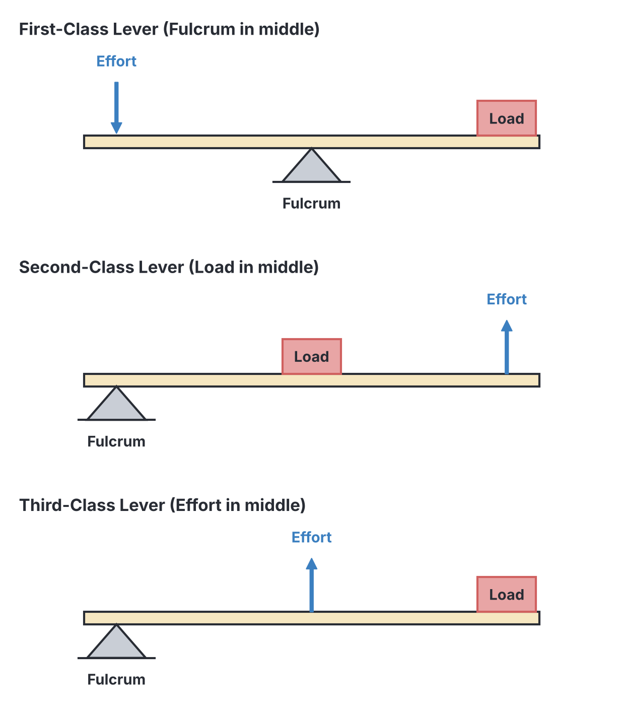
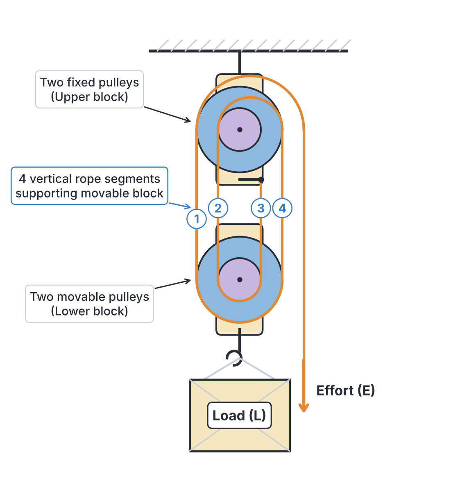
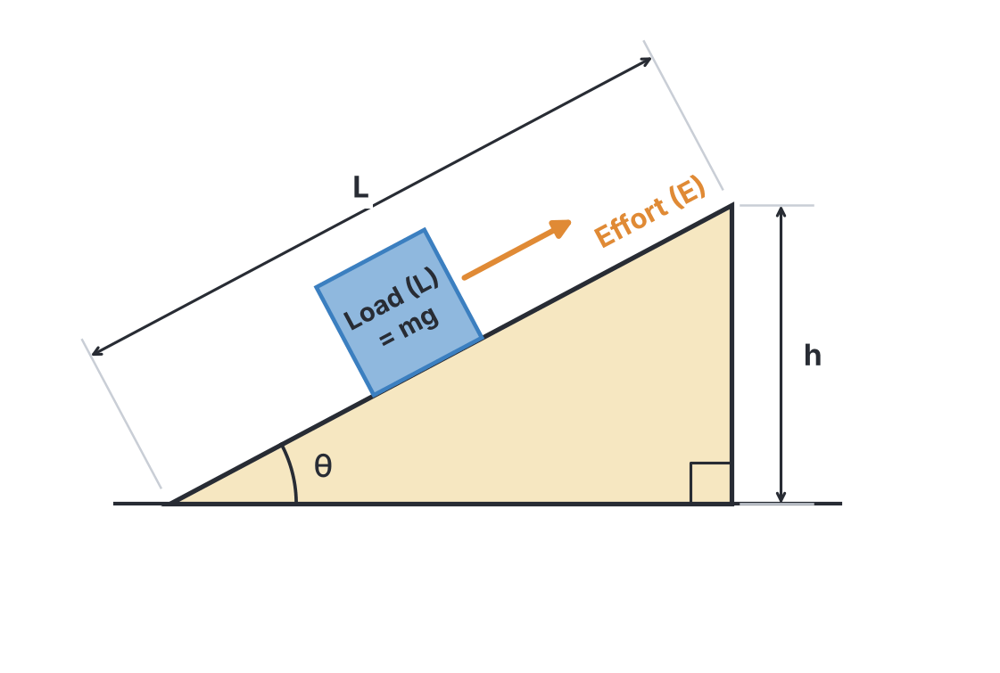
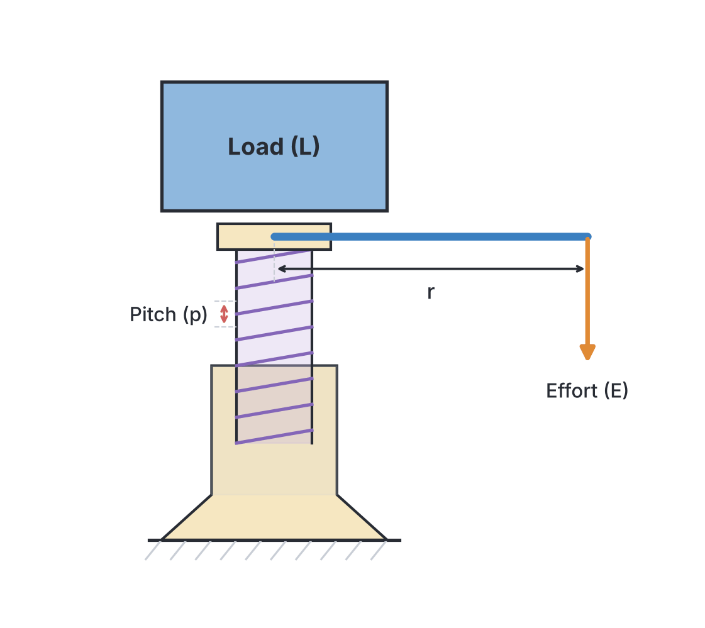
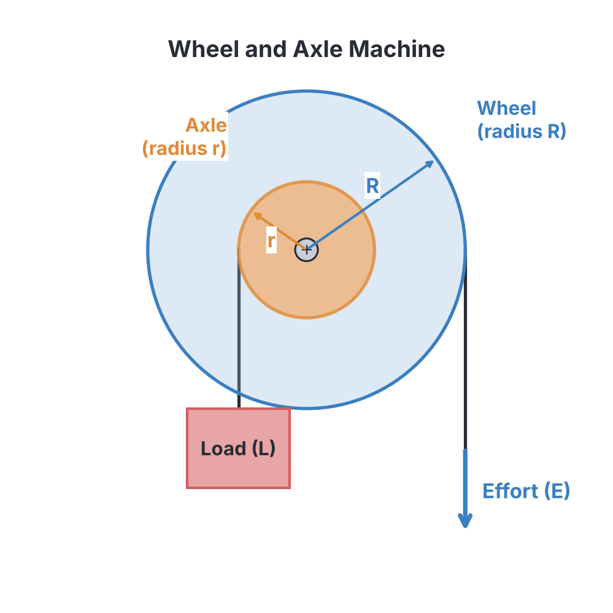

# JAMB Physics Notes: Simple Machines

## What JAMB expects

This topic is Section A, Topic 8 of the JAMB Physics syllabus. It covers the physics of simple machines and how they make work easier.

The syllabus contents are:
* (i) definition of simple machines;
* (ii) types of machines;
* (iii) mechanical advantage, velocity ratio and efficiency of machines.

By the end of these notes, you should be able to:
1. identify different types of simple machines;
2. solve problems involving simple machines.

## Definition of Simple Machines

A **machine** is a mechanical device that makes work easier by allowing a small applied force (called the **effort**) to overcome a much larger resisting force (called the **load**). Sometimes, a machine is used simply to change the direction of an applied force (like a single fixed pulley) to make the task more convenient.

Machines do **not** create energy. According to the principle of conservation of energy, the work you put into a machine can never be less than the useful work you get out of it. In fact, because some energy is always wasted in overcoming friction between the moving parts and lifting the weight of the machine's own parts, the total work put in is always greater than the useful work done on the load.

**Textbook variation:** You may see some textbooks refer to "Force Ratio" (FR) instead of Mechanical Advantage (MA). For JAMB, these two terms mean exactly the same thing.

## Parameters of a Machine: MA, VR, and Efficiency

To solve problems involving simple machines, we rely on three fundamental parameters: Mechanical Advantage, Velocity Ratio, and Efficiency.

### 1. Mechanical Advantage (MA)
Mechanical advantage is the ratio of the load lifted by the machine to the effort applied. It tells you how many times the machine multiplies your effort.

$$MA = \frac{\text{Load}\ (L)}{\text{Effort}\ (E)}$$

- **Unit:** MA is a ratio of two forces (Newtons divided by Newtons), so it has **no unit**.
- If $MA > 1$, the machine multiplies force (a small effort lifts a large load).
- If $MA < 1$, the machine requires an effort larger than the load, but it usually multiplies speed or distance.

### 2. Velocity Ratio (VR)
Velocity ratio is the ratio of the distance moved by the effort to the distance moved by the load in the same time interval. It depends purely on the geometry and design of the machine.

$$VR = \frac{\text{Distance moved by Effort}\ (d_E)}{\text{Distance moved by Load}\ (d_L)}$$

- **Unit:** VR is a ratio of two distances, so it also has **no unit**.
- Unlike MA, the Velocity Ratio of a machine is a constant that does not change with friction.

### 3. Efficiency ($\varepsilon$)
Efficiency is the ratio of the useful work output by the machine to the total work input into the machine, usually expressed as a percentage. 

$$Efficiency = \frac{\text{Useful Work Output}}{\text{Work Input}} \times 100\%$$

Since Work = Force $\times$ Distance:
- Work Output = $\text{Load} \times d_L$
- Work Input = $\text{Effort} \times d_E$

We can rewrite the efficiency formula in terms of MA and VR:
$$Efficiency = \frac{L \times d_L}{E \times d_E} \times 100\% = \frac{\frac{L}{E}}{\frac{d_E}{d_L}} \times 100\%$$
$$Efficiency = \frac{MA}{VR} \times 100\%$$

A perfect (ideal) machine would have an efficiency of 100% (or 1), meaning $MA = VR$. In reality, due to friction and the weight of the machine's moving parts, efficiency is always **less than 100%**, which means $MA < VR$.

**Work Done Against Friction:**
The energy lost to friction is the difference between the total work you put in and the useful work you get out.
$$\text{Work done against friction} = \text{Work Input} - \text{Work Output}$$

## Types of Simple Machines

JAMB expects you to identify and calculate parameters for several common types of simple machines. 

### 1. The Lever
A lever is a rigid bar that can turn about a fixed point called the **pivot** or **fulcrum**. Levers rely on the principle of moments. 
If the distance from the effort to the fulcrum is $x$ and the distance from the load to the fulcrum is $y$, the velocity ratio is:
$$VR = \frac{x}{y}$$

Levers are classified into three orders (or classes) based on the relative positions of the Fulcrum (F), Load (L), and Effort (E). 

| Class of Lever | Position | Mechanical Advantage | Examples |
| --- | --- | --- | --- |
| **First-class** | Fulcrum is between Load and Effort | Can be $>1$, $<1$, or $=1$ | Crowbar, scissors, see-saw, pliers, claw hammer |
| **Second-class** | Load is between Fulcrum and Effort | Always $> 1$ | Wheelbarrow, nutcracker, bottle opener |
| **Third-class** | Effort is between Fulcrum and Load | Always $< 1$ | Tweezers, forceps, broom, human forearm |

### 2. The Pulley (Block and Tackle System)
A pulley is a grooved wheel with a rope running around it. A system of fixed and movable pulleys used together is called a **block and tackle**. This is commonly used in Nigerian building sites to lift heavy concrete blocks.

For a block and tackle system, the Velocity Ratio is simply **the number of pulleys in the system** (or the number of rope segments supporting the movable load block).
$$VR = n \quad (\text{where } n \text{ is the number of pulleys})$$

### 3. The Inclined Plane
An inclined plane (a slope or ramp) is used to raise heavy objects, such as pushing a drum of palm oil into the back of a lorry. 
If an inclined plane has a slant length $L$ and a vertical height $h$, and makes an angle $\theta$ with the horizontal, the velocity ratio is:
$$VR = \frac{\text{length of the incline}}{\text{height of the incline}} = \frac{L}{h}$$
Since $\sin\theta = \frac{h}{L}$, this can also be written as:
$$VR = \frac{1}{\sin\theta}$$

### 4. The Screw and Screw Jack
A screw can be thought of as an inclined plane wrapped around a cylinder. A common example is a car jack used to lift a vehicle when changing a tyre. 
The distance between two consecutive threads is called the **pitch** ($p$). When the handle (tommy bar) of length $r$ makes one complete revolution, the effort moves a distance equal to the circumference of the circle ($2\pi r$), while the load moves up by one pitch ($p$).
$$VR = \frac{2\pi r}{p}$$
*Note: Because screw jacks have a very large VR, they usually have very low efficiencies (less than 50%). This is actually a design feature: an efficiency below 50% ensures the jack is "self-locking" and will not unwind under the weight of the car when you let go of the handle.*

### 5. The Wheel and Axle
This consists of a large wheel of radius $R$ attached to a smaller axle of radius $r$, turning together on the same shaft. It is commonly used in steering wheels or manual winches used to draw water from deep boreholes.
$$VR = \frac{\text{Radius of Wheel}}{\text{Radius of Axle}} = \frac{R}{r} = \frac{D}{d}$$
*(Where $D$ and $d$ are the diameters of the wheel and axle, respectively).*

### 6. Gears
Gears are toothed wheels. When two gears interlock, the larger wheel with more teeth drives the smaller one, or vice-versa. 
If gear A (the driving gear) is turning gear B (the driven gear), they rotate in opposite directions. The Velocity Ratio is defined by the number of teeth:
$$VR = \frac{\text{Number of teeth on driven wheel}\ (N_B)}{\text{Number of teeth on driving wheel}\ (N_A)}$$

### 7. The Hydraulic Press
A hydraulic press uses a fluid to transmit pressure from a small piston to a large piston (based on Pascal's principle). If the radius of the large (load) piston is $R$ and the radius of the small (effort) piston is $r$:
$$VR = \frac{\text{Area of load piston}}{\text{Area of effort piston}} = \frac{\pi R^2}{\pi r^2} = \frac{R^2}{r^2}$$

## Solving Problems Involving Simple Machines

Here are three full worked examples demonstrating how to tackle calculation questions for JAMB.

**Example 1: Basic Parameters**
A load of $800\ \text{N}$ is lifted by applying an effort of $200\ \text{N}$. If the load moves $2\ \text{m}$ when the effort moves $10\ \text{m}$, calculate the mechanical advantage, velocity ratio, and efficiency.

1. **State the given values:**
   Load $L = 800\ \text{N}$
   Effort $E = 200\ \text{N}$
   Distance of load $d_L = 2\ \text{m}$
   Distance of effort $d_E = 10\ \text{m}$
2. **Calculate Mechanical Advantage:**
   $$MA = \frac{L}{E} = \frac{800\ \text{N}}{200\ \text{N}} = 4$$
3. **Calculate Velocity Ratio:**
   $$VR = \frac{d_E}{d_L} = \frac{10\ \text{m}}{2\ \text{m}} = 5$$
4. **Calculate Efficiency:**
   $$Efficiency = \frac{MA}{VR} \times 100\% = \frac{4}{5} \times 100\% = 80\%$$

**Example 2: Pulley System and Work Done Against Friction**
A block and tackle pulley system with 4 pulleys is used to lift a $150\ \text{N}$ load. If an effort of $50\ \text{N}$ is applied and the load is raised by $3\ \text{m}$, calculate the efficiency of the machine and the work done against friction.

1. **State the given values:**
   Load $L = 150\ \text{N}$
   Effort $E = 50\ \text{N}$
   Distance of load $d_L = 3\ \text{m}$
   $VR = 4$ (because there are 4 pulleys)
2. **Calculate the MA and Efficiency:**
   $$MA = \frac{L}{E} = \frac{150\ \text{N}}{50\ \text{N}} = 3$$
   $$Efficiency = \frac{MA}{VR} \times 100\% = \frac{3}{4} \times 100\% = 75\%$$
3. **Find the distance moved by the effort ($d_E$):**
   $$VR = \frac{d_E}{d_L} \implies 4 = \frac{d_E}{3\ \text{m}} \implies d_E = 12\ \text{m}$$
4. **Calculate the Total Work Input (by the effort):**
   $$W_{\text{in}} = E \times d_E = 50\ \text{N} \times 12\ \text{m} = 600\ \text{J}$$
5. **Calculate the Useful Work Output (on the load):**
   $$W_{\text{out}} = L \times d_L = 150\ \text{N} \times 3\ \text{m} = 450\ \text{J}$$
6. **Calculate Work done against friction:**
   $$W_{\text{friction}} = W_{\text{in}} - W_{\text{out}} = 600\ \text{J} - 450\ \text{J} = 150\ \text{J}$$

**Example 3: The Inclined Plane**
An inclined plane of length $5\ \text{m}$ is used to raise a $50\ \text{kg}$ bag of cement onto a truck of height $2\ \text{m}$. The effort applied parallel to the plane is $300\ \text{N}$. (Take $g = 10\ \text{m s}^{-2}$). Calculate the efficiency of the plane.

1. **State the given values:**
   Mass $m = 50\ \text{kg} \implies$ Load $L = mg = 50 \times 10 = 500\ \text{N}$
   Effort $E = 300\ \text{N}$
   Length of plane $L_{plane} = 5\ \text{m}$
   Height $h = 2\ \text{m}$
2. **Calculate the MA:**
   $$MA = \frac{\text{Load}}{\text{Effort}} = \frac{500}{300} = \frac{5}{3}$$
3. **Calculate the VR:**
   $$VR = \frac{L_{plane}}{h} = \frac{5}{2} = 2.5$$
4. **Calculate the Efficiency:**
   $$Efficiency = \frac{MA}{VR} \times 100\% = \frac{\frac{5}{3}}{2.5} \times 100\% = \frac{5}{3} \div \frac{5}{2} \times 100\%$$
   $$Efficiency = \frac{5}{3} \times \frac{2}{5} \times 100\% = \frac{2}{3} \times 100\% \approx 66.67\%$$

## Key terms

| Term | Meaning |
| --- | --- |
| **Machine** | A device that allows work to be done more easily by applying a small effort to overcome a large load. |
| **Load ($L$)** | The force overcome by the machine (usually a weight). |
| **Effort ($E$)** | The applied force used to operate the machine. |
| **Mechanical Advantage (MA)** | The ratio of the load to the effort. It indicates how many times the machine multiplies the effort. |
| **Velocity Ratio (VR)** | The ratio of the distance moved by the effort to the distance moved by the load. |
| **Efficiency** | The ratio of useful work done by the machine to the total work put into the machine, expressed as a percentage. |
| **Pitch ($p$)** | The distance between two successive threads on a screw. |

## Exam tips and common mistakes

- **Mixing up MA and Efficiency:** Remember that Efficiency is a percentage (or a decimal between 0 and 1). If a question says a machine is 80% efficient, use $0.8$ in your equation (e.g., $0.8 = \frac{MA}{VR}$). A common mistake is writing $80 = \frac{MA}{VR}$, which will give a completely wrong MA.
- **Wrong Units:** MA, VR, and Efficiency **do not have units**. However, when calculating them, ensure your Load and Effort are in the same units (both in Newtons) and distances are in the same units (both in metres or both in centimetres).
- **Screw Jack Pitch:** In the VR formula $VR = \frac{2\pi r}{p}$, the handle length $r$ and the pitch $p$ must be in the exact same units before dividing. If $r$ is in cm and $p$ is in mm, convert one of them!
- **Inclined Plane Sine Error:** The VR of an inclined plane is $\frac{1}{\sin\theta}$, not $\sin\theta$. If the angle is $30^\circ$, VR $= \frac{1}{0.5} = 2$.
- **Gears VR Formula Inversion:** The VR for gears is $\frac{\text{Driven teeth}}{\text{Driving teeth}}$. Do not accidentally divide driving by driven.

## Quick summary

1. A simple machine makes work easier but does not create energy; total work put in is always greater than useful work output due to friction.
2. Mechanical Advantage (MA) is $\frac{\text{Load}}{\text{Effort}}$.
3. Velocity Ratio (VR) is $\frac{\text{Distance moved by Effort}}{\text{Distance moved by Load}}$.
4. Efficiency is calculated as $\frac{MA}{VR} \times 100\%$ or $\frac{\text{Useful Work Output}}{\text{Work Input}} \times 100\%$.
5. Levers are grouped into three classes (First, Second, Third) depending on whether the Fulcrum, Load, or Effort is in the middle.
6. The VR of a block and tackle system equals the number of pulleys.
7. The VR of an inclined plane is $\frac{1}{\sin\theta}$ or $\frac{\text{Length}}{\text{Height}}$.
8. The VR of a screw jack is $\frac{2\pi r}{p}$, where $r$ is the handle length and $p$ is the pitch.

## Practice questions

**1. Which of the following best defines a simple machine?**
- A. A device that creates energy to perform work.
- B. A device that changes the state of matter to reduce friction.
- C. A device that allows work to be done more easily by applying a small effort to overcome a large load.
- D. A device that converts thermal energy into mechanical energy.

**Answer: C.** A simple machine makes work easier by changing the magnitude or direction of an applied force, allowing a small effort to lift a large load.

**2. In which class of lever is the load situated between the fulcrum and the effort?**
- A. First-class lever
- B. Second-class lever
- C. Third-class lever
- D. Fourth-class lever

**Answer: B.** In a second-class lever (like a wheelbarrow), the load is between the fulcrum and the effort.

**3. A machine has a velocity ratio of 5 and is 80% efficient. What effort is required to lift a load of $400\ \text{N}$?**
- A. $80\ \text{N}$
- B. $100\ \text{N}$
- C. $200\ \text{N}$
- D. $320\ \text{N}$

**Answer: B.** 
1. Convert efficiency to decimal: $\varepsilon = 0.8$.
2. Find MA: $\varepsilon = \frac{MA}{VR} \implies 0.8 = \frac{MA}{5} \implies MA = 4$.
3. Find Effort: $MA = \frac{L}{E} \implies 4 = \frac{400}{E} \implies E = \frac{400}{4} = 100\ \text{N}$. 
*Mistake D assumes Effort is $400 \times 0.8$, which is incorrect.*

**4. A screw jack has a pitch of $0.2\ \text{cm}$ and a handle of length $35\ \text{cm}$. Calculate its velocity ratio. (Take $\pi = \frac{22}{7}$)**
- A. $110$
- B. $550$
- C. $1100$
- D. $2200$

**Answer: C.** 
1. Formula: $VR = \frac{2\pi r}{p}$. Both $r$ and $p$ are in cm.
2. Substitute: $VR = \frac{2 \times \frac{22}{7} \times 35}{0.2} = \frac{2 \times 22 \times 5}{0.2} = \frac{220}{0.2} = 1100$.
*Mistake B comes from forgetting to multiply by 2 in the circumference formula.*

**5. An inclined plane is inclined at $30^\circ$ to the horizontal. If its efficiency is 60%, what is its mechanical advantage?**
- A. $0.6$
- B. $1.2$
- C. $2.0$
- D. $3.3$

**Answer: B.** 
1. Calculate VR: $VR = \frac{1}{\sin 30^\circ} = \frac{1}{0.5} = 2$.
2. Calculate MA: $\varepsilon = \frac{MA}{VR} \implies 0.6 = \frac{MA}{2} \implies MA = 1.2$.
*Mistake C is the VR of the plane, not the MA.*

**6. A gear system has a driving wheel with 20 teeth and a driven wheel with 60 teeth. What is the velocity ratio of the system?**
- A. $\frac{1}{3}$
- B. $3$
- C. $20$
- D. $60$

**Answer: B.** 
1. Formula for gears: $VR = \frac{\text{Number of teeth on driven wheel}}{\text{Number of teeth on driving wheel}}$.
2. Calculate: $VR = \frac{60}{20} = 3$.
*Mistake A comes from dividing the driving teeth by the driven teeth in error.*

**7. A block and tackle system with 6 pulleys is used to raise a load of $600\ \text{N}$ by applying an effort of $150\ \text{N}$. The work done against friction when the load is raised by $2\ \text{m}$ is:**
- A. $300\ \text{J}$
- B. $600\ \text{J}$
- C. $1200\ \text{J}$
- D. $1800\ \text{J}$

**Answer: B.** 
1. Calculate the distance moved by effort ($d_E$): $VR = 6$, so $d_E = VR \times d_L = 6 \times 2 = 12\ \text{m}$.
2. Total work input = $E \times d_E = 150 \times 12 = 1800\ \text{J}$.
3. Useful work output = $L \times d_L = 600 \times 2 = 1200\ \text{J}$.
4. Work against friction = $1800 - 1200 = 600\ \text{J}$.
*Mistake C is the useful work output, not the work lost to friction.*

**8. A pair of scissors is an example of which type of simple machine?**
- A. First-class lever
- B. Second-class lever
- C. Third-class lever
- D. Inclined plane

**Answer: A.** In a pair of scissors, the pivot (fulcrum) is located in the middle, between the load (the paper being cut) and the effort (the user's fingers). This makes it a first-class lever.

**9. The velocity ratio of a hydraulic press is determined by the ratio of the:**
- A. radii of the two pistons
- B. squares of the radii of the two pistons
- C. lengths of the two pistons
- D. forces applied to the two pistons

**Answer: B.** The VR of a hydraulic press relates to the areas of the pistons. Since Area = $\pi r^2$, the VR is the ratio of the squares of their radii ($R^2 / r^2$).

**10. A wheel and axle is used to draw water from a borehole. The diameter of the wheel is $60\ \text{cm}$ and the diameter of the axle is $15\ \text{cm}$. If the system is 80% efficient, what effort is needed to lift a bucket weighing $240\ \text{N}$?**
- A. $60\ \text{N}$
- B. $75\ \text{N}$
- C. $192\ \text{N}$
- D. $300\ \text{N}$

**Answer: B.** 
1. Calculate VR: $VR = \frac{D}{d} = \frac{60}{15} = 4$.
2. Calculate MA from Efficiency: $\varepsilon = \frac{MA}{VR} \implies 0.8 = \frac{MA}{4} \implies MA = 3.2$.
3. Calculate Effort: $MA = \frac{\text{Load}}{\text{Effort}} \implies 3.2 = \frac{240}{E} \implies E = \frac{240}{3.2} = 75\ \text{N}$.
*Mistake A assumes the machine is 100% efficient, yielding an effort of $240/4 = 60\ \text{N}$.*
