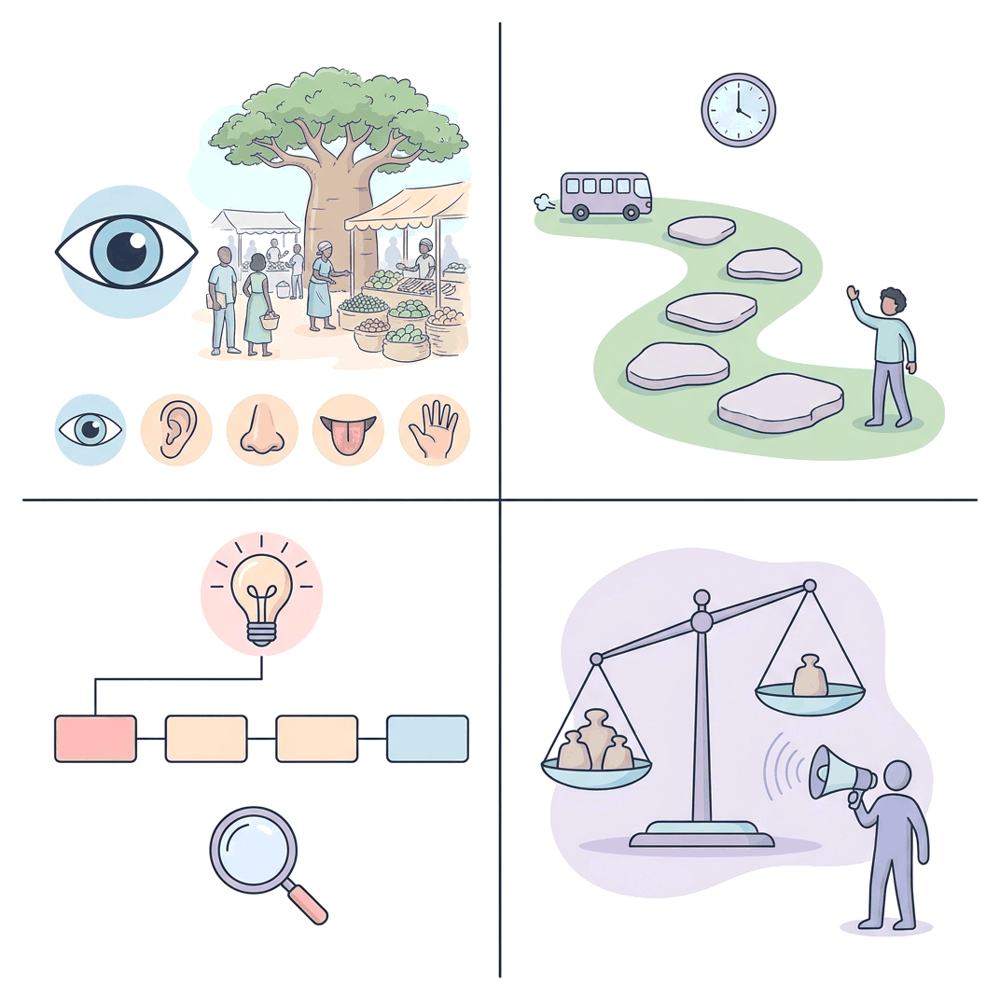

# JAMB Use of English Notes: Types of Passages

## What JAMB expects

This topic is Section A of the JAMB Use of English syllabus: Comprehension and Summary. It covers the four content items that name the kinds of passage you will read in the examination:

- (a) description
- (b) narration
- (c) exposition
- (d) argumentation/persuasion

It also covers note (i) of Section A: "Each of the three passages to be set (one will be a cloze test) should reflect various disciplines and be about 200 words long."

Section A carries **25 of the 60 questions** in the paper:

| Item | Number of questions |
| --- | --- |
| 1 comprehension passage | 5 |
| 1 summary passage | 5 |
| 1 cloze passage | 10 |
| 1 reading text (the approved novel) | 5 |

By the end of these notes, you should be able to:

1. Say what description, narration, exposition and argumentation/persuasion are.
2. Recognise each type of passage from its purpose, its organisation and its language.
3. Compare the four types in a table and tell them apart quickly in the examination hall.
4. Handle passages that mix two or more types.
5. Read a passage from any discipline (science, agriculture, economics, law, history, health, technology and so on) without panicking about unfamiliar subject matter.
6. Use a simple step-by-step method for every comprehension passage.

The skills of finding main points, implied meanings, word meanings and the writer's intention are taught fully in A2a, A2b and A2c. Summary (synthesis of ideas) is in A3, the cloze test in A4 and the approved reading text in A5. This file gives you the foundation: knowing **what kind of passage you are reading**, because that tells you what the writer is trying to do and where the answers are likely to be.

**About the passages in these notes:** every passage here is original, written for practice. The people, small communities and events in them are invented, even when a real state or city is named for a Nigerian setting. Do not treat them as real news or history.

## Why the type of passage matters

Every writer has a **purpose**. The purpose decides how the passage is built:

- A writer who wants you to **see** something writes a **description**.
- A writer who wants to **tell you what happened** writes a **narration**.
- A writer who wants to **explain or inform** writes an **exposition**.
- A writer who wants you to **agree** or **act** writes an **argument** or a **persuasive** piece.

Once you know the type, you know:

- where the main point is likely to be (for example, in an argument it is often stated at the start and repeated at the end);
- what kind of questions JAMB is likely to ask (for example, "The writer's attitude is…" questions are common with argumentative passages);
- which words matter most (for example, time words in a narrative, contrast words in an argument).

**Note on textbook variation:** Nigerian English textbooks and exam guides do not all use the same names. Some use "descriptive, narrative, expository and argumentative". Some list "argumentative" and "persuasive" as two separate types; the JAMB syllabus joins them with a slash ("argumentation/persuasion"). Some add other labels such as "discursive", "explanatory", "informative" or "reflective". These extra labels usually fit inside the four syllabus types (for example, "explanatory" and "informative" are kinds of exposition). Use the four syllabus names in JAMB.

## The comprehension passages in JAMB: what to expect

### About 200 words long

The syllabus says each passage should be **about 200 words**. That is roughly two to four paragraphs. This is short, so every sentence counts. A single word such as "however" or "only" can change the answer to a question.

### Reflecting various disciplines

"Various disciplines" means the passages can come from **any field of study**, not just English or literature. You may read about:

| Discipline | Possible topics |
| --- | --- |
| Science and health | Malaria, vaccines, nutrition, climate change, the human body |
| Agriculture | Cassava processing, irrigation, soil erosion, fish farming |
| Economics and business | Inflation, small businesses, savings, trade, unemployment |
| Government and law | Elections, rights of citizens, the courts, local government |
| History and culture | Festivals, ancient kingdoms, traditional crafts, colonial history |
| Technology | Mobile phones, the internet, solar energy, artificial intelligence |
| Education and society | Reading culture, examination malpractice, youth, the family |
| Environment | Flooding, desertification, waste management, deforestation |

**You do not need to be an expert in the subject.** Every answer you need is in the passage. JAMB is testing your reading, not your knowledge of biology or economics. In fact, using outside knowledge is a common trap: an option may be true in real life but **not stated or implied in the passage**. Always answer from the passage.

### One of the passages is a cloze test

A cloze test is a passage with gaps. You choose the word that best fills each gap. It is taught in A4. The cloze passage can also be descriptive, narrative, expository or argumentative, and knowing the type helps you predict the missing words.

## (a) Description

### What description is

A **descriptive passage** paints a picture in words. Its purpose is to help the reader **see, hear, smell, taste or feel** a person, place, object, scene or experience as if they were there.

The writer is not mainly telling a story or arguing a point. The writer wants you to form a clear **mental picture**.

### Features of a descriptive passage

1. **Sensory details.** Words that appeal to the five senses: sight (colours, shapes, size), sound (noise, music, silence), smell (aroma, stench), taste (sweet, peppery) and touch (rough, smooth, hot, damp).
2. **Many adjectives and adverbs.** For example: *the narrow, dusty road; the old man walked slowly*.
3. **Figurative language.** Similes (*her voice was as soft as cotton wool*), metaphors (*the market was a beehive*) and personification (*the wind whispered through the palm fronds*).
4. **Spatial organisation.** Details are usually arranged by **space**, not by time: from left to right, near to far, top to bottom, outside to inside, or from the general view to small details.
5. **A dominant impression.** Good descriptions create one main feeling or idea, for example that a place is peaceful, chaotic, frightening or beautiful. All the details support this impression.
6. **Present or past tense.** Either can be used. A description of a place as it usually is often uses the simple present (*The market opens at dawn*).

### Things that can be described

- **A person:** physical appearance, clothes, voice, habits, character.
- **A place:** a market, a village, a school compound, a city street, a farm.
- **An object:** a traditional drum, a smartphone, a car.
- **An event or scene:** a festival, a wedding, a rainstorm, a football match.
- **A process seen with the eyes:** what a place looks like as the harmattan arrives.

### Worked example: an original descriptive passage

> The weekly market at Ilode wakes before the sun. By five o'clock, the first lorries have rumbled in from the farms, their engines coughing in the cold harmattan air. Women in faded wrappers unload baskets of yam, pepper and ripe plantain, while boys roll heavy sacks of garri across the red earth.
>
> At the centre of the market stands an old iroko tree, wide enough to shelter twenty traders from the sun. Under it, the fish sellers lay out their smoked catfish in neat rows, and the sharp smell of smoke hangs in the air. To the left, the cloth sellers have hung bright Ankara prints on wooden frames, so that the whole corner looks like a field of moving flowers. To the right, the noise rises: a trader shouts prices through a cracked megaphone, a radio plays highlife music, and goats bleat from a pen behind the meat stalls.
>
> By midday, the dust and heat are heavy. Yet nobody seems tired. Buyers squeeze between the stalls, bargaining loudly and laughing. The market is not just a place to buy and sell; it is the beating heart of Ilode.

**How to recognise it as description:**

| Clue | Example from the passage |
| --- | --- |
| Sensory details: sight | "bright Ankara prints", "red earth", "faded wrappers" |
| Sensory details: sound | "engines coughing", "shouts prices", "goats bleat" |
| Sensory details: smell | "the sharp smell of smoke" |
| Sensory details: touch/feeling | "cold harmattan air", "the dust and heat are heavy" |
| Spatial organisation | "At the centre…", "To the left…", "To the right…" |
| Figurative language | "engines coughing" (personification), "like a field of moving flowers" (simile), "the beating heart of Ilode" (metaphor) |
| Dominant impression | The market is lively, busy and central to the town's life |

Notice that although there is a little movement of time ("By five o'clock", "By midday"), the passage does not tell a story with a problem, events and an ending. Its main job is to show you the market. That makes it **descriptive**.

### Questions JAMB may ask on a descriptive passage

- What is the dominant impression created by the passage? (Here: liveliness, the importance of the market.)
- What figure of speech is used in a phrase? ("the beating heart of Ilode" is a metaphor.)
- What is the meaning of a descriptive word as used in the passage? ("rumbled" suggests a deep, heavy, continuous sound.)
- Which of the following is NOT mentioned in the passage? (Watch carefully: for example, the passage mentions smoked catfish, not fresh fish.)

## (b) Narration

### What narration is

A **narrative passage** tells a **story**: a series of events that happen to people (characters) over time. Its purpose is to tell the reader **what happened**. Narratives can be true (a news story, a biography, a history) or imaginary (a short story, an extract from a novel).

### Features of a narrative passage

1. **Chronological order.** Events are usually told in the order in which they happened (time order). Sometimes a writer uses a **flashback**, going back to an earlier time.
2. **Time words and transitions.** *First, then, next, after that, suddenly, later, at last, the following morning, when, while, as soon as, finally.*
3. **Characters.** People (or animals) who act and speak.
4. **Setting.** Where and when the story happens.
5. **Plot.** A beginning, a problem or conflict, a turning point (climax) and an ending (resolution).
6. **Past tense.** Most narratives use the simple past (*she walked, he said*). Some use the present tense for drama.
7. **Point of view.** **First person** ("I", "we") when the narrator is in the story; **third person** ("he", "she", "they") when the narrator is outside the story.
8. **Dialogue.** Characters' exact words, shown in quotation marks.

### First person vs third person narration

| Feature | First-person narration | Third-person narration |
| --- | --- | --- |
| Pronouns used for the narrator | I, me, my, we, us | He, she, they (the narrator is not named or seen) |
| Who tells the story | A character in the story | Someone outside the story |
| What the reader knows | Only what the narrator sees, thinks and feels | Can include several characters' thoughts (if the narrator is "all-knowing") |
| Example | "I ran to the gate, but the bus had gone." | "Chidi ran to the gate, but the bus had gone." |

### Worked example: an original narrative passage

> Halima had never missed a bus in her life, so when she reached the motor park at Lokoja and saw the Abuja bus pulling away, she could not believe her eyes. She had stopped for only two minutes to buy roasted corn. Now her bag, with her admission letter inside, was on the roof rack of a moving bus.
>
> She shouted and waved, but the driver did not look back. A young okada rider who had seen everything called out to her. "Madam, enter! We fit catch am!" Halima hesitated. Her mother had warned her many times about okada riders. But there was no time to think. She climbed on, holding the corn in one hand and the rider's shoulder with the other.
>
> For ten minutes they chased the bus along the busy highway. At last, at a checkpoint, the bus slowed down, and the rider pulled up beside it. Halima jumped off, ran to the door and banged on it until the driver opened. Breathless, she climbed in, and the passengers burst out laughing.
>
> When she tried to pay the okada rider, he refused. "Just pass your exam," he said with a smile, and rode away. Halima never learnt his name.

**How to recognise it as narration:**

| Clue | Example from the passage |
| --- | --- |
| Characters | Halima, the okada rider, the driver, the passengers |
| Setting | The motor park at Lokoja and the highway towards Abuja |
| Time order and time words | "when she reached", "Now", "For ten minutes", "At last", "When she tried to pay" |
| Problem/conflict | Her bag with the admission letter is on the departing bus |
| Climax | The chase and catching the bus at the checkpoint |
| Resolution | She gets on the bus; the rider refuses payment |
| Past tense | "had never missed", "shouted", "climbed", "jumped" |
| Dialogue | "Madam, enter! We fit catch am!" (Nigerian Pidgin, used for realism) |
| Point of view | Third person ("Halima", "she") |

### Questions JAMB may ask on a narrative passage

- Why did a character do something? (Why did Halima hesitate? Because her mother had warned her about okada riders.)
- What happened first, next or last? (Sequence questions.)
- What can we infer about a character? (The rider was kind and helpful; he refused payment.)
- What is the narrative point of view? (Third person.)
- What does an expression mean? ("Breathless" means out of breath after running.)

**Common trap:** an option may describe what you expect to happen in such a story rather than what the passage says. For example, the passage does not say Halima arrived late at Abuja or that she lost her letter. Do not add events.

## (c) Exposition

### What exposition is

An **expository passage** explains, informs or instructs. Its purpose is to help the reader **understand** a subject, an idea, a process, a cause or a fact. Most textbooks, encyclopaedia entries, news reports (the factual parts), health leaflets and science articles are expository.

The writer of a pure exposition does **not** try to make you agree with an opinion. The tone is usually **neutral, objective and factual**.

### Features of an expository passage

1. **Factual information.** Facts, figures, definitions and explanations.
2. **Objective tone.** Few personal feelings; the writer stays in the background. The third person and the passive voice are common (*The seeds are dried and ground*).
3. **Clear topic sentences.** Each paragraph usually begins with a sentence that states its main idea.
4. **Logical organisation.** Common patterns are:
   - **definition** (what something is);
   - **classification** (the types or kinds of something);
   - **process** (the steps in how something is done or happens);
   - **cause and effect** (why something happens and what it leads to);
   - **comparison and contrast** (how two things are alike or different);
   - **problem and solution** (what is wrong and how it can be fixed).
5. **Signal words** that show the pattern: *for example, such as, firstly, secondly, the first stage, as a result, therefore, because, consequently, similarly, in contrast, on the other hand*.
6. **Technical vocabulary**, usually explained by the writer.
7. **Simple present tense** for general truths (*Water boils at 100 °C at sea level*).

### Common patterns of exposition with signal words

| Pattern | What it does | Signal words | Example topic |
| --- | --- | --- | --- |
| Definition | Says what something is | is, means, refers to, is known as | What inflation is |
| Classification | Groups things into types | types, kinds, categories, classes | The three types of rock |
| Process | Explains steps in order | first, next, then, after this, finally, stage | How garri is made |
| Cause and effect | Explains why and what results | because, since, as a result, therefore, leads to, consequently | Why gully erosion happens in the South-East |
| Comparison/contrast | Shows likenesses and differences | similarly, likewise, whereas, while, however, unlike, in contrast | Public and private schools |
| Problem and solution | States a problem and ways to solve it | problem, challenge, solution, can be solved by, one way to | Reducing malaria in a community |

### Worked example: an original expository passage

> Garri is one of the most widely eaten foods in Nigeria. It is made from cassava, a starchy root crop. Fresh cassava roots cannot be eaten raw safely because many varieties contain compounds that release cyanide, a poison. Processing removes most of this danger.
>
> The first step is peeling. The roots are peeled and washed to remove dirt. Next, they are grated into a wet pulp, usually with a motorised grating machine. The pulp is then packed into sacks, and heavy stones or a press are placed on the sacks for one to three days. During this time, the pulp ferments and much of the water drains out. Fermentation gives garri its slightly sour taste and also helps to reduce the cyanide content.
>
> After pressing, the dry lumps are broken up and sieved. Finally, the sieved pulp is roasted (fried) in a wide, shallow pan over a fire and stirred continuously until it becomes dry and crisp. Some producers add palm oil while frying, which produces yellow garri; without oil, the garri is white.
>
> Properly processed garri can be stored for months, which makes it an important food in both towns and villages.

**How to recognise it as exposition:**

| Clue | Example from the passage |
| --- | --- |
| Purpose: to inform/explain | How garri is made and why processing is needed |
| Process pattern and signal words | "The first step", "Next", "then", "After pressing", "Finally" |
| Cause and effect | Fermentation "helps to reduce the cyanide content"; adding palm oil "produces yellow garri" |
| Passive voice | "The roots are peeled and washed", "The pulp is then packed" |
| Technical words explained | "cyanide, a poison"; "roasted (fried)" |
| Objective tone | No personal opinion; no "I think" |

**Accuracy note:** the length of fermentation, and whether palm oil is added, varies from place to place and producer to producer. The passage says "one to three days" and "some producers", so it does not claim one fixed method.

### Questions JAMB may ask on an expository passage

- What is the main idea of the passage or of a paragraph? (A2a)
- Which step comes before or after another step?
- What is the cause or effect of something? (Why is cassava processed? To remove the danger of cyanide.)
- What does a technical word mean in the context?
- Which statement is supported by the passage?

**Common trap:** expository passages often include facts that are true in real life but not mentioned in the passage. For example, an option might say "Garri is rich in protein." The passage says nothing about protein (and, in fact, garri is mainly starch). Choose only what the passage supports.

## (d) Argumentation/persuasion

### What argumentation is

An **argumentative passage** presents a **point of view** on an issue and supports it with **reasons and evidence**, so that the reader will accept it. The writer takes a side (a **position**, **stand** or **thesis**) on a debatable question, for example whether students should use phones in school.

A good argument:

- states a clear position (the thesis);
- gives reasons, each supported by evidence, examples or facts;
- often mentions the **opposing view** (the counter-argument) and answers it (the rebuttal);
- ends with a conclusion that restates the position.

### What persuasion is

A **persuasive passage** also tries to make the reader agree, but it goes further: it often tries to make the reader **feel** something and **do** something. Advertisements, campaign speeches, sermons, public health appeals ("Sleep under a treated net tonight!") and letters to the editor are often persuasive.

### Argumentation vs persuasion

The syllabus joins the two ("argumentation/persuasion") because both try to win the reader over. Many textbooks treat them as one type. Others separate them like this:

| Feature | Argumentation | Persuasion |
| --- | --- | --- |
| Main aim | To prove that a position is reasonable or correct | To make the reader agree and, often, act |
| Main appeal | Reason and logic (facts, evidence, statistics, examples) | Reason, but also emotion and the writer's credibility |
| Opposing view | Usually stated fairly and then answered | Often ignored or dismissed |
| Tone | Calm, measured, logical | Can be emotional, urgent, passionate |
| Typical language | "The evidence shows…", "It can be argued that…", "However, critics claim…" | "We must act now!", "Imagine…", "Don't you want…?", "Join us…" |
| Typical forms | Debates, essays, editorials, academic articles | Advertisements, speeches, campaign posters, appeals |
| Ending | Restates the conclusion | Calls the reader to action |

**Note on textbook variation:** the line between the two is not sharp. Many real passages use both logic and emotion. Some books use "argumentative" for any passage that takes a side; others use "persuasive" for the same thing. In the JAMB exam, you usually need only to recognise that the writer is **taking a side and trying to convince**, and then work out the writer's opinion and attitude (A2c).

### Features of an argumentative/persuasive passage

1. **A clear position**, often in the first or last paragraph.
2. **Opinion words:** *I believe, in my view, clearly, undoubtedly, it is wrong to, should, must, ought to*.
3. **Reasons and evidence:** *because, since, for instance, statistics show, research suggests, experience has shown*.
4. **Contrast and concession words** to handle opposing views: *however, but, although, nevertheless, on the other hand, admittedly, some people argue that*.
5. **Rhetorical questions:** questions asked for effect, not for an answer (*Can a nation grow if its children cannot read?*).
6. **Emotive language** (especially in persuasion): words chosen to stir feelings (*shameful, tragic, heartless, golden opportunity*).
7. **Repetition** for emphasis (*We need clean water. We need it now. We need it in every village.*).
8. **Modal verbs of obligation:** *should, must, ought to, need to*.
9. **A conclusion or call to action.**

### Worked example: an original argumentative passage

> Should secondary school students be allowed to bring mobile phones to school? Many principals say no, and their fears are understandable. Phones can distract students during lessons, encourage cheating in tests and expose young people to harmful content. Yet a total ban is the wrong answer.
>
> First, phones are now learning tools. A student in Gusau or Ogoja whose school library has only a few old books can use a phone to look up a word, watch a chemistry demonstration or read a free e-book. Banning phones takes away this resource from the students who need it most.
>
> Second, phones help with safety. Many students travel long distances to school, and parents want to reach them when lessons end late or when there is trouble on the road.
>
> The problems the principals mention are real, but they can be managed. Schools can require phones to be switched off and kept in bags during lessons, allow them only in supervised study periods, and punish misuse firmly.
>
> We do not ban pens because some students write rude notes. Instead, we teach them to use pens well. The same should be true of phones. It is time for our schools to stop fearing technology and start teaching responsible use.

**How to recognise it as argumentation (with some persuasion):**

| Clue | Example from the passage |
| --- | --- |
| A debatable issue | Should students be allowed to bring phones to school? |
| Clear position (thesis) | "Yet a total ban is the wrong answer." |
| Reasons with signal words | "First, phones are now learning tools." "Second, phones help with safety." |
| Evidence/examples | A student whose library has few books can use a phone to learn |
| Opposing view stated | "Phones can distract students…, encourage cheating… and expose young people to harmful content." |
| Rebuttal | "The problems… are real, but they can be managed." |
| Analogy | Pens are not banned because some students misuse them |
| Rhetorical question | "Should secondary school students be allowed…?" (opening question) |
| Call to action / conclusion | "It is time for our schools to stop fearing technology and start teaching responsible use." |
| Modal of obligation | "should be true", "Schools can require" |

### Questions JAMB may ask on an argumentative/persuasive passage

- What is the writer's main argument or position?
- What is the writer's attitude to a group or idea? (Here: sympathetic to principals' fears but critical of a total ban.)
- Which statement would the writer most likely agree with?
- What is the purpose of a particular sentence? (The pen analogy is used to show that misuse is not a reason for a ban.)
- Which of the following is an opinion, not a fact?

### Fact vs opinion

Argumentative passages mix facts and opinions. JAMB often asks you to tell them apart.

| | Fact | Opinion |
| --- | --- | --- |
| Definition | A statement that can be checked and proved true or false | A statement of what someone believes, feels or judges |
| Signal words | Dates, numbers, names, measurable details | *I think, should, best, worst, beautiful, wrong, clearly, unfortunately* |
| Example | "Lagos State is in the south-west of Nigeria." | "Lagos is the most exciting city in Nigeria." |
| Example | "Many students travel long distances to school." (can be checked by a survey) | "A total ban is the wrong answer." |

**Tip:** a sentence can sound confident and still be an opinion. "Undoubtedly, phones are the greatest invention of our time" is an opinion, even with "undoubtedly".

## Comparing the four types of passage

| Feature | Description | Narration | Exposition | Argumentation/persuasion |
| --- | --- | --- | --- | --- |
| Main purpose | To show/paint a picture | To tell what happened | To explain or inform | To convince (and often to make the reader act) |
| Key question it answers | What is it like? | What happened? | What is it? How? Why? | What should we believe or do? |
| Usual organisation | Spatial (by place) or by feature | Chronological (by time) | Logical (definition, process, cause–effect, comparison, classification) | Position → reasons/evidence → counter-argument → conclusion |
| Typical tense | Present or past | Mainly past | Mainly present | Mainly present, with modals (should, must) |
| Typical language | Adjectives, sensory images, similes, metaphors | Time words, action verbs, dialogue | Facts, technical terms, signal words, passive voice | Opinion words, rhetorical questions, emotive words, contrast words |
| Writer's presence | Can be personal or impersonal | Narrator may be "I" or outside the story | Usually hidden, objective | Clearly present; shows a stand |
| Tone | Varies (admiring, gloomy, nostalgic…) | Varies with events | Neutral, factual | Firm, critical, urgent, passionate |
| Everyday examples | Travel writing, character sketches | Stories, biographies, news events | Textbooks, manuals, health leaflets | Editorials, speeches, advertisements |

## Mixed passages: when a passage uses more than one type

Real writing is rarely pure. A narrative may contain a descriptive paragraph about a place. An argument may use a short story as an example. An expository passage on malaria may end with a persuasive appeal to use treated nets.

**How to decide the type of a mixed passage:** ask, "What is the writer's **main** purpose? What does the whole passage mainly do?" The type is decided by the **dominant purpose**, not by one sentence.

### Worked example: a mixed passage

> Three years ago, Mallam Sani's maize farm outside Kaduna produced barely enough to feed his family. The soil was tired, and every rainy season the topsoil washed away. Then an extension worker showed him how to plant along the contours of the slope and to leave crop residues on the ground instead of burning them.
>
> Mallam Sani's story is not unusual. Across northern Nigeria, farmers lose fertile topsoil to erosion every year. Contour planting slows down running water, while crop residues protect the soil surface and add organic matter as they rot.
>
> Government should therefore employ and train many more extension workers. Without them, simple, cheap techniques that could double many farmers' harvests will remain unknown, and rural poverty will continue.

- Paragraph 1 is **narrative** (a short story about Mallam Sani).
- Paragraph 2 is **expository** (it explains how the techniques work).
- Paragraph 3 is **argumentative/persuasive** (it says what government "should" do).
- The **main purpose** is shown in the conclusion: to argue that more extension workers are needed. The story and the explanation are **evidence** for that argument. So the passage as a whole is best described as **argumentative**, using narration and exposition as support.

**Accuracy note on the example:** "could double many farmers' harvests" is presented as the writer's claim in an argument, which is why it uses "could" and "many". It is not a scientific figure.

**JAMB trap:** an option may name the type of only one paragraph. If the question asks about "the passage", judge the whole passage.

## How to read any JAMB comprehension passage: a step-by-step method

This method works for every type of passage. The skills behind each step are taught in A2a, A2b and A2c.

**Step 1: Skim the questions first (about 30 seconds).**
Glance at the questions before reading. You will then read with a purpose, noticing the parts of the passage the questions are about. Do not look at the options yet; they can mislead you.

**Step 2: Read the whole passage once, quickly, for the general idea.**
Ask: What is this about? What is the writer's purpose? What type of passage is it? Do not stop at difficult words.

**Step 3: Identify the type and the main idea.**
Note the type (description, narration, exposition, argument). Underline (mentally or on your rough paper, if allowed) the topic sentence of each paragraph and the writer's position if there is one.

**Step 4: Answer each question by going back to the passage.**
Find the exact part of the passage that each question refers to. Read the sentences before and after it. Never answer from memory of the first reading alone.

**Step 5: Eliminate wrong options.**
For each option ask: Is it stated? Is it implied? Or is it outside the passage, too extreme, or only partly true? Cross out wrong options until one remains.

**Step 6: Check the key words in the question.**
Words such as *NOT, EXCEPT, mainly, most likely, implies, according to the passage* change what is being asked.

**Step 7: Manage your time.**
The whole paper has 60 questions. A good target is about 7–8 minutes for a five-question comprehension passage, including reading. Do not spend too long on one question; mark it and return.

**Note:** JAMB's Use of English is a computer-based test. Check the instructions on the day about rough paper and navigation; procedures can change between years.

## Common traps in the passage-type questions

| Trap | What happens | How to avoid it |
| --- | --- | --- |
| Judging the type by one sentence | A narrative with one descriptive paragraph is called "descriptive" | Ask what the **whole passage** mainly does |
| Confusing exposition with argument | A factual passage about a problem is called "argumentative" | Look for a **stand** (should, must, I believe). No stand = exposition |
| Confusing description with narration | A description of a market at dawn and midday is called "narrative" | Is there a plot (problem, events, resolution)? If not, it is descriptive |
| Using outside knowledge | Choosing a true fact that is not in the passage | Answer **only** from the passage |
| Being fooled by familiar words | An option repeats words from the passage but changes the meaning | Check the meaning, not just the words |
| Extreme options | Options with "always", "never", "all", "only" | These are often wrong unless the passage is just as extreme |

## Key terms

| Term | Meaning |
| --- | --- |
| Passage | A short piece of writing (in JAMB, about 200 words) on which questions are set |
| Description | Writing that paints a picture of a person, place, object or scene using sensory details |
| Narration | Writing that tells a story: a sequence of events involving characters over time |
| Exposition | Writing that explains or informs in an objective way |
| Argumentation | Writing that supports a position with reasons and evidence |
| Persuasion | Writing that tries to make the reader agree and often act, using reason and emotion |
| Dominant impression | The main feeling or idea that a description creates |
| Chronological order | Arrangement of events in the order in which they happened |
| Spatial order | Arrangement of details by position in space (left to right, near to far) |
| Point of view | The position from which a story is told (first person or third person) |
| Flashback | A part of a narrative that goes back to an earlier time |
| Thesis | The main position or claim in an argument |
| Counter-argument | The opposing view that a writer mentions in an argument |
| Rebuttal | The writer's answer to the opposing view |
| Rhetorical question | A question asked for effect, not to get an answer |
| Emotive language | Words chosen to stir the reader's feelings |
| Signal words (transitions) | Words that show how ideas connect, e.g. *however, therefore, first, finally* |
| Discipline | A field of study, e.g. agriculture, economics, medicine, law |

## Exam tips and common mistakes

- **Decide the type by purpose:** show (description), tell (narration), explain (exposition), convince (argumentation/persuasion).
- **Exposition vs argument is the most common confusion.** If the writer gives facts without taking a side, it is exposition. If the writer says what "should" be done or clearly favours one side, it is argument.
- **Description vs narration:** a narrative has a plot; a description has a dominant impression. Time words alone do not make a passage narrative.
- **The whole, not the part:** in a mixed passage, the main purpose decides the type.
- **Never use outside knowledge.** A true fact that is not in the passage is the wrong answer.
- **Read the question word carefully:** NOT, EXCEPT, mainly, most likely, implies.
- **Don't fear unfamiliar subjects.** Passages from science, law or economics explain what you need. Focus on the language and logic.
- **Know your terms:** first person (I/we) vs third person (he/she/they); fact vs opinion; thesis, counter-argument, rebuttal.
- **Labels vary between books.** If an option says "expository" and another says "informative", read them as the same idea unless the question clearly separates them.

## Quick summary

1. JAMB Section A has a comprehension passage, a summary passage, a cloze passage (all about 200 words, from various disciplines) and questions on the approved reading text: 25 questions in all.
2. Description paints a picture with sensory details, figurative language and spatial order, and creates a dominant impression.
3. Narration tells a story in time order, with characters, setting, a plot and usually the past tense, from a first- or third-person point of view.
4. Exposition explains or informs objectively, using patterns such as definition, process, cause and effect, comparison and classification.
5. Argumentation supports a position with reasons and evidence and answers the opposing view; persuasion adds emotional appeals and a call to action. The syllabus treats them together.
6. Many passages mix types; the dominant purpose of the whole passage decides its type.
7. Answer only from the passage: skim the questions, read for the general idea, find the exact lines, then eliminate wrong options.

## Practice questions

Read the passage below and answer questions 1 to 5.

> For decades, people in Nigeria's cities have thrown plastic bags and bottles into gutters without a second thought. The result is visible every rainy season. Blocked drains cannot carry away storm water, streets turn into rivers, and homes and shops are flooded. In some neighbourhoods, residents now wade through dirty water for days after a heavy downpour.
>
> Some people argue that plastic is cheap and convenient, and that poor traders cannot afford alternatives. This concern deserves respect. However, the cost of flooding is far greater: damaged goods, lost working days and outbreaks of diseases such as cholera. A small fee on plastic bags, as several countries have introduced, would encourage shoppers to reuse bags, and the money could fund drain clearing.
>
> Our gutters are choking. If we do nothing, the floods will only get worse. Every state government should act before the next rainy season.

**1. The passage is mainly**

- A. descriptive
- B. narrative
- C. expository
- D. argumentative

**Answer: D.** The writer takes a stand (governments "should act"), states an opposing view ("Some people argue…") and answers it. The first paragraph describes the problem, but the main purpose is to convince.

**2. Which sentence states the opposing view?**

- A. "Blocked drains cannot carry away storm water."
- B. "Some people argue that plastic is cheap and convenient."
- C. "The cost of flooding is far greater."
- D. "Our gutters are choking."

**Answer: B.** "Some people argue that…" introduces the counter-argument, which the writer then answers with "However".

**3. "Our gutters are choking" is an example of**

- A. a simile
- B. personification
- C. hyperbole
- D. a rhetorical question

**Answer: B.** Gutters cannot literally choke; the writer gives them a human (living) action. Some textbooks would also call it a metaphor, since it is an implied comparison, but of the options given, personification is the best answer.

**4. Which of the following is an opinion rather than a fact?**

- A. Blocked drains cannot carry away storm water.
- B. Several countries have introduced a fee on plastic bags.
- C. Every state government should act before the next rainy season.
- D. Flooding can damage goods.

**Answer: C.** "Should act" expresses what the writer believes ought to happen. The other statements can be checked.

**5. The writer's attitude to the traders' concern about cost is best described as**

- A. dismissive
- B. respectful but unconvinced
- C. fully supportive
- D. indifferent

**Answer: B.** The writer says the concern "deserves respect" but then argues that the cost of flooding is "far greater".

**6. A passage that explains, step by step, how a solar panel converts sunlight into electricity is**

- A. narrative
- B. descriptive
- C. expository
- D. persuasive

**Answer: C.** It explains a process objectively, which is exposition. There is no story, no picture-painting purpose and no stand.

**7. Which of the following is most typical of a narrative passage?**

- A. Rhetorical questions and a call to action
- B. Events arranged in chronological order
- C. Details arranged from left to right
- D. A definition followed by types

**Answer: B.** Narratives tell events in time order. Option A suits persuasion, C suits description, and D suits exposition (classification).

**8. "I pushed open the heavy door and stepped into the dark hall." This sentence is told from the**

- A. first-person point of view
- B. second-person point of view
- C. third-person point of view
- D. objective point of view

**Answer: A.** The narrator uses "I", so the narrator is a character in the story.

**9. The main aim of a descriptive passage is to**

- A. tell the reader what happened
- B. help the reader form a clear mental picture
- C. prove that a position is correct
- D. explain the causes of an event

**Answer: B.** Description appeals to the senses to help the reader see, hear and feel the subject.

**10. A passage tells the story of a village that suffered from cholera, explains how the disease spreads through dirty water, and ends by urging readers to boil their drinking water. Which type best describes the passage as a whole?**

- A. Narrative, because it begins with a story
- B. Expository, because it explains how cholera spreads
- C. Persuasive, because its main purpose is to make readers act
- D. Descriptive, because it describes a village

**Answer: C.** The story and the explanation support the final appeal. The dominant purpose of the whole passage is to make readers boil their water, so it is persuasive.
