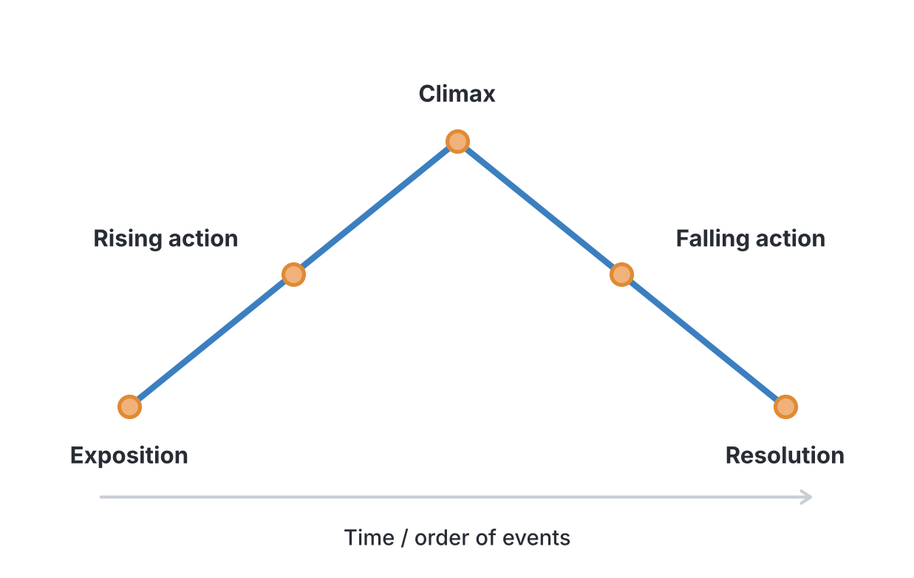

# JAMB Use of English Notes: The Approved Reading Text (Recommended Novel)

> **IMPORTANT: confirm the text with JAMB for the 2027 UTME.**
>
> The JAMB Use of English syllabus does **not** name the reading text. It says only "Approved Reading Text". JAMB announces the title separately.
>
> At the time of writing (November 2026), education websites and a Guardian (Nigeria) tag page report that the approved text for the **2025 and 2026 UTME** is ***The Lekki Headmaster* by Kabir Alabi Garba**. We could not verify this from JAMB's own notice, and we found no announcement yet for the 2027 UTME.
>
> **Before you study, check JAMB's official website and announcements, or ask your school, to confirm the text for your exam year.** If the text changes, the study method in these notes still applies, but the novel-specific sections must be rewritten.

## What JAMB expects

This topic is part of Section A of the JAMB Use of English syllabus: Comprehension and Summary. It covers content item (ii)(d): **Approved Reading Text**.

In the examination (Section D of the syllabus), there are **5 questions on the reading text** ("1 reading text - 5 questions"). Unlike the other Section A questions, there is no passage printed in the exam for these questions. You must have **read the novel yourself, before the exam**.

The Section A objectives apply to the novel too:

1. Objective i: **identify main points**, for example the main events and the central conflict of the story.
2. Objective ii: **determine implied meanings**, for example what a character's action suggests about them.
3. Objective iii: **identify the grammatical functions of words, phrases, clauses and figurative/idiomatic expressions**, for example the meaning of an expression as used in the novel.
4. Objective iv: **deduce or infer the writer's intentions, including mood, attitude and opinion**, for example the author's attitude to a character or a social issue.

### How these notes are organised

Because we could not get reliable enough information about the novel's content, this file is in two parts:

- **Part 1 (complete):** how JAMB tests the reading text, the literary terms you need, and a step-by-step method for studying any set novel, with templates.
- **Part 2 (to be completed):** clearly marked sections for the plot, characters, themes, setting, style and likely question areas. These will be written by a reviewer who has read the novel. **Nothing about the novel's content has been guessed or copied from unverified websites.**

---

# PART 1: HOW TO STUDY THE APPROVED READING TEXT

## Why JAMB sets a reading text

JAMB includes a novel for several reasons:

- **To encourage reading.** Candidates who read whole books build vocabulary, spelling and understanding faster than those who only read notes.
- **To test sustained comprehension.** A passage is 200 words; a novel is a whole world of events and people. JAMB wants to know if you can follow and remember a long text.
- **To test interpretation.** The questions check whether you understand why things happen and what the writer is saying, not just what happens.

**Warning:** summaries on websites and in pamphlets are often inaccurate. Some invent events or confuse characters. The only safe preparation is **reading the novel itself**, more than once.

## What kinds of questions JAMB asks on the reading text

Reading-text questions are multiple choice (A to D). From the way JAMB words its other Section A questions and from the syllabus objectives, the questions usually fall into these types. The examples below are **generic patterns**, not real questions on the novel.

| Question type | What it tests | Example pattern |
| --- | --- | --- |
| Character identification | Who did, said or was something | "Who among the following ___ in the novel?" |
| Character traits | What a character is like | "[Character] can best be described as…" |
| Relationships | How characters are connected | "[Character A] is [Character B]'s…" |
| Events (plot) | What happened | "What happened when…?" |
| Cause and effect | Why something happened | "[Character] did X because…" |
| Sequence | The order of events | "Which of the following happened first?" |
| Setting | Where and when events take place | "The event … took place in…" |
| Theme | The main ideas of the novel | "The novel mainly explores the theme of…" |
| Vocabulary in context | Meaning of a word or expression in the novel | "The expression … as used in the novel means…" |
| Narrative technique | How the story is told | "The novel is narrated from the … point of view" |
| Writer's attitude/purpose | What the author thinks or wants | "The author's attitude to … is one of…" |
| Title | What the title refers to or means | "The title of the novel refers to…" |

## The literary terms you need

You must know these terms to answer questions about any novel. The examples here use **made-up stories**, not the set novel.

### Plot

The **plot** is the sequence of connected events in a story, especially how one event causes another.

A plot usually has five stages:

| Stage | What happens | Example (an invented story) |
| --- | --- | --- |
| Exposition | Characters and setting are introduced | Ada, a hardworking girl, lives with her aunt in Onitsha |
| Rising action | Problems and tension build | Her aunt's shop is robbed and Ada must work to pay her school fees |
| Climax | The turning point; the moment of highest tension | Ada is offered money to help cheat in an exam |
| Falling action | The results of the climax unfold | She refuses and reports the offer; the cheats are caught |
| Resolution (denouement) | The story ends; problems are settled | Ada wins a scholarship |

### Setting

The **setting** is the **place** and **time** in which the events of a story happen. It includes:

- **Physical setting:** country, town, building (a school, a market, a hospital).
- **Time setting:** period in history, season, time of day.
- **Social setting:** the community, its customs, its social and economic conditions.

A story can have several settings. JAMB may ask where a particular event happened.

### Characters and characterisation

A **character** is a person (or sometimes an animal or thing) in a story.

| Type | Meaning | Example (invented) |
| --- | --- | --- |
| Protagonist | The main character, usually at the centre of the conflict | Ada, in the story above |
| Antagonist | The character or force that opposes the protagonist | The man who offers Ada money to cheat |
| Major character | Important throughout the story | Ada's aunt |
| Minor character | Appears briefly, has a small role | The bus driver who gives Ada a lift |
| Round character | Complex, with many traits; may surprise us | An aunt who is strict but secretly generous |
| Flat character | Has one or two traits; does not surprise us | A greedy landlord who only thinks of rent |
| Dynamic character | Changes during the story | A lazy boy who becomes responsible |
| Static character | Does not change | A loyal friend who stays loyal throughout |
| Foil | A character who contrasts with another, highlighting their qualities | A lazy cousin who makes Ada's diligence clearer |

**Characterisation** is the way a writer presents a character:

- **Direct characterisation:** the writer tells you. "Mr Bello was a generous man."
- **Indirect characterisation:** you work it out from what the character says, does, thinks, and how others react. "Mr Bello quietly paid the hospital bill of a stranger and left without giving his name." (This shows generosity and humility.)

JAMB character questions often test **indirect characterisation**: you must infer a trait from an action (objective ii: implied meanings).

### Theme

A **theme** is a central idea or message that the story explores, for example honesty, corruption, education, friendship, ambition, justice, sacrifice, the effects of poverty. A theme is **not** the same as the topic or the plot.

| | Plot | Theme |
| --- | --- | --- |
| Question it answers | What happens? | What is the story about, at a deeper level? |
| Example (invented story) | Ada refuses to cheat and wins a scholarship | Honesty is rewarded; integrity matters more than short-term gain |

A novel usually has one or two **major themes** and several **minor themes**. JAMB questions often ask which theme a particular event illustrates.

### Conflict

**Conflict** is the struggle at the heart of a story. Without conflict, there is no story.

| Type | Meaning | Example (invented) |
| --- | --- | --- |
| Person vs person | A character struggles against another character | Two brothers quarrel over their father's land |
| Person vs society | A character struggles against the community, its rules or customs | A girl fights a custom that stops girls from going to school |
| Person vs self (internal) | A character struggles with their own feelings or choices | A boy is torn between telling the truth and protecting a friend |
| Person vs nature | A character struggles against natural forces | A fisherman is caught in a storm on the lagoon |

### Point of view (narrative perspective)

The **point of view** is the position from which the story is told.

| Point of view | Pronouns used | What the reader knows | Example sentence |
| --- | --- | --- | --- |
| First person | I, me, we | Only what the narrator knows, sees and feels | "I walked into the classroom and everyone went quiet." |
| Third person omniscient | he, she, they | The narrator knows the thoughts and feelings of all characters | "Tunde was nervous, though he hid it; his teacher, meanwhile, was secretly proud of him." |
| Third person limited | he, she, they | The narrator follows one character's thoughts only | "Tunde was nervous. He wondered what the teacher was thinking." |
| Second person (rare) | you | The reader is placed inside the story | "You walk into the classroom…" |

**Note:** some textbooks use "omniscient narrator" and "third-person narrator" as if they mean the same thing; others separate omniscient from limited, as in the table. Both approaches are common.

### Narrative techniques

| Technique | Meaning | Example (invented) |
| --- | --- | --- |
| Linear narration | Events are told in the order they happened | Morning, then afternoon, then evening |
| Flashback | The story goes back to an earlier time | In the middle of the story, the headmaster remembers his own school days |
| Foreshadowing | Hints of what will happen later | "Nobody noticed the crack in the old wall." (Later, the wall falls.) |
| Dialogue | Characters' conversations, in quotation marks | "Where are you going?" Mama asked. |
| Suspense | Keeping the reader eager to know what happens next | A chapter ends before the exam result is revealed |
| Letters, diaries, reports | Parts of the story told through documents | A chapter written as a character's letter home |
| Multiple narrators | Different characters tell different parts | Chapter 1 told by the teacher, Chapter 2 by a pupil |

### Other terms you may need

| Term | Meaning |
| --- | --- |
| Narrator | The voice that tells the story (not always the author) |
| Author | The real person who wrote the book |
| Tone | The author's attitude as shown in the writing (serious, humorous, sarcastic, sympathetic) |
| Mood (atmosphere) | The feeling the story creates in the reader (tense, gloomy, cheerful) |
| Irony | A contrast between what is expected and what happens, or between what is said and what is meant |
| Satire | Using humour or exaggeration to criticise people, institutions or society |
| Symbol | An object, person or event that stands for a bigger idea (a broken bridge standing for a broken relationship) |
| Climax | The turning point of greatest tension |
| Denouement | The final unravelling and resolution of the plot |
| Subplot | A secondary story that runs alongside the main plot |
| Title | The name of the novel; often linked to a central character, setting or theme |

Mood and tone are explained further in `A2c-writers-intention-mood-and-attitude.md`. Figures of speech and idioms are explained in `A2b-words-phrases-and-expressions-in-passages.md` and `B7a-ordinary-and-figurative-usage.md`.

## Step-by-step method for studying the set novel

### Step 1: Get the right book

Use a genuine copy of the approved edition. Pirated or summarised versions may have missing pages or errors. Check that the title and author match JAMB's announcement exactly.

### Step 2: First reading: read for enjoyment

Read the whole novel from start to finish, without stopping to make notes. Your aim is to follow the story and get to know the characters. Do not rely on a summary.

### Step 3: Second reading: read with a pen

Read again, chapter by chapter. After each chapter, fill in a **reading log** (see the template below):

- What happens in this chapter (3 to 5 key events, in order)?
- Which characters appear, and what do they do?
- Where and when does it happen?
- Any important words, expressions or figures of speech?
- Which themes appear?

### Step 4: Build character charts

For each major character, fill in a **character chart** (template below). For each trait, note an **event that proves it**. JAMB questions often describe an action and ask what it shows about a character.

### Step 5: Track themes with evidence

For each theme, list the events and characters that illustrate it. A theme with no evidence from the text is only a guess.

### Step 6: Make a timeline

Draw the main events in order. Note any flashbacks (events told out of order). Sequence questions ("Which happened first?") are common in novel tests.

### Step 7: Note setting changes

List every important place and what happens there.

### Step 8: Collect vocabulary

Note unfamiliar words and expressions with the page number and the meaning in context. Look them up in a good dictionary.

### Step 9: Third reading: revise and test yourself

Close to the exam, re-read the novel quickly. Then test yourself (or a study partner) with questions in the JAMB patterns above. Answer from memory, then check the book.

### Step 10: Avoid relying on online summaries

If a website and the book disagree, **the book is right**. Many free summaries are copied from each other, and errors spread.

## Templates

### Reading log (one per chapter)

| Item | Your notes |
| --- | --- |
| Chapter number and title (if any) | |
| Key events, in order (3 to 5) | 1. 2. 3. |
| Characters who appear | |
| What each character does or reveals | |
| Setting (place and time) | |
| Themes shown | |
| New words and expressions (with page) | |
| Figures of speech or striking lines (with page) | |
| One possible JAMB question from this chapter | |

### Character chart (one per major character)

| Item | Your notes |
| --- | --- |
| Name | |
| Role (protagonist, antagonist, major, minor) | |
| Relationship to other characters | |
| Occupation or position | |
| Key traits (each with an event that proves it) | 1. Trait: … Evidence (chapter/page): … |
| Does the character change? How? | |
| Important things the character does | |
| What happens to the character at the end | |
| Themes linked to this character | |

### Theme tracker

| Theme | Events that show it (chapter) | Characters linked to it |
| --- | --- | --- |
| | | |

### Timeline

| Order | Event | Chapter | Place |
| --- | --- | --- | --- |
| 1 | | | |
| 2 | | | |

## How to answer reading-text questions in the exam

1. **Read the question carefully.** Note key words like "first", "NOT", "mainly", "because".
2. **Recall the relevant part of the novel.** Picture the scene: who was there, where, and what happened.
3. **Predict the answer before looking at the options.**
4. **Eliminate options** that name the wrong character, the wrong place, the wrong order or a theme the novel does not deal with.
5. **Beware of "nearly right" options.** JAMB may use a real character's name with an event that happened to someone else, or a real place with the wrong event.
6. **For "NOT" questions**, check each option against the novel; three will be true and one false.
7. **For vocabulary questions**, think about how the word is used in the novel's context, not just its dictionary meaning.

---

# PART 2: THE NOVEL (TO BE COMPLETED)

> **The sections below are placeholders.** They must be completed by a reviewer who has read the approved edition of the novel. Do not fill them from online summaries. Every fact should be checked against the book, with chapter or page references where possible.
>
> **Reported title (to be confirmed for 2027):** *The Lekki Headmaster* by Kabir Alabi Garba.

## About the novel and its author

> **TO BE COMPLETED by a reviewer who has read the novel.**

Checklist of what to fill in:

- [ ] Confirm the exact title and author's name as printed on the cover.
- [ ] Publisher, year of publication and edition (check the copyright page).
- [ ] Number of chapters (and whether chapters have titles).
- [ ] A short, verified note on the author (only facts from a reliable source, e.g. the book's own author note).
- [ ] Confirm JAMB's announcement for the exam year, with date and source.

## Plot overview (chapter by chapter)

> **TO BE COMPLETED by a reviewer who has read the novel.**

Checklist of what to fill in:

- [ ] A one-paragraph overview of the whole story (in your own words).
- [ ] For each chapter: chapter number/title, 3 to 5 key events in order, characters involved.
- [ ] The main conflict and how it develops.
- [ ] The climax (turning point).
- [ ] The resolution/ending.
- [ ] Any flashbacks, with what period they go back to.
- [ ] A simple timeline table of major events.

| Chapter | Key events | Characters involved |
| --- | --- | --- |
| 1 | *To be completed* | *To be completed* |
| 2 | *To be completed* | *To be completed* |

## Characters

> **TO BE COMPLETED by a reviewer who has read the novel.**

Checklist of what to fill in:

- [ ] List of major characters, with correct spelling of each name.
- [ ] For each major character: role, relationships, occupation/position, key traits with supporting events, how they change, what happens to them at the end.
- [ ] List of minor characters with a one-line description each.
- [ ] A relationships table (who is related to or works with whom).
- [ ] Protagonist and antagonist (if clear).

| Character | Role | Key traits (with evidence) | Relationship to others |
| --- | --- | --- | --- |
| *To be completed* | | | |

## Themes

> **TO BE COMPLETED by a reviewer who has read the novel.**

Checklist of what to fill in:

- [ ] Major themes, each with a short explanation and the events/characters that show it.
- [ ] Minor themes, each with one or two supporting events.
- [ ] The message(s) the author seems to convey.

| Theme | How the novel shows it (events, chapters) | Characters linked |
| --- | --- | --- |
| *To be completed* | | |

## Setting

> **TO BE COMPLETED by a reviewer who has read the novel.**

Checklist of what to fill in:

- [ ] Main place(s) where the story happens (country, city, specific locations such as buildings).
- [ ] Time setting (period, how much time passes in the story).
- [ ] Social setting (community, social and economic conditions shown).
- [ ] Which events happen in which places (table).

## Style (language and narrative technique)

> **TO BE COMPLETED by a reviewer who has read the novel.**

Checklist of what to fill in:

- [ ] Point of view (first person, third person omniscient or limited, multiple narrators).
- [ ] Narrative structure (linear, flashbacks, letters, etc.).
- [ ] Language: simple or complex, use of dialogue, use of Nigerian Pidgin or local languages (with examples and page references).
- [ ] Figures of speech, proverbs and idioms used (with page references and meanings in context).
- [ ] Tone and mood of the novel.
- [ ] Use of humour, irony, satire or symbolism (if any).
- [ ] Meaning of the title.
- [ ] At most one short, verified quotation, if it is important (with page number).

## Likely JAMB question areas

> **TO BE COMPLETED by a reviewer who has read the novel.**

Checklist of what to fill in:

- [ ] Key events most likely to be tested (turning points, beginnings and endings of chapters).
- [ ] Characters most likely to be tested and the facts about them (relationships, jobs, key actions).
- [ ] Places and their events.
- [ ] Important words and expressions in context.
- [ ] 20 or more practice questions in JAMB style, each checked against the book with a page reference.

## Needs checking against the novel

The following claims appear on education websites and blogs about the novel. **We have not verified any of them, and none is stated as fact in these notes.** A reviewer who has read the book should check each one and either confirm it (with a page reference) or discard it.

- [ ] Is *The Lekki Headmaster* by Kabir Alabi Garba really the approved text for the 2027 UTME? (Check JAMB's official announcement.)
- [ ] Was it the approved text for both the 2025 and 2026 UTME, as reported? Did it replace *The Life Changer* by Khadija Abubakar Jalli, as some sites say?
- [ ] Is the story set mainly in Lagos State, and specifically in the Lekki area, as the title suggests and some sites claim?
- [ ] Does the title refer to the headmaster (or head teacher) of a school, and is that person the main character?
- [ ] Is the novel set in contemporary (present-day) Nigeria, as one site claims?
- [ ] Is the novel tested in the Use of English paper? (One site claimed it is tested under Literature-in-English; the JAMB syllabus places the "Approved Reading Text" under Use of English, Section A.)
- [ ] Who is the publisher, and what is the year of publication?
- [ ] What themes do blogs commonly list (for example, education, discipline, integrity, leadership)? Check each against the book before including it.
- [ ] Any character names, events or quotations circulating online: check spelling and accuracy against the book.

---

## Key terms

| Term | Meaning |
| --- | --- |
| Approved Reading Text | The novel JAMB prescribes for Use of English; announced separately from the syllabus |
| Plot | The connected sequence of events in a story |
| Setting | The place, time and social background of a story |
| Protagonist | The main character |
| Antagonist | The character or force that opposes the protagonist |
| Characterisation | How a writer presents a character, directly or indirectly |
| Theme | A central idea or message explored in the story |
| Conflict | The struggle at the heart of the story |
| Point of view | The position from which the story is told (first person, third person) |
| Flashback | A scene that goes back to an earlier time |
| Foreshadowing | Hints about what will happen later |
| Climax | The turning point of greatest tension |
| Resolution (denouement) | The ending, where problems are settled |
| Tone | The author's attitude as shown in the writing |
| Mood | The feeling the story creates in the reader |

## Exam tips and common mistakes

- **Confirm the text for your exam year with JAMB.** Do not assume last year's novel is still the text.
- **Read the novel itself, at least twice.** Summaries are not enough and are often wrong.
- **Learn character names with their correct spelling and relationships.** Options often mix up characters.
- **Know the order of events.** Sequence questions are common.
- **Do not confuse theme with plot.** A theme is an idea (e.g. honesty); a plot is events.
- **Do not confuse the author with the narrator.** In a first-person novel, "I" is a character, not the author.
- **Answer from the book, not from online summaries.** If they disagree, the book is right.
- **Vocabulary questions depend on context.** Think about how the word is used in the novel.

## Quick summary

1. The syllabus names no title; JAMB announces the reading text separately, and it must be confirmed for each exam year.
2. It is reported (not verified from JAMB) that the 2025 and 2026 text is *The Lekki Headmaster* by Kabir Alabi Garba.
3. JAMB sets 5 questions on the reading text, with no passage printed; you must have read the novel.
4. Questions test characters, events, sequence, setting, themes, vocabulary in context, narrative technique and the writer's attitude.
5. Know the literary terms: plot, setting, character types, theme, conflict, point of view, flashback, foreshadowing, tone and mood.
6. Study method: read for enjoyment, re-read with a reading log, build character charts, track themes, make a timeline and test yourself.
7. Novel-specific notes in Part 2 are placeholders until checked by a reviewer who has read the book.

## Practice questions

These questions test reading-text skills and literary terms. They are not about the content of the novel.

**1. In the JAMB UTME, how many questions are set on the approved reading text?**

- A. 2
- B. 5
- C. 10
- D. 15

**Answer: B.** Section D of the syllabus lists "1 reading text - 5 questions".

**2. The main character at the centre of a story's conflict is called the**

- A. antagonist
- B. narrator
- C. protagonist
- D. foil

**Answer: C.** The antagonist opposes the protagonist; a foil contrasts with another character; the narrator tells the story.

**3. "Mr Bello quietly paid a stranger's hospital bill and left without giving his name." This sentence shows Mr Bello's character through**

- A. direct characterisation
- B. indirect characterisation
- C. flashback
- D. foreshadowing

**Answer: B.** The writer does not state "Mr Bello was generous"; we infer it from his action.

**4. A story told by a narrator who says "I" and takes part in the events is written in the**

- A. first-person point of view
- B. second-person point of view
- C. third-person omniscient point of view
- D. third-person limited point of view

**Answer: A.** First-person narrators use "I" and are characters in the story.

**5. When a novel goes back to show events that happened before the main story, the writer is using**

- A. foreshadowing
- B. flashback
- C. suspense
- D. satire

**Answer: B.** A flashback moves back in time. Foreshadowing hints at the future.

**6. Which of the following is a THEME rather than a plot event?**

- A. A pupil wins a scholarship.
- B. A school building collapses.
- C. The importance of integrity in public life.
- D. A teacher is transferred to another school.

**Answer: C.** A theme is an idea; the others are events.

**7. A girl struggles against a custom in her community that prevents girls from going to school. This is an example of conflict between**

- A. person and self
- B. person and nature
- C. person and person
- D. person and society

**Answer: D.** The struggle is against the community's rules or customs.

**8. The turning point of greatest tension in a story is the**

- A. exposition
- B. climax
- C. resolution
- D. rising action

**Answer: B.** The exposition introduces, rising action builds tension, the climax is the turning point, and the resolution ends the story.

**9. "The author's attitude to the corrupt officials is one of contempt." This sentence describes the author's**

- A. setting
- B. plot
- C. tone
- D. point of view

**Answer: C.** Tone is the author's attitude as shown in the writing.

**10. The best way to prepare for the reading-text questions is to**

- A. memorise a summary from a website
- B. read only the first and last chapters
- C. read the approved novel carefully, more than once, and make notes
- D. watch a film version of a different novel

**Answer: C.** Only careful reading of the actual text gives reliable knowledge; online summaries are often inaccurate.
