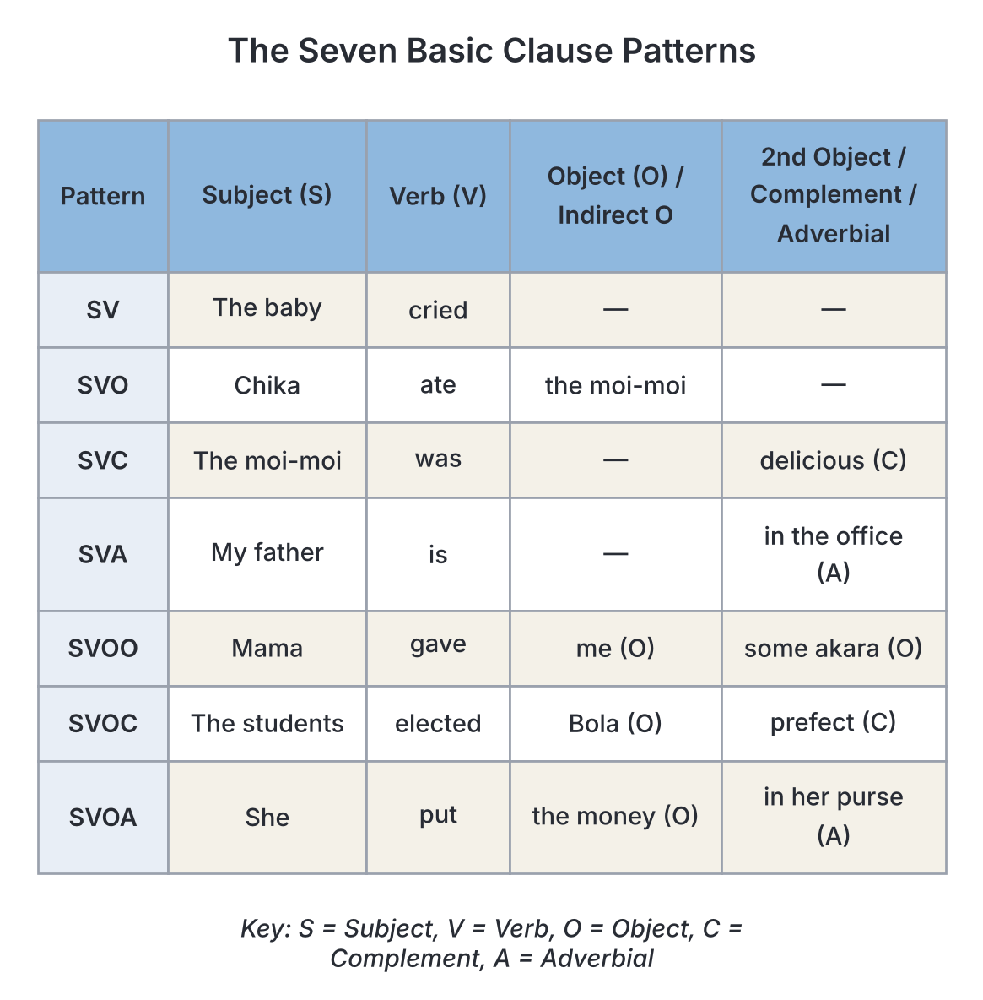

# JAMB Use of English Notes: Sentence Patterns

## What JAMB expects

This topic is Section B of the JAMB Use of English syllabus: Lexis and Structure, content item **(c) clause and sentence patterns**. These notes cover **sentence patterns**: the parts of a sentence, the basic patterns they form, and the different types of sentences. Clauses themselves (main, subordinate, noun, adjective and adverbial clauses) are explained in `B3a-clauses.md`, so read that first if you can.

It covers these objectives:

- **Section B, objective iv:** identify various grammatical patterns in use.
- **Section B, objective v:** interpret information conveyed in sentences.
- **Section A, objective iii:** identify the grammatical functions of words, phrases and clauses (for example "the word in italics functions as the object / complement / adverbial").

**How many questions?** Sentence patterns are part of "Basic Grammar", which has **10 questions** in Section B. Questions on word order, sentence types and grammatical function also appear in Section A (comprehension) and in sentence interpretation.

By the end of these notes, you should be able to:

1. Identify the five elements of a clause: subject, verb, object, complement and adverbial.
2. Recognise the seven basic clause patterns (SV, SVO, SVC, SVA, SVOO, SVOC, SVOA).
3. Classify sentences by structure: simple, compound, complex and compound-complex.
4. Classify sentences by function: declarative, interrogative, imperative and exclamatory.
5. Recognise special patterns JAMB likes to test: active and passive, inversion after negative words, and word order in reported questions.
6. Spot sentence errors such as fragments, run-on sentences and faulty word order.

**A note on how words are marked:** in the real JAMB paper, the tested word or group is usually **underlined** or in *italics*. In these notes, it is printed in *italics*.

## The five elements of a clause

Every clause in English is built from a small number of parts, called **elements** (or **constituents**). The most widely used system, found in Quirk and colleagues' *A Comprehensive Grammar of the English Language* and in many Nigerian textbooks, uses five elements:

| Element | Symbol | What it does | Example (element in italics) |
| --- | --- | --- | --- |
| Subject | S | Who or what the sentence is about; usually comes before the verb | *The farmer* harvested the yams. |
| Verb (Predicator) | V (or P) | The action or state | The farmer *harvested* the yams. |
| Object | O | The person or thing affected by the action | The farmer harvested *the yams*. |
| Complement | C | Completes the meaning of the subject or object by describing or renaming it | The farmer is *a hardworking man*. |
| Adverbial | A | Tells when, where, how, why, etc. | The farmer harvested the yams *in December*. |

**Terminology differences:**

- Some books call the verb element the **predicator** (P) and use the symbol P instead of V. Some (especially those following Halliday's systemic grammar, used in some Nigerian universities) use **S P C A**, where "C" includes objects and "A" is the adjunct. This is the same idea with different labels.
- Some books use **predicate** for everything after the subject (verb + object + complement + adverbial). Don't confuse **predicate** (the whole "rest of the sentence") with **predicator** (the verb only).

### 1. The subject (S)

The subject is usually a noun, a pronoun, a noun phrase or a noun clause. It comes before the verb in a statement, and the verb agrees with it.

- *Amina* sings.
- *She* sings.
- *The tall girl in the choir* sings.
- *Whoever sings best* will win the prize.
- *To sing well* requires practice.

**How to find the subject:** ask "Who or what + verb?" "Who sings?" → *Amina*.

**Subject–verb agreement:** the verb agrees with the subject, not with nearby words: *The box of mangoes* **is** heavy. (subject = *box*, singular) More in `B5b-number-and-concord.md`.

### 2. The verb (V)

The verb element is the verb phrase: a main verb with any auxiliaries.

- She *sings*.
- She *is singing*.
- She *has been singing*.
- She *might have been singing*.

The **type of verb** decides which pattern the clause can take:

| Verb type | What follows it | Example |
| --- | --- | --- |
| Intransitive | Nothing needed | The baby *slept*. |
| Monotransitive | One object | She *bought* a bag. |
| Ditransitive | Two objects (indirect + direct) | She *gave* me a bag. |
| Complex-transitive | Object + complement or object + adverbial | They *elected* him captain. / She *put* the bag on the table. |
| Linking (copular) | Subject complement | The food *smells* delicious. |

Common **linking verbs**: *be, seem, appear, become, get, grow, turn, look, sound, smell, taste, feel, remain, stay, prove*.

Many verbs can be used in more than one way:

- The bus *stopped*. (intransitive)
- The driver *stopped* the bus. (transitive)
- The soup *tastes* good. (linking)
- She *tasted* the soup. (transitive)

### 3. The object (O)

The object is the person or thing that receives the action of a transitive verb. There are two kinds:

- **Direct object (Od):** what is directly affected. *She wrote **a letter**.*
- **Indirect object (Oi):** the person who receives or benefits from the direct object. *She wrote **her mother** a letter.*

**How to find them:** ask "verb + what?" for the direct object (*wrote what?* → a letter). Ask "to whom? / for whom?" for the indirect object (*wrote to whom?* → her mother).

The indirect object can usually be turned into a phrase with *to* or *for*:

- She gave **the beggar** some money. → She gave some money **to the beggar**.
- He bought **his wife** a wrapper. → He bought a wrapper **for his wife**.

When *to* or *for* is used, many grammars no longer call it an indirect object; it becomes a prepositional phrase (adverbial or prepositional object, depending on the book).

### 4. The complement (C)

A complement completes the meaning by **describing or renaming** the subject or the object. It is **not** affected by an action, which is how it differs from an object.

- **Subject complement (Cs):** follows a linking verb and describes or renames the subject.
  - Ngozi is *a nurse*. (Ngozi = a nurse)
  - The weather became *hot*.
  - Garri tastes *sour* when it is fresh.
- **Object complement (Co):** follows the object and describes or renames it.
  - They made Ngozi *the class captain*. (Ngozi = the class captain)
  - The news made us *happy*. (us = happy)
  - She painted the wall *blue*.

**Object vs complement:**

| | Object | Complement |
| --- | --- | --- |
| Example | He hit *a policeman*. | He became *a policeman*. |
| Is it the same person/thing as the subject? | No (*he* ≠ *a policeman*) | Yes (*he* = *a policeman*) |
| Verb type | Transitive (action) | Linking (state) |
| Can the sentence become passive? | Yes: *A policeman was hit by him.* | No: ✗ *A policeman was become by him.* |
| Can it be an adjective? | No | Yes: *He became **rich**.* |

### 5. The adverbial (A)

The adverbial gives information about **when, where, how, why, how often, how long** and so on. It can be an adverb, a prepositional phrase, a noun phrase or an adverbial clause.

- She sings *beautifully*. (how)
- She sings *in the church choir*. (where)
- She sings *every Sunday*. (when / how often)
- She sings *because she loves music*. (why)

Most adverbials are **optional** and can move around. But some verbs **need** an adverbial to complete their meaning (see the SVA and SVOA patterns below). These are called **obligatory adverbials**.

- ✗ *She put the plate.* (incomplete)
- ✓ *She put the plate on the table.* (the adverbial is needed)
- ✗ *My uncle lives.* (incomplete in this meaning)
- ✓ *My uncle lives in Kano.*

## The seven basic clause patterns

Using the five elements, almost every English clause fits one of **seven basic patterns**. This list comes from Quirk and colleagues and is widely used. **Some textbooks list only five patterns** (they leave out SVA and SVOA, treating the adverbial as optional), and some add more, such as SVOO with *to*/*for*. If your class book is different, the ideas are the same.

| Pattern | Elements | Verb type | Example |
| --- | --- | --- | --- |
| 1. SV | Subject + Verb | Intransitive | *The baby / cried.* |
| 2. SVO | Subject + Verb + Object | Monotransitive | *Chika / ate / the moi-moi.* |
| 3. SVC | Subject + Verb + Complement | Linking | *The moi-moi / was / delicious.* |
| 4. SVA | Subject + Verb + Adverbial (obligatory) | Intransitive/linking with a required adverbial | *My father / is / in the office.* |
| 5. SVOO | Subject + Verb + Indirect object + Direct object | Ditransitive | *Mama / gave / me / some akara.* |
| 6. SVOC | Subject + Verb + Object + Object complement | Complex-transitive | *The students / elected / Bola / prefect.* |
| 7. SVOA | Subject + Verb + Object + Adverbial (obligatory) | Complex-transitive | *She / put / the money / in her purse.* |

### Optional extras

Any of the seven patterns can have **optional adverbials** added, without changing the pattern:

- *Yesterday*, the baby cried *loudly*. → still basically **SV** (with two optional adverbials).
- Chika ate the moi-moi *quickly* *at lunch*. → still **SVO**.

In exams, if asked for the basic pattern, find the elements the verb **needs**, then add any optional adverbials if the options include them. Some JAMB-style questions write the full pattern including optional adverbials (e.g. "SVOA" for *Chika ate the moi-moi at lunch*). Read the options carefully and choose the one that matches every element in the sentence.

### Worked examples: finding the pattern

**Example 1:** *The headmaster appointed Musa class monitor.*

1. Find the verb: *appointed*.
2. Subject: who appointed? → *The headmaster*.
3. Appointed whom? → *Musa* (object).
4. *class monitor*: is Musa = class monitor? Yes → object complement.
5. **Pattern: SVOC.**

**Example 2:** *The headmaster sent Musa a letter.*

1. Verb: *sent*. Subject: *The headmaster*.
2. Sent what? → *a letter* (direct object). Sent to whom? → *Musa* (indirect object).
3. Is Musa = a letter? No → two objects.
4. **Pattern: SVOO.**

**Example 3:** *The headmaster sent Musa to the office.*

1. Verb: *sent*. Subject: *The headmaster*. Object: *Musa*.
2. *to the office*: tells where → adverbial, and it is needed for the meaning here.
3. **Pattern: SVOA.**

**Example 4:** *The headmaster seems angry.*

1. Verb: *seems* (linking). *angry* describes the subject.
2. **Pattern: SVC.**

**Example 5:** *The headmaster has travelled.*

1. Verb: *has travelled*. Nothing else needed.
2. **Pattern: SV.**

## Sentence types by structure

This classification looks at **how many clauses** a sentence has and **what kind** they are.

### 1. Simple sentence

A simple sentence has **one main clause** and no subordinate clause.

- The rain fell.
- My elder sister in Port Harcourt sells fabrics and shoes.
- Musa and his friends played football after school.

**Watch out:** a simple sentence can be long. It can have a **compound subject** (*Musa and his friends*) or a **compound verb** (*sells fabrics and shoes*; *sang and danced*), but it still has only one subject–verb unit. It may also contain phrases (*in Port Harcourt*, *after school*).

### 2. Compound sentence

A compound sentence has **two or more main clauses** joined by:

- a **coordinating conjunction** (*for, and, nor, but, or, yet, so* — remember **FANBOYS**), or
- a **semicolon**, or
- a semicolon plus a **conjunctive adverb** (*however, therefore, moreover, nevertheless, consequently*).

Examples:

- The rain fell, **and** the river overflowed its banks.
- I wanted to go to the party, **but** my mother said no.
- You can take a keke **or** you can walk.
- He studied hard; **therefore**, he passed.
- The shop was closed; we went home.

### 3. Complex sentence

A complex sentence has **one main clause** and **at least one subordinate clause**.

- **When the rain fell**, the river overflowed its banks.
- The man **who repaired our generator** lives in Ikeja.
- I know **that you are tired**.

### 4. Compound-complex sentence

A compound-complex sentence has **at least two main clauses** and **at least one subordinate clause**.

- **When the rain fell**, the river overflowed its banks, **and** many farms were destroyed.
- I called Ada **because I needed help**, **but** she did not answer.

### Comparison table

| Type | Main clauses | Subordinate clauses | Example |
| --- | --- | --- | --- |
| Simple | 1 | 0 | *The market opens at six.* |
| Compound | 2 or more | 0 | *The market opens at six, and it closes at eight.* |
| Complex | 1 | 1 or more | *The market opens at six because traders arrive early.* |
| Compound-complex | 2 or more | 1 or more | *The market opens at six because traders arrive early, and it closes at eight.* |

### How to classify a sentence: step by step

1. **Find every finite verb** (verbs with tense). Each one usually marks a clause.
2. **For each clause, ask:** can it stand alone? → main. Does it begin with a subordinator (*because, when, if, who, that*, etc.) and depend on another clause? → subordinate.
3. **Count:** main clauses and subordinate clauses.
4. **Match** with the table above.

**Worked example:** *Although the generator was faulty, the technician repaired it, and the light came back.*

1. Finite verbs: *was*, *repaired*, *came back* → three clauses.
2. *Although the generator was faulty* → subordinate (begins with *although*). *the technician repaired it* → main. *the light came back* → main (joined by *and*).
3. Two main + one subordinate.
4. **Compound-complex.**

**Trap:** non-finite verbs (*to go*, *walking*, *broken*) do not make a separate finite clause in this count. *Walking to school, I saw an accident.* → one finite verb (*saw*) → **simple** sentence (in the traditional count used in most school books). Grammars that treat *walking to school* as a non-finite clause would call this sentence complex. JAMB-style questions usually follow the traditional school count.

## Sentence types by function

This classification looks at **what the sentence does**.

### 1. Declarative (statement)

Makes a statement. Usually ends with a full stop. Word order: subject before verb.

- The JAMB result is out.
- I did not see your message.

### 2. Interrogative (question)

Asks a question. Ends with a question mark. There are several kinds:

| Kind | How it is formed | Example | Expected answer |
| --- | --- | --- | --- |
| Yes/No question | Auxiliary before subject | *Is the result out?* / *Did you see my message?* | Yes or no |
| Wh-question | Question word (*who, what, where, when, why, which, whose, how*) + auxiliary + subject | *Where do you live?* / *Why was she late?* | Information |
| Alternative question | Offers choices with *or* | *Will you take tea or coffee?* | One of the choices |
| Tag question | Statement + short question at the end | *You are coming, aren't you?* | Confirmation |
| Declarative question (in speech) | Statement word order + rising intonation | *You're leaving already?* | Usually surprise/confirmation |

Question tags are covered fully in `B5c-degree-and-question-tags.md`.

**When the question word is the subject**, there is no *do*:

- ✓ *Who broke the window?* ✗ *Who did break the window?* (unless you are being emphatic)
- ✓ *What happened?* ✗ *What did happen?* (unless emphatic)

### 3. Imperative (command, request, advice, warning)

Tells someone to do something. Usually no stated subject (the subject *you* is understood). Uses the base form of the verb.

- *Close the door.*
- *Please sit down.*
- *Don't touch that wire!*
- *Let's go.* (*let's* + base verb for suggestions including the speaker)

### 4. Exclamatory (exclamation)

Expresses strong feeling. Usually begins with *What* or *How* and ends with an exclamation mark.

- *What a beautiful dress (it is)!*
- *How fast she runs!*
- *What lovely weather we are having!*

**Watch the word order:** in an exclamation, the subject comes **before** the verb (no inversion).

- ✓ *How beautiful she is!* ✗ *How beautiful is she!* (that would be a question form)
- ✓ *What a clever boy you are!*

### Form vs function: an important note

The **form** of a sentence does not always match its **use**:

- *Could you pass the salt?* → interrogative form, but used as a polite **request**.
- *You will report to my office at 2 p.m.* → declarative form, but used as a **command**.
- *Isn't it a lovely day!* → interrogative form, used as an **exclamation**.

In JAMB, if asked for the **type of sentence by structure/form**, go by the form. If asked what the speaker is **doing** (requesting, commanding, complaining), go by the use. Read the question carefully.

## Special patterns JAMB likes to test

### 1. Active and passive voice

In an **active** sentence, the subject does the action. In a **passive** sentence, the subject receives the action.

- Active: *The police **arrested** the thief.*
- Passive: *The thief **was arrested** (by the police).*

**How to form the passive:**

1. Move the **object** of the active sentence to the subject position.
2. Use the correct form of **be** (in the same tense as the active verb) + the **past participle** of the main verb.
3. Add *by* + the original subject only if it is needed.

| Tense | Active | Passive |
| --- | --- | --- |
| Present simple | They **clean** the hall. | The hall **is cleaned**. |
| Present continuous | They **are cleaning** the hall. | The hall **is being cleaned**. |
| Past simple | They **cleaned** the hall. | The hall **was cleaned**. |
| Past continuous | They **were cleaning** the hall. | The hall **was being cleaned**. |
| Present perfect | They **have cleaned** the hall. | The hall **has been cleaned**. |
| Past perfect | They **had cleaned** the hall. | The hall **had been cleaned**. |
| Future (*will*) | They **will clean** the hall. | The hall **will be cleaned**. |
| Modal | They **must clean** the hall. | The hall **must be cleaned**. |

**Only transitive verbs** (verbs with objects) can be made passive. ✗ *The baby was slept.*

**SVOO in the passive:** either object can become the subject:

- Active: *The principal gave Tolu a prize.*
- Passive 1: *Tolu was given a prize (by the principal).*
- Passive 2: *A prize was given to Tolu (by the principal).*

**Common errors:**

- ✗ *The thief was arrest yesterday.* → ✓ *was arrested*
- ✗ *The work has been finish.* → ✓ *has been finished*
- ✗ *The letter was wrote by Ada.* → ✓ *was written*

### 2. Inversion after negative and limiting words

When a sentence **begins** with certain negative or limiting words, the auxiliary verb comes **before** the subject, as in a question. This is formal English and is a favourite JAMB gap-filling area.

| Opening words | Pattern | Example |
| --- | --- | --- |
| *Never* | Never + aux + S + V | *Never **have I** seen such a crowd.* |
| *Seldom / Rarely* | ... + aux + S + V | *Rarely **does he** come late.* |
| *Hardly / Scarcely ... when* | Hardly + had + S + V-ed ... when | *Hardly **had we** arrived **when** it started to rain.* |
| *No sooner ... than* | No sooner + had + S + V-ed ... than | *No sooner **had we** arrived **than** it started to rain.* |
| *Not only ... but (also)* | Not only + aux + S + V ... but also | *Not only **did she** sing, **but** she **also** danced.* |
| *Only then / Only when / Only after* | ... + aux + S + V | *Only then **did I** understand.* / *Only when the bell rang **did we** leave.* |
| *Under no circumstances / On no account* | ... + aux + S + V | *Under no circumstances **should you** open this door.* |
| *Little* | Little + aux + S + V | *Little **did they** know what would happen.* |
| *So* + adjective ... *that* | So + adj + be + S ... that | *So loud **was the noise** that we could not hear.* |

**Pairing rules (very common traps):**

- **No sooner** goes with **than**: ✓ *No sooner had he sat down than the phone rang.* ✗ *No sooner had he sat down when the phone rang.*
- **Hardly / Scarcely / Barely** go with **when** (or *before*): ✓ *Hardly had he sat down when the phone rang.* ✗ *Hardly had he sat down than the phone rang.*

**Without the negative word at the front, there is no inversion:**

- *I have never seen such a crowd.* (normal order)
- *Never have I seen such a crowd.* (inverted)
- ✗ *Never I have seen such a crowd.*

### 3. Word order in reported (indirect) questions

In a **reported question**, use **statement word order** (subject before verb). Don't use *do/does/did*, and don't put a question mark.

| Direct question | Reported question | Wrong |
| --- | --- | --- |
| "Where do you live?" | She asked me **where I lived**. | ✗ She asked me where did I live. |
| "Why are you late?" | The teacher asked **why I was late**. | ✗ The teacher asked why was I late. |
| "Have you eaten?" | Mum asked **if/whether I had eaten**. | ✗ Mum asked had I eaten. |
| "What time is it?" | Can you tell me **what time it is**? | ✗ Can you tell me what time is it? |

The same applies to embedded questions after *I wonder, I don't know, Do you know, Could you tell me*:

- ✓ *Do you know where the bank is?* ✗ *Do you know where is the bank?*
- ✓ *I wonder what he wants.* ✗ *I wonder what does he want.*

### 4. Cleft sentences (for emphasis)

A **cleft sentence** splits one idea into two parts to focus on one element. They are formed with *It is/was ... that/who* or *What ... is/was*:

- Normal: *Ada broke the plate.*
- Cleft: *It was **Ada** who broke the plate.* (not someone else)
- Cleft: *It was **the plate** that Ada broke.* (not the cup)
- Pseudo-cleft: *What Ada broke was **the plate**.*

These link to emphatic stress in speech (see `C5-emphatic-stress.md`), and they help with sentence interpretation.

### 5. Existential "there" sentences

*There is/are* introduces something that exists. The verb agrees with the noun that follows:

- ✓ *There **is** a book on the table.*
- ✓ *There **are** two books on the table.*
- ✗ *There is many people outside.* → ✓ *There **are** many people outside.*

## Sentence errors to avoid

### 1. Sentence fragments

A fragment is a group of words written as a sentence but missing a main clause.

- ✗ *Because the road was bad.* → ✓ *We arrived late because the road was bad.*
- ✗ *The man who sells suya near our house.* → ✓ *The man who sells suya near our house is from Sokoto.*
- ✗ *Waiting for the bus.* → ✓ *We were waiting for the bus.*

### 2. Run-on sentences and comma splices

A run-on joins two main clauses with no punctuation or with only a comma.

- ✗ *I was hungry I ate some bread.*
- ✗ *I was hungry, I ate some bread.* (comma splice)
- ✓ *I was hungry, so I ate some bread.*
- ✓ *I was hungry; I ate some bread.*
- ✓ *Because I was hungry, I ate some bread.*

### 3. Faulty parallelism

Items joined by *and*, *or*, *both ... and*, *either ... or*, *not only ... but also* should have the **same grammatical form**.

- ✗ *She likes cooking, reading and to swim.* → ✓ *She likes cooking, reading and swimming.*
- ✗ *He is not only intelligent but also works hard.* → ✓ *He is not only intelligent but also hardworking.* / *He not only is intelligent but also works hard.*
- ✗ *Either you pay now or leave.* → ✓ *Either pay now or leave.* / *You either pay now or leave.*

### 4. Misplaced modifiers

Put describing words close to what they describe.

- ✗ *She almost ate all the rice.* (This says she nearly started eating.) → ✓ *She ate almost all the rice.*
- ✗ *I only have ₦500.* (common in speech; formal written English prefers:) ✓ *I have only ₦500.*
- ✗ *We saw a lorry driving to Onitsha full of yams.* → ✓ *Driving to Onitsha, we saw a lorry full of yams.* (if *we* were driving)

## How JAMB tests sentence patterns

1. **"Choose the option that best completes the gap"**, testing word order: *Hardly ______ when the lights went off.* (A. we had started B. had we started C. we started D. did we start) → **B**.
2. **"Choose the correct sentence"** among options with faulty word order, fragments, or wrong question forms.
3. **"The word/phrase in italics functions as ..."**: subject, object, complement, adverbial, indirect object.
4. **"The sentence is ..."**: simple, compound, complex or compound-complex; or declarative, interrogative, imperative, exclamatory.
5. **Sentence interpretation**: knowing what is subject and what is object helps you interpret who did what (see `B8-sentence-interpretation.md`).

### Worked example: function of a word

> The committee declared the meeting *open*.
>
> The word in italics functions as
>
> - A. object of the verb
> - B. subject complement
> - C. object complement
> - D. adverbial

- *the meeting* is the object of *declared*.
- *open* describes *the meeting* (the meeting = open).
- So *open* is an **object complement**. **Answer: C.**
- B is a trap: a subject complement would describe *the committee*.

### Worked example: word order

> Can you tell me where ______?
>
> - A. is the post office
> - B. the post office is
> - C. does the post office
> - D. is it the post office

- After *Can you tell me where*, use statement order: subject + verb.
- **Answer: B.**

## Key terms

| Term | Meaning |
| --- | --- |
| Subject (S) | The person or thing a clause is about; usually comes before the verb |
| Verb / Predicator (V or P) | The verb phrase of the clause |
| Predicate | Everything in a clause except the subject (used in some books) |
| Direct object (Od) | The person or thing directly affected by the action |
| Indirect object (Oi) | The person who receives or benefits from the direct object |
| Subject complement (Cs) | A word or phrase after a linking verb that describes or renames the subject |
| Object complement (Co) | A word or phrase after the object that describes or renames the object |
| Adverbial (A) | A word, phrase or clause that tells when, where, how, why, etc. |
| Linking (copular) verb | A verb that joins the subject to its complement, e.g. *be, seem, become* |
| Simple sentence | One main clause only |
| Compound sentence | Two or more main clauses |
| Complex sentence | One main clause plus one or more subordinate clauses |
| Compound-complex sentence | Two or more main clauses plus one or more subordinate clauses |
| Inversion | Putting the auxiliary verb before the subject, e.g. after *Never*, *Hardly* |
| Cleft sentence | A sentence split into two parts for emphasis, e.g. *It was Ada who ...* |
| Run-on sentence | Two main clauses joined without proper punctuation or a conjunction |

## Exam tips and common mistakes

- **Object or complement?** If the word is the same person/thing as the subject (or object) and follows a linking verb, it is a complement. If it receives an action, it is an object.
- **Indirect object** comes before the direct object without *to*/*for*: *gave **me** a book*.
- **Count finite verbs** to classify sentences; non-finite forms (*to go, walking, broken*) are not counted as separate clauses in the usual school count.
- **A long sentence can still be simple.** Compound subjects and compound verbs do not make a sentence compound.
- ***No sooner ... than***; ***Hardly/Scarcely ... when***. Never mix them.
- **Inversion only when the negative word comes first:** *Never have I ...* but *I have never ...*.
- **Reported and embedded questions use statement order:** *I asked where he lived*, not *where did he live*.
- **Exclamations use statement order:** *How beautiful she is!*
- **Passives need *be* + past participle:** *was arrested*, *has been written*, not *was arrest*, *has been wrote*.

## Quick summary

1. A clause is built from five elements: subject, verb, object, complement and adverbial (some books use P for the verb and different labels).
2. The seven basic patterns are SV, SVO, SVC, SVA, SVOO, SVOC and SVOA; some textbooks list only five.
3. Objects receive an action; complements describe or rename the subject or object.
4. By structure, sentences are simple, compound, complex or compound-complex, depending on the number and type of clauses.
5. By function, sentences are declarative, interrogative, imperative or exclamatory; form and use don't always match.
6. JAMB often tests inversion (*Never have I ...*, *No sooner ... than*, *Hardly ... when*), passive forms, and statement order in reported questions.
7. Avoid fragments, comma splices, faulty parallelism and misplaced modifiers.

## Practice questions

**1. In the sentence "The villagers made the old man their chief", the words *their chief* function as**

- A. direct object
- B. indirect object
- C. object complement
- D. subject complement

**Answer: C.** *the old man* is the object, and *their chief* renames him (the old man = their chief). That makes it an object complement.

**2. Choose the option that best completes the gap: No sooner had the bell rung ______ the students rushed out.**

- A. when
- B. than
- C. then
- D. before

**Answer: B.** *No sooner* is always paired with *than*.

**3. Choose the option that best completes the gap: Never ______ such a large crowd at the stadium.**

- A. I have seen
- B. I had saw
- C. have I seen
- D. I saw

**Answer: C.** When *Never* begins the sentence, the auxiliary comes before the subject (inversion): *Never have I seen*.

**4. "My uncle, who lives in Jos, sells cars, and his wife runs a restaurant." This sentence is**

- A. simple
- B. compound
- C. complex
- D. compound-complex

**Answer: D.** There are two main clauses (*My uncle sells cars*; *his wife runs a restaurant*) and one subordinate clause (*who lives in Jos*).

**5. Choose the option that best completes the gap: The officer asked me where ______.**

- A. was I going
- B. I was going
- C. did I go
- D. am I going

**Answer: B.** Reported questions use statement word order (subject before verb).

**6. "Gave me the novel" is a fragment because it lacks**

- A. a verb
- B. a subject
- C. an object
- D. a complement

**Answer: B.** It has a verb (*gave*) and objects (*me*, *the novel*) but no subject saying who gave.

**7. Which of the following sentences follows the pattern SVOO?**

- A. The teacher gave the pupils some homework.
- B. The teacher became a principal.
- C. The teacher put the books on the shelf.
- D. The teacher considered the pupils lazy.

**Answer: A.** *the pupils* is the indirect object and *some homework* is the direct object. B is SVC, C is SVOA and D is SVOC.

**8. Choose the correct passive form of "The Senate has passed the bill".**

- A. The bill has been pass by the Senate.
- B. The bill has been passed by the Senate.
- C. The bill was been passed by the Senate.
- D. The bill had passed by the Senate.

**Answer: B.** Present perfect passive = *has been* + past participle (*passed*).

**9. "What a lovely voice she has!" is a/an ______ sentence.**

- A. interrogative
- B. imperative
- C. exclamatory
- D. declarative

**Answer: C.** It begins with *What* and expresses strong feeling, with statement word order and an exclamation mark.

**10. Choose the option that best completes the gap: Not only ______ the examination, but she also won a scholarship.**

- A. she passed
- B. did she pass
- C. she did pass
- D. passed she

**Answer: B.** When *Not only* begins a sentence, use inversion with the auxiliary *did*: *Not only did she pass ...*.
