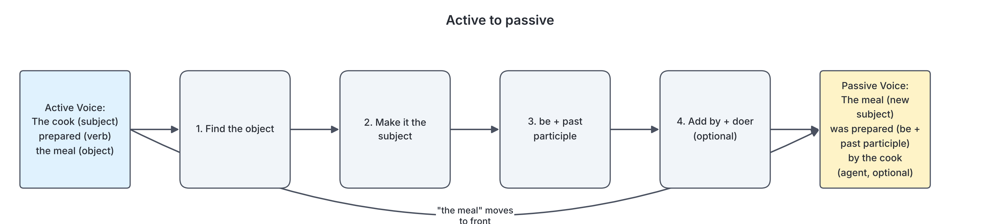

# JAMB Use of English Notes: Verbs

## What JAMB expects

This topic is part of Section B of the JAMB Use of English syllabus: Lexis and Structure, content item (d) "word classes and their functions". It is the second of four files on word classes:

- B4a: nouns and pronouns
- **B4b: verbs (this file)**
- B4c: adjectives and adverbs
- B4d: prepositions, conjunctions, determiners and interjections

It also supports content item (e), because mood, tense, aspect and concord are all about verbs. Those are covered in detail in B5a (mood, tense and aspect) and B5b (number and concord).

The objectives this file serves are:

- **Objective iv:** identify various grammatical patterns in use.
- **Objective i:** identify words and expressions in their ordinary, figurative and idiomatic contexts (especially phrasal verbs).
- **Objective v:** interpret information conveyed in sentences (modal verbs change meaning in important ways).

In the exam, verb questions appear mainly in the **Basic Grammar** part of Section B (10 questions), usually as "choose the option that best completes the gap". They also show up in sentence interpretation (5 questions), and phrasal verbs show up in synonym and antonym questions. Verbs are one of the most tested areas in the whole paper.

By the end of these notes, you should be able to:

1. Say what a verb is and find it in any sentence.
2. Tell lexical (main) verbs from auxiliary (helping) verbs, and primary auxiliaries from modal auxiliaries.
3. Use the modal verbs correctly and explain the meaning each one carries.
4. Tell transitive, intransitive and linking verbs apart.
5. Give the correct principal parts of regular and irregular verbs, including the tricky pairs (lie/lay, hang/hanged, fly/flow, fall/fell).
6. Tell finite verbs from non-finite verbs (infinitives, gerunds and participles), and choose correctly between "to + verb" and "verb + -ing".
7. Use common phrasal and prepositional verbs correctly, and avoid the extra prepositions that Nigerian English often adds.
8. Recognise active and passive voice.

## What is a verb?

A verb is a word that shows an **action**, a **state** or an **event**. It is the most important word in a clause: you cannot have a complete sentence without one.

- Action: Ngozi **runs** to school. The mechanic **repaired** the danfo bus.
- State: My uncle **owns** a farm in Ogbomoso. I **know** the answer.
- Event: The rain **started** at noon. The market **closed** early.

A quick way to find the verb is to change the time of the sentence. The word that changes form is the verb (or the first part of the verb phrase):

- Today Tunde **plays** football. Yesterday Tunde **played** football. Tomorrow Tunde **will play** football.

### The verb phrase

Often the "verb" in a sentence is more than one word. A **verb phrase** is a main verb plus any helping verbs in front of it.

| Sentence | Verb phrase | Helping verb(s) | Main verb |
| --- | --- | --- | --- |
| Amaka is reading. | is reading | is | reading |
| The goats have eaten the cassava leaves. | have eaten | have | eaten |
| The result might have been released. | might have been released | might, have, been | released |
| Do you speak Hausa? | do … speak | do | speak |

The main verb carries the meaning. The helping verbs add information about time, possibility, voice, questions and negatives.

## Lexical (main) verbs and auxiliary (helping) verbs

All English verbs fall into two big groups.

| Group | What they do | Examples | Can they stand alone as the only verb? |
| --- | --- | --- | --- |
| **Lexical verbs** (main, full or notional verbs) | Carry the real meaning of the action or state | eat, write, travel, believe, build, sell | Yes: "Kemi sells pepper." |
| **Auxiliary verbs** (helping verbs) | Help the main verb to show tense, aspect, voice, mood, questions and negatives | be, have, do; can, may, must, will, etc. | Not usually (but see "be, have, do as main verbs" below) |

Auxiliary verbs themselves are divided into two kinds: **primary auxiliaries** and **modal auxiliaries**.

### Primary auxiliaries: be, have, do

There are three primary auxiliaries. They are called "primary" because they can also work as main verbs.

**1. Be** (am, is, are, was, were, be, being, been)

- Forms the **progressive (continuous) aspect**: She **is** cooking jollof rice. They **were** waiting at the motor park.
- Forms the **passive voice**: The bridge **was** built in 1975. The results **are being** checked.
- As a main verb (linking verb): Abuja **is** the capital of Nigeria. The students **were** tired.

**2. Have** (have, has, had, having)

- Forms the **perfect aspect**: I **have** finished my assignment. The bus **had** left before we arrived.
- As a main verb (meaning own, eat, take, experience): She **has** two brothers. We **had** amala for lunch.

**3. Do** (do, does, did)

- Forms **questions** in the simple present and simple past: **Do** you live in Kano? **Did** he pay the fee?
- Forms **negatives**: I **do** not like noise. He **didn't** come.
- Adds **emphasis**: I **did** tell you about the test! (emphatic "do")
- Stands in for a verb already used (substitute "do"): Chika sings well, and so **does** her sister.
- As a main verb: She **does** her homework every night. He **did** the dishes.

**Watch out:** after the auxiliary "do/does/did", the main verb is always in the base form.

- Correct: Did she **go** to the market?
- Wrong: Did she **went** to the market?
- Correct: He doesn't **know** the way.
- Wrong: He doesn't **knows** the way.

### Modal auxiliaries

The modal auxiliaries are: **can, could, may, might, shall, should, will, would, must**. Grammar books also discuss four "semi-modals" or "marginal modals": **ought to, need, dare** and **used to**.

Modals have special rules:

| Rule | Example | Wrong form |
| --- | --- | --- |
| No -s in the third person singular | She **can** swim. | She cans swim. |
| Always followed by the base form (bare infinitive) | You **must** go. | You must to go. / You must going. |
| No infinitive or participle form of their own | You will **be able to** swim. | You will can swim. |
| Questions and negatives without "do" | **Can** he drive? He **cannot** drive. | Does he can drive? |

The one exception to "base form after a modal" is **ought**, which takes "to": You **ought to** apologise.

### What each modal means

Modals show attitudes such as ability, permission, possibility, obligation and prediction. This is the most important part of modals for JAMB, because sentence interpretation questions test whether you understand the meaning.

| Modal | Main meanings | Examples |
| --- | --- | --- |
| **can** | Present ability; informal permission; general possibility | Bisi **can** speak French. **Can** I go out? Harmattan **can** be very cold. |
| **could** | Past ability; polite request; weaker possibility | At five, he **could** read. **Could** you help me? It **could** rain later. |
| **may** | Formal permission; possibility | **May** I come in, sir? The flight **may** be delayed. |
| **might** | Weaker possibility; past of "may" in reported speech | The meeting **might** be cancelled. He said he **might** come. |
| **shall** | Future with I/we (traditional British); offers and suggestions; formal rules | I **shall** arrive at noon. **Shall** I close the window? Candidates **shall** not leave the hall. |
| **should** | Advice; duty; expectation | You **should** see a doctor. The parcel **should** arrive tomorrow. |
| **will** | Future; willingness; firm intention | It **will** rain. I **will** help you. |
| **would** | Past of "will" in reported speech; polite requests; conditionals; past habit | She said she **would** call. **Would** you sit down? If I had money, I **would** buy a car. As a child, I **would** visit my grandmother every Christmas. |
| **must** | Strong obligation; firm deduction (logical certainty) | You **must** wear your uniform. He has worked all day; he **must** be tired. |
| **ought to** | Duty, advice (similar to "should") | You **ought to** respect your elders. |
| **need** (as modal) | Necessity, mostly in negatives and questions | You **needn't** come. **Need** I say more? |
| **dare** (as modal) | Courage, mostly in negatives and questions | He **daren't** argue with his father. **How dare** you! |
| **used to** | Past habit or state that no longer exists | We **used to** live in Jos. |

### Important modal contrasts

**must not vs need not.** These look similar but mean very different things.

| Form | Meaning | Example |
| --- | --- | --- |
| must not (mustn't) | It is **forbidden**; do not do it | You **mustn't** use your phone in the exam hall. |
| need not (needn't) / don't have to | It is **not necessary**; you may if you want | You **needn't** bring a pen; we have plenty. |

**must vs have to.** Both show obligation. Many British grammars say "must" often shows obligation from the speaker, while "have to" shows obligation from outside (a rule, a law). For the past, only "had to" is possible: Yesterday I **had to** walk home. (Not "I musted".)

**can vs may for permission.** In formal English, "may" is the polite form for asking permission: **May** I use your phone? "Can" is accepted in everyday speech, and most modern grammars accept it, but in a formal exam context "may" is the safer choice for formal permission.

**shall vs will.** Traditional British grammar taught that "shall" is used with I/we and "will" with the other persons for plain future, and that the pattern reverses to show determination. Modern British usage mostly uses "will" (or "'ll") for all persons, and "shall" survives mainly in offers and suggestions ("**Shall** we go?") and in legal or formal rules. Grammar books differ on how strictly to teach the old rule. In JAMB, "Shall I…?" / "Shall we…?" for offers and suggestions is the safe, tested use.

**Modal + have + past participle (past modals).** These talk about the past.

| Form | Meaning | Example |
| --- | --- | --- |
| should have + pp | It was the right thing, but it did not happen (regret, criticism) | You **should have** studied harder. (You didn't.) |
| must have + pp | Firm deduction about the past | The ground is wet; it **must have** rained. |
| can't/couldn't have + pp | Firm deduction that something did NOT happen | She **can't have** seen me; she was in Lagos. |
| might/may/could have + pp | Possibility in the past | He **might have** missed the bus. |
| needn't have + pp | It was done, but it was not necessary | You **needn't have** cooked; we had already eaten. |
| would have + pp | Unreal past (third conditional) | If you had called, I **would have** come. |

**Interpretation trap:** "You should have told me" means you did NOT tell me. "He needn't have paid" means he DID pay, but it wasn't necessary. "He didn't need to pay" usually means he didn't pay because it wasn't necessary (though the context can allow either). JAMB sentence interpretation questions love these.

### Be, have and do as main verbs

Because the primary auxiliaries can also be main verbs, a sentence can contain the same word twice, doing two different jobs.

- She **has had** her breakfast. (has = auxiliary; had = main verb meaning "eaten")
- What **did** you **do** yesterday? (did = auxiliary; do = main verb)
- He **is being** stubborn. (is = auxiliary; being = main verb "be")

## Dynamic and stative verbs

Lexical verbs can also be divided by meaning.

| Type | Meaning | Examples | Progressive (-ing) allowed? |
| --- | --- | --- | --- |
| **Dynamic** (action) verbs | Actions that start, continue and stop | run, eat, write, build, play, read | Yes: She **is writing** a letter. |
| **Stative** (state) verbs | States, feelings, thoughts, possession, senses | know, believe, understand, love, hate, want, own, belong, contain, seem, consist | Normally no |

This matters because Nigerian English often uses stative verbs in the progressive. These are wrong in Standard British English:

| Wrong (common Nigerian usage) | Correct |
| --- | --- |
| I am having a car. | I **have** a car. |
| I am knowing the answer. | I **know** the answer. |
| She is understanding the lesson. | She **understands** the lesson. |
| This bag is belonging to me. | This bag **belongs** to me. |
| We are hearing you. | We **can hear** you. / We hear you. |

Some verbs are stative in one meaning and dynamic in another, so they can take -ing in the dynamic meaning:

- I **have** a car. (possession: stative) / I **am having** lunch. (eating: dynamic, correct)
- I **think** you are right. (opinion: stative) / I **am thinking** about my exams. (mental activity: dynamic, correct)
- The soup **tastes** salty. (state) / The cook **is tasting** the soup. (action, correct)
- He **sees** the board clearly. (sense) / He **is seeing** the principal at two o'clock. (meeting: dynamic, correct)

There is more on this in B5a (progressive aspect).

## Transitive, intransitive and linking verbs

This classification is about **what follows the verb**.

### Transitive verbs

A transitive verb needs an **object**: a noun or pronoun that receives the action. Ask "what?" or "whom?" after the verb.

- The farmer **planted** yams. (planted what? yams)
- Mama **called** me. (called whom? me)
- The police **arrested** the thief.

Some transitive verbs take two objects: an **indirect object** (the person who receives) and a **direct object** (the thing given).

- My father **gave** me a bicycle. (indirect object: me; direct object: a bicycle)
- She **sent** her aunt a letter.
- The teacher **showed** the class a map of Nigeria.

The same idea can be written with "to" or "for": My father gave a bicycle **to me**. She bought a dress **for her daughter**.

Some transitive verbs take an **object complement**: a word that describes or renames the object.

- The members **elected** Musa **chairman**.
- The noise **drove** him **mad**.
- They **painted** the house **green**.

### Intransitive verbs

An intransitive verb does **not** take an object. The action stops with the subject.

- The baby **slept**.
- The guests **arrived** late.
- Prices **rose** sharply last year.
- The old man **died** peacefully.

An intransitive verb may be followed by an adverb or a prepositional phrase, but that is not an object.

- She **sat** under the mango tree. (under the mango tree = adverbial, not object)

### Verbs that can be both

Many verbs can be transitive in one sentence and intransitive in another.

| Transitive | Intransitive |
| --- | --- |
| The boys **played** football. | The boys **played** happily. |
| She **opened** the door. | The door **opened**. |
| He **runs** a business in Aba. | He **runs** every morning. |
| The cook **burnt** the rice. | The rice **burnt**. |

### Pairs to watch: transitive vs intransitive

Some pairs look alike, but one is transitive and the other intransitive. JAMB tests these often.

| Intransitive (no object) | Transitive (takes an object) |
| --- | --- |
| **lie** (lay, lain): to rest flat. The dog **lies** on the mat. | **lay** (laid, laid): to put something down. The hen **lays** eggs. Please **lay** the book on the table. |
| **rise** (rose, risen): to go up. The sun **rises** in the east. | **raise** (raised, raised): to lift something up. **Raise** your hand. |
| **sit** (sat, sat): to be seated. Please **sit** down. | **set** (set, set): to put something in place. **Set** the table. |
| **fall** (fell, fallen): to drop down. The mango **fell**. | **fell** (felled, felled): to cut down a tree. The loggers **felled** the iroko tree. |

### Linking (copular) verbs

A linking verb does not show action. It **links** the subject to a word that describes or renames it. That word is called the **subject complement**.

The main linking verb is **be**. Others include: become, seem, appear, look, feel, sound, taste, smell, grow, turn, remain, get, prove.

- Ada **is** a nurse. (nurse renames Ada)
- The weather **became** cold.
- You **look** tired.
- This soup **tastes** delicious.
- The leaves **turned** yellow.
- The market **remained** closed.

**Test for a linking verb:** you can usually replace it with "is/was/are" and the sentence still makes sense. "The soup tastes delicious" → "The soup is delicious."

**Adjective, not adverb, after a linking verb.** Because the complement describes the subject, it should be an adjective.

- Correct: The food smells **good**. Wrong: The food smells well (in the sense of "pleasant").
- Correct: I feel **bad** about it. Wrong: I feel badly about it. (In British English "I feel bad" is the standard form.)
- Correct: She looked **angry**. Compare: She looked **angrily** at him. (Here "look" is an action verb meaning "direct her eyes", so the adverb is correct.)

Note: "I feel **well**" is correct when "well" is the adjective meaning "healthy". See B4c for more on adjectives after linking verbs.

## Regular and irregular verbs: the principal parts

Every verb has **principal parts**: the forms from which all its tenses are built.

| Base form | Past tense | Past participle | Present participle |
| --- | --- | --- | --- |
| walk | walked | walked | walking |
| write | wrote | written | writing |

(Some books list three principal parts and leave out the present participle, because the -ing form is always regular. Others list four or five, adding the -ing form and the third person -s form. The difference does not matter for the exam.)

- The **past tense** is used alone: She **wrote** a letter.
- The **past participle** is used after "have" (perfect aspect) and "be" (passive voice): She **has written**. The letter **was written**.

### Regular verbs

Regular verbs form both the past tense and the past participle by adding **-ed** (or **-d** if the base already ends in -e).

- play → played → played
- cook → cooked → cooked
- bake → baked → baked

Spelling rules for -ed:

| Rule | Examples |
| --- | --- |
| Verb ends in -e: add -d | love → loved, hope → hoped |
| Consonant + y: change y to i, add -ed | carry → carried, study → studied |
| Vowel + y: just add -ed | play → played, enjoy → enjoyed |
| One-syllable verb ending in one vowel + one consonant: double the consonant | stop → stopped, plan → planned |
| Two-syllable verb stressed on the last syllable: double the consonant | preFER → preferred, ocCUR → occurred, adMIT → admitted |
| Two-syllable verb stressed on the first syllable: usually don't double | VIsit → visited, OFfer → offered |
| Verb ends in -l after one vowel: British English doubles the l | travel → travelled, cancel → cancelled (American: traveled, canceled) |

JAMB expects **British** spelling: "travelled", "cancelled", "labelled", "quarrelled". See B6a for spelling.

### Irregular verbs

Irregular verbs do not follow the -ed pattern. You must learn them. They fall into groups.

**Group 1: All three forms the same**

| Base | Past | Past participle |
| --- | --- | --- |
| cut | cut | cut |
| put | put | put |
| hit | hit | hit |
| cost | cost | cost |
| hurt | hurt | hurt |
| let | let | let |
| shut | shut | shut |
| set | set | set |
| spread | spread | spread |
| burst | burst | burst |
| broadcast | broadcast | broadcast |
| forecast | forecast | forecast |
| bet | bet | bet |
| bid (offer money) | bid | bid |
| quit | quit (also quitted, British) | quit (also quitted, British) |

**Note:** dictionaries also record "broadcasted" and "forecasted", but "broadcast" and "forecast" are the standard past forms and the safe choices in an exam. "Bursted", "costed" (except in the business meaning "worked out the cost of") and "hitted" are wrong.

**Group 2: Past tense and past participle the same**

| Base | Past | Past participle |
| --- | --- | --- |
| bring | brought | brought |
| buy | bought | bought |
| catch | caught | caught |
| teach | taught | taught |
| think | thought | thought |
| seek | sought | sought |
| fight | fought | fought |
| find | found | found |
| bind | bound | bound |
| wind (turn) | wound | wound |
| lead | led | led |
| feed | fed | fed |
| flee | fled | fled |
| meet | met | met |
| keep | kept | kept |
| sleep | slept | slept |
| sweep | swept | swept |
| weep | wept | wept |
| leave | left | left |
| lend | lent | lent |
| send | sent | sent |
| spend | spent | spent |
| build | built | built |
| hold | held | held |
| sell | sold | sold |
| tell | told | told |
| stand | stood | stood |
| understand | understood | understood |
| sit | sat | sat |
| lose | lost | lost |
| win | won | won |
| hang (an object) | hung | hung |
| lay | laid | laid |
| pay | paid | paid |
| say | said | said |
| strike | struck | struck |
| cling | clung | clung |
| sting | stung | stung |
| swing | swung | swung |
| burn | burnt / burned | burnt / burned |
| learn | learnt / learned | learnt / learned |
| dream | dreamt / dreamed | dreamt / dreamed |
| spell | spelt / spelled | spelt / spelled |
| spoil | spoilt / spoiled | spoilt / spoiled |

**Note:** for burn, learn, dream, spell and spoil, British English accepts both the -t and -ed forms. American English prefers -ed. Both are correct in a British exam.

**Group 3: All three forms different**

| Base | Past | Past participle |
| --- | --- | --- |
| go | went | gone |
| see | saw | seen |
| take | took | taken |
| give | gave | given |
| write | wrote | written |
| drive | drove | driven |
| ride | rode | ridden |
| rise | rose | risen |
| arise | arose | arisen |
| strive | strove | striven |
| speak | spoke | spoken |
| break | broke | broken |
| choose | chose | chosen |
| freeze | froze | frozen |
| steal | stole | stolen |
| wake | woke | woken |
| eat | ate | eaten |
| fall | fell | fallen |
| forbid | forbade | forbidden |
| forgive | forgave | forgiven |
| forget | forgot | forgotten |
| forsake | forsook | forsaken |
| hide | hid | hidden |
| bite | bit | bitten |
| tear | tore | torn |
| wear | wore | worn |
| swear | swore | sworn |
| bear | bore | borne (born: only for birth in the passive, "He was born in Enugu") |
| begin | began | begun |
| drink | drank | drunk |
| sing | sang | sung |
| ring | rang | rung |
| swim | swam | swum |
| sink | sank | sunk |
| shrink | shrank | shrunk |
| spring | sprang | sprung |
| stink | stank | stunk |
| fly | flew | flown |
| grow | grew | grown |
| know | knew | known |
| throw | threw | thrown |
| blow | blew | blown |
| draw | drew | drawn |
| show | showed | shown (showed is also recorded, but shown is standard) |
| lie (recline) | lay | lain |
| tread | trod | trodden |
| weave | wove | woven |
| do | did | done |
| be | was/were | been |

**Group 4: Base and past participle the same**

| Base | Past | Past participle |
| --- | --- | --- |
| come | came | come |
| become | became | become |
| overcome | overcame | overcome |
| run | ran | run |

### Tricky pairs: same or similar base, different meanings

These are among the most tested items in Basic Grammar. One verb is irregular, its look-alike is regular (or differently irregular).

| Verb and meaning | Past | Past participle | Example |
| --- | --- | --- | --- |
| **lie** = recline, rest flat | lay | lain | He **lay** on the bed all afternoon. |
| **lie** = tell a falsehood | lied | lied | The witness **lied** to the court. |
| **lay** = put down; produce eggs | laid | laid | She **laid** the baby on the mat. The hen **has laid** six eggs. |
| **hang** = suspend an object | hung | hung | We **hung** the calendar on the wall. |
| **hang** = execute by hanging | hanged | hanged | The murderer **was hanged** in 1990. |
| **fly** = move through the air | flew | flown | The bird **flew** away. |
| **flow** = move like a liquid | flowed | flowed | The river **flowed** into the sea. |
| **flee** = run away | fled | fled | The villagers **fled** from the flood. |
| **fall** = drop | fell | fallen | The child **fell** from the tree. |
| **fell** = cut down | felled | felled | The workers **felled** the tree. |
| **find** = discover | found | found | I **found** my keys. |
| **found** = establish | founded | founded | The school was **founded** in 1960. |
| **wind** (/waɪnd/) = turn, twist | wound (/waʊnd/) | wound | He **wound** the clock. |
| **wound** (/wuːnd/) = injure | wounded | wounded | The soldier was **wounded**. |
| **see** = look | saw | seen | I **saw** the film. |
| **saw** = cut with a saw | sawed | sawn (sawed in American English) | The carpenter **sawed** the plank. |
| **sew** = stitch | sewed | sewn / sewed | The tailor **has sewn** my dress. |
| **sow** = plant seeds | sowed | sown / sowed | The farmer **sowed** maize. |
| **bear** = carry, endure | bore | borne | She **has borne** the pain bravely. |
| **bear** = give birth (passive) | — | born | He **was born** in 2008. |
| **shine** = give light | shone | shone | The sun **shone** brightly. |
| **shine** = polish (mainly American) | shined | shined | He **shined** his shoes. (British English often says "polished") |
| **strike** = hit | struck | struck | Lightning **struck** the tree. |
| **stricken** | — | (old participle, used as adjective) | **grief-stricken**, **poverty-stricken** |

### Common irregular verb errors

| Wrong | Correct |
| --- | --- |
| He has went home. | He has **gone** home. / He **went** home. |
| She has spoke to me. | She has **spoken** to me. |
| The bell has rang. | The bell has **rung**. |
| The ship sunk. | The ship **sank**. |
| I have drank the water. | I have **drunk** the water. |
| He swimmed across. | He **swam** across. |
| The price was costed at ₦500. | The price **was** ₦500. / It **cost** ₦500. |
| The pipe bursted. | The pipe **burst**. |
| The thief was hung yesterday. | The thief was **hanged** yesterday. |
| The book is laying on the table. | The book is **lying** on the table. |
| I laid down to rest. | I **lay** down to rest. |
| She has wrote the letter. | She has **written** the letter. |
| He was borned in Ilorin. | He was **born** in Ilorin. |

## Finite and non-finite verbs

### Finite verbs

A **finite verb** shows **tense** (present or past) and changes to **agree** with its subject. Every complete sentence (every independent clause) needs at least one finite verb.

- She **walks** to school. (present tense; agrees with "she")
- They **walked** to school. (past tense)
- He **is** happy. They **are** happy. (agrees with subject)

In a verb phrase, the **first** verb is the finite one: She **has** been waiting. They **will** come.

### Non-finite verbs

A **non-finite verb** does not show tense by itself and does not change for the subject. There are three kinds:

1. The **infinitive** (to + base form, or the bare base form)
2. The **gerund** (-ing form used as a noun)
3. The **participles** (present participle -ing; past participle -ed/-en)

| | Finite | Non-finite |
| --- | --- | --- |
| Shows tense? | Yes | No |
| Agrees with subject? | Yes | No |
| Can be the only verb in a full sentence? | Yes | No |
| Examples | goes, went, is, has, can | to go, going, gone |

**Watch out:** "Running to catch the bus." is NOT a complete sentence, because "running" is non-finite. It is a fragment. A complete version: "Running to catch the bus, Tola dropped her purse."

### The infinitive

**To-infinitive:** to + base form: to eat, to read, to be.

Uses:

- As subject: **To err** is human.
- As object: She wants **to travel** to Abuja.
- To show purpose: He went to the market **to buy** tomatoes.
- After adjectives: I am happy **to see** you.
- After certain nouns: I have no time **to waste**.

**Bare infinitive** (base form without "to"). It is used:

- After modals: You **must go**. She **can sing**.
- After "make", "let" and (optionally) "help" in the active voice: The teacher **made** us **rewrite** the essay. **Let** me **see**. She helped me (to) **carry** the bag.
- After verbs of perception (see, hear, watch, feel, notice) for a complete action: I **saw** him **cross** the road. We **heard** her **sing**.
- After "had better", "would rather" and "why not": You **had better leave** now. I **would rather stay** at home.

**Very important:** in the **passive**, "make" takes the **to**-infinitive:

- Active: They **made** him **apologise**.
- Passive: He **was made to apologise**.
- Wrong: He was made apologise.

Similarly: I saw him **leave**. → He was seen **to leave**.

**Common errors with the infinitive:**

| Wrong | Correct |
| --- | --- |
| You must to come early. | You must **come** early. |
| She made me to cry. | She made me **cry**. |
| Let him to go. | Let him **go**. |
| I would rather to stay. | I would rather **stay**. |
| He was made sit down. | He was made **to sit** down. |

**The split infinitive.** A split infinitive puts a word between "to" and the verb: "to **boldly** go", "to **really** understand". Older grammar books called this an error. Most modern grammars and style guides (for example, Fowler's *Modern English Usage* in its later editions, and Swan's *Practical English Usage*) say it is acceptable, especially when avoiding it sounds awkward. In a formal exam, the unsplit version is never wrong, so it is the safer choice: "to understand fully" or "fully to understand".

### The gerund

A **gerund** is the -ing form of a verb used as a **noun**. It can do any job a noun does.

- As subject: **Swimming** is good exercise.
- As object: I enjoy **reading**.
- After a preposition: She is good **at drawing**. He left **without saying** goodbye.
- As complement: My hobby is **dancing**.

**Possessive before a gerund.** Formal British English prefers a possessive before a gerund: "I don't mind **your** coming late." "We were surprised at **his** leaving." Everyday English also uses the object form ("I don't mind **you** coming late"), and many modern grammars accept both. In formal exam options, the possessive is the traditional correct choice.

### Participles

**Present participle** (-ing): used for progressive aspect and as an adjective or in participle phrases.

- She is **sleeping**. (progressive)
- a **sleeping** baby (adjective)
- **Hearing** the noise, the guard rushed out. (participle phrase)

**Past participle** (-ed / -en): used for perfect aspect, passive voice, and as an adjective.

- They have **finished**. (perfect)
- The goods were **stolen**. (passive)
- a **broken** chair, **fried** plantain (adjective)

**Gerund vs present participle.** Both end in -ing. Ask: is it working as a noun (gerund) or as a verb/adjective (participle)?

| Sentence | -ing word | Type | Why |
| --- | --- | --- | --- |
| **Smoking** is dangerous. | smoking | Gerund | It is the subject (a noun job) |
| The man **smoking** a pipe is my uncle. | smoking | Participle | It describes "the man" |
| I like **cooking**. | cooking | Gerund | It is the object of "like" |
| She is **cooking**. | cooking | Participle | Part of the verb phrase "is cooking" |
| a **swimming** pool | swimming | Gerund (in a compound noun) | It means "a pool for swimming", not "a pool that swims" |
| a **sleeping** child | sleeping | Participle | It means "a child who is sleeping" |

**-ed and -ing adjectives.** The -ing participle adjective describes the **cause** of a feeling; the -ed participle adjective describes the **person who has** the feeling.

- The lecture was **boring**. (it caused boredom) → The students were **bored**.
- The news is **exciting**. → We are **excited**.
- It was a **confusing** question. → I was **confused**.

Wrong: I am boring in this class (unless you mean you make others bored).

**The dangling (unattached) participle.** A participle phrase at the start of a sentence must refer to the subject of the main clause. If it does not, the sentence becomes illogical.

- Wrong: **Walking** to school, a snake bit Uche. (This says the snake was walking to school.)
- Correct: **Walking** to school, Uche was bitten by a snake.
- Wrong: **Having finished** the exam, the hall was quiet.
- Correct: **Having finished** the exam, the candidates left the hall quietly.

### To-infinitive or -ing? Verb patterns

Some verbs are followed by the to-infinitive, some by the -ing form, and some by both (sometimes with a change of meaning). This is heavily tested.

**Verbs followed by the -ing form (gerund):**

enjoy, avoid, finish, mind, deny, admit, risk, consider, delay, postpone, put off, keep (on), give up, miss, practise, imagine, appreciate, can't help, can't stand, suggest, recommend, resent

- I enjoy **watching** football. (not "to watch")
- He denied **stealing** the money.
- Would you mind **opening** the window?
- She suggested **going** to Ikogosi Warm Springs. (not "suggested to go")

**Verbs followed by the to-infinitive:**

want, hope, decide, agree, refuse, promise, plan, expect, afford, manage, fail, offer, threaten, learn, pretend, seem, appear, tend, arrange, choose, deserve

- She decided **to study** law.
- They refused **to pay** the fine.
- He managed **to escape**.

**Verbs followed by object + to-infinitive:**

advise, allow, ask, encourage, expect, force, invite, order, permit, persuade, remind, teach, tell, warn, want

- The principal advised us **to read** widely.
- My mother wants me **to become** a doctor. (not "wants that I become")

**Verbs that take both, with little change in meaning:** begin, start, continue, like, love, hate, prefer.

- It began **to rain**. / It began **raining**.

**Verbs that take both, with a change in meaning:**

| Verb | + to-infinitive | + -ing |
| --- | --- | --- |
| **stop** | stopped what you were doing in order to do something else: He stopped **to buy** suya. (He stopped walking so that he could buy suya.) | ended the action itself: He stopped **buying** suya. (He no longer buys it.) |
| **remember** | remember a duty, then do it: Remember **to lock** the door. | remember a past action: I remember **locking** the door. (I locked it, and I remember doing it.) |
| **forget** | fail to do: I forgot **to post** the letter. (It was not posted.) | forget a past experience: I'll never forget **meeting** the governor. |
| **try** | make an effort: She tried **to lift** the box. (It was hard.) | do as an experiment: Try **adding** more salt. (See if it helps.) |
| **regret** | be sorry to give bad news: We regret **to inform** you … | be sorry about a past action: I regret **shouting** at him. |
| **mean** | intend: I meant **to call** you. | involve: Passing JAMB means **studying** hard. |
| **go on** | change to a new activity: After the introduction, she went on **to discuss** the causes. | continue the same activity: He went on **talking** for an hour. |

### "To" as a preposition, not part of an infinitive

In some expressions "to" is a **preposition**, so it is followed by a noun or a **gerund**, not the base verb. This is one of the most common traps in JAMB.

look forward to, be used to (= be accustomed to), get used to, object to, be committed to, be devoted to, with a view to, in addition to, contribute to, confess to, admit to, when it comes to, be opposed to, be accustomed to

| Wrong | Correct |
| --- | --- |
| I look forward to see you. | I look forward to **seeing** you. |
| She is used to wake up early. | She is used to **waking** up early. |
| He came with a view to make peace. | He came with a view to **making** peace. |
| They object to pay the levy. | They object to **paying** the levy. |
| We are committed to serve you. | We are committed to **serving** you. |

**Test:** if you can put a noun after "to" (I look forward to **the holiday**), then "to" is a preposition, and a verb after it must take -ing.

**used to vs be used to:**

| Form | Meaning | Followed by | Example |
| --- | --- | --- | --- |
| used to (modal-like) | a past habit that has stopped | base form | I **used to walk** to school. (I don't now.) |
| be used to / get used to | be/become accustomed to | noun or -ing | I **am used to walking** to school. (It is normal for me.) |

Negative and question forms of "used to": "I **didn't use to** like okra." "**Did** you **use to** live here?" Some British speakers also say "I **used not to**", which is more formal. Writing "didn't used to" is a common error in standard written English.

## Phrasal verbs and prepositional verbs

### What they are

A **multi-word verb** is a verb followed by one or two particles (small words like up, down, in, out, off, on, over, away, back, through, with, for, into). Together they act as one verb, often with a meaning you cannot guess from the parts.

- **give up** = stop trying; quit
- **look after** = take care of
- **put up with** = tolerate

Grammar books classify these in slightly different ways. A common classification (used, for example, in Quirk and colleagues' *Comprehensive Grammar of the English Language* and many school textbooks) is:

| Type | Form | Example | Can the object go between verb and particle? |
| --- | --- | --- | --- |
| **Phrasal verb** | verb + adverb particle | turn off, put off, call off, give up | Yes (if transitive): Turn **the light** off. Turn **it** off. |
| **Prepositional verb** | verb + preposition | look after, look into, call on, depend on | No: Look after **the baby**. (not "Look the baby after") |
| **Phrasal-prepositional verb** | verb + adverb + preposition | put up with, look forward to, run out of, do away with | No: put up **with** the noise |

Many school books simply call all three "phrasal verbs". For JAMB, the key skills are knowing the **meanings** and the **word order with pronouns**.

### Word order with pronouns

With a separable phrasal verb, a **pronoun object must go between the verb and the particle**.

- Correct: Switch **it** off. Wrong: Switch off it.
- Correct: Pick **them** up. Wrong: Pick up them.
- With a noun, both orders work: Switch **off the fan** / Switch **the fan off**.

With a prepositional verb, the object always follows the preposition:

- Correct: Look after **them**. Wrong: Look them after.

### Common phrasal verbs for JAMB

| Phrasal verb | Meaning | Example |
| --- | --- | --- |
| bring up | raise a child; mention a topic | She was **brought up** in Owerri. He **brought up** the issue of fees. |
| call off | cancel | The match was **called off** because of rain. |
| call on | visit briefly; ask formally | We **called on** our grandmother. The chairman **called on** the secretary to read the minutes. |
| carry out | perform, do | The doctors **carried out** a test. |
| come across | find by chance | I **came across** an old photograph. |
| cut down on | reduce | You should **cut down on** sugar. |
| do away with | abolish | The school **did away with** corporal punishment. |
| fall out (with) | quarrel | The two friends **fell out** over money. |
| get along/on with | have a good relationship | She **gets on** well **with** her roommate. |
| give in | surrender | The rebels finally **gave in**. |
| give up | stop, abandon | Don't **give up** your dreams. |
| go off | explode; ring (alarm); go bad (food) | The alarm **went off** at 5 a.m. The milk has **gone off**. |
| keep up with | stay level with | He walked fast to **keep up with** us. |
| look down on | despise | Don't **look down on** the poor. |
| look into | investigate | The police will **look into** the matter. |
| look up to | admire, respect | Many young people **look up to** Chimamanda Adichie. |
| make up | invent; reconcile; form | He **made up** a story. They kissed and **made up**. Women **make up** half the class. |
| make up for | compensate for | Hard work can **make up for** lost time. |
| put off | postpone; discourage | The wedding was **put off** till December. |
| put out | extinguish | The firemen **put out** the fire. |
| put up with | tolerate | I can't **put up with** this noise. |
| run out of | have no more of | We **ran out of** fuel near Ore. |
| set up | establish | The government **set up** a panel. |
| take after | resemble a parent or relative | Ife **takes after** her mother. |
| take off | remove (clothes); leave the ground; become successful | The plane **took off**. Her business **took off**. |
| take over | take control | The new manager **took over** in May. |
| turn down | reject; reduce volume | She **turned down** the offer. **Turn down** the radio. |
| turn up | appear, arrive | Only ten people **turned up**. |
| wear out | become useless through use; exhaust | My sandals are **worn out**. |

### Nigerian English: extra or missing particles

Some verbs are used with particles in Nigerian English that are not used in Standard British English, and some particles are left out. JAMB tests these.

| Nigerian usage (non-standard) | Standard British English |
| --- | --- |
| cope up with | **cope with** |
| voice out (one's opinion) | **voice** (one's opinion), or **speak out** |
| discuss about | **discuss** (discuss the problem) |
| emphasise on / stress on | **emphasise** / **stress** (the point) |
| request for (as a verb) | **request** (request a transfer). (The **noun** takes "for": a request **for** a transfer.) |
| demand for (as a verb) | **demand** (demand payment). (Noun: a demand **for** payment.) |
| comprise of | **comprise** (the house comprises six rooms), or **consist of** / **be composed of** |
| resemble to | **resemble** (she resembles her father) |
| reply the letter | **reply to** the letter |
| enter into the room | **enter** the room |
| off the light / on the fan | **switch/turn off** the light; **switch/turn on** the fan |
| pick the call | **answer** the call / **pick up** the phone |
| drop from the bus | **get off** the bus, or (formal) **alight from** the bus |
| He branched my house | He **stopped at** / **called at** my house |

**Note on "enter into":** "enter into an agreement / a contract / a discussion" is correct (it means "begin" or "take part in"). Only "enter into a room/house" is wrong.

**Note on "reply":** "reply" takes "to" before the thing or person replied to: "She **replied to** my letter." Without an object you just say "She **replied**."

## Active and passive voice

**Voice** tells you whether the subject **does** the action (active) or **receives** it (passive). This is introduced briefly here; B3b looks at it as a sentence pattern.

| | Active voice | Passive voice |
| --- | --- | --- |
| Subject | does the action | receives the action |
| Form | normal verb | form of **be** + **past participle** |
| Example | The dog **bit** the boy. | The boy **was bitten** by the dog. |

### How to change active to passive, step by step

1. Find the object of the active sentence: The cook **prepared the meal**. → object = the meal.
2. Make the object the new subject: The meal …
3. Use the same tense of **be**, plus the **past participle** of the main verb: … **was prepared** …
4. Add "by + the old subject" only if it is useful: … by the cook.

Result: **The meal was prepared by the cook.**

| Tense | Active | Passive |
| --- | --- | --- |
| Simple present | They **clean** the hall. | The hall **is cleaned**. |
| Present progressive | They **are cleaning** the hall. | The hall **is being cleaned**. |
| Present perfect | They **have cleaned** the hall. | The hall **has been cleaned**. |
| Simple past | They **cleaned** the hall. | The hall **was cleaned**. |
| Past progressive | They **were cleaning** the hall. | The hall **was being cleaned**. |
| Past perfect | They **had cleaned** the hall. | The hall **had been cleaned**. |
| Future (will) | They **will clean** the hall. | The hall **will be cleaned**. |
| Modal | They **must clean** the hall. | The hall **must be cleaned**. |

**Only transitive verbs can be made passive**, because only they have an object. You cannot say "The baby was slept."

**When to use the passive:**

- When the doer is unknown: My phone **was stolen**.
- When the doer is obvious or unimportant: The suspect **was arrested**. (by the police, obviously)
- In formal and scientific writing: The solution **was heated** to 100 °C.

**Common passive errors:**

| Wrong | Correct | Why |
| --- | --- | --- |
| The goods were deliver yesterday. | The goods were **delivered** yesterday. | Passive needs the past participle |
| The house is build of mud. | The house is **built** of mud. | Past participle of build is built |
| The meeting was held in Lokoja and attended by many. | (correct) | |
| He was borned in 2007. | He was **born** in 2007. | "born" is already the participle |
| The thief was hung. | The thief was **hanged**. | Execution uses "hanged" |

### Needs + -ing (passive meaning)

In British English, "need" + -ing has a passive meaning:

- Your hair **needs cutting**. (= needs to be cut)
- The car **needs washing**. (= needs to be washed)

Both "needs cutting" and "needs to be cut" are correct. "Needs to cut" is wrong if you mean the hair should be cut (it would mean the hair must cut something).

## Worked examples: answering verb questions in JAMB

**Example 1.** Choose the option that best completes the gap.
*The prisoner who killed the guard was ______ last year.*

- A. hung
- B. hanged
- C. hunged
- D. hang

**How to think:** the sentence is about execution, so we need "hang, hanged, hanged". "Hung" is for hanging objects. "Hunged" does not exist. "Hang" is the base form, which cannot follow "was" as a passive. **Answer: B.**

**Example 2.** Choose the option that best completes the gap.
*I am looking forward to ______ you at the reunion.*

- A. see
- B. seeing
- C. have seen
- D. be seeing

**How to think:** "look forward to" ends with the preposition "to", so the verb after it must be a gerund. **Answer: B.**

**Example 3.** Choose the option that best completes the gap.
*The tired traveller ______ on the bench and fell asleep.*

- A. laid
- B. layed
- C. lay
- D. lied

**How to think:** the traveller rested his body (no object), so we need "lie" (recline). Its past tense is "lay". "Laid" is the past of "lay" (put something down), which needs an object. "Lied" means told lies. "Layed" is not a word. **Answer: C.**

**Example 4 (interpretation).** *You needn't have bought a new uniform.* This means that

- A. you did not buy a new uniform
- B. you bought a new uniform, but it was not necessary
- C. you must buy a new uniform
- D. you should have bought a new uniform

**How to think:** "needn't have + past participle" means the action happened but was unnecessary. **Answer: B.**

**Example 5.** Choose the option that best completes the gap.
*The principal made the latecomers ______ the compound.*

- A. to sweep
- B. sweeping
- C. sweep
- D. swept

**How to think:** active "make + object + bare infinitive". **Answer: C.** (In the passive it would be "The latecomers were made **to sweep** the compound.")

## Key terms

| Term | Meaning |
| --- | --- |
| Verb | A word that shows an action, state or event |
| Verb phrase | A main verb plus any auxiliary verbs before it, e.g. "might have gone" |
| Lexical (main) verb | A verb that carries the main meaning, e.g. eat, build |
| Auxiliary (helping) verb | A verb that helps the main verb show tense, aspect, voice, mood, questions or negatives |
| Primary auxiliary | be, have or do; can also act as main verbs |
| Modal auxiliary | can, could, may, might, shall, should, will, would, must (plus ought to, need, dare, used to) |
| Stative verb | A verb for a state, not an action (know, own, believe); not normally used with -ing |
| Transitive verb | A verb that takes an object |
| Intransitive verb | A verb that takes no object |
| Linking (copular) verb | A verb that joins the subject to a complement, e.g. be, become, seem |
| Principal parts | The base form, past tense and past participle (and the -ing form) of a verb |
| Finite verb | A verb that shows tense and agrees with its subject |
| Non-finite verb | An infinitive, gerund or participle; it shows no tense of its own |
| Gerund | An -ing form used as a noun |
| Participle | An -ing or -ed/-en form used in verb phrases or as an adjective |
| Phrasal verb | Verb + adverb particle with a special meaning, e.g. give up |
| Prepositional verb | Verb + preposition, e.g. look after, depend on |
| Active voice | The subject does the action |
| Passive voice | The subject receives the action (be + past participle) |

## Exam tips and common mistakes

- **No -s and no "to" after modals:** "She can **sing**", not "She cans sing" or "She can to sing". The exception is "ought to".
- **Base form after do/does/did:** "Did he **come**?" not "Did he came?"
- **lie/lay:** if there is an object, use lay/laid/laid; if not, use lie/lay/lain. "The book is **lying** on the table." "She **laid** the book on the table."
- **hanged vs hung:** people executed are **hanged**; objects are **hung**.
- **found vs find:** "The school was **founded** in 1952" (established), not "was found".
- **"to" as a preposition:** look forward to, be used to, object to, with a view to, be committed to + **-ing**.
- **make/let + bare infinitive (active); be made + to-infinitive (passive).**
- **Stative verbs:** "I **have** a car", "I **know**", "It **belongs** to me". Don't add -ing for possession, knowledge or belief.
- **Drop the extra particle:** cope **with** (not cope up with), **discuss** (not discuss about), **emphasise** (not emphasise on), **comprise** (not comprise of), **resemble** (not resemble to).
- **Pronoun position:** switch **it** off, not switch off it.
- **Past modals:** "should have gone" = it didn't happen; "needn't have gone" = it happened but was unnecessary; "must have gone" = I'm sure it happened.
- **Dangling participles:** the -ing phrase at the start must describe the subject of the main clause.
- **British spelling:** travelled, cancelled, quarrelled. "Burnt/burned", "learnt/learned" are both fine in British English.

## Quick summary

1. A verb shows an action, state or event; a sentence needs at least one finite verb.
2. Lexical verbs carry meaning; auxiliaries help. The primary auxiliaries (be, have, do) can also be main verbs; the modals (can, may, must, etc.) take the bare infinitive and never add -s.
3. Modals carry meanings such as ability, permission, possibility, obligation and deduction; past modals (should have, needn't have, must have) are favourites in sentence interpretation.
4. Transitive verbs take objects, intransitive verbs do not, and linking verbs join the subject to a complement (usually an adjective).
5. Irregular verbs must be learnt, especially the tricky pairs: lie/lay, hang (hung/hanged), fall/fell, find/found, fly/flow, see/saw, sew/sow.
6. Non-finite forms are infinitives, gerunds and participles. Learn which verbs take "to + verb" and which take "-ing", and remember that "look forward to", "be used to" and similar expressions take -ing.
7. Phrasal and prepositional verbs have special meanings; avoid non-standard particles such as "cope up with" and "discuss about".
8. The passive is formed with be + past participle; only transitive verbs can be made passive.

## Practice questions

**1. Choose the option that best completes the gap: The murderer was ______ at dawn.**

- A. hung
- B. hanged
- C. hunged
- D. hang

**Answer: B.** For execution by hanging, the past participle is "hanged". "Hung" is used for objects such as pictures and clothes.

**2. Choose the option that best completes the gap: I look forward to ______ from you soon.**

- A. hear
- B. have heard
- C. hearing
- D. be hearing

**Answer: C.** In "look forward to", "to" is a preposition, so it is followed by a gerund (-ing form).

**3. Choose the option that best completes the gap: The panel ______ the causes of the crisis for three hours.**

- A. discussed about
- B. discussed
- C. discussed on
- D. discussed over

**Answer: B.** "Discuss" is transitive and takes a direct object without a preposition.

**4. Choose the option that best completes the gap: Many new students find it hard to ______ the pressure of university life.**

- A. cope up with
- B. cope on with
- C. cope with
- D. cope

**Answer: C.** The standard form is "cope with". "Cope up with" is a common Nigerian error, and "cope" alone cannot take an object.

**5. Choose the option that best completes the gap: The final match was ______ because the pitch was flooded.**

- A. called off
- B. called on
- C. called up
- D. called in

**Answer: A.** "Call off" means cancel. "Call on" means visit or ask formally; "call up" means summon for military service or telephone; "call in" means ask someone to come and help.

**6. Choose the option that best completes the gap: Mr Okafor made his son ______ the whole compound.**

- A. to sweep
- B. sweeping
- C. sweep
- D. swept

**Answer: C.** In the active voice, "make + object" is followed by the bare infinitive (no "to").

**7. Choose the option that best completes the gap: The pigeon has ______ away.**

- A. flew
- B. flown
- C. flowed
- D. flied

**Answer: B.** The principal parts are fly, flew, flown. "Has" needs the past participle "flown". "Flowed" belongs to "flow" (liquids).

**8. In the sentence "The soup tastes delicious", the verb "tastes" is used as a**

- A. transitive verb
- B. linking verb
- C. auxiliary verb
- D. modal verb

**Answer: B.** "Tastes" joins the subject "the soup" to the adjective complement "delicious"; you could replace it with "is". It has no object, so it is not transitive here.

**9. Choose the option that best completes the gap: The injured man ______ on the floor for hours before help came.**

- A. laid
- B. layed
- C. lied
- D. lay

**Answer: D.** The man rested his body (no object), so the verb is "lie" (recline), whose past tense is "lay". "Laid" needs an object; "lied" means told lies; "layed" is not a word.

**10. Choose the option that best completes the gap: Your hair is too long; it needs ______.**

- A. cut
- B. to cut
- C. cutting
- D. been cut

**Answer: C.** In British English, "need + -ing" has a passive meaning: "needs cutting" = "needs to be cut". "Needs to cut" would mean the hair must cut something.
