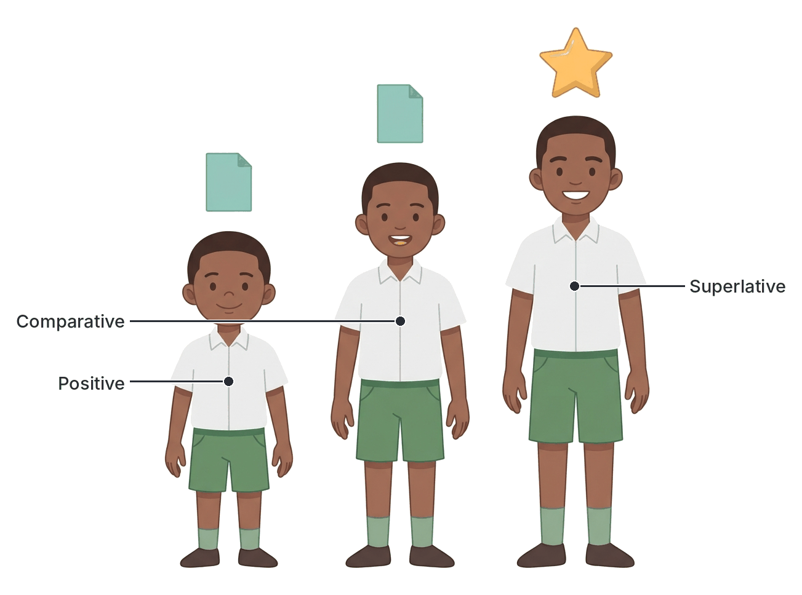

# JAMB Use of English Notes: Degree and Question Tags

## What JAMB expects

This topic is part of Section B of the JAMB Use of English syllabus: Lexis and Structure. It covers the last two items of content item (e): **degree (positive, comparative and superlative)** and **question tags**.

It serves these objectives:

- **Objective iv:** identify various grammatical patterns in use.
- **Objective v:** interpret information conveyed in sentences.

In the examination, these appear under "Basic Grammar" (10 questions in Section B). Typical questions look like this:

> Of the two brothers, Emeka is the ______.
> A. tallest B. most tall C. taller D. more taller

> You are coming to the party, ______?
> A. isn't it B. aren't you C. don't you D. are you

By the end of these notes, you should be able to:

1. Explain the three degrees of comparison: positive, comparative and superlative.
2. Form the comparative and superlative of regular and irregular adjectives and adverbs.
3. Use comparison structures correctly (*than*, *as…as*, *the…of*, *the more…the more*).
4. Avoid double comparatives, double superlatives and wrong comparison of absolute adjectives (*unique*, *perfect*) and Latin comparatives (*superior to*, *senior to*).
5. Form question tags correctly for all kinds of statements, including the special cases.
6. Explain the meaning shown by the intonation of a question tag.

---

# Part 1: Degree (comparison)

## What is degree?

**Degree** (or **degrees of comparison**) is the form an adjective or adverb takes to show **how much** of a quality something has, compared with other things.

There are three degrees:

| Degree | What it does | Example |
| --- | --- | --- |
| Positive | Describes a quality without comparing | Ada is **tall**. |
| Comparative | Compares **two** people or things | Ada is **taller** than Ngozi. |
| Superlative | Compares **three or more**, picking out the top or bottom one | Ada is the **tallest** girl in the class. |

## The positive degree

The positive degree is the **basic form** of the adjective or adverb. It is the form you find first in the dictionary.

- *The road to Jos is **long**.*
- *Kunle runs **fast**.*
- *This mango is **sweet**.*
- *She sings **beautifully**.*

The positive degree is also used in **equal comparisons** with ***as … as***:

- *Ada is **as tall as** her mother.* (They are the same height.)
- *This bag is **as heavy as** that one.*
- *Tunde is **not as clever as** his sister.* / *Tunde is **not so clever as** his sister.* (*not so…as* is a little more formal; both are correct in negative sentences.)

**Watch out:** use the positive form, not the comparative, between *as … as*:

- **Wrong:** *She is as taller as her brother.*
- **Right:** *She is as **tall** as her brother.*

## The comparative degree

The comparative compares **two** people, things or groups. It is usually followed by ***than***.

- *Lagos is **bigger** than Ibadan.*
- *This exam was **more difficult** than the last one.*
- *Emeka drives **more carefully** than his brother.*

**Comparing two without *than*:** when the two things are named earlier, use ***the*** + comparative + ***of the two***.

- *Of the two sisters, Funmi is **the prettier**.* (not "the prettiest")
- *Which is **the better** of the two plans?*

**Textbook variation:** in informal English, many native speakers use the superlative for two (*the best of the two*). Grammar books and all exam guides prefer the **comparative** for two. Always use the comparative for two in JAMB.

## The superlative degree

The superlative compares **three or more** and picks out the one at the top (or bottom). It is usually preceded by ***the*** and often followed by ***in*** (with a place or group) or ***of*** (with a number of people or things).

- *Zuma Rock is one of **the most famous** rocks in Nigeria.*
- *Chidi is **the cleverest** boy **in** the class.* (not "of the class")
- *This is **the best** of all the essays.*
- *She is **the youngest of** the five children.*

**Watch out:** *in* is used with a place or a group seen as a unit (*in the class, in Nigeria, in the world*). *Of* is used with a number of items (*of the three, of all, of the students*).

## Forming comparatives and superlatives (regular)

### Rule 1: One-syllable words: add -er and -est

| Positive | Comparative | Superlative |
| --- | --- | --- |
| tall | taller | tallest |
| short | shorter | shortest |
| fast | faster | fastest |
| cheap | cheaper | cheapest |
| old | older | oldest |
| young | younger | youngest |

**Spelling changes:**

| Rule | Examples |
| --- | --- |
| Word ends in **-e**: add **-r** and **-st** | large → larger → largest; wise → wiser → wisest; nice → nicer → nicest |
| Short word ending in **one vowel + one consonant**: double the consonant | big → bigger → biggest; hot → hotter → hottest; thin → thinner → thinnest; fat → fatter → fattest; wet → wetter → wettest; sad → sadder → saddest |
| Ends in **-w** or **-y** after a vowel: no doubling | new → newer → newest; grey → greyer → greyest |

### Rule 2: Two-syllable words ending in -y: change y to i and add -er, -est

| Positive | Comparative | Superlative |
| --- | --- | --- |
| happy | happier | happiest |
| easy | easier | easiest |
| busy | busier | busiest |
| heavy | heavier | heaviest |
| pretty | prettier | prettiest |
| early | earlier | earliest |
| dirty | dirtier | dirtiest |

### Rule 3: Most words of two or more syllables: use *more* and *most*

| Positive | Comparative | Superlative |
| --- | --- | --- |
| careful | more careful | most careful |
| beautiful | more beautiful | most beautiful |
| expensive | more expensive | most expensive |
| important | more important | most important |
| intelligent | more intelligent | most intelligent |
| difficult | more difficult | most difficult |
| famous | more famous | most famous |
| modern | more modern | most modern |

### Rule 4: Some two-syllable words can take either form

Words such as *clever, narrow, simple, gentle, quiet, common, polite, pleasant, shallow, stupid* can take either **-er/-est** or **more/most**.

- *cleverer / more clever*; *cleverest / most clever*
- *simpler / more simple*; *simplest / most simple*
- *narrower / more narrow*; *narrowest / most narrow*
- *quieter / more quiet*; *quietest / most quiet*
- *politer / more polite*; *politest / most polite*

**Textbook variation:** dictionaries list both forms for these words, but they differ on which is more common. Words ending in **-er, -ow, -le** (*clever, narrow, simple, gentle*) more often take *-er/-est*. JAMB normally avoids testing them.

### Rule 5: Adverbs

- Adverbs ending in **-ly** use **more/most**: *quickly → more quickly → most quickly*; *carefully → more carefully → most carefully*.
- One-syllable adverbs (*fast, hard, late, soon, near*) add **-er/-est**: *fast → faster → fastest*; *hard → harder → hardest*; *soon → sooner → soonest*.
- **Exception:** *early → earlier → earliest* (it ends in *-ly*, but it is not formed from an adjective + *-ly*).

**Common error:** "quicklier" and "carefullier" do not exist.

### Rule 6: The lowest degree: *less* and *least*

To show a smaller amount of a quality, use ***less*** (comparative) and ***least*** (superlative) with any adjective or adverb.

- *This route is **less dangerous** than the expressway.*
- *Of all the subjects, Physics is the one I find **least interesting**.*
- *He spoke **less clearly** than the other speaker.*

## Irregular comparatives and superlatives

These must be learnt by heart. JAMB tests them often.

| Positive | Comparative | Superlative | Notes |
| --- | --- | --- | --- |
| good | better | best | *good* is an adjective |
| well | better | best | *well* is an adverb (or adjective meaning "healthy") |
| bad | worse | worst | |
| badly | worse | worst | |
| ill | worse | worst | meaning "sick" |
| much | more | most | with uncountable nouns |
| many | more | most | with countable nouns |
| little | less | least | meaning "amount" (*little money*) |
| few | fewer | fewest | with countable nouns |
| far | farther / further | farthest / furthest | see below |
| old | older / elder | oldest / eldest | see below |
| late | later / latter | latest / last | see below |

**Note on *little*:** when *little* means "small in size", it is often compared with *smaller* and *smallest* instead (*a little house → a smaller house*). *Littler* and *littlest* exist but are informal.

### *Farther* and *further*

| Word | Use | Example |
| --- | --- | --- |
| farther / farthest | physical distance only | Kano is **farther** from Lagos than Ibadan is. |
| further / furthest | physical distance **and** "more, additional" | Kano is **further** from Lagos. / For **further** information, call the school. / The meeting is adjourned until **further** notice. |

**Textbook variation:** many grammar books say *farther* is for distance and *further* for extent. In modern British English, *further* is used for both meanings and is much more common. For "additional" or "more", only ***further*** is correct: *further studies*, *further details*, never "farther studies".

### *Older/elder* and *oldest/eldest*

| Word | Use | Example |
| --- | --- | --- |
| older, oldest | people and things; can be followed by *than* | My brother is **older than** me. This is the **oldest** church in Calabar. |
| elder, eldest | people in the same **family** only; used **before a noun** or with *the*; **never** followed by *than* | My **elder** brother is a doctor. She is the **eldest** of the four children. |

- **Wrong:** *My brother is elder than me.*
- **Right:** *My brother is **older than** me.* / *He is my **elder** brother.*
- **Wrong:** *This is the eldest building in town.*
- **Right:** *This is the **oldest** building in town.*

### *Later/latter* and *latest/last*

| Word | Meaning | Example |
| --- | --- | --- |
| later | after in time | I will see you **later**. |
| latter | the second of two things mentioned (opposite: *former*) | Between Ada and Bola, the **latter** (Bola) is taller. |
| latest | most recent, newest | Have you heard the **latest** news? |
| last | final; at the end of a series | Z is the **last** letter of the alphabet. |

- *Have you read his **latest** novel?* (his newest; he may write more)
- *This is his **last** novel.* (his final one; he will write no more, or it is the previous one)

### *Less* and *fewer*

- ***Fewer*** + plural countable noun: *fewer students, fewer mistakes, fewer cars*.
- ***Less*** + uncountable noun: *less money, less rice, less time, less noise*.
- **Wrong:** *There were less people at the rally.* **Right:** *There were **fewer** people at the rally.*

**Textbook variation:** *less* with plural nouns (*less people*) is common in informal English, but exams always treat it as wrong. Use *less than* with amounts and numbers seen as one total: *less than 10 kilometres*, *less than 5,000 naira*.

## Double comparatives and double superlatives

Use **either** *-er/-est* **or** *more/most*, **never both**.

| Wrong | Right |
| --- | --- |
| more taller | taller |
| more better | better |
| most tallest | tallest |
| most best | best |
| more easier | easier |
| more cleverer | cleverer / more clever |
| more superior | superior |
| worser | worse |
| bestest | best |
| more worse | worse |
| lesser money | less money |

**Note on *lesser*:** *lesser* is a real word meaning "not so great or important". It is used before a noun: *the **lesser** of two evils*, *a **lesser** offence*. It is **not** used instead of *less* for amounts: **wrong:** "lesser money"; **right:** *less money*.

## Absolute adjectives (adjectives that cannot be compared)

Some adjectives describe a quality that is **total** or **complete**. Logically, something either has the quality fully or does not have it at all. These are called **absolute** (or **non-gradable**) adjectives. Traditional grammar says they should **not** be compared and should **not** be used with *very*.

| Absolute adjective | Meaning | Wrong (traditional view) | Right |
| --- | --- | --- | --- |
| unique | the only one of its kind | very unique, more unique, most unique | unique, quite unique (= completely unique), almost unique |
| perfect | without any fault | more perfect, very perfect | perfect, nearly perfect |
| complete | with nothing missing | more complete | complete, almost complete |
| dead | not alive | more dead, very dead | dead |
| empty | containing nothing | emptier (traditional view) | empty, almost empty |
| full | containing as much as possible | fuller (traditional view) | full, nearly full |
| round, square | the shape | rounder, squarer (traditional view) | round, almost round |
| universal | for everyone everywhere | more universal | universal |
| absolute, total, entire, infinite, eternal | complete | more total | total |
| impossible | cannot happen | very impossible | impossible, quite impossible |
| supreme, ultimate | highest, final | more supreme | supreme |
| fatal | causing death | more fatal | fatal |

**Textbook variation:** in real use, writers do compare some of these. The US Constitution speaks of "a more perfect union", and *fuller*, *emptier* and *rounder* appear in good dictionaries (for example *a fuller account*). But *unique* is the word exams test, and here every exam guide agrees: **avoid "very unique", "more unique" and "most unique"**. Use *almost unique*, *quite unique* or a different adjective, such as *very unusual* or *very rare*.

## Latin comparatives: *superior to, inferior to, senior to, junior to, prior to, preferable to*

Some adjectives that came from Latin are already comparatives in meaning. They:

1. are followed by ***to***, **not** *than*;
2. are **not** used with *more* or *most*.

| Word | Wrong | Right |
| --- | --- | --- |
| superior | This car is more superior than that one. | This car is **superior to** that one. |
| inferior | His work is inferior than mine. | His work is **inferior to** mine. |
| senior | She is senior than me. | She is **senior to** me. |
| junior | He is two years junior than his brother. | He is two years **junior to** his brother. |
| prior | The meeting held prior than the election. | The meeting held **prior to** the election. |
| preferable | Walking is more preferable than taking a taxi. | Walking is **preferable to** taking a taxi. |
| anterior / posterior | — | **anterior to**, **posterior to** (used in science) |

Similarly, the verb ***prefer*** takes ***to***:

- *I prefer amala **to** eba.* (not "than eba")
- With infinitives: *I prefer to walk **rather than** (to) take a bus.*

### Other comparison words that take *to*

- *similar **to***: *Your answer is similar **to** mine.*
- *different **from*** (preferred in British English), *different **to*** (also British, informal), *different **than*** (mainly American).
  - **Textbook variation:** all three exist, but *different from* is accepted everywhere. Choose *different from* in JAMB.
- *the same **as***: *My shoes are the same **as** yours.* (not "same with")
- *compared **with** / compared **to***: both are used in British English.

## Other comparison structures

### *The + comparative, the + comparative* (parallel increase)

This shows that two things change together.

- ***The more** you read, **the more** you learn.*
- ***The harder** you work, **the better** your results will be.*
- ***The sooner**, **the better**.*

**Common error:** leaving out *the*: "More you read, more you learn" is wrong.

### Comparative + *and* + comparative (gradual change)

- *The weather is getting **hotter and hotter**.*
- *Food is becoming **more and more** expensive.* (not "more expensive and more expensive")

### Comparing with *any other* or *anyone else*

When you compare one member of a group with the rest of the group, add ***other*** or ***else***. Otherwise you compare the thing with itself.

- **Wrong:** *Lagos is bigger than any city in Nigeria.* (Lagos is a city in Nigeria, so this says Lagos is bigger than itself.)
- **Right:** *Lagos is bigger than any **other** city in Nigeria.*
- **Right:** *Amaka is cleverer than anyone **else** in her class.*

### Comparing like with like

Compare the same kinds of things.

- **Wrong:** *The population of Kano is larger than Kaduna.* (population compared with a city)
- **Right:** *The population of Kano is larger than **that of** Kaduna.*
- **Right:** *My results are better than **those of** my brother.* / *…better than **my brother's**.*

### Pronoun case after *than* and *as*

- **Formal (exam-safe):** *She is taller than **I** (am).* / *He is as clever as **she** (is).*
- **Informal (very common):** *She is taller than **me**.*

**Textbook variation:** modern grammars (Swan, Cambridge, Oxford) accept *than me* as normal in speech and much writing. Traditional grammar insists on *than I* because *am* is understood. In exams, if both appear, choose ***than I***. Note that the meaning can differ: *She likes Tolu more than I* (= more than I like Tolu) vs *She likes Tolu more than me* (= more than she likes me).

### Intensifiers with comparatives and superlatives

- With comparatives, use ***much, far, a lot, a little, slightly, even, still***: *much taller*, *far better*, *a little cheaper*. **Not** *very*: "very taller" is wrong.
- With superlatives, use ***by far, easily, much, quite***: *by far the best*, *easily the tallest*, *quite the most beautiful*.

### *Than* versus *then*

- ***Than*** is for comparison: *She is older **than** me.*
- ***Then*** is for time: *We ate, and **then** we left.*
- **Wrong:** *He is taller then his brother.*

## Comparing positive, comparative and superlative: summary table

| Feature | Positive | Comparative | Superlative |
| --- | --- | --- | --- |
| Compares | nothing (or equality with *as…as*) | two | three or more |
| Short words | tall | taller | tallest |
| Long words | beautiful | more beautiful | most beautiful |
| Irregular | good / bad | better / worse | best / worst |
| Usual word after | *as* (in *as…as*) | *than* | *in* / *of* |
| Usual word before | *as*, *so*, *very* | *much*, *far* | *the* |
| Example | Ada is tall. | Ada is taller than Bola. | Ada is the tallest in the class. |

---

# Part 2: Question tags

## What is a question tag?

A **question tag** (also called a **tag question**) is a short question added to the **end** of a statement. It turns the statement into a question, either to:

1. **check** whether something is true (when you are not sure), or
2. **ask for agreement** (when you are fairly sure).

Examples:

- *You are a student, **aren't you**?*
- *She can swim, **can't she**?*
- *They didn't come, **did they**?*

The tag is made of **two parts**:

1. an **auxiliary verb** (helping verb) such as *is, are, was, do, does, did, have, has, can, will, should*; and
2. a **pronoun** that refers to the subject of the statement.

## The basic rules

### Rule 1: Positive statement → negative tag; negative statement → positive tag

| Statement | Tag | Example |
| --- | --- | --- |
| Positive (+) | Negative (−) | *It is hot, **isn't it**?* |
| Negative (−) | Positive (+) | *It isn't hot, **is it**?* |

The negative tag is almost always **contracted**: *isn't, aren't, don't, can't, won't, haven't*. The full form (*is it not?*) is very formal and is placed differently: *It is hot, is it not?*

### Rule 2: Use the same auxiliary verb as the statement

If the statement has an auxiliary or the verb *be*, repeat it in the tag.

| Statement | Tag |
| --- | --- |
| She **is** a nurse, | **isn't** she? |
| They **were** late, | **weren't** they? |
| You **have** finished, | **haven't** you? |
| He **can** drive, | **can't** he? |
| We **should** leave now, | **shouldn't** we? |
| It **will** rain, | **won't** it? |
| You **would** help me, | **wouldn't** you? |
| She **must** go, | **mustn't** she? |
| They **had** left, | **hadn't** they? |

### Rule 3: No auxiliary? Use *do, does* or *did*

If the statement has only a main verb in the simple present or simple past, use the correct form of ***do*** in the tag.

| Statement | Tense | Tag |
| --- | --- | --- |
| You **like** pounded yam, | simple present (I/you/we/they) | **don't** you? |
| She **sells** fish, | simple present (he/she/it) | **doesn't** she? |
| They **went** to Abuja, | simple past | **didn't** they? |
| He **came** late, | simple past | **didn't** he? |
| Chika **didn't** call, | negative simple past | **did** she? |

**Very common JAMB trap:** using *isn't it?* or *is it?* for everything. "Isn't it?" is not a general tag in Standard English, though it is very common in Nigerian (and some other) spoken English.

- **Wrong:** *You are coming, isn't it?*
- **Right:** *You are coming, **aren't you**?*
- **Wrong:** *He passed the exam, isn't it?*
- **Right:** *He passed the exam, **didn't he**?*

### Rule 4: The pronoun matches the subject

The tag uses a **pronoun**, never a noun.

| Statement | Tag |
| --- | --- |
| **Mr Okafor** is your teacher, | isn't **he**? |
| **The girls** have arrived, | haven't **they**? |
| **Your car** is new, | isn't **it**? |
| **Musa and I** are friends, | aren't **we**? |
| **You and your sister** were there, | weren't **you**? |
| **This** is your book, | isn't **it**? |
| **That** was a good film, | wasn't **it**? |
| **These** are your shoes, | aren't **they**? |
| **Those** were the days, | weren't **they**? |

**Note:** *this/that* in the subject → ***it*** in the tag; *these/those* → ***they***.

### Rule 5: Match the tense

- *She **is** working, **isn't** she?* (present continuous)
- *She **was** working, **wasn't** she?* (past continuous)
- *She **has** worked here for years, **hasn't** she?* (present perfect)
- *She **will** work tomorrow, **won't** she?* (future)

## Special cases

### *I am* → *aren't I?*

The positive statement *I am* takes the tag ***aren't I?***

- *I am your best friend, **aren't I**?* (not "amn't I?" and not "isn't it?")
- *I'm late, **aren't I**?*

*Am I not?* is also correct but very formal: *I am right, am I not?*

The negative *I'm not* takes ***am I?***:

- *I'm not late, **am I**?*

### *Let's* → *shall we?*

A suggestion with ***let's*** (= let us) takes ***shall we?***

- ***Let's** go to the stadium, **shall we**?*
- ***Let's** start the meeting, **shall we**?*

**But** ***let us*** meaning "allow us" (a request to someone else) takes ***will you?*** or ***won't you?***

- ***Let us** go now, **will you**?* (= Please allow us to go.)
- ***Let me** help you, **will you**?* / ***Let me** help you, **shall I**?* (offer)

### Imperatives (commands and requests)

An imperative usually takes ***will you?*** It can also take *won't you?* (a polite invitation), *would you?*, *could you?* or *can you?* (more polite requests), or *can't you?* (impatient).

| Statement | Tag | Effect |
| --- | --- | --- |
| Close the door, | **will you**? | ordinary request |
| Sit down, | **won't you**? | polite invitation |
| Help me with this box, | **would you**? / **could you**? | polite request |
| Keep quiet, | **can't you**? | impatient, annoyed |

A **negative** imperative takes ***will you?***:

- ***Don't** make noise, **will you**?*
- ***Don't** forget to call me, **will you**?*

### Negative words: *never, hardly, scarcely, barely, seldom, rarely, nobody, no one, nothing, none, neither, little, few*

These words make a statement **negative in meaning**, even though there is no *not*. So the tag must be **positive**.

| Statement | Tag | Why |
| --- | --- | --- |
| He **never** comes late, | **does he**? | *never* is negative |
| She **hardly** eats meat, | **does she**? | *hardly* = almost not |
| You **seldom** visit your grandmother, | **do you**? | *seldom* is negative |
| They **scarcely** had time to eat, | **did they**? | *scarcely* is negative |
| He **rarely** speaks in class, | **does he**? | *rarely* is negative |
| There is **little** hope, | **is there**? | *little* (without *a*) is negative |
| **Few** people came, | **did they**? | *few* (without *a*) is negative |
| **Nothing** happened, | **did it**? | *nothing* is negative |

**Compare:** *a little* and *a few* are **positive**:

- *There is **a little** water left, **isn't there**?*
- ***A few** students passed, **didn't they**?*

**Common JAMB trap:**

> He hardly comes to school on time, ______?
> A. doesn't he B. does he C. isn't it D. did he
>
> **Answer: B.** *Hardly* is negative, so the tag is positive. The verb *comes* is simple present, third person → *does he?*

### *Everyone, everybody, someone, somebody, no one, nobody, anyone, anybody* → *they*

The tag uses ***they*** for these indefinite pronouns (and a **plural** auxiliary to go with *they*).

- ***Everyone** is here, **aren't they**?*
- ***Somebody** called me, **didn't they**?*
- ***Nobody** came, **did they**?* (*nobody* is negative → positive tag)
- ***No one** knew the answer, **did they**?*
- ***Everybody** has paid, **haven't they**?*

**Textbook variation:** some older textbooks give *isn't he?* (e.g. "Everybody is happy, isn't he?"). Modern grammars (Swan, Cambridge, Oxford) all use ***they***. If *they* is in an option, choose it.

### *Everything, something, nothing, anything* → *it*

- ***Everything** is ready, **isn't it**?*
- ***Something** is wrong, **isn't it**?*
- ***Nothing** went wrong, **did it**?*

### *There is / there are* → *there* in the tag

- ***There is** a problem, **isn't there**?* (not "isn't it")
- ***There are** many students outside, **aren't there**?*
- ***There was** no light yesterday, **was there**?* (*no* is negative → positive tag)

### *Have* as a main verb

When *have* means "possess" or "own":

- **British English** (especially older or formal): *You **have** a car, **haven't you**?*
- **Modern British and American English**: *You **have** a car, **don't you**?*

When *have got* is used, the tag is always *haven't/hasn't*:

- *You've **got** a car, **haven't you**?*

When *have* means an action (*have breakfast, have a bath, have a party*), use *do*:

- *You **had** breakfast, **didn't you**?*
- *They **have** lunch at one o'clock, **don't they**?*

**Textbook variation:** older Nigerian textbooks often accept only *haven't you?* for possession. Modern grammars accept both. Well-set JAMB questions put only one of them in the options.

### *Used to*

- *You **used to** live in Kaduna, **didn't you**?* (modern standard)
- *You **used to** live in Kaduna, **usedn't you**?* (very old-fashioned British; avoid)

### *Ought to*

- *We **ought to** go, **shouldn't we**?* (most common)
- *We **ought to** go, **oughtn't we**?* (formal British; also correct)

### *Must*

- ***Must*** for obligation: *You must leave now, **mustn't you**?*
- ***Must*** for deduction (meaning "I'm sure that"): the tag follows the verb that the deduction is about.
  - *He **must be** tired, **isn't he**?* (= I'm sure he is tired, isn't he?)
  - *They **must have** left, **haven't they**?*

### *Had better* and *would rather*

- *You'**d better** go now, **hadn't you**?* (*'d* = *had*)
- *You'**d rather** stay at home, **wouldn't you**?* (*'d* = *would*)

### *Need* and *dare*

- As main verbs: *You **need** money, **don't you**?*
- As modal verbs (in negatives): *You **needn't** come, **need you**?*

### Compound sentences and sentences with *I think*, *I believe*

- In a sentence with a main clause and a reported clause, the tag usually goes with the **main** clause: *He said that he was coming, **didn't he**?*
- But with *I think / I believe / I suppose* (where *I* is the speaker), the tag goes with the **reported** clause, because that is the real point of the question: *I think **she is** right, **isn't she**?* (not "don't I?")
- With a negative *I don't think*, the tag is positive and goes with the reported clause: *I don't think **he will** come, **will he**?*

### Same-way tags (positive statement + positive tag)

Sometimes a positive statement is followed by a **positive** tag. This shows **interest, surprise or sarcasm**, not a request for agreement.

- *So you've passed your exams, **have you**? Well done!* (interest)
- *Oh, you're the new prefect, **are you**?* (surprise)
- *So you think you're clever, **do you**?* (sarcasm)

Negative statement + negative tag is **not** used in standard English. JAMB normally tests ordinary "opposite" tags.

## Intonation in question tags

The meaning of a question tag depends on the **intonation** (the rise or fall of the voice) on the tag. This links with Oral Forms (Section C).

| Intonation on the tag | Meaning | Example |
| --- | --- | --- |
| **Falling** (↘) | The speaker is fairly sure and expects agreement. It is not a real question. | *It's a lovely day, ↘ isn't it?* |
| **Rising** (↗) | The speaker is not sure and is asking a real question. | *You're from Ilorin, ↗ aren't you?* |

## Worked examples: question tags step by step

**Method:**

1. Is the statement **positive** or **negative**? (Look for *not, n't, never, hardly, seldom, no, nobody, nothing, few, little*.)
2. Find the **auxiliary** (or *be*). If there is none, use *do/does/did*.
3. Choose the **pronoun** for the subject (*everyone → they*, *this → it*, *there → there*).
4. Make the tag the **opposite** of the statement (unless it is an imperative or *let's*).

**Example 1:** *The children have eaten, ______?*

1. Positive.
2. Auxiliary: *have*.
3. Pronoun: *the children → they*.
4. Negative tag: ***haven't they?***

**Example 2:** *Nobody saw the thief, ______?*

1. *Nobody* is negative.
2. No auxiliary; simple past → *did*.
3. *Nobody → they*.
4. Positive tag: ***did they?***

**Example 3:** *I am the class captain, ______?*

1. Positive.
2. *am* → special case.
3. —
4. ***aren't I?***

**Example 4:** *Let's play football, ______?*

→ ***shall we?***

**Example 5:** *Don't touch that wire, ______?*

→ negative imperative → ***will you?***

**Example 6:** *Ngozi seldom cooks, ______?*

1. *Seldom* is negative.
2. Simple present, third person → *does*.
3. *Ngozi → she*.
4. Positive: ***does she?***

## Summary table: special question tags

| Statement type | Tag | Example |
| --- | --- | --- |
| I am… | aren't I? | I am early, aren't I? |
| I'm not… | am I? | I'm not late, am I? |
| Let's… | shall we? | Let's go, shall we? |
| Let us / let me (permission) | will you? | Let us go, will you? |
| Imperative (positive) | will you? / won't you? / would you? / can you? | Close the window, will you? |
| Imperative (negative) | will you? | Don't shout, will you? |
| never, hardly, seldom, rarely, scarcely, barely | positive tag | He never lies, does he? |
| nobody, no one, nothing, none, few, little | positive tag | Nothing happened, did it? |
| everyone, someone, nobody, anyone | they | Everyone came, didn't they? |
| everything, something, nothing | it | Everything is fine, isn't it? |
| this / that | it | That's your bag, isn't it? |
| these / those | they | These are yours, aren't they? |
| There is / are | there | There's a problem, isn't there? |
| Simple present (no auxiliary) | don't / doesn't | She likes rice, doesn't she? |
| Simple past (no auxiliary) | didn't | They won, didn't they? |
| had better | hadn't | You'd better go, hadn't you? |
| would rather | wouldn't | You'd rather stay, wouldn't you? |
| used to | didn't | He used to smoke, didn't he? |

## Key terms

| Term | Meaning |
| --- | --- |
| Degree (of comparison) | The form of an adjective or adverb that shows how much of a quality something has |
| Positive degree | The basic form, used without comparison, e.g. *tall* |
| Comparative degree | The form used to compare two, e.g. *taller*, *more careful* |
| Superlative degree | The form used to compare three or more, e.g. *tallest*, *most careful* |
| Irregular comparison | Comparison not formed with -er/-est or more/most, e.g. *good, better, best* |
| Double comparative | The error of using both *more* and *-er*, e.g. *more taller* |
| Absolute adjective | An adjective whose quality cannot be increased, e.g. *unique, perfect* |
| Latin comparative | A word like *superior, inferior, senior, junior, prior* that is followed by *to*, not *than* |
| Question tag | A short question added to the end of a statement, e.g. *…, isn't it?* |
| Auxiliary verb | A helping verb used in the tag, e.g. *is, do, have, can, will* |
| Falling tone | Intonation on a tag that expects agreement |
| Rising tone | Intonation on a tag that asks a real question |
| Same-way tag | A positive tag after a positive statement, showing interest or surprise |

## Exam tips and common mistakes

- **Two things → comparative; three or more → superlative.** *The taller of the two*, *the tallest of the three*.
- **Never double up:** *more taller*, *most tallest*, *more better*, *worser* are always wrong.
- **Superior, inferior, senior, junior, prior, preferable** take ***to***, not *than*, and never take *more*.
- ***Prefer … to***: *I prefer rice to beans*.
- ***Elder/eldest*** is only for family members and is never followed by *than*. *My brother is older than me.*
- ***Further*** for "additional": *further information*, not "farther information".
- ***Fewer*** with countable nouns, ***less*** with uncountable nouns.
- **Avoid "very unique"** and "more unique".
- **Add *other* or *else*** when comparing one member with the rest of its group.
- **Question tags: positive statement → negative tag, and the reverse.** Copy the auxiliary; if there is none, use *do/does/did*.
- **"Isn't it?" is not a universal tag.** It only goes with *it is* statements.
- ***Never, hardly, seldom, scarcely, rarely, nobody, nothing, few, little*** make the statement negative, so the tag is **positive**.
- ***I am → aren't I?***; ***Let's → shall we?***; imperatives → ***will you?***; *everyone → they*; *there is → isn't there?*

## Quick summary

1. Adjectives and adverbs have three degrees: **positive** (*tall*), **comparative** (*taller*, for two) and **superlative** (*tallest*, for three or more).
2. Short words add **-er/-est**; most longer words use **more/most**; some words are irregular (*good–better–best*, *bad–worse–worst*, *much/many–more–most*, *little–less–least*, *far–further/farther–furthest/farthest*).
3. Never use **double comparatives** (*more taller*), and avoid comparing **absolute adjectives** like *unique*.
4. ***Superior, inferior, senior, junior, prior, preferable*** and the verb ***prefer*** take ***to***, not *than*.
5. A **question tag** uses an auxiliary verb + a pronoun. A positive statement takes a negative tag, and a negative statement takes a positive tag.
6. If there is no auxiliary, use ***do/does/did***. The pronoun must match the subject (*everyone → they*, *this → it*, *there is → there*).
7. Special tags: ***I am → aren't I?***, ***Let's → shall we?***, imperatives → ***will you?***, and words like *never, hardly, seldom, nobody* need a **positive** tag.
8. A **falling tone** on a tag expects agreement; a **rising tone** asks a real question.

## Practice questions

**1. Choose the option that best completes the sentence: Of the two candidates, Amina is the ______.**

- A. most qualified
- B. more qualified
- C. qualifiedest
- D. most qualifiedest

**Answer: B.** Only two candidates are compared, so the comparative (*more qualified*) is needed.

**2. Choose the option that best completes the sentence: Many people believe that locally made goods are not ______ imported ones.**

- A. inferior than
- B. more inferior to
- C. inferior to
- D. inferior from

**Answer: C.** *Inferior* is a Latin comparative. It is followed by *to* and is never used with *more*.

**3. Choose the option that best completes the sentence: My ______ brother is a lecturer at the University of Nigeria, Nsukka.**

- A. elder
- B. older than
- C. eldest than
- D. more elder

**Answer: A.** *Elder* is used before a noun for family members. It is never followed by *than* and never used with *more*.

**4. Choose the option that best completes the sentence: For ______ information, contact the school bursar.**

- A. farther
- B. further
- C. farthest
- D. more far

**Answer: B.** *Further* is used to mean "additional" or "more". *Farther* is only for physical distance.

**5. Choose the option that best completes the sentence: The harder you study, ______ your chances of success.**

- A. more better
- B. the best
- C. better
- D. the better

**Answer: D.** The structure *the + comparative, the + comparative* shows two things changing together: *the harder…, the better…*.

**6. Choose the option that best completes the sentence: You are coming to the meeting, ______?**

- A. isn't it
- B. don't you
- C. aren't you
- D. are you

**Answer: C.** The statement is positive and uses *are*, with the subject *you*, so the tag is *aren't you?* *Isn't it?* is not a general tag in Standard English.

**7. Choose the option that best completes the sentence: I am the head girl of this school, ______?**

- A. isn't I
- B. aren't I
- C. isn't it
- D. amn't I

**Answer: B.** *I am* takes the tag *aren't I?* in Standard English. *Isn't I?* and *amn't I?* are not standard, and *isn't it?* does not match the subject *I*. (The very formal *am I not?* is also correct.)

**8. Choose the option that best completes the sentence: Let's visit the Olumo Rock this weekend, ______?**

- A. shall we
- B. will you
- C. don't we
- D. isn't it

**Answer: A.** A suggestion with *let's* takes the tag *shall we?*

**9. Choose the option that best completes the sentence: Bayo seldom attends church services, ______?**

- A. doesn't he
- B. isn't it
- C. does he
- D. did he

**Answer: C.** *Seldom* makes the statement negative in meaning, so the tag is positive. The verb *attends* is simple present, third person, so the tag is *does he?*

**10. Choose the option that best completes the sentence: Everyone has submitted the assignment, ______?**

- A. hasn't he
- B. haven't they
- C. isn't it
- D. hasn't it

**Answer: B.** *Everyone* is referred to as *they* in the tag, and *they* takes the plural auxiliary *haven't*.
