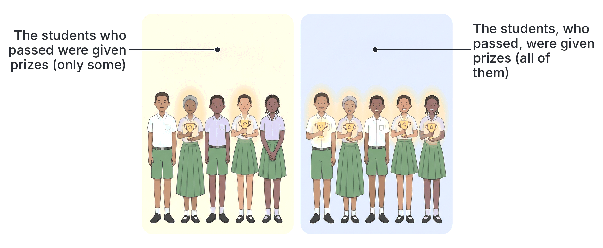

# JAMB Use of English Notes: Punctuation and Capitalisation

## What JAMB expects

This topic is part of Section B of the JAMB Use of English syllabus: Lexis and Structure. It covers content item (f), **mechanics**, apart from spelling (spelling is in B6a-spelling.md). Mechanics are the technical "nuts and bolts" of writing: **spelling, punctuation and capitalisation**.

It serves these objectives:

- **Objective iv:** identify various grammatical patterns in use.
- **Objective v:** interpret information conveyed in sentences.

Punctuation questions come under "Basic Grammar" (10 questions in Section B). Punctuation also matters for **sentence interpretation** (5 questions), because a single comma can change the meaning of a sentence. Typical questions look like this:

> Choose the option that is correctly punctuated.
> A. The dog wagged it's tail.
> B. The dog wagged its tail.
> C. The dog wagged its' tail.
> D. The dog wagged it is tail.

By the end of these notes, you should be able to:

1. Explain what punctuation is and why it matters for meaning.
2. Use each punctuation mark correctly: full stop, question mark, exclamation mark, comma, semicolon, colon, apostrophe, quotation marks, hyphen, dash, brackets, ellipsis and slash.
3. Show how punctuation changes the meaning of a sentence.
4. Apply the rules of capitalisation.
5. Recognise where British and American usage differ.
6. Tackle JAMB punctuation questions step by step.

## What is punctuation?

**Punctuation** is the set of marks we use in writing to separate sentences and parts of sentences, and to make the meaning clear. In speech, we use pauses and changes in our voice (intonation). In writing, punctuation does this job.

Compare:

- *Woman, without her man, is nothing.*
- *Woman: without her, man is nothing.*

The words are exactly the same, but the meanings are opposite. Punctuation changed the meaning.

## The full stop (.)

The **full stop** (called a **period** in American English) marks the end of a **statement** or a **command** that is not exclaimed.

- *The market opens at seven o'clock.*
- *Please close the door.*

### Full stops in abbreviations (British vs American)

| Rule | British English | American English |
| --- | --- | --- |
| Abbreviations that end with the last letter of the word (contractions) | **No full stop**: Mr, Mrs, Dr, St, Ltd | **Full stop**: Mr., Mrs., Dr., St. |
| Abbreviations that cut off the end of the word | Full stop often used: *Prof.*, *Rev.*, *etc.*, *e.g.*, *i.e.* (many modern British writers leave them out: *eg*, *ie*) | Full stop: *Prof.*, *Rev.*, *etc.*, *e.g.*, *i.e.* |
| Initialisms and acronyms | Usually **no** full stops: *JAMB, UTME, NYSC, BBC, UN, NNPC, WAEC* | Often no full stops (*FBI*), but some keep them (*U.S.*) |

**Textbook variation:** older Nigerian textbooks often show *Mr.* and *Dr.* with a full stop. Modern British style leaves the full stop out of *Mr, Mrs, Dr* because the abbreviation ends with the same letter as the full word (Mister, Doctor). Both forms are seen in Nigeria, so JAMB normally avoids testing this point.

### Only one full stop at the end

If a sentence ends with an abbreviation that has a full stop, do not add another:

- *Bring pens, pencils, rulers, etc.* (not "etc..")

## The question mark (?)

The **question mark** ends a **direct question**.

- *Where are you going?*
- *Have you eaten?*
- *You are coming, aren't you?* (question tag)

**Do not** use a question mark after an **indirect (reported) question**. An indirect question is a statement, so it ends with a full stop.

- **Wrong:** *She asked me where I was going?*
- **Right:** *She asked me where I was going.*
- **Right:** *She asked me, "Where are you going?"*
- **Wrong:** *I wonder if he will come?*
- **Right:** *I wonder if he will come.*

A polite request in question form may end with either a question mark or a full stop: *Could you please send me the form?* / *Could you please send me the form.* (The question mark is more common and is always safe.)

## The exclamation mark (!)

The **exclamation mark** shows strong feeling: surprise, anger, joy, fear, or a strong command.

- *What a beautiful day!*
- *How tall he has grown!*
- *Help!*
- *Get out of my house!*
- *Ouch!*

**Tips:**

- Use only **one** exclamation mark: "Wow!!!" is not acceptable in formal writing.
- Do not use exclamation marks in formal letters and essays except in direct speech.
- Sentences beginning with *What a…* and *How…* that express feeling take an exclamation mark: *What a lovely dress!* But a real question beginning with *How* takes a question mark: *How old are you?*

## The comma (,)

The **comma** marks a short pause inside a sentence. It is the most used, and most misused, punctuation mark.

### 1. To separate items in a list

- *We bought yam, rice, beans and garri.*
- *She is kind, patient and hard-working.*

### The serial (Oxford) comma: a textbook variation

The **serial comma** (or **Oxford comma**) is a comma before *and* or *or* at the end of a list:

- *We bought yam, rice, beans**,** and garri.* (with serial comma)
- *We bought yam, rice, beans and garri.* (without serial comma)

| Style | Serial comma? |
| --- | --- |
| Most British newspapers and many British schools | Usually **no**, except to avoid confusion |
| Oxford University Press (hence the name) | **Yes** |
| Most American style guides | **Yes** |

**Both are correct.** The serial comma is needed when leaving it out would cause confusion:

- *I dedicate this book to my parents, Chinua Achebe and God.* (This seems to say my parents are Chinua Achebe and God!)
- *I dedicate this book to my parents, Chinua Achebe, and God.* (Clear: three separate dedications.)

JAMB will not normally ask you to choose between these two styles.

### 2. Between adjectives

Use a comma between two or more adjectives that describe the noun **equally** (you could put *and* between them, or swap their order):

- *It was a long, tiring journey.* (= long and tiring)
- *She is an intelligent, hard-working student.*

Do **not** use a comma when the adjectives are not equal (you could not put *and* between them):

- *a beautiful old house* (not "a beautiful, old house")
- *three tall men*
- *a big black goat*

### 3. Before a conjunction joining two main clauses

Use a comma before *and, but, or, nor, so, yet* when they join two **independent clauses** (each could be a sentence), especially when the clauses are long.

- *I wanted to travel to Abuja, but the roads were flooded.*
- *She studied hard, so she passed the exam.*
- *You can come with us, or you can stay at home.*

When the clauses are short, the comma is often left out: *He came and he went.*

### 4. After an introductory word, phrase or clause

- *However, the meeting was postponed.*
- *Yes, I will come.*
- *In the morning, we went to the market.*
- *After the rain stopped, the children went out to play.*
- *If you work hard, you will succeed.*
- *Unfortunately, the bus broke down.*

**Note:** when the dependent clause comes **after** the main clause, there is usually no comma:

- *If you work hard, you will succeed.*
- *You will succeed if you work hard.* (no comma)

### 5. To mark off extra (non-essential) information

Use a pair of commas around words that add extra information, which could be removed without changing the main meaning.

- *My brother, who lives in Kano, is a doctor.*
- *Abuja, the capital of Nigeria, is in the centre of the country.*
- *The match, however, was cancelled.*
- *Mrs Adebayo, our English teacher, is very strict.*

**Always use two commas** (one before and one after), unless the extra part comes at the beginning or end of the sentence.

- **Wrong:** *Mrs Adebayo, our English teacher is very strict.*
- **Right:** *Mrs Adebayo, our English teacher, is very strict.*

### Defining and non-defining relative clauses: commas change meaning

This is very important for **sentence interpretation** questions.

| Type | Commas? | What it does | Example |
| --- | --- | --- | --- |
| **Defining** (restrictive) relative clause | **No** commas | Tells us **which one(s)**. It is necessary for the meaning. | *The students who passed the exam were given prizes.* |
| **Non-defining** (non-restrictive) relative clause | **Commas** | Adds extra information about **all** the people or things mentioned. | *The students, who passed the exam, were given prizes.* |

**Interpretation:**

- *The students who passed the exam were given prizes.* → **Only some** students passed, and **only those** got prizes.
- *The students, who passed the exam, were given prizes.* → **All** the students passed, and **all** of them got prizes.

**Another example:**

- *My sister who lives in Enugu is a nurse.* → I have **more than one** sister; the one in Enugu is a nurse.
- *My sister, who lives in Enugu, is a nurse.* → I have **only one** sister. She lives in Enugu and is a nurse.

**Note:** *that* is used only in defining clauses, never after a comma.

- **Wrong:** *The book, that I bought yesterday, is torn.*
- **Right:** *The book, which I bought yesterday, is torn.* / *The book that I bought yesterday is torn.*

### 6. In direct address (calling someone by name)

Use a comma to separate the name of the person you are speaking to.

- *Tunde, come here.*
- *Come here, Tunde.*
- *I think, Mama, that you are right.*

**Meaning can change:**

- *Let's eat, Grandma.* (We invite Grandma to eat.)
- *Let's eat Grandma.* (We plan to eat Grandma!)

### 7. With question tags, *yes* and *no*

- *You are coming, aren't you?*
- *No, I have not finished.*

### 8. In direct speech

- *She said, "I am tired."*
- *"I am tired," she said.*
- *"I am tired," she said, "and I want to go home."*

### 9. In dates, addresses and numbers

- *Monday, 1 October 1960* (British style often has no comma between the month and the year)
- *October 1, 1960* (American style: comma before the year)
- *She lives at 12 Broad Street, Lagos Island, Lagos.*
- *The hall holds 1,500 people.* (comma to group thousands)

### 10. Common comma errors

**The comma splice.** Two independent clauses joined only by a comma are wrong.

- **Wrong:** *It was raining, we stayed indoors.*
- **Right:** *It was raining, so we stayed indoors.* (add a conjunction)
- **Right:** *It was raining; we stayed indoors.* (use a semicolon)
- **Right:** *It was raining. We stayed indoors.* (two sentences)

**A comma between the subject and its verb.**

- **Wrong:** *The boy in the blue shirt, is my cousin.*
- **Right:** *The boy in the blue shirt is my cousin.*

**A comma between a verb and its object.**

- **Wrong:** *She told me, that she was leaving.*
- **Right:** *She told me that she was leaving.*

**A comma before *because* in a short sentence** is usually not needed:

- *I stayed at home because I was ill.*

## The semicolon (;)

The **semicolon** is stronger than a comma but weaker than a full stop.

### 1. To join two closely related independent clauses (without a conjunction)

- *The rain fell heavily; the streets were flooded.*
- *Ada likes Mathematics; her brother prefers Literature.*

### 2. Before a conjunctive adverb (*however, therefore, moreover, nevertheless, consequently, otherwise, thus*) that joins two clauses

- *He studied hard; **however**, he did not pass.*
- *The bridge has collapsed; **therefore**, motorists must use another route.*

**Watch out:** a comma alone before *however* in this position is a comma splice.

- **Wrong:** *He studied hard, however he did not pass.*
- **Right:** *He studied hard; however, he did not pass.*
- **Right:** *He studied hard. However, he did not pass.*

### 3. To separate items in a list when the items already contain commas

- *The delegates came from Ibadan, Oyo State; Owerri, Imo State; and Jos, Plateau State.*

## The colon (:)

The **colon** introduces something that **explains**, **lists** or **expands** what comes before it.

### 1. To introduce a list (after a complete sentence)

- *You will need three things: a pen, a ruler and an eraser.*

**Watch out:** do not put a colon directly after a verb or a preposition.

- **Wrong:** *The items needed are: a pen, a ruler and an eraser.*
- **Right:** *The items needed are a pen, a ruler and an eraser.*
- **Right:** *The following items are needed: a pen, a ruler and an eraser.*

### 2. To introduce an explanation or a result

- *He failed for one reason: he did not study.*
- *There was only one thing to do: run.*

### 3. To introduce a quotation (especially a long or formal one)

- *The motto of the school is clear: "Knowledge is power."*

### 4. Other uses

- Time (in some styles): *10:30 a.m.* (British style often uses a full stop: *10.30 a.m.*)
- Ratios: *3:1*
- Bible references: *John 3:16*
- Titles and subtitles: *Nigeria: A History*
- After the greeting in a formal speech: *Ladies and gentlemen:* (a comma is more common in British English)

**Capital letter after a colon?** In British English, the word after a colon normally begins with a **small letter**, unless it is a proper noun or the start of a quotation. American English often uses a capital when a full sentence follows.

## The apostrophe (')

The **apostrophe** has two main jobs: to show **possession** and to show **contraction** (missing letters).

### 1. Possession

| Rule | Example |
| --- | --- |
| Singular noun: add **'s** | the boy**'s** bag (one boy), the teacher**'s** car, Ada**'s** phone |
| Plural noun ending in **-s**: add only **'** | the boys**'** bags (more than one boy), the teachers**'** common room, the students**'** hostel |
| Plural noun **not** ending in -s: add **'s** | the children**'s** playground, the men**'s** toilet, women**'s** rights, people**'s** opinions |
| Singular noun ending in -s | James**'s** book (or James**'** book): see the variation below |
| Joint possession: **'s** on the last name only | Ada and Emeka**'s** house (one house that they share) |
| Separate possession: **'s** on each name | Ada**'s** and Emeka**'s** houses (two different houses) |
| Compound nouns: **'s** on the last word | my mother-in-law**'s** car, the Commissioner for Education**'s** speech |
| Time expressions | a day**'s** work, two weeks**'** holiday, today**'s** newspaper |

**How to place the apostrophe: step by step**

1. Write the owner word in its correct singular or plural form: *boy* (one) or *boys* (many); *child* or *children*.
2. Add **'s** to it.
3. If the word now ends in **s's** and is a regular plural (*boys's*), drop the final *s*: *boys'*.

| Owner | Step 1 | Step 2 | Result |
| --- | --- | --- | --- |
| one girl | girl | girl's | **girl's** |
| many girls | girls | girls's | **girls'** |
| many children | children | children's | **children's** |
| many women | women | women's | **women's** |

**Interpretation:**

- *The **girl's** books are on the table.* → **One** girl owns the books.
- *The **girls'** books are on the table.* → **More than one** girl owns the books.

### Names ending in -s: a textbook variation

| Style | Example |
| --- | --- |
| Add **'s** (most modern British guides, and the general rule) | James**'s** car, Charles**'s** idea, Moses**'s** staff, the boss**'s** office |
| Add only **'** (also common, especially with longer or classical/biblical names) | James**'** car, Moses**'** staff, Jesus**'** disciples, Achilles**'** heel |

Both are seen in good writing. JAMB normally avoids testing this point. With a **common noun** ending in *s* (*boss, bus, class*), always add **'s**: *the boss's office*, *the bus's engine*.

### Possessive pronouns never take an apostrophe

*his, hers, its, ours, yours, theirs, whose*

- **Wrong:** *The book is her's.* **Right:** *The book is hers.*
- **Wrong:** *Is this your's?* **Right:** *Is this yours?*
- **Wrong:** *The dog wagged it's tail.* **Right:** *The dog wagged its tail.*

But indefinite pronouns **do** take an apostrophe: *someone's bag*, *everybody's business*, *one's duty*, *nobody's fault*.

### 2. Contraction (missing letters)

The apostrophe shows where letters have been left out.

| Full form | Contraction |
| --- | --- |
| it is / it has | it's |
| do not | don't |
| does not | doesn't |
| cannot | can't |
| will not | won't |
| shall not | shan't |
| I am | I'm |
| you are | you're |
| they are | they're |
| who is / who has | who's |
| I would / I had | I'd |
| let us | let's |
| of the clock | o'clock |
| 1999 | '99 |

**The four most confused pairs:**

| Possessive (no apostrophe) | Contraction (apostrophe) |
| --- | --- |
| **its** (belonging to it): *The cat licked its paw.* | **it's** (it is / it has): *It's raining. It's been a long day.* |
| **your** (belonging to you): *Your bag is here.* | **you're** (you are): *You're late.* |
| **their** (belonging to them): *Their house is big.* | **they're** (they are): *They're coming.* (and **there**: a place) |
| **whose** (belonging to whom): *Whose pen is this?* | **who's** (who is / who has): *Who's at the door?* |

**Test:** replace the word with *it is*, *you are*, *they are* or *who is*. If the sentence still makes sense, use the apostrophe form.

**Note:** contractions are normal in speech and informal writing, but avoid them in formal essays and letters.

### 3. Do not use an apostrophe to make ordinary plurals

- **Wrong:** *Fresh tomato's for sale.* **Right:** *Fresh tomatoes for sale.*
- **Wrong:** *Buy your phone's here.* **Right:** *Buy your phones here.*
- **Wrong:** *in the 1990's* **Right (modern British):** *in the 1990s*
- **Wrong:** *two NGO's* **Right:** *two NGOs*

The apostrophe is still used for plurals of single **letters**, to avoid confusion: *Mind your p's and q's*; *There are three a's in "banana".*

## Quotation marks (' ' or " ")

**Quotation marks** (also called **inverted commas** or **quotes**) show:

1. **direct speech** (the exact words someone said),
2. **quotations** from a book or speech,
3. **titles** of short works (poems, articles, songs, chapters), and
4. words used in a **special or doubtful sense**.

### British vs American quotation marks: a textbook variation

| Feature | British English (common modern style) | American English |
| --- | --- | --- |
| Main quotation marks | **Single** ('…') is common in printed books; double is also used, especially in handwriting and newspapers | **Double** ("…") |
| Quotation inside a quotation | Double inside single: *'He said "No" to me,' she explained.* | Single inside double: *"He said 'No' to me," she explained.* |
| Full stops and commas | **Logical** placement: inside if they belong to the quoted words, outside if they don't | **Always inside** the closing quotation mark |

**Both single and double quotation marks are correct in British English.** Nigerian schools usually teach **double** quotation marks for handwriting. What matters is to be **consistent**. JAMB will not normally ask you to choose between them.

### Punctuating direct speech

| Pattern | Example |
| --- | --- |
| Reporting clause first: comma before the quotation, capital letter to begin the speech | *Mother said, "Come home early."* |
| Reporting clause after: comma (or ? or !) inside the quotation marks, small letter for *said* | *"Come home early," Mother said.* |
| Question in the speech: question mark inside | *"Where are you going?" asked the teacher.* |
| Exclamation in the speech: exclamation mark inside | *"Stop!" shouted the policeman.* |
| Speech broken by the reporting clause (one sentence) | *"If you come early," she said, "we can leave together."* |
| Speech broken by the reporting clause (two sentences) | *"I am tired," she said. "Let's go home."* |
| New speaker | Start a new paragraph each time the speaker changes. |

**Common errors:**

- **Wrong:** *He said "I am hungry".* **Right:** *He said, "I am hungry."*
- **Wrong:** *"Where are you going," he asked?* **Right:** *"Where are you going?" he asked.*
- **Wrong:** *"Stop!," she shouted.* **Right:** *"Stop!" she shouted.* (no comma after ! or ?)

**Reported (indirect) speech** has **no** quotation marks: *Mother said that I should come home early.*

### Titles

- **Short works** (poems, short stories, articles, songs, chapters) go in **quotation marks**: *Gabriel Okara's poem "Once Upon a Time"*.
- **Long works** (books, novels, newspapers, films, plays, albums) go in **italics** when printed, or are **underlined** in handwriting: *Things Fall Apart*, *The Punch*.

**Textbook variation:** some Nigerian textbooks also use quotation marks for book titles in handwriting. The italics/underline rule for long works is the standard in modern style guides.

## The hyphen (-)

The **hyphen** is a short line that **joins** words or parts of words. It has no space on either side.

### 1. Compound adjectives before a noun

When two or more words act together as **one adjective before a noun**, join them with hyphens.

- *a **well-known** writer* (but: *The writer is **well known**.* — no hyphen after the noun, in most British styles)
- *a **five-year-old** girl* (but: *The girl is **five years old**.*)
- *a **ten-page** report* (note: *page*, not *pages*)
- *a **hard-working** student*
- *an **up-to-date** timetable* (but: *The timetable is **up to date**.*)
- *a **part-time** job*
- *a **first-class** degree*
- *a **two-day** workshop* (not "a two-days workshop")

**Meaning can change:**

- *a **man-eating** lion* (a lion that eats people)
- *a **man eating** lion* (a man who is eating lion meat)
- *twenty-**odd** students* (about twenty students) vs *twenty **odd** students* (twenty strange students)
- *a **little-used** road* (a road that is rarely used) vs *a **little used** car* (a small second-hand car)

**No hyphen after an *-ly* adverb:** *a **highly respected** chief* (not "highly-respected"), *a **newly built** house*.

### 2. Numbers and fractions

- Compound numbers from 21 to 99: *twenty-one, forty-five, ninety-nine*
- Fractions used as adjectives or nouns: *two-thirds*, *three-quarters* (in British English the hyphen is common for fractions; some styles omit it when the fraction is a noun: *two thirds of the class*)

### 3. Some prefixes

- Before a capital letter: *pre-Independence*, *anti-Nigerian*, *un-British*, *mid-July*
- To avoid a double vowel or confusion: *re-enter*, *co-operate* (British; also *cooperate*), *anti-inflammatory*
- With *ex-* (meaning former), *self-*, *all-*: *ex-governor*, *self-control*, *all-powerful*
- To show a different meaning: *re-cover* (cover again) vs *recover* (get better); *re-sign* (sign again) vs *resign* (leave a job); *re-form* (form again) vs *reform* (improve)

### 4. Some compound nouns

*mother-in-law, passer-by, editor-in-chief, runner-up, merry-go-round*

**Textbook variation:** compound words change over time from two words → hyphenated → one word (*e-mail → email*, *to-day → today*, *week-end → weekend*). Dictionaries differ on many compounds (*co-operate / cooperate*, *decision-making / decision making*). JAMB avoids testing uncertain ones.

### 5. Word division at the end of a line

In handwriting, a hyphen can split a long word at the end of a line. Split it **between syllables**: *exami-nation*, *govern-ment*. Never split a one-syllable word.

## The dash (– or —)

A **dash** is longer than a hyphen. It shows a **break** in a sentence. It is common in informal writing.

### 1. To add a strong break or an afterthought

- *I will come tomorrow – if it doesn't rain.*
- *He gave me everything – money, clothes and food.*

### 2. In pairs, around extra information (like strong brackets)

- *My uncle – a retired soldier – still wakes up at five every morning.*

### British vs American dashes

| Style | Mark | Example |
| --- | --- | --- |
| British (most common) | **en dash** (–) with spaces | *I will come – if it doesn't rain.* |
| American (most common) | **em dash** (—) without spaces | *I will come—if it doesn't rain.* |

The **en dash** without spaces is also used for **ranges**: *pages 10–20*, *the 2019–2023 session*, *the Lagos–Ibadan Expressway*.

**Don't confuse** the hyphen (joins) with the dash (separates).

## Brackets ( ) and [ ]

### Round brackets (parentheses)

Round brackets enclose **extra information**, such as an explanation, an example or a date. The sentence must still make sense without the words in brackets.

- *Nnamdi Azikiwe (1904–1996) was Nigeria's first President.*
- *The Joint Admissions and Matriculation Board (JAMB) conducts the UTME.*
- *Bring your documents (birth certificate, O-level result and passport photographs).*

**Punctuation with brackets:** if the bracket is part of a sentence, the full stop goes **outside**: *He came late (as usual).* If a whole sentence is in brackets, the full stop goes **inside**: *He came late. (This happens every day.)*

**Commas, dashes or brackets?** All three can mark off extra information. Commas make the weakest break, brackets a quieter "aside", and dashes the strongest, most dramatic break.

### Square brackets

Square brackets show words **added by someone other than the original writer**, usually inside a quotation:

- *"He [the governor] promised to fix the roads."*
- *"The goverment [sic] has failed."* (*[sic]* means "thus": the error was in the original.)

## The ellipsis (…)

The **ellipsis** is three dots. It shows:

1. that words have been **left out** of a quotation: *"Ask not what your country can do for you … ask what you can do for your country."*
2. a sentence that **trails off** or a pause: *I thought he would come, but …*

Use **three** dots only (not two, not six).

## The slash (/)

The **slash** (also called **oblique** or **stroke**) shows alternatives, and is used in dates, fractions and web addresses.

- *Each candidate should bring his/her photograph.* (= his or her)
- *the 2025/2026 academic session*
- *1/2* (one half)
- *www.jamb.gov.ng/* (web address)

Avoid the slash in formal essays; write *or* or *and* instead.

## Capitalisation

**Capitalisation** means using **capital letters** (upper case: A, B, C) rather than **small letters** (lower case: a, b, c) at the start of certain words.

### Rule 1: The first word of a sentence

- ***The** exam starts at nine.*
- ***After** the exam, we went home.*

### Rule 2: The pronoun *I*

- *Yesterday **I** went to the market, and **I** bought some oranges.*

**Note:** only *I* is always capitalised. *me, my, mine* are not.

### Rule 3: The first word of direct speech

- *She said, "**We** are leaving now."*
- *"**If** you come early," she said, "**we** can leave together."* (Here *we* continues the same sentence, so it is not capitalised.)

### Rule 4: Proper nouns (names of particular people, places and things)

| Type | Examples |
| --- | --- |
| People | Chinua Achebe, Wole Soyinka, Ngozi Okonjo-Iweala |
| Countries, states, cities, towns | Nigeria, Ghana, Kano State, Port Harcourt, Ilorin |
| Rivers, mountains, lakes, oceans | the River Niger, the Benue, Zuma Rock, Lake Chad, the Atlantic Ocean, Obudu Plateau |
| Streets, buildings, monuments | Broad Street, the National Theatre, Aso Rock |
| Organisations, institutions, companies | the Joint Admissions and Matriculation Board, the University of Ibadan, the Nigerian Army, the Senate |
| Nationalities, languages, ethnic groups | Nigerian, Ghanaian, English, French, Hausa, Igbo, Yoruba, Efik |
| Religions and their followers; holy books | Christianity, Islam, Christian, Muslim, the Bible, the Qur'an |
| God (in monotheistic religions) and pronouns referring to God (in some styles) | God, Allah, the Almighty |
| Days, months, festivals, public holidays | Monday, January, Christmas, Eid-el-Fitr, Easter, Independence Day, Democracy Day |
| Historical events and periods | the Nigerian Civil War, the Second World War, the Middle Ages |
| Brand names | Peugeot, Indomie, Milo |
| Planets and stars | Mars, Jupiter, the Milky Way (*earth*, *sun* and *moon* are usually small unless named as planets: *the Earth orbits the Sun*) |

**Small letters for:**

- **Seasons:** *the rainy season*, *harmattan*, *spring*, *summer*, *autumn*, *winter* (unless part of a name: *the Harmattan Festival*)
- **School subjects**, except languages and subjects named after a proper noun: *mathematics, biology, chemistry, physics*; but *English, French, Yoruba, Christian Religious Studies* (because of *Christian*). (When a subject is the name of a course or exam paper, it is often capitalised: *JAMB Use of English*, *UTME Biology*.)
- **Compass directions:** *We drove north.* *The wind blows from the south-west.*
  - **But** capitalise them when they name a **region**: *the North*, *the South-East*, *the Middle Belt*, *the Niger Delta*, *the West*.
  - *Kano is in the north of Nigeria* (a direction) / *Many people in the North speak Hausa* (a region). (Style guides differ on this; both are found in Nigerian newspapers.)
- **General nouns:** *a university*, *the river*, *my mother*, *a governor*, *the president of a club*.

### Rule 5: Titles of people

- Capitalise a title **before a name**: *President Nnamdi Azikiwe*, *Governor Bello*, *Doctor Okafor*, *Professor Wole Soyinka*, *Chief Obafemi Awolowo*, *Uncle Emeka*, *Alhaji Musa*.
- Usually use a small letter when the title stands **alone** or **after** the name, as a general description: *The governor visited the hospital.* *Emeka, my uncle, is a farmer.*
- When the title refers to **one specific holder** of a high office, some styles capitalise it: *the President of Nigeria*, *the Pope*, *the Emir of Kano*. (Style guides differ.)
- Family words used as names: *I told **Mum**.* (a name) / *I told **my mum**.* (not a name)

### Rule 6: Titles of books, films, newspapers, poems and songs

Capitalise the **first word** and all **important words**. Small words (*a, an, the, and, but, or, of, in, on, at, to, for, with*) are usually lower case unless they are the first word.

- *Things Fall Apart*
- *The Joys of Motherhood*
- *Arrow of God*
- *Half of a Yellow Sun*
- *Purple Hibiscus*
- *The Lion and the Jewel*

**Textbook variation:** some styles (especially in British publishing) use **sentence case** for titles of articles and chapters (*Climate change in the Sahel*). For book titles, title case as above is standard.

### Rule 7: Abbreviations and acronyms

Abbreviations of proper names are written in capitals: *JAMB, UTME, WAEC, NECO, NYSC, ECOWAS, NNPC, INEC, UNICEF, WHO*.

### Rule 8: Letters

- The greeting: *Dear Sir*, *Dear Mrs Okonkwo*, *Dear Chika*
- The closing: *Yours faithfully*, *Yours sincerely* (only the first word of the closing is capitalised: not "Yours Faithfully")

### Common capitalisation errors

| Wrong | Right | Rule |
| --- | --- | --- |
| i will come tomorrow. | **I** will come tomorrow. | sentence start; *I* |
| She speaks yoruba and english. | She speaks **Y**oruba and **E**nglish. | languages |
| We travelled in the Rainy Season. | We travelled in the **r**ainy **s**eason. | seasons |
| He is a Student of Biology. | He is a **s**tudent of **b**iology. | general nouns; subjects |
| I met the Governor of a state. | I met the **g**overnor of a state. | general title |
| He lives in lagos. | He lives in **L**agos. | place name |
| See you on monday in april. | See you on **M**onday in **A**pril. | days and months |
| Yours Faithfully, | Yours **f**aithfully, | letter closing |
| The nigerian flag is green and white. | The **N**igerian flag is green and white. | nationality adjective |

## How punctuation changes meaning: interpretation practice

Because JAMB has 5 sentence interpretation questions, it is worth practising how punctuation changes meaning.

| Sentence | Meaning |
| --- | --- |
| *The teacher said, "The principal is a fool."* | The **teacher** called the principal a fool. |
| *"The teacher," said the principal, "is a fool."* | The **principal** called the teacher a fool. |
| *My brother, who is a lawyer, lives in Abuja.* | I have **one** brother; he is a lawyer. |
| *My brother who is a lawyer lives in Abuja.* | I have **more than one** brother; the lawyer one lives in Abuja. |
| *The girl's dresses are expensive.* | **One** girl owns the dresses. |
| *The girls' dresses are expensive.* | **Several** girls own the dresses. |
| *Let's eat, children.* | We invite the children to eat. |
| *Let's eat children.* | We plan to eat children (absurd). |
| *She found her friend's bag.* | The bag belonged to **one** friend. |
| *She found her friends' bags.* | The bags belonged to **several** friends. |
| *Twenty-odd students came.* | **About twenty** students came. |
| *Twenty odd students came.* | Twenty **strange** students came. |

## How to answer JAMB punctuation questions: step by step

### Type 1: "Choose the option that is correctly punctuated"

1. **Read all four options.** Find where they differ (a comma, an apostrophe, a quotation mark).
2. **Check apostrophes:** is the owner singular or plural? Is it a possessive pronoun (*its, yours*) that needs no apostrophe?
3. **Check commas:** is there a comma splice? A comma between subject and verb? A missing second comma around extra information?
4. **Check direct speech:** comma before the quotation; question or exclamation mark inside; capital letter at the start of the speech.
5. **Check capitals:** sentence start, *I*, names, languages, days, months.
6. **Choose the only option with no errors.**

#### Worked example

> Choose the option that is correctly punctuated.
> A. "Where are you going," asked Musa?
> B. "Where are you going?" asked Musa.
> C. "Where are you going"? asked Musa.
> D. "where are you going?" asked Musa.

- A: the question mark should be inside the quotation marks, not at the end.
- C: the question mark belongs to the spoken question, so it goes inside.
- D: the speech must begin with a capital *W*.

**Answer: B.**

### Type 2: Interpretation with punctuation

Read the punctuation as carefully as the words. Ask: *Who said it? How many people? Is this extra information or identifying information?*

#### Worked example

> *The candidates, who wrote the examination in Ibadan, scored high marks.* This means that
> A. only some candidates wrote the examination in Ibadan
> B. all the candidates wrote the examination in Ibadan
> C. candidates who did not write in Ibadan scored low marks
> D. some of the candidates who wrote in Ibadan scored high marks

The commas make *who wrote the examination in Ibadan* a **non-defining** clause: extra information about **all** the candidates. **Answer: B.**

## Key terms

| Term | Meaning |
| --- | --- |
| Punctuation | Marks used in writing to separate parts of sentences and make meaning clear |
| Capitalisation | Using capital (upper-case) letters at the start of certain words |
| Full stop (period) | Mark that ends a statement or command |
| Comma splice | The error of joining two independent clauses with only a comma |
| Serial (Oxford) comma | A comma before the final *and/or* in a list; optional in British English |
| Defining (restrictive) clause | A relative clause without commas that identifies which person or thing is meant |
| Non-defining (non-restrictive) clause | A relative clause between commas that adds extra information |
| Apostrophe | Mark used to show possession or missing letters |
| Contraction | A shortened form with an apostrophe, e.g. *don't*, *it's* |
| Quotation marks (inverted commas) | Marks that enclose direct speech, quotations and short titles |
| Hyphen | Short mark that joins words, e.g. *well-known* |
| Dash | Longer mark that shows a break in a sentence |
| Ellipsis | Three dots showing omitted words or a trailing thought |
| Proper noun | The name of a particular person, place or thing; always capitalised |

## Exam tips and common mistakes

- **Indirect questions end with a full stop**, not a question mark: *She asked where I lived.*
- **No comma splices.** Join two sentences with a conjunction, a semicolon, or a full stop.
- **Before *however*, *therefore* and *moreover* joining two clauses, use a semicolon** (or a full stop), with a comma after the adverb.
- **Commas around extra information come in pairs.** Don't forget the second one.
- **Commas change meaning** in relative clauses: no commas = only some (defining); commas = all (non-defining).
- **Apostrophe placement:** singular owner → *'s* (*the boy's*); plural owner ending in -s → *'* (*the boys'*); plural not ending in -s → *'s* (*the children's*).
- ***Its* (no apostrophe) = belonging to it; *it's* = it is / it has.** Possessive pronouns (*hers, yours, theirs*) never take an apostrophe.
- **Never use an apostrophe for ordinary plurals:** *tomatoes*, *phones*, *1990s*, *NGOs*.
- **In direct speech,** the question mark or exclamation mark goes **inside** the quotation marks, and there is no comma after it.
- **Capitalise** languages, nationalities, days, months, festivals and proper names; **don't capitalise** seasons, general titles or ordinary school subjects.
- **Variations JAMB avoids:** single vs double quotation marks, the Oxford comma, *Mr* vs *Mr.*, *James's* vs *James'*. Don't worry about these; focus on the clear rules.

## Quick summary

1. **Mechanics** are spelling, punctuation and capitalisation. Punctuation shows pauses and structure in writing and can completely change meaning.
2. The **full stop** ends statements, the **question mark** ends direct questions (not indirect ones), and the **exclamation mark** shows strong feeling.
3. The **comma** separates list items, introductory parts and extra information (in pairs). Never join two independent clauses with a comma alone (comma splice).
4. **Commas around a relative clause** make it non-defining (extra information about all); **no commas** make it defining (identifies only some).
5. The **semicolon** joins two closely related sentences, and comes before *however/therefore* joining two clauses. The **colon** introduces a list, explanation or quotation after a complete sentence.
6. The **apostrophe** shows possession (*the boy's*, *the boys'*, *the children's*) or missing letters (*it's*, *don't*). It is never used in possessive pronouns or ordinary plurals.
7. **Quotation marks** enclose direct speech; British English allows single or double marks, but be consistent. **Hyphens** join compound adjectives before nouns (*a well-known writer*); **dashes** mark breaks.
8. **Capital letters** begin sentences, the pronoun *I*, direct speech and all proper nouns (people, places, languages, days, months, festivals, organisations). Seasons and general titles take small letters.

## Practice questions

**1. Choose the option that is correctly punctuated.**

- A. The teacher asked us where we lived?
- B. The teacher asked us, where we lived.
- C. The teacher asked us where we lived.
- D. The teacher asked us "where we lived."

**Answer: C.** This is an indirect (reported) question, so it ends with a full stop. It needs no question mark, comma or quotation marks.

**2. Choose the option that is correctly punctuated.**

- A. The dog wagged it's tail.
- B. The dog wagged its tail.
- C. The dog wagged its' tail.
- D. The dog wagged it is tail.

**Answer: B.** *Its* (belonging to it) is a possessive pronoun and has no apostrophe. *It's* means "it is" or "it has".

**3. Choose the option that is correctly punctuated.**

- A. The childrens' toys are scattered on the floor.
- B. The childrens toys are scattered on the floor.
- C. The children's toys are scattered on the floor.
- D. The children toy's are scattered on the floor.

**Answer: C.** *Children* is a plural that does not end in *-s*, so the possessive is formed by adding *'s*: *children's*.

**4. Choose the option that is correctly punctuated.**

- A. "Where are you going," asked Musa?
- B. "Where are you going?" asked Musa.
- C. "Where are you going"? asked Musa.
- D. "Where are you going?," asked Musa.

**Answer: B.** The question mark belongs to the spoken question, so it goes inside the quotation marks, and no comma is added after it.

**5. Choose the option that is correctly punctuated.**

- A. It was raining heavily, we stayed indoors.
- B. It was raining heavily; we stayed indoors.
- C. It was raining heavily we stayed indoors.
- D. It was raining heavily: we, stayed indoors.

**Answer: B.** Two independent clauses can be joined by a semicolon. A is a comma splice, C is a run-on sentence, and D has a wrong comma between the subject and verb.

**6. "My sister, who lives in Kaduna, is a nurse." This sentence means that the speaker**

- A. has more than one sister
- B. has only one sister
- C. has a sister who is not a nurse
- D. has two sisters who live in Kaduna

**Answer: B.** The commas make *who lives in Kaduna* a non-defining clause, which adds extra information. It suggests the speaker has only one sister. Without the commas, it would suggest more than one sister.

**7. Choose the option that is correctly punctuated.**

- A. He studied hard, however, he failed the examination.
- B. He studied hard however he failed the examination.
- C. He studied hard; however, he failed the examination.
- D. He studied hard; however he, failed the examination.

**Answer: C.** When *however* joins two independent clauses, a semicolon comes before it and a comma after it. A is a comma splice.

**8. Choose the option that is correctly capitalised.**

- A. We celebrate christmas in December.
- B. We celebrate Christmas in december.
- C. We celebrate Christmas in December.
- D. we celebrate Christmas in December.

**Answer: C.** Festivals (*Christmas*) and months (*December*) are proper nouns and take capital letters, and the first word of a sentence is capitalised.

**9. Choose the option that is correctly punctuated.**

- A. She is a well known writer.
- B. She is a well-known writer.
- C. She is a well-known-writer.
- D. She is a well, known writer.

**Answer: B.** When *well known* comes before the noun as one adjective, it is joined with a hyphen: *a well-known writer*. The noun *writer* is not part of the compound.

**10. Choose the option that is correctly capitalised.**

- A. Many students in Nigeria speak english and Hausa.
- B. Many Students in Nigeria speak English and Hausa.
- C. many students in Nigeria speak English and Hausa.
- D. Many students in Nigeria speak English and Hausa.

**Answer: D.** Languages (*English*, *Hausa*) and countries (*Nigeria*) are capitalised, the first word of the sentence is capitalised, and the common noun *students* is not.
