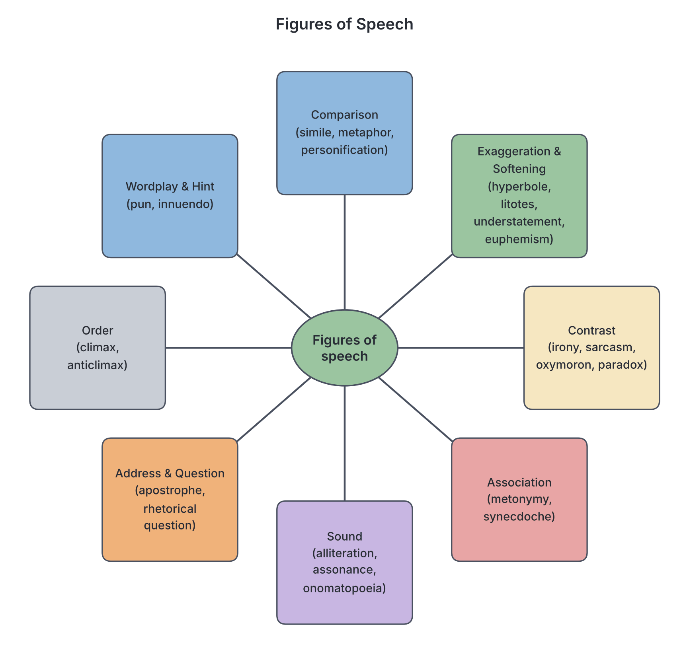

# JAMB Use of English Notes: Ordinary and Figurative Usage

## What JAMB expects

This topic is Section B (Lexis and Structure), content item (g) of the JAMB Use of English syllabus: "ordinary usage, figurative usage and idiomatic usage". These notes cover **ordinary usage** and **figurative usage**. Idiomatic usage has its own file, `B7b-idiomatic-usage.md`.

The objective covered here is:

- **Objective i:** identify words and expressions in their ordinary, figurative and idiomatic contexts.

It also supports Section A, where the syllabus says questions will test "comprehension of words, phrases, clauses, sentences, figures of speech and idioms as used in the passages".

How it is tested (Section D of the syllabus):

- There is no separate "figures of speech" question block. Instead, this skill appears inside **Sentence interpretation (5 questions)**, **Synonyms (5)** and **Antonyms (5)**, where a word may be used figuratively, and inside the **comprehension passage** questions ("the writer's use of '...' is an example of ..." or "the expression '...' as used in the passage means ...").

By the end of these notes, you should be able to:

1. Tell the difference between the ordinary (literal) meaning and the figurative meaning of a word or expression.
2. Name and explain the main figures of speech, with examples.
3. Tell apart figures of speech that students often confuse (simile and metaphor, irony and sarcasm, metonymy and synecdoche, oxymoron and paradox, and others).
4. Work out what a figurative expression means in a sentence, step by step.

## Ordinary usage vs figurative usage

### What ordinary (literal) usage means

A word is used in its **ordinary** or **literal** sense when it means exactly what the dictionary gives as its first, basic meaning. Nothing is hidden. You take the words at face value.

- *The goat ate the cassava leaves.* (A real goat really ate real leaves.)
- *The bridge over the River Niger at Onitsha is very long.*
- *Ada's hands were cold after she washed the plates.*
- *The pot of soup is boiling.*

### What figurative usage means

A word is used **figuratively** when it is used in a way that goes beyond its literal meaning, to create a picture, a comparison or a special effect. The words do not mean exactly what they say.

- *Ada gave her rival a cold look.* (A look cannot have a temperature. "Cold" here means unfriendly.)
- *My father was boiling with anger.* (He was not hot like water. He was extremely angry.)
- *The new governor is a bridge between the two communities.* (He is not made of concrete. He connects and unites them.)
- *That boy is a goat.* (An insult meaning he is foolish or stubborn, not that he is an animal.)

### Comparing ordinary and figurative usage

| Point | Ordinary (literal) usage | Figurative usage |
| --- | --- | --- |
| Meaning | The basic dictionary meaning | An extended, imaginative meaning |
| Can you take it at face value? | Yes | No |
| Purpose | To state facts plainly | To describe vividly, persuade, entertain or emphasise |
| Example with "sweet" | *The pawpaw is sweet.* | *She has a sweet voice.* (pleasant) |
| Example with "heavy" | *This bag of rice is heavy.* | *He left with a heavy heart.* (sad) |
| Example with "bright" | *The sun is bright this morning.* | *Chidi is a bright student.* (intelligent) |
| Example with "storm" | *The storm blew off the church roof.* | *The minister's speech caused a storm in the Senate.* (an angry reaction) |

### Same word, different usage

JAMB likes to test whether you can see that one word changes meaning with its context. Study these pairs carefully.

| Word | Ordinary usage | Figurative usage | Figurative meaning |
| --- | --- | --- | --- |
| hot | *The jollof rice is still hot.* | *The fuel price is a hot topic in Abuja.* | much discussed, controversial |
| root | *The roots of the iroko tree go deep.* | *Greed is the root of the problem.* | the basic cause |
| fire | *The fire burnt the market stalls.* | *The coach fired up the team.* / *She was fired.* | excited; dismissed from a job |
| sharp | *The knife is sharp.* | *She has a sharp tongue.* | speaks in a harsh, hurtful way |
| cold | *The harmattan morning was cold.* | *They gave the visitor a cold welcome.* | unfriendly |
| flood | *Floods destroyed farms in Kogi State.* | *Letters of complaint flooded the office.* | arrived in very large numbers |
| sweet | *The sugarcane is sweet.* | *Victory is sweet.* | pleasant, satisfying |
| bitter | *Bitter leaf is bitter.* | *They are bitter enemies.* | full of hatred or resentment |
| green | *The leaves are green.* | *He is still green at the job.* | inexperienced |
| light | *Switch on the light.* | *The report threw light on the matter.* | made it clearer |

### How to tell which usage a sentence has

1. **Read the whole sentence.** Do not judge a word on its own.
2. **Ask: is this literally possible?** Can a look be cold? Can a heart be heavy? If the literal meaning is impossible or silly, the usage is figurative.
3. **Look for the "thing" being described.** If an abstract thing (anger, love, fear, an idea) is described with a word for a physical thing (fire, storm, ice, weight), it is figurative.
4. **Replace the word with a plain word.** "A heavy heart" → "a sad heart". If a plain word fits, you have found the figurative meaning.
5. **Check that your meaning fits the context and tone** of the whole sentence or passage.

**Worked example.** *The news of his admission into the University of Ibadan was music to his parents' ears.*

- Is it literal? No. News is not music.
- What is being described? The parents' reaction to the news.
- Plain replacement: "very pleasant to hear".
- Meaning: the news made his parents very happy.

### Why writers use figurative language

- To create **pictures** in the reader's mind (imagery).
- To make a point **stronger** or more memorable.
- To **compare** something unfamiliar with something familiar.
- To show **feelings** and **attitude** (for example, irony shows mockery).
- To be **polite** (euphemism) or **humorous** (pun).

## What a figure of speech is

A **figure of speech** is a particular way of using words, different from their ordinary use, to achieve a special effect. Each figure of speech has a name. JAMB may ask you to name a figure of speech in a sentence or passage, or (more often) to say what the figurative expression means.

**Textbook variation:** books do not agree on how many figures of speech there are, or on how to group them. Some books group them as figures of **comparison** (simile, metaphor, personification), figures of **emphasis or exaggeration** (hyperbole, climax), figures of **contrast** (antithesis, oxymoron, paradox, irony), figures of **association** (metonymy, synecdoche) and figures of **sound** (alliteration, assonance, onomatopoeia). Others group them differently, and some call alliteration, assonance and onomatopoeia "sound devices" rather than figures of speech. For JAMB, what matters is that you know what each one is and can recognise it.

## Figures of comparison

### Simile

A **simile** compares two different things directly, using **"like"** or **"as"** (and sometimes "as if", "as though" or "than").

- *Her teeth are as white as milk.*
- *The young athlete ran like a leopard.*
- *During the harmattan, Kano is as dry as a bone.*
- *He snored like a grinding machine.*
- *She stood there as still as a statue.*
- *The rumour spread like wildfire.*

Many similes are fixed in the language. Learn some common ones:

| Simile | Meaning |
| --- | --- |
| as busy as a bee | very busy |
| as brave as a lion | very brave |
| as cool as a cucumber | calm, not nervous |
| as light as a feather | very light |
| as old as the hills | very old |
| as quiet as a mouse | very quiet |
| as stubborn as a mule | very stubborn |
| as sober as a judge | completely sober (not drunk), or very serious |
| as clear as crystal | very clear, easy to understand |
| as good as gold | (usually of a child) very well behaved |

**Trap:** not every sentence with "like" or "as" is a simile. A simile compares two **unlike** things.

- *Ngozi looks like her mother.* → Not a simile. Two people are naturally alike. This is an ordinary (literal) comparison.
- *Ngozi's voice is like a nightingale's.* → Simile. A voice is compared to a bird's song.
- *As I was leaving, it started to rain.* → Not a simile. "As" here means "while".

### Metaphor

A **metaphor** compares two different things **without** using "like" or "as". It says one thing **is** another thing, or speaks of one thing in terms of another.

- *The classroom was a zoo when the teacher left.* (very noisy and disorderly)
- *My mother is the pillar of our family.* (she supports and holds the family together)
- *Lagos traffic is a nightmare.*
- *Education is the key to success.*
- *The headmaster barked orders at the pupils.* (he gave orders harshly, like a dog barking)
- *She has a heart of gold.* (she is very kind)

A metaphor can be in a noun ("a zoo"), a verb ("barked") or an adjective ("a stony silence").

### Simile vs metaphor

| Point | Simile | Metaphor |
| --- | --- | --- |
| Uses "like" or "as"? | Yes | No |
| How it compares | Says A is **like** B | Says A **is** B, or describes A in terms of B |
| Strength | A softer, open comparison | A stronger, more direct comparison |
| Example | *The man is as strong as an ox.* | *The man is an ox.* |
| Example | *Her words cut like a knife.* | *Her words were a knife in his heart.* |

### Personification

**Personification** gives human qualities, feelings or actions to non-human things: animals, objects, ideas or nature.

- *The wind whispered through the palm trees.*
- *The old lorry groaned up the hill to Obudu.*
- *Opportunity knocked at his door.*
- *The sun smiled on the farmers in Benue.*
- *Death came for the old man in the night.*
- *My phone died just when I needed it.*

Wind cannot whisper, a lorry cannot groan and the sun cannot smile. Only people do these things.

**Textbook variation:** some books treat personification as a kind of metaphor. That is acceptable, but in JAMB options, if "personification" is offered and the non-human thing is given a human action, choose personification.

## Figures of exaggeration, understatement and softening

### Hyperbole

**Hyperbole** (pronounced /haɪˈpɜːbəli/, hy-PER-bo-lee) is deliberate, extreme exaggeration for emphasis or humour. It is not meant to be believed literally.

- *I have told you a million times to close the gate.*
- *I am so hungry that I could eat a whole cow.*
- *The queue at the bank stretched from Ikeja to Ibadan.*
- *Her bag weighs a ton.*
- *I nearly died of shame.*
- *We waited for ages.*

### Litotes

**Litotes** (pronounced /laɪˈtəʊtiːz/, ly-TOH-teez) is a form of understatement in which a positive idea is expressed by **denying its opposite**, usually with "not" or "no".

- *Wizkid is not a bad singer.* (meaning: he is a very good singer)
- *Passing JAMB with 320 is no small achievement.* (meaning: it is a great achievement)
- *The Chief is not unknown in this town.* (meaning: he is well known)
- *It was not an easy journey from Maiduguri to Port Harcourt.* (meaning: it was a hard journey)

### Understatement (meiosis)

**Understatement** presents something as much smaller, less serious or less important than it really is.

- *After the flood destroyed half the town, the chairman said, "We have a small problem."*
- *Scoring 360 in the UTME was quite a good result.* (said of one of the highest scores in the country)

### Litotes vs understatement vs hyperbole

**Textbook variation:** many books treat litotes as one **type** of understatement (the type that uses a negative). Some books use "litotes" and "understatement" as if they mean the same thing. If JAMB offers both in the same question, look for the negative: "not bad", "no mean", "not unkind" points to litotes.

| Point | Hyperbole | Understatement | Litotes |
| --- | --- | --- | --- |
| What it does | Makes something bigger than it is | Makes something smaller than it is | Says something positive by denying its opposite |
| Uses a negative? | Not necessarily | Not necessarily | Yes ("not", "no") |
| Example | *I've walked a thousand miles today.* | *The fire did some damage* (it burnt the whole house) | *She is no fool.* (she is clever) |
| Effect | Emphasis, humour | Irony, modesty, humour | Modesty, emphasis by contrast |

### Euphemism

A **euphemism** is a mild, polite or indirect word or expression used instead of one that may be unpleasant, rude or embarrassing.

| Euphemism | Plain meaning |
| --- | --- |
| *He passed away / passed on / is no more / joined his ancestors.* | He died. |
| *She is expecting / in the family way.* | She is pregnant. |
| *I want to ease myself / use the convenience.* | I want to go to the toilet. |
| *The company is letting some workers go.* | The company is sacking some workers. |
| *He is economical with the truth.* | He lies. |
| *senior citizens* | old people |
| *between jobs* | unemployed |
| *the less privileged* | poor people |

In many Nigerian cultures it is respectful to avoid saying "died" directly about an elder, so euphemisms such as "he has joined his ancestors" or "the king has gone to the village" are very common.

**Opposite term:** a **dysphemism** is a harsh or rude word used instead of a neutral one (for example "kicked the bucket" for "died"). JAMB rarely tests it, but it helps to know.

## Figures of contrast

### Irony

**Irony** is the use of words or a situation in which the real meaning is the **opposite** of what is said or expected. There are three main types.

**1. Verbal irony** — the speaker says the opposite of what they mean.

- Looking at the heavy downpour, Emeka says, *"What a lovely day for a picnic!"*
- To a student who comes in an hour late: *"You are very early today."*

**2. Situational irony** — what happens is the opposite of what was expected.

- A fire station burns down.
- The man who campaigned against drunk driving is arrested for drunk driving.
- A police officer's house is robbed.

**3. Dramatic irony** — the audience or reader knows something that a character does not.

- In a play, the audience knows the "friend" has poisoned the drink, but the character happily drinks it, thanking him.

### Sarcasm

**Sarcasm** is the use of remarks that clearly mean the opposite of what they say, made in order to **hurt, mock or criticise** someone.

- To a student who failed every subject: *"Congratulations, genius. Your parents must be so proud."*
- *"Oh, thank you so much for waking me at 3 a.m. with your loud music."*

### Irony vs sarcasm

| Point | Irony | Sarcasm |
| --- | --- | --- |
| Basic idea | The real meaning or outcome is the opposite of what is said or expected | Saying the opposite of what you mean, in order to mock |
| Must it hurt someone? | No | Yes, it is meant to wound or ridicule |
| Can it be a situation, not words? | Yes (situational, dramatic irony) | No, it is always spoken or written words |
| Tone | Can be gentle, humorous or serious | Bitter, mocking, scornful |
| Relationship | The wider term | Often described as a harsh form of verbal irony |
| Example | *A traffic warden is late because of traffic.* | *"Nice of you to finally show up," to someone two hours late.* |

### Oxymoron

An **oxymoron** puts two words with opposite or contradictory meanings **side by side**, usually an adjective and a noun.

- *a deafening silence*
- *an open secret*
- *a wise fool*
- *bitter-sweet memories*
- *a living death*
- *cruel kindness*
- *an original copy* (a common Nigerian expression; note it is an oxymoron)

### Paradox

A **paradox** is a statement that seems to contradict itself or seems absurd, but which contains a truth when you think about it.

- *The more you learn, the more you realise you don't know.*
- *Less is more.*
- *The child is father of the man.* (a famous line from Wordsworth: adult character grows out of childhood)
- *Sometimes you have to be cruel to be kind.*
- *I must spend money to save money.*

### Oxymoron vs paradox

| Point | Oxymoron | Paradox |
| --- | --- | --- |
| Length | Usually two words together | A whole statement or idea |
| What contradicts | Two opposite words placed side by side | An idea that seems to contradict itself |
| Hidden truth? | Creates an effect; the "truth" is short | The apparent nonsense hides a real truth |
| Example | *a deafening silence* | *The more you give, the richer you become.* |

### Antithesis

**Antithesis** puts **contrasting ideas** next to each other in a balanced, parallel structure (similar grammar on both sides).

- *Man proposes, God disposes.*
- *To err is human; to forgive, divine.* (Alexander Pope)
- *Speech is silver, silence is golden.*
- *Some are born great, some achieve greatness, and some have greatness thrust upon them.* (Shakespeare, *Twelfth Night*)
- *United we stand, divided we fall.*

### Antithesis vs oxymoron vs paradox

| Point | Antithesis | Oxymoron | Paradox |
| --- | --- | --- | --- |
| What is placed together | Contrasting ideas in balanced phrases | Two contradictory words | A self-contradictory but true statement |
| Typical form | "X ..., Y ..." with parallel grammar | adjective + noun | One sentence |
| Example | *Easy to start, hard to finish.* | *sweet sorrow* | *The poorest man can be the happiest.* |

## Figures of association

### Metonymy

**Metonymy** (pronounced /mɪˈtɒnəmi/, mi-TON-o-mee) refers to something by the name of **something closely associated with it**.

| Expression | What the associated word stands for |
| --- | --- |
| *Aso Rock has announced a new policy.* | the Nigerian Presidency (the President's official residence is in the Aso Rock Villa) |
| *The pen is mightier than the sword.* | writing/ideas vs war/force |
| *The crown* | the king or monarchy |
| *The bench* | judges |
| *The press* | journalists and newspapers |
| *The bottle has ruined him.* | alcohol |
| *Lagos is celebrating the win.* | the people of Lagos |
| *I have read all of Achebe.* | Achebe's works |
| *The White House said ...* | the US President and staff |

### Synecdoche

**Synecdoche** (pronounced /sɪˈnekdəki/, si-NEK-do-kee) uses a **part to stand for the whole**, or (less often) the **whole to stand for a part**.

Part for the whole:

- *All hands on deck.* (hands = sailors/workers)
- *He has many mouths to feed.* (mouths = people)
- *She finally bought her own wheels.* (wheels = car)
- *We need fresh legs in the second half.* (legs = players)
- *There were many new faces at the meeting.* (faces = people)

Whole for the part:

- *Nigeria won the match.* (Nigeria = the national team)
- *The police arrested the thieves.* (the police = some police officers)

### Metonymy vs synecdoche

| Point | Metonymy | Synecdoche |
| --- | --- | --- |
| Relationship | Something **associated** with the thing | A **part** of the thing (or the whole for a part) |
| Is the word a physical part of the thing? | No | Yes (usually) |
| Example | *The crown* for the king (a crown is worn by the king, not part of his body) | *Hands* for workers (hands are part of the workers) |
| Example | *Aso Rock* for the Presidency | *Wheels* for a car |

**Textbook variation:** some books treat synecdoche as a special type of metonymy. In JAMB, if a part of the body or object stands for the whole, choose synecdoche; if a related object or place stands for the thing, choose metonymy.

## Figures of address and questioning

### Apostrophe

**Apostrophe** (as a figure of speech) is addressing an absent person, a dead person, an object, an idea or a place **as if it could hear and answer**.

- *O Death, where is your sting?* (from the Bible, 1 Corinthians 15:55)
- *Nigeria, my beloved country, why do you weep?*
- *O moon, guide me home tonight.*
- *Mother, if only you could see me now in my convocation gown.* (said of a mother who has died)

**Trap:** do not confuse this with the **punctuation mark** called an apostrophe ('). They share a name but are completely different things. Note also that apostrophe often includes personification, but the key feature of apostrophe is **direct address**.

### Rhetorical question

A **rhetorical question** is asked for effect, not to get an answer. The answer is obvious or is not expected.

- *Who does not want to pass JAMB?* (Everyone wants to.)
- *Must we continue to buy fuel at this price?* (We should not have to.)
- *Is this how you repay your parents' sacrifice?*
- *How many times must I tell you?*

## Figures of build-up and let-down

### Climax

**Climax** (as a figure of speech) arranges words, phrases or ideas in order of **increasing importance or force**.

- *He came, he saw, he conquered.* (often given in its Latin form, *veni, vidi, vici*)
- *She lost her money, her house, her family and finally her hope.*
- *First it was a whisper, then a murmur, then a shout, then a roar.*

### Anticlimax (bathos)

**Anticlimax** is a sudden drop from something serious or important to something trivial or silly, often for humour.

- *He lost his wife, his house, his job and his biro.*
- *The armed robbers took the gold, the cars, the jewellery and a packet of biscuits.*

**Textbook variation:** some books use "bathos" for an anticlimax that is unintentional (and therefore ridiculous), and "anticlimax" for one used deliberately.

| Point | Climax | Anticlimax |
| --- | --- | --- |
| Order | Rising importance | Falls suddenly to something unimportant |
| Effect | Builds tension and emphasis | Humour, surprise, mockery |
| Example | *He lost a friend, a brother, a soul.* | *He lost a friend, a brother and his umbrella.* |

## Figures of sound

### Alliteration

**Alliteration** is the repetition of the same **consonant sound** at the beginning of nearby words.

- *Peter Piper picked a peck of pickled peppers.*
- *Big black bats.*
- *The soldiers stood silent and still.*
- *Fela's fiery fans.*

**Trap:** alliteration depends on **sound, not spelling**. *Kind king* and *cold cat* are alliterative (/k/). *Phone* and *fat* alliterate (/f/). But *cell* and *cat* do not (/s/ and /k/).

### Assonance

**Assonance** is the repetition of the same **vowel sound** in nearby words, usually in stressed syllables.

- *The rain in Spain stays mainly in the plain.* (/eɪ/)
- *Go slow over the road.* (/əʊ/)
- *The light of the fire is a sight.* (/aɪ/)

### Alliteration vs assonance

| Point | Alliteration | Assonance |
| --- | --- | --- |
| Sound repeated | Consonant | Vowel |
| Position | Usually at the start of words | Anywhere in the words (usually stressed syllables) |
| Example | *Sweet smell of success* (/s/) | *Hear the mellow wedding bells* (/e/) |

**Related term:** **consonance** is the repetition of consonant sounds at the end or in the middle of words (*pitter-patter*, *stroke of luck*). It is less often tested.

### Onomatopoeia

**Onomatopoeia** (pronounced /ˌɒnəˌmætəˈpiːə/, on-o-mat-o-PEE-a) is the use of words whose **sound imitates** the sound they describe.

- *The bees buzzed.*
- *The door creaked open.*
- *The rain pattered on the zinc roof.*
- *The hen clucked; the cock crowed.*
- *Bang! The tyre burst.*
- *The snake hissed.*
- *The clock ticked.*
- *The generator hummed all night.*

## Pun and innuendo

### Pun

A **pun** is a play on words that uses a word with **two meanings**, or two words that **sound alike**, for humour.

- *A bicycle can't stand on its own because it is two-tired.* (two-tyred / too tired)
- *The tailor won his case because he had a good suit.* (suit of clothes / lawsuit)
- *I used to be a banker, but I lost interest.* (bank interest / being interested)
- *Time flies like an arrow; fruit flies like a banana.*

### Innuendo

An **innuendo** is an indirect remark that **hints** at something, usually something unpleasant, critical or improper, without saying it openly.

- *"Some people in this office seem to be building houses very quickly on a small salary."* (hint: someone is stealing money)
- *"I'm not saying she copied, but her answers are exactly like mine, even the mistakes."*

| Point | Pun | Innuendo |
| --- | --- | --- |
| Purpose | Humour, wordplay | To hint at something without saying it |
| How it works | Double meaning of a word or similar sounds | Indirect suggestion |
| Tone | Light, playful | Often critical, suspicious or improper |

## All the figures of speech at a glance

| Figure | Key test | Quick example |
| --- | --- | --- |
| Simile | Comparison with "like"/"as" | *as proud as a peacock* |
| Metaphor | Comparison without "like"/"as" | *He is a lion in battle.* |
| Personification | Human qualities to a non-human thing | *The trees danced in the wind.* |
| Hyperbole | Extreme exaggeration | *I've told you a thousand times.* |
| Litotes | Positive idea by denying its opposite | *not a bad idea* |
| Understatement | Making something seem smaller than it is | *It's a bit warm* (in 45°C heat) |
| Euphemism | Mild word for an unpleasant idea | *passed away* |
| Irony | Opposite of what is said or expected | A fire station burns down. |
| Sarcasm | Mocking irony meant to hurt | *"Brilliant work, Einstein."* |
| Oxymoron | Two opposite words together | *deafening silence* |
| Paradox | Self-contradictory but true statement | *Less is more.* |
| Antithesis | Contrasting ideas in balanced structure | *Man proposes, God disposes.* |
| Metonymy | Associated thing stands for the thing | *the crown* for the king |
| Synecdoche | Part for whole (or whole for part) | *hands* for workers |
| Apostrophe | Addressing the absent or non-human | *O Death, where is your sting?* |
| Rhetorical question | Question not needing an answer | *Who wants to fail?* |
| Climax | Rising order of importance | *He came, he saw, he conquered.* |
| Anticlimax | Sudden fall to the trivial | *...his house, his car and his pen.* |
| Alliteration | Same consonant sound at word starts | *big brown bag* |
| Assonance | Same vowel sound in nearby words | *fleet feet sweep* |
| Onomatopoeia | Sound imitates meaning | *buzz, hiss, bang* |
| Pun | Double meaning for humour | *two-tired bicycle* |
| Innuendo | Indirect, often unpleasant, hint | *Some people's houses grow fast.* |

## How to answer figurative-usage questions step by step

### Question type 1: "The expression in italics means ..." / "best explains the sentence"

1. Read the full sentence and decide whether the italicised words are literal or figurative.
2. If figurative, identify the figure (metaphor, hyperbole, and so on). This helps you decide how far the meaning is from the literal.
3. Put the meaning into plain words.
4. Read every option. Reject options that take the words **literally** when the context is figurative. This is the most common JAMB trap.
5. Choose the option that matches the plain meaning and fits the tone.

**Worked example 1.** *The new principal is* a breath of fresh air *in our school.*

- A. The principal likes to keep the windows open.
- B. The principal brings new and welcome ideas.
- C. The principal has made the school cleaner.
- D. The principal breathes heavily.

Step 1: literal? No. Step 2: metaphor. Step 3: "a welcome change". Step 4: A, C and D are literal or partly literal readings. **Answer: B.**

**Worked example 2.** *When the results came out, Bola was* walking on air.

- A. Bola was very happy.
- B. Bola was flying.
- C. Bola was confused.
- D. Bola was walking carefully.

"Walking on air" is a figurative (idiomatic) expression meaning extremely happy. **Answer: A.** Option B is the literal trap.

**Worked example 3.** *The minister's speech* added fuel to the fire.

The literal reading (someone poured petrol) is a trap. The figurative meaning is that the speech made a bad situation worse.

### Question type 2: "Which figure of speech is used?"

1. Check for "like" or "as" → simile (if two unlike things are compared).
2. Check for a non-human thing doing human things → personification.
3. Check for addressing someone or something absent → apostrophe.
4. Check for opposite words side by side → oxymoron.
5. Check for exaggeration → hyperbole; for a "not + opposite" pattern → litotes.
6. Check the sound pattern → alliteration (consonant), assonance (vowel), onomatopoeia (imitates sound).
7. If none of these, ask whether a part, or an associated thing, stands for the whole → synecdoche or metonymy.

**Worked example 4.** *The angry sea swallowed the fishing boat.*

"Angry" and "swallowed" give human (or animal) actions and feelings to the sea. **Personification.**

**Worked example 5.** *The chairman of the party said the government should listen to the street.*

"The street" stands for ordinary people, who are associated with it. **Metonymy.**

### Common JAMB traps

- **The literal option.** One option almost always takes the figurative expression literally. It is nearly always wrong.
- **The partly right option.** An option may capture part of the meaning ("Bola was happy") while another captures it fully ("Bola was extremely happy"). Choose the one that matches the strength of the expression.
- **"Like" that is not a simile.** "He looks like his father" is a literal comparison.
- **Apostrophe the punctuation mark.** If the question is about figures of speech, "apostrophe" means addressing the absent.
- **Hyperbole vs metaphor.** "He is a giant of a man" may be both (a metaphor that exaggerates). Choose the one the question focuses on: is the main effect comparison or exaggeration?

## Key terms

| Term | Meaning |
| --- | --- |
| Literal (ordinary) meaning | The basic, dictionary meaning of a word, taken at face value |
| Figurative meaning | An extended, imaginative meaning beyond the literal |
| Figure of speech | A special way of using words to create an effect |
| Imagery | Language that creates pictures in the reader's mind |
| Simile | A comparison using "like" or "as" |
| Metaphor | A direct comparison without "like" or "as" |
| Personification | Giving human qualities to non-human things |
| Hyperbole | Deliberate exaggeration |
| Litotes | Understatement by denying the opposite ("not bad") |
| Euphemism | A mild expression for something unpleasant |
| Irony | A contrast between what is said or expected and what is meant or happens |
| Sarcasm | Mocking, hurtful irony |
| Oxymoron | Two contradictory words side by side |
| Paradox | A statement that seems contradictory but is true |
| Antithesis | Contrasting ideas in balanced phrases |
| Metonymy | Naming something by something associated with it |
| Synecdoche | A part standing for the whole, or the whole for a part |
| Apostrophe (figure) | Addressing an absent person or a thing as if present |
| Onomatopoeia | Words that imitate sounds |
| Alliteration | Repetition of initial consonant sounds |
| Assonance | Repetition of vowel sounds |

## Exam tips and common mistakes

- **Never take a figurative expression literally.** The literal option is JAMB's favourite trap.
- **Simile needs two unlike things.** "She sings like her sister" is not a simile.
- **Sound, not spelling,** decides alliteration and assonance: *photo* and *fan* alliterate; *cat* and *city* do not.
- **Litotes has a negative.** "Not bad", "no mean feat", "not unlike" are litotes.
- **Irony vs sarcasm:** all sarcasm is a kind of verbal irony, but not all irony is sarcasm. Sarcasm aims to wound.
- **Metonymy vs synecdoche:** part of the thing → synecdoche (hands, wheels, heads); something associated → metonymy (crown, bench, Aso Rock).
- **Oxymoron is short** (two words); **paradox is a statement**.
- **Apostrophe (figure of speech) is not the punctuation mark.**
- **Check the strength of meaning.** "Over the moon" is "extremely happy", not just "happy".
- **Context decides.** The same word ("cold", "bright", "heavy") can be literal in one sentence and figurative in the next.

## Quick summary

1. Ordinary (literal) usage takes words at their basic dictionary meaning; figurative usage stretches the meaning to create a picture or effect.
2. To find a figurative meaning, ask whether the literal meaning is possible, then replace the expression with plain words.
3. Figures of comparison: simile (with "like"/"as"), metaphor (without them) and personification (human qualities to things).
4. Hyperbole exaggerates; understatement and litotes play things down; euphemism softens unpleasant ideas.
5. Irony, sarcasm, oxymoron, paradox and antithesis all depend on contrast or opposition.
6. Metonymy uses an associated thing; synecdoche uses a part for the whole (or the whole for a part).
7. Alliteration, assonance and onomatopoeia are figures of sound; apostrophe and rhetorical questions are figures of address.
8. In JAMB, the option that reads a figurative expression literally is almost always wrong.

## Practice questions

**1. In the sentence "The wind howled angrily all night", the figure of speech used is**

- A. simile
- B. personification
- C. hyperbole
- D. litotes

**Answer: B.** The wind is given a human action and feeling (howling angrily). There is no "like" or "as", no exaggeration of quantity and no negative.

**2. "Our new coach is not a bad tactician." The figure of speech in this sentence is**

- A. oxymoron
- B. euphemism
- C. litotes
- D. irony

**Answer: C.** A positive idea (he is a good tactician) is expressed by denying its opposite ("not bad").

**3. Choose the option that best explains the information conveyed in the sentence: "The news of the strike was a bombshell to the students."**

- A. The students were injured by a bomb during the strike.
- B. The news of the strike came as a great shock to the students.
- C. The students caused the strike.
- D. The students were pleased by the news of the strike.

**Answer: B.** "Bombshell" is used figuratively (metaphor) to mean a very shocking piece of news. Option A takes it literally.

**4. Which of the following contains an oxymoron?**

- A. The market was as busy as an anthill.
- B. There was a deafening silence after the verdict.
- C. The pen is mightier than the sword.
- D. The thunder roared over the village.

**Answer: B.** "Deafening" and "silence" are contradictory words placed side by side. A is a simile, C contains metonymy and D is personification.

**5. "The Palace has refused to comment on the dispute." The word "Palace" is an example of**

- A. synecdoche
- B. metonymy
- C. apostrophe
- D. pun

**Answer: B.** "Palace" stands for the king (or his officials), who are associated with the building. The palace is not a part of the king, so it is metonymy, not synecdoche.

**6. "The farmer needs more hands to harvest his yams." The word "hands" here is an example of**

- A. metonymy
- B. hyperbole
- C. synecdoche
- D. alliteration

**Answer: C.** "Hands", a part of the body, stands for the whole person (labourers). A part standing for the whole is synecdoche.

**7. In which of the following is the word "bright" used in its ordinary (literal) sense?**

- A. Amina is a bright student.
- B. The future of the company looks bright.
- C. The torchlight was too bright for my eyes.
- D. She gave us a bright smile.

**Answer: C.** Only the torchlight literally gives off strong light. In A, "bright" means intelligent; in B, promising; in D, cheerful.

**8. "O Niger, mighty river, carry my message to the sea." This line is an example of**

- A. apostrophe
- B. rhetorical question
- C. antithesis
- D. onomatopoeia

**Answer: A.** The speaker addresses the river directly as if it could hear and act. That direct address of a non-human thing is apostrophe.

**9. Choose the option that best explains the information conveyed in the sentence: "My father was a tower of strength to us when our mother died."**

- A. My father built a tall house after our mother died.
- B. My father became very strong physically.
- C. My father gave us great support and comfort.
- D. My father was too proud to cry.

**Answer: C.** "A tower of strength" is a figurative expression for someone who gives strong support and comfort in difficult times. A and B take it literally.

**10. "He lost his wife, his children, his fortune and his toothbrush." The figure of speech in this sentence is**

- A. climax
- B. anticlimax
- C. paradox
- D. hyperbole

**Answer: B.** The list moves from very serious losses to a trivial one (a toothbrush), which is a sudden drop in importance: anticlimax.
