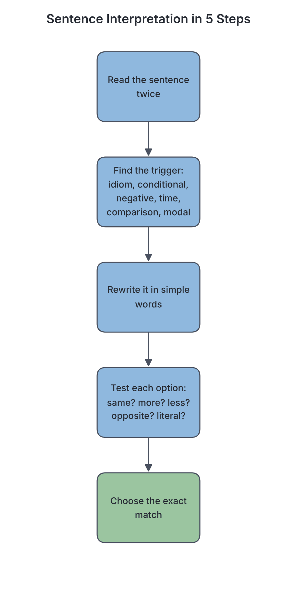

# JAMB Use of English Notes: Sentence Interpretation

## What JAMB expects

This topic is Section B (Lexis and Structure) of the JAMB Use of English syllabus. It covers:

- **Objective v:** interpret information conveyed in sentences.

It also draws on objective i (identify words and expressions in their ordinary, figurative and idiomatic contexts) and objective iv (identify various grammatical patterns in use), because you cannot interpret a sentence correctly without understanding its idioms and its grammar.

How it is tested (Section D of the syllabus):

- **Sentence interpretation: 5 questions.** Each question gives one sentence and four options. The instruction is usually: *"Choose the option that best explains the information conveyed in each of the following sentences."*

By the end of these notes, you should be able to:

1. Follow a step-by-step method for any sentence interpretation question.
2. Interpret sentences containing idioms and figurative expressions.
3. Interpret sentences with conditionals (*if*, *unless*, *had it not been for*, *but for*).
4. Interpret sentences with negatives and "negative" words (*hardly*, *scarcely*, *barely*, *few*, *little*).
5. Interpret time patterns such as *no sooner ... than* and *hardly ... when*.
6. Interpret comparisons (*the more ... the more*, *not as ... as*, *rather than*, *prefer*).
7. Interpret modal verbs (*must*, *should*, *might*, *needn't*, *should have*).
8. Spot the common traps JAMB sets in this question type.

## What a sentence interpretation question looks like

> *Choose the option that best explains the information conveyed in the sentence.*
>
> **Had Ngozi listened to her teacher, she would have passed.**
>
> - A. Ngozi listened to her teacher and passed.
> - B. Ngozi did not listen to her teacher and failed.
> - C. Ngozi listened to her teacher but failed.
> - D. Ngozi will pass if she listens to her teacher.

The answer is **B**. "Had Ngozi listened" means "if Ngozi had listened", which tells us that in fact she **did not** listen, and "she would have passed" tells us that in fact she **did not** pass.

The key skill is to find out **what is actually true** according to the sentence, and to choose the option that says exactly that, no more and no less.

## The step-by-step method

### Step 1: Read the sentence slowly, twice

Read it once for the general idea. Read it again and underline (mentally) the **key words**: negatives, idioms, conditionals, time words, comparisons and modal verbs.

### Step 2: Identify the "trigger" structure

Most JAMB sentences are built around one tricky feature. Ask yourself which one it is:

| Trigger | Examples | What to check |
| --- | --- | --- |
| Idiom or figurative expression | *at sea*, *in hot water*, *a dark horse* | The real (non-literal) meaning |
| Conditional | *if*, *had ... would have*, *but for*, *unless*, *were I* | What actually happened (or did not happen) |
| Negative | *not*, *never*, *hardly*, *scarcely*, *few*, *little* | Whether the statement is positive or negative overall |
| Time sequence | *no sooner ... than*, *hardly ... when*, *until*, *before* | Which event happened first, and how close together |
| Comparison | *the more ... the more*, *not so ... as*, *rather than* | Who or what is more or less |
| Modal verb | *must have*, *should have*, *needn't have*, *might* | Certainty, obligation, regret, possibility |
| Concession | *although*, *even though*, *despite*, *in spite of* | What is surprising or unexpected |

### Step 3: Rewrite the sentence in simple words

Put the meaning into plain, simple English, in your own words. Try to say **what actually happened** or **what is actually true**.

### Step 4: Compare each option with your rewrite

Go through all four options. For each one, ask:

- Does it say the **same thing** as the sentence?
- Does it **add** information that the sentence does not give?
- Does it **leave out** something important?
- Does it **reverse** the meaning (positive ↔ negative)?
- Does it take an idiom **literally**?

### Step 5: Choose the option that matches exactly

The correct option is the one that says what the sentence says: not more, not less, not different. If two options seem right, the one that adds extra information or makes a stronger claim is usually wrong.

## Interpreting idioms and figurative expressions

Many sentence interpretation questions contain an idiom. You must know what it means and reject the literal option. (See `B7b-idiomatic-usage.md` for a full list.)

**Worked example 1.** *The new student is a dark horse.*

- A. The new student is very dark in complexion.
- B. The new student is wicked.
- C. Little is known about the new student's abilities.
- D. The new student likes horses.

A **dark horse** is a person whose abilities are not known and who may surprise people. **Answer: C.** A and D are literal traps; B confuses "dark" with "evil".

**Worked example 2.** *When asked about the missing money, the cashier was all at sea.*

- A. The cashier was on a ship.
- B. The cashier was confused.
- C. The cashier was angry.
- D. The cashier had travelled abroad.

"At sea" (or "all at sea") means confused and not knowing what to do. **Answer: B.**

**Worked example 3.** *The Senator's speech fell on deaf ears.*

- A. The Senator's audience was deaf.
- B. Nobody listened to or acted on the speech.
- C. The speech was too loud.
- D. The speech was interpreted in sign language.

"To fall on deaf ears" means to be ignored. **Answer: B.**

**Worked example 4.** *Her brother is a chip off the old block.*

"A chip off the old block" means a person who is very like their parent in character or appearance. So the sentence means her brother is very much like their father (or mother).

**Worked example 5.** *Tola's explanation did not hold water.*

"To hold water" (usually used in the negative) means to be logical or believable. So: Tola's explanation was not convincing.

## Interpreting conditional sentences

Conditional sentences are JAMB favourites. The secret is to know which type of conditional you are dealing with, because each type tells you something different about **what actually happened**.

### The three main types of conditional

| Type | Form | Time | What it tells you | Example |
| --- | --- | --- | --- | --- |
| First (real/possible) | *If* + present, *will* + verb | Future | Something likely or possible | *If it rains, we will stay at home.* (It may rain.) |
| Second (unreal present) | *If* + past, *would* + verb | Present/future | Something imaginary or unlikely now | *If I had money, I would buy a car.* (I don't have money.) |
| Third (unreal past) | *If* + had + past participle, *would have* + past participle | Past | Something that did **not** happen | *If he had studied, he would have passed.* (He didn't study; he didn't pass.) |

**Textbook variation:** some books also describe a "zero conditional" (*If you heat ice, it melts* — a general truth) and "mixed conditionals" (*If I had studied Medicine, I would be a doctor now*). Not every school textbook uses these names, but the meanings are the same.

### Reversing the conditional to find the facts

For the second and third conditionals, the facts are the **opposite** of what the sentence says.

| Sentence | Real facts |
| --- | --- |
| *If I were the governor, I would fix the roads.* | I am not the governor; I cannot fix the roads. |
| *If she had left early, she would have caught the bus.* | She did not leave early; she missed the bus. |
| *If they had not cheated, they would not have been disqualified.* | They cheated; they were disqualified. |
| *If he had been at the meeting, he would have voted against the plan.* | He was not at the meeting; he did not vote. |

### Inverted conditionals (without "if")

Formal English can drop "if" and turn the verb round. JAMB uses these a lot.

| Inverted form | Same as | Meaning |
| --- | --- | --- |
| *Had I known, I would have come.* | *If I had known, I would have come.* | I didn't know, so I didn't come. |
| *Were I in your position, I would apologise.* | *If I were in your position, ...* | I am not in your position; my advice is to apologise. |
| *Should you need help, call me.* | *If you need help (by any chance), call me.* | You may or may not need help. |

**Worked example 6.** *Had the driver been careful, the accident would not have happened.*

- A. The driver was careful, but the accident happened.
- B. The driver was careless, and the accident happened.
- C. The driver was careless, but there was no accident.
- D. The accident did not happen because the driver was careful.

Third conditional, so reverse both parts: the driver was **not** careful; the accident **did** happen. **Answer: B.**

**Worked example 7.** *Were Ada a little taller, she would make the basketball team.*

Second conditional: Ada is **not** tall enough; she is **not** in the team. Any option saying "Ada is tall" or "Ada is in the team" is wrong.

### "But for" and "had it not been for"

These mean "if something had not happened / did not exist". They tell you that the thing **did** happen and that it **prevented** a result.

| Sentence | Real facts |
| --- | --- |
| *But for the rain, we would have finished the match.* | It rained, and because of the rain we did not finish the match. |
| *Had it not been for his mother's support, he would have dropped out.* | His mother supported him, so he did not drop out. |
| *But for your help, I would have failed.* | You helped me, so I did not fail. |
| *If it were not for the generator, the shop would close at night.* | There is a generator, so the shop stays open at night. |

**Worked example 8.** *But for the timely intervention of the police, the riot would have spread to other parts of the town.*

- A. The police did not come, and the riot spread.
- B. The police came on time, and the riot did not spread.
- C. The police came late, and the riot spread.
- D. The riot spread before the police came.

"But for X, Y would have happened" = X happened; Y did not happen. The police intervened in time; the riot did not spread. **Answer: B.**

### "Unless", "provided that", "in case"

| Word | Meaning | Example | Interpretation |
| --- | --- | --- | --- |
| *unless* | if ... not | *Unless you pay, you can't write the exam.* | You can write the exam only if you pay. |
| *provided (that) / providing / as long as* | only if | *You may go out provided that you finish your homework.* | Finishing your homework is a condition for going out. |
| *in case* | as a precaution, because something might happen | *Take an umbrella in case it rains.* | Take it now because rain is possible (not "if it rains, take an umbrella"). |
| *even if* | whether or not | *Even if he apologises, I won't forgive him.* | I won't forgive him in either case. |

**Trap:** *in case* is not the same as *if*. *Take an umbrella in case it rains* means take it now as a precaution. *Take an umbrella if it rains* means take it only when it is already raining.

## Interpreting negatives

### Simple negatives

Count the negatives carefully. Two negatives in standard English often make a positive.

- *It is not impossible for him to win.* = It is possible for him to win.
- *She is not unwilling to help.* = She is willing to help (perhaps not very eagerly).
- *Nobody failed to submit the form.* = Everybody submitted the form.

### "Negative" adverbs: hardly, scarcely, barely, seldom, rarely

These words are negative in meaning even though they do not contain "not".

| Word | Meaning | Example | Interpretation |
| --- | --- | --- | --- |
| *hardly / scarcely / barely* | almost not | *I could hardly hear him.* | I could hear him only with great difficulty; almost not at all. |
| *seldom / rarely* | not often | *She seldom eats meat.* | She eats meat only occasionally. |

**Trap:** *hardly* does **not** mean "hard". *He works hard* = he works with great effort. *He hardly works* = he does almost no work. These have opposite meanings.

**Worked example 9.** *The candidate could scarcely read the questions.*

- A. The candidate read the questions quickly.
- B. The candidate read the questions with great difficulty.
- C. The candidate did not see the questions.
- D. The candidate read only a few of the questions.

"Scarcely" = almost not; he could read them, but only with difficulty. **Answer: B.** C goes too far (he did read them).

### "Few" vs "a few", "little" vs "a little"

| Phrase | Meaning | Tone |
| --- | --- | --- |
| *few* students | not many students (almost none) | negative |
| *a few* students | some students (a small number) | positive |
| *little* water | not much water (almost none) | negative |
| *a little* water | some water (a small amount) | positive |
| *quite a few* | a fairly large number | positive |

- *Few people came to the meeting.* = The meeting was poorly attended (disappointing).
- *A few people came to the meeting.* = Some people came (not many, but some).

**Worked example 10.** *Little attention was paid to the warning.*

The warning was **mostly ignored**. An option saying "Some attention was paid to the warning" would be the "a little" trap.

### "Not only ... but also"

*Not only did he win the race, but he also broke the record.* = He won the race **and** broke the record. Both happened. "Not only" here is not a negative in meaning.

## Interpreting time sequences

### "No sooner ... than" and "hardly / scarcely ... when"

These patterns mean that **one event happened immediately after another**.

| Sentence | Meaning |
| --- | --- |
| *No sooner had we arrived than it started to rain.* | It started to rain immediately after we arrived. |
| *Hardly had the teacher left when the class became noisy.* | The class became noisy immediately after the teacher left. |
| *Scarcely had I sat down when the phone rang.* | The phone rang immediately after I sat down. |

Remember the fixed pairs: **no sooner ... than**, **hardly ... when**, **scarcely ... when**. ~~No sooner ... when~~ and ~~hardly ... than~~ are incorrect in standard British usage (though "hardly ... than" does occur in informal use, it is marked wrong in exams).

**Worked example 11.** *No sooner had the electricity been restored than it went off again.*

- A. The electricity was never restored.
- B. The electricity went off a long time after it was restored.
- C. The electricity went off immediately after it was restored.
- D. The electricity was restored after it went off.

**Answer: C.** The meaning is "immediately after". A is wrong because it was restored; B is wrong because there was no long gap.

### "Until", "before", "by the time"

- *He did not leave until the meeting ended.* = He left when the meeting ended (not before).
- *By the time the ambulance arrived, the man had died.* = The man died **before** the ambulance arrived.
- *She had finished cooking before the guests arrived.* = Cooking came first, then the guests.

**Worked example 12.** *It was not until he lost his job that he realised the value of money.*

= He realised the value of money only **after** he lost his job (he did not realise it before).

## Interpreting comparisons

### "The more ... the more" (and similar)

This pattern shows that **two things change together**.

| Sentence | Meaning |
| --- | --- |
| *The more you practise, the better you become.* | Practice and skill increase together. |
| *The higher you climb, the colder it gets.* | Height and coldness increase together. |
| *The less you eat, the weaker you become.* | Less food leads to more weakness. |
| *The sooner, the better.* | It is better if it happens soon. |

**Worked example 13.** *The more the government borrows, the heavier the burden on future generations.*

- A. The government should borrow more.
- B. Future generations will borrow more.
- C. Increased government borrowing increases the burden on future generations.
- D. The burden on future generations is too heavy to be reduced.

**Answer: C.** The sentence links two increases. It gives no advice (A) and does not say the burden cannot be reduced (D).

### "As ... as" and "not as/so ... as"

- *Kano is as hot as Maiduguri.* = The two are equally hot.
- *Jos is not as hot as Kano.* = Kano is hotter than Jos.

**Trap:** students often reverse this. *A is not as big as B* means **B is bigger**.

### "Rather than", "prefer ... to", "would rather"

- *She would rather walk than take an okada.* = She prefers walking.
- *I prefer reading to watching television.* = I like reading more.
- *He chose to study rather than go to the party.* = He studied; he did not go.

### Superlatives with "one of" and "the second"

- *Lagos is one of the most populous cities in Africa.* = It is among the most populous, not necessarily the most populous.
- *Ada is the second tallest girl in her class.* = Only one girl in the class is taller.

**Note:** be careful with exact facts in such sentences; JAMB asks what the **sentence** says, not what you believe from outside knowledge.

## Interpreting modal verbs

Modal verbs change the meaning of a sentence a lot. Learn these carefully.

| Modal form | Meaning | Example | Interpretation |
| --- | --- | --- | --- |
| *must* | strong obligation or certainty | *You must wear your uniform.* | It is compulsory. |
| *must have* + past participle | strong certainty about the past | *He must have forgotten.* | I am almost sure he forgot. |
| *can't have* + past participle | certainty that something did not happen | *She can't have stolen it; she was in Abuja.* | I am sure she did not steal it. |
| *should* / *ought to* | advice, duty | *You should see a doctor.* | It is advisable. |
| *should have* + past participle | something was right but did not happen (regret, criticism) | *You should have told me.* | You did not tell me, and that was wrong. |
| *needn't have* + past participle | something was done, but it was unnecessary | *You needn't have bought rice; we have plenty.* | You bought rice, but it was not necessary. |
| *didn't need to* | something was unnecessary (and usually not done) | *I didn't need to buy rice, so I didn't.* | No rice was bought. |
| *might / may* | possibility | *It might rain.* | Rain is possible, not certain. |
| *might have* + past participle | past possibility | *He might have missed the bus.* | Perhaps he missed it; we are not sure. |
| *could have* + past participle | past ability or possibility not used | *You could have won.* | You were able to win, but you did not. |
| *had better* | strong advice, with a warning | *You had better leave now.* | Leave now, or there may be trouble. |
| *used to* | past habit that no longer exists | *I used to live in Kaduna.* | I lived in Kaduna in the past; I don't now. |
| *be used to* + -ing | be accustomed to | *I am used to waking up early.* | Waking early is normal for me now. |

**Worked example 14.** *You needn't have cooked; we had already eaten.*

- A. You did not cook, and that was fine.
- B. You cooked, but it was unnecessary.
- C. You should have cooked.
- D. You must cook next time.

**Answer: B.** "Needn't have + past participle" means the action **was done** but was not necessary.

**Worked example 15.** *Musa should have consulted his parents before choosing a course.*

= Musa did **not** consult his parents, and that was a mistake. Any option saying he consulted them is wrong.

**Worked example 16.** *Bola used to sell akara at Oshodi.*

= Bola sold akara at Oshodi in the past but no longer does. An option saying "Bola is accustomed to selling akara" confuses *used to* with *be used to*.

## Interpreting concession and contrast

Words like *although*, *even though*, *despite* and *in spite of* show that something happened **unexpectedly**, against a difficulty.

- *Although he was ill, he wrote the exam.* = He was ill; he wrote the exam anyway.
- *Despite the rain, the rally went ahead.* = It rained; the rally still took place.
- *In spite of her wealth, she lives simply.* = She is rich but lives simply.

**Worked example 17.** *For all his education, he behaves like a fool.*

"For all" here means "in spite of". = He is educated, but he behaves foolishly.

## Interpreting purpose, result and cause

| Pattern | Meaning | Example |
| --- | --- | --- |
| *so that* / *in order to* | purpose | *She left early so that she could catch the bus.* |
| *so ... that* / *such ... that* | result | *The noise was so loud that nobody could sleep.* |
| *too ... to* | so much that it is impossible | *He is too young to vote.* (He cannot vote.) |
| *... enough to* | sufficient for | *She is old enough to vote.* (She can vote.) |
| *because of* / *owing to* / *due to* | cause | *The flight was delayed owing to bad weather.* |

**Trap:** *too ... to* is negative in meaning. *The box is too heavy for me to lift* = I **cannot** lift it.

## Common JAMB traps in sentence interpretation

| Trap | What it looks like | How to avoid it |
| --- | --- | --- |
| Literal reading | An option takes an idiom word for word | Always ask: is this an idiom? |
| Reversed meaning | The option says the opposite (e.g. conditional facts not reversed) | Work out the real facts before reading the options |
| Extra information | The option adds a reason, result or detail not in the sentence | Choose only what the sentence says |
| Partial meaning | The option gives only half the meaning | Make sure all key parts are covered |
| Overstatement | *always*, *never*, *all*, *completely* when the sentence says *sometimes*, *hardly*, *some* | Match the strength of the sentence |
| Confused look-alikes | *hard/hardly*, *few/a few*, *used to/be used to*, *in case/if* | Learn these pairs |
| Outside knowledge | The option is true in real life but not stated in the sentence | Answer from the sentence alone |

**Worked example 18 (overstatement trap).** *Many of the workers have not been paid for months.*

- A. None of the workers has been paid for months.
- B. A large number of the workers have gone unpaid for months.
- C. The workers will never be paid.
- D. The employer refuses to pay the workers.

**Answer: B.** A changes "many" to "none". C and D add information that the sentence does not give.

**Worked example 19 (extra information trap).** *The principal commended the students for their good behaviour during the excursion.*

- A. The principal praised the students for behaving well on the trip.
- B. The principal rewarded the students with gifts.
- C. The students behaved well because the principal was there.
- D. The principal organised the excursion.

**Answer: A.** B, C and D all add details (gifts, the principal's presence, who organised the trip) that the sentence does not mention.

## A complete practice walkthrough

**Sentence:** *Hardly had the convoy left Kaduna when the bridge collapsed.*

1. **Read twice.** Key words: *hardly had ... when*, *left*, *collapsed*.
2. **Trigger:** a time pattern (hardly ... when).
3. **Rewrite:** The bridge collapsed immediately after the convoy left Kaduna.
4. **Compare options:**
   - "The convoy was on the bridge when it collapsed." → adds information (we don't know where the convoy was).
   - "The bridge collapsed just after the convoy left Kaduna." → matches.
   - "The convoy could hardly leave Kaduna because the bridge collapsed." → misreads "hardly" as "with difficulty" and reverses the order of events.
   - "The convoy left Kaduna long after the bridge collapsed." → wrong order and wrong timing.
5. **Choose:** "The bridge collapsed just after the convoy left Kaduna."

## Key terms

| Term | Meaning |
| --- | --- |
| Sentence interpretation | Working out exactly what information a sentence conveys |
| Trigger | The word or structure that makes a sentence tricky to interpret |
| Conditional | A sentence showing that one thing depends on another (*if*, *unless*, *had ... would have*) |
| Inversion | Changing the normal word order, e.g. *Had I known* instead of *If I had known* |
| Negative adverb | An adverb with a negative meaning, e.g. *hardly*, *scarcely*, *seldom* |
| Modal verb | A helping verb showing possibility, certainty, obligation or advice (*must*, *might*, *should*) |
| Concession | Admitting a fact that makes the main idea surprising (*although*, *despite*) |
| Overstatement | An option that makes a stronger claim than the sentence |
| Literal trap | An option that reads an idiom word for word |

## Exam tips and common mistakes

- **Work out the real facts first,** before you read the options, especially for conditionals.
- **Third conditional = reversed facts:** *If he had come, he would have seen her* means he did not come and did not see her.
- **"But for X" = X happened** and prevented something.
- **"Needn't have done" = it was done,** but it was unnecessary.
- **"Should have done" = it was not done,** and that was a mistake.
- **"Hardly" means "almost not",** not "with hard work".
- **"Few" is negative; "a few" is positive.** The same goes for "little" and "a little".
- **"No sooner ... than"** and **"hardly/scarcely ... when"** mean "immediately after".
- **"A is not as ... as B"** means B has more of the quality.
- **Reject options that add information,** overstate (*never*, *all*, *none*) or take idioms literally.
- **Answer from the sentence, not from outside knowledge.**

## Quick summary

1. Sentence interpretation questions (5 in JAMB) test whether you can say exactly what a sentence means.
2. Use five steps: read twice, find the trigger, rewrite in simple words, test each option, choose the exact match.
3. In second and third conditionals, and with "but for" and "had it not been for", the real facts are the reverse of what the "if" part says.
4. Negative adverbs (*hardly*, *scarcely*, *seldom*) and *few*/*little* make a sentence negative in meaning.
5. "No sooner ... than" and "hardly ... when" mean one event happened immediately after another.
6. Modal forms such as *should have*, *needn't have*, *must have* and *used to* each carry a precise meaning that JAMB tests.
7. The wrong options usually take idioms literally, reverse the meaning, add information or overstate.

## Practice questions

*In each of questions 1 to 10, choose the option that best explains the information conveyed in the sentence.*

**1. Had the farmers planted early, they would have had a good harvest.**

- A. The farmers planted early and had a good harvest.
- B. The farmers did not plant early and did not have a good harvest.
- C. The farmers planted early but did not have a good harvest.
- D. The farmers will have a good harvest if they plant early.

**Answer: B.** "Had they planted" = "if they had planted" (third conditional), so the facts are reversed: they did not plant early and did not get a good harvest.

**2. But for the doctor's quick action, the patient would have died.**

- A. The doctor acted quickly, and the patient survived.
- B. The doctor did not act, and the patient died.
- C. The patient died in spite of the doctor's quick action.
- D. The doctor was slow, but the patient survived.

**Answer: A.** "But for X, Y would have happened" means X happened and prevented Y. The doctor acted quickly, so the patient did not die.

**3. No sooner had the referee blown the whistle than the fans invaded the pitch.**

- A. The fans invaded the pitch before the whistle was blown.
- B. The referee blew the whistle because the fans invaded the pitch.
- C. The fans invaded the pitch immediately after the whistle was blown.
- D. The fans waited a long time before invading the pitch.

**Answer: C.** "No sooner ... than" means one event happened immediately after the other.

**4. Chinedu hardly studies for his examinations.**

- A. Chinedu studies very hard for his examinations.
- B. Chinedu almost never studies for his examinations.
- C. Chinedu finds studying for examinations difficult.
- D. Chinedu never writes examinations.

**Answer: B.** "Hardly" means "almost not". A confuses "hardly" with "hard"; C confuses it with "with difficulty".

**5. You needn't have paid the bill; the company has already settled it.**

- A. You did not pay the bill, and that was right.
- B. You paid the bill, but it was unnecessary.
- C. You should pay the bill now.
- D. The company refused to settle the bill.

**Answer: B.** "Needn't have + past participle" means the action was done but was not necessary.

**6. The more we argued, the angrier the landlord became.**

- A. The landlord became angry and then we argued.
- B. Arguing made the landlord calmer.
- C. The landlord grew increasingly angry as our arguing increased.
- D. We stopped arguing because the landlord was angry.

**Answer: C.** "The more ... the more/-er" shows two things increasing together: more arguing, more anger.

**7. Few candidates were able to answer the last question.**

- A. Many candidates answered the last question.
- B. Some candidates answered the last question, which was a good result.
- C. Only a small number of candidates could answer the last question.
- D. No candidate answered the last question.

**Answer: C.** "Few" (without "a") means "not many", with a negative tone. D overstates; "few" is not "none".

**8. The minister's promise to fix the roads turned out to be a mere flash in the pan.**

- A. The minister's promise caused a fire.
- B. The minister's promise was quickly fulfilled.
- C. The minister's promise produced a brief show of effort that did not last.
- D. The minister's promise was made at night.

**Answer: C.** "A flash in the pan" is something that seems impressive at first but quickly fails or ends without results. A is the literal trap.

**9. Abu used to cycle to school.**

- A. Abu is accustomed to cycling to school.
- B. Abu cycled to school in the past but no longer does so.
- C. Abu still cycles to school every day.
- D. Abu has never cycled to school.

**Answer: B.** "Used to + verb" describes a past habit that has stopped. A describes "be used to + -ing" (be accustomed to).

**10. The lecture was too difficult for the new students to follow.**

- A. The new students followed the lecture easily.
- B. The new students could not follow the lecture because it was so difficult.
- C. The new students followed the lecture although it was difficult.
- D. The lecture was difficult, but the new students enjoyed it.

**Answer: B.** "Too ... to" means "so much that it is impossible": the lecture was so difficult that the students could not follow it.
