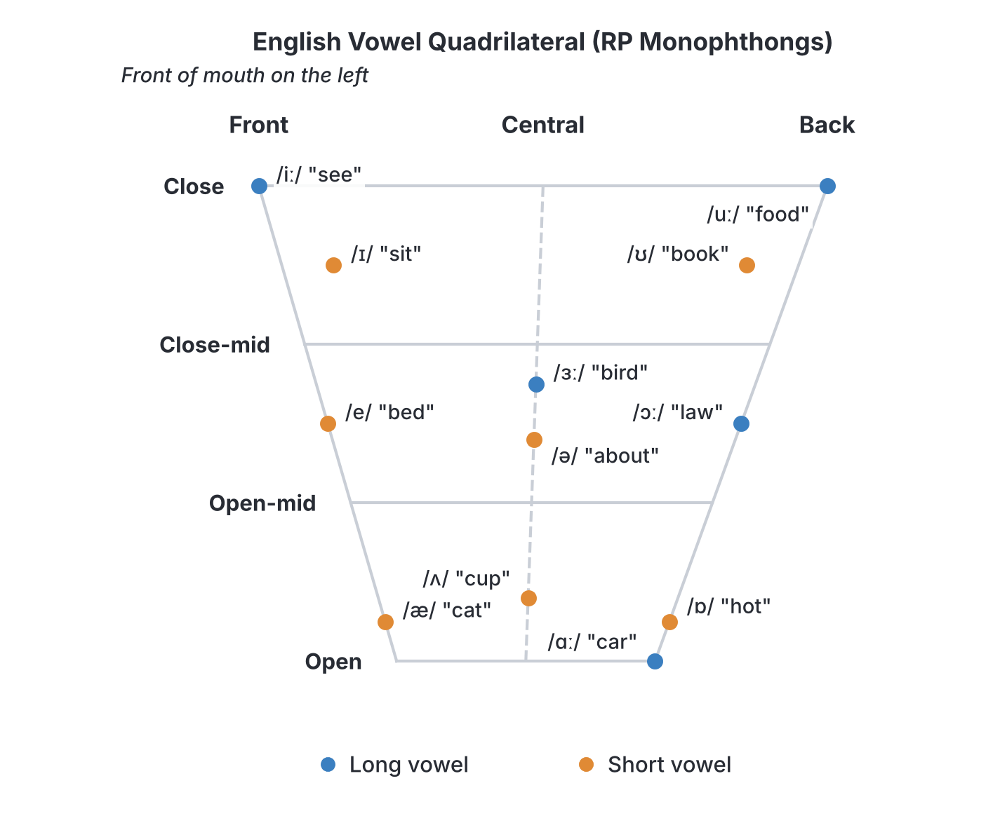
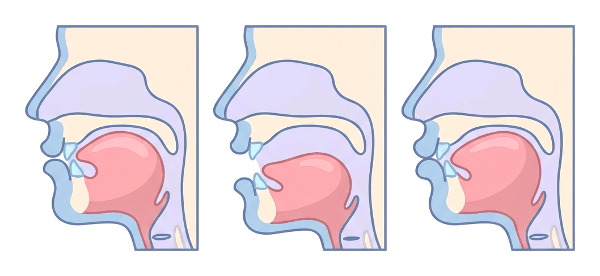
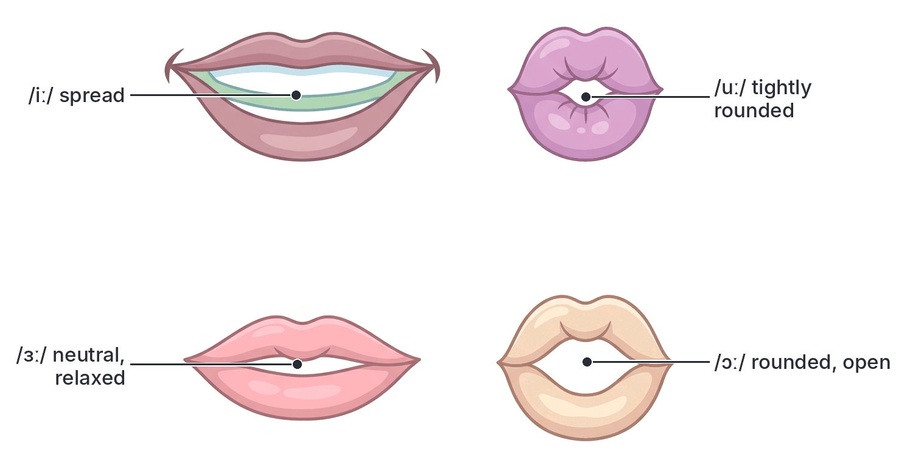

# JAMB Use of English Notes: Vowels (Monophthongs)

## What JAMB expects

This topic is Section C (Oral Forms), content item (a) of the JAMB Use of English syllabus: **Vowels (monophthongs, diphthongs and triphthongs)**. These notes cover the first part, the **monophthongs** (pure vowels). Diphthongs and triphthongs are in `C1b-diphthongs-and-triphthongs.md`.

The syllabus objectives for Oral Forms are:

1. make distinctions among vowel types;
2. differentiate among consonant types; and
3. identify correct pronunciation of individual words and articulation of connected speech.

Objectives 1 and 3 apply directly here. In the exam, **vowels carry 2 questions** out of the 10 Oral Forms questions (consonants, rhymes, word stress and emphatic stress get 2 each).

By the end of these notes, you should be able to:

1. Say what a vowel sound is, and why vowel *sounds* are not the same as vowel *letters*.
2. Name and describe the 12 pure vowels (monophthongs) of English, using their IPA symbols.
3. Group them by length (long and short) and by tongue position (front, central, back).
4. Recognise the different spellings that can stand for each vowel sound.
5. Tell apart vowels that many Nigerian speakers mix up, using minimal pairs.
6. Answer JAMB questions such as "Choose the option that has the same vowel sound as the one represented by the letter(s) in italics".

> **Note on the syllabus spelling:** the syllabus prints "monothongs". The correct word is **monophthongs** (mono = one, phthong = sound). See the transcription notes in `syllabus.md`.

> **How italics are used in these notes:** JAMB prints the tested letters underlined. In these notes, the tested letters are shown in *italics*, for example b*ir*d.

## Which accent does JAMB test?

JAMB Oral English questions are based on the model accent described in British dictionaries and in the syllabus's recommended books (for example, the *Cambridge English Pronouncing Dictionary* by Daniel Jones). This accent is usually called **RP (Received Pronunciation)**, and some newer books call it Standard Southern British English. You don't have to *sound* British in daily life. But to get JAMB questions right, you must know which sound RP uses in each word.

RP has **44 sounds**:

| Group | Number | Where in these notes |
| --- | --- | --- |
| Pure vowels (monophthongs) | 12 | This file |
| Diphthongs | 8 | C1b |
| Triphthongs | 5 (usually counted separately, not as part of the 44) | C1b |
| Consonants | 24 | C2a and C2b |

12 monophthongs + 8 diphthongs = **20 vowel sounds**. 20 vowels + 24 consonants = **44 sounds**. Most textbooks count the triphthongs as combinations of a diphthong and /ə/, so they are not added to the 44.

## Vowel sounds vs vowel letters

English has only **5 vowel letters** (a, e, i, o, u), but **20 vowel sounds**. So one letter can stand for many sounds, and one sound can be spelt in many ways.

The letter **a** alone stands for different sounds in:

| Word | Sound of the letter "a" | IPA |
| --- | --- | --- |
| cat | /æ/ | /kæt/ |
| father | /ɑː/ | /ˈfɑːðə/ |
| water | /ɔː/ | /ˈwɔːtə/ |
| want | /ɒ/ | /wɒnt/ |
| about | /ə/ | /əˈbaʊt/ |
| any | /e/ | /ˈeni/ |
| village | /ɪ/ | /ˈvɪlɪdʒ/ |
| make | /eɪ/ (a diphthong) | /meɪk/ |

And the sound **/iː/** can be spelt in many ways: s*ee*, s*ea*, k*ey*, f*ie*ld, rec*ei*ve, p*eo*ple, mach*i*ne, P*e*ter.

**This is the single most important idea in Oral English: never answer from the spelling. Always say the word in your head and listen to the sound.**

### What is a vowel sound?

A vowel sound is made when air from the lungs passes out through the mouth **freely**, without being stopped or squeezed by the tongue, teeth or lips. The vocal cords vibrate, so all English vowels are **voiced**. What makes one vowel different from another is the shape of the mouth:

1. **How high the tongue is** (close/high, mid, open/low).
2. **Which part of the tongue is raised** (front, centre or back).
3. **The shape of the lips** (rounded or spread/unrounded).
4. **How long the vowel lasts** (long or short).

A consonant, by contrast, is made with some blockage or narrowing of the air (see C2a).

### What is a monophthong?

A **monophthong** (also called a **pure vowel**) is a vowel during which the tongue and lips **stay in one position** from start to finish. The quality of the sound does not change. Say "ah" /ɑː/ for three seconds: your mouth does not move. That is a monophthong.

A **diphthong** glides from one vowel position to another within one syllable, e.g. /aɪ/ in "my". A **triphthong** glides through three positions, e.g. /aɪə/ in "fire". These are covered in C1b.

## How vowels are described

### Tongue height

| Term (used in most books) | Other name | What happens |
| --- | --- | --- |
| Close | High | Tongue is raised close to the roof of the mouth; jaw nearly shut. Try /iː/ in "see". |
| Close-mid / half-close | High-mid | Tongue a little lower |
| Open-mid / half-open | Low-mid | Tongue lower still |
| Open | Low | Tongue is low, jaw wide open. Try /ɑː/ in "car". |

### Part of the tongue

- **Front vowels:** the front of the tongue is raised towards the hard palate: /iː/, /ɪ/, /e/, /æ/.
- **Central vowels:** the centre of the tongue is raised: /ʌ/, /ɜː/, /ə/.
- **Back vowels:** the back of the tongue is raised towards the soft palate: /ɑː/, /ɒ/, /ɔː/, /ʊ/, /uː/.

**Textbook variation:** older books (and some Nigerian Oral English textbooks) list /ʌ/ as a **back** vowel. Newer descriptions of RP, including Roach's *English Phonetics and Phonology*, describe it as **central** (open-mid to open). So you may see "4 front, 3 central, 5 back" in one book and "4 front, 2 central, 6 back" in another. For JAMB, what matters most is recognising which words contain /ʌ/.

### Lip shape

- **Rounded:** lips pushed forward into a circle: /uː/, /ʊ/, /ɔː/, /ɒ/.
- **Unrounded (spread or neutral):** /iː/, /ɪ/, /e/, /æ/, /ʌ/, /ɑː/, /ɜː/, /ə/.

### Length

The length mark **ː** (like a colon) after a symbol shows a **long** vowel.

| Long vowels (5) | Short vowels (7) |
| --- | --- |
| /iː/ /ɑː/ /ɔː/ /uː/ /ɜː/ | /ɪ/ /e/ /æ/ /ʌ/ /ɒ/ /ʊ/ /ə/ |

**Important:** the long and short pairs (/iː/–/ɪ/, /uː/–/ʊ/, /ɔː/–/ɒ/) differ in **quality** (mouth position) as well as length. /ɪ/ is not just a shorter /iː/; the tongue is lower and further back. That is why the symbols are different, not just the length marks.

## The 12 monophthongs one by one

For each vowel: the symbol, how it is made, common spellings, example words with transcriptions, and traps. Stress in transcriptions is marked with **ˈ** before the stressed syllable (e.g. /ˈfɑːðə/ = FAther).

### 1. /iː/: the long close front vowel (as in "see")

**How it is made:** front of the tongue raised very high, close to the hard palate; lips spread (as in a smile); long.

| Spelling | Example words |
| --- | --- |
| ee | see /siː/, feet /fiːt/, sheep /ʃiːp/, green /ɡriːn/ |
| ea | sea /siː/, teach /tiːtʃ/, meat /miːt/, leave /liːv/ |
| e (open syllable) | be /biː/, he /hiː/, Peter /ˈpiːtə/, these /ðiːz/ |
| ie | field /fiːld/, piece /piːs/, believe /bɪˈliːv/, chief /tʃiːf/ |
| ei | receive /rɪˈsiːv/, ceiling /ˈsiːlɪŋ/, seize /siːz/ |
| ey | key /kiː/ |
| eo | people /ˈpiːpl/ |
| i (in some loanwords) | machine /məˈʃiːn/, police /pəˈliːs/, ski /skiː/ |
| ae | Caesar /ˈsiːzə/ |

**Traps:** "ea" is not always /iː/: br*ea*d /bred/, h*ea*d /hed/, gr*ea*t /ɡreɪt/, br*ea*k /breɪk/, h*ea*rt /hɑːt/, l*ea*rn /lɜːn/. And "ee" in b*ee*n is /iː/ in RP (/biːn/), though /bɪn/ is also heard in fast speech.

### 2. /ɪ/: the short near-close front vowel (as in "sit")

**How it is made:** front of the tongue raised, but lower and slightly further back than for /iː/; lips spread loosely; short.

| Spelling | Example words |
| --- | --- |
| i | sit /sɪt/, ship /ʃɪp/, fish /fɪʃ/, live (verb) /lɪv/ |
| y | gym /dʒɪm/, myth /mɪθ/, rhythm /ˈrɪðəm/, system /ˈsɪstəm/ |
| e | England /ˈɪŋɡlənd/, pretty /ˈprɪti/, English /ˈɪŋɡlɪʃ/ |
| o | women /ˈwɪmɪn/ |
| u | busy /ˈbɪzi/, business /ˈbɪznəs/, minute (noun) /ˈmɪnɪt/ |
| ui | build /bɪld/, guilt /ɡɪlt/, biscuit /ˈbɪskɪt/ |
| a (unstressed) | village /ˈvɪlɪdʒ/, private /ˈpraɪvət/ or /ˈpraɪvɪt/ |
| ie | sieve /sɪv/ |

**Watch out:** *women* has /ɪ/ in its **first** syllable (/ˈwɪmɪn/), while *woman* has /ʊ/ (/ˈwʊmən/). JAMB likes this pair.

**Textbook variation (final -y):** the last sound in words like *happy, city, money* is written /i/ (no length mark) in the *Cambridge English Pronouncing Dictionary* and in newer books: /ˈhæpi/. Older books write /ɪ/: /ˈhæpɪ/. Either way, it is short, and JAMB does not usually test this sound on its own.

### 3. /e/: the short front vowel between close-mid and open-mid (as in "bed")

**How it is made:** front of the tongue raised to about half height; lips spread; short.

| Spelling | Example words |
| --- | --- |
| e | bed /bed/, pen /pen/, ten /ten/, get /ɡet/ |
| ea | head /hed/, bread /bred/, dead /ded/, weather /ˈweðə/, heavy /ˈhevi/ |
| ai | said /sed/, again /əˈɡen/ (also /əˈɡeɪn/) |
| ay | says /sez/ |
| a | any /ˈeni/, many /ˈmeni/ |
| ie | friend /frend/ |
| u | bury /ˈberi/ |
| eo | leopard /ˈlepəd/, Geoffrey /ˈdʒefri/ |

**Symbol variation:** some books (especially newer British ones and some international phonetics books) write this vowel as **/ɛ/**. Both symbols mean the same sound in these notes. JAMB options usually use /e/.

**Traps:** *said* and *says* are /e/, not /eɪ/. *Bury* rhymes with *very* and *berry*, not with *hurry*.

### 4. /æ/: the short open front vowel (as in "cat")

**How it is made:** front of the tongue low, jaw quite open; lips spread; short.

| Spelling | Example words |
| --- | --- |
| a | cat /kæt/, man /mæn/, bag /bæɡ/, hand /hænd/, apple /ˈæpl/, bank /bæŋk/ |
| ai | plaid /plæd/, plait /plæt/ |

/æ/ is almost always spelt with **a**.

**Note:** in modern RP many speakers say /æ/ a little more open, close to [a]. Some newer books write it as /a/. The sound tested is the same: the vowel in *cat, man, hat*.

**Trap: the "bath" words.** In RP, many words spelt with "a" before *s, f, th, n + consonant* take **/ɑː/**, not /æ/: *bath /bɑːθ/, ask /ɑːsk/, fast /fɑːst/, after /ˈɑːftə/, dance /dɑːns/, plant /plɑːnt/, answer /ˈɑːnsə/, laugh /lɑːf/, half /hɑːf/, can't /kɑːnt/*. In northern England and in American English these words have /æ/. JAMB follows RP, so these are /ɑː/.

### 5. /ʌ/: the short open-mid central vowel (as in "cup")

**How it is made:** centre of the tongue raised a little above the open position; lips neutral, not rounded; short.

| Spelling | Example words |
| --- | --- |
| u | cup /kʌp/, sun /sʌn/, bus /bʌs/, but /bʌt/, much /mʌtʃ/ |
| o | son /sʌn/, love /lʌv/, come /kʌm/, money /ˈmʌni/, mother /ˈmʌðə/, month /mʌnθ/, front /frʌnt/, Monday /ˈmʌndeɪ/, oven /ˈʌvn/, among /əˈmʌŋ/, wonder /ˈwʌndə/ |
| ou | young /jʌŋ/, country /ˈkʌntri/, touch /tʌtʃ/, double /ˈdʌbl/, enough /ɪˈnʌf/, cousin /ˈkʌzn/, southern /ˈsʌðən/ |
| oo | blood /blʌd/, flood /flʌd/ |
| oe | does /dʌz/ |

**The big trap:** many words spelt with **o** take /ʌ/: *son, love, come, done, some, none, one /wʌn/, once /wʌns/, other, brother, nothing /ˈnʌθɪŋ/, colour /ˈkʌlə/, honey /ˈhʌni/, worry /ˈwʌri/, glove /ɡlʌv/, govern /ˈɡʌvn/, compass /ˈkʌmpəs/*. Many Nigerian speakers say these with [ɔ], following the spelling. In RP they all have /ʌ/.

**Textbook variation:** see the note above; some books call /ʌ/ a back vowel.

### 6. /ɑː/: the long open back vowel (as in "car")

**How it is made:** tongue low and towards the back; jaw wide open; lips neutral (unrounded); long.

| Spelling | Example words |
| --- | --- |
| ar | car /kɑː/, farm /fɑːm/, card /kɑːd/, star /stɑː/, March /mɑːtʃ/ |
| a (bath words) | father /ˈfɑːðə/, bath /bɑːθ/, ask /ɑːsk/, fast /fɑːst/, glass /ɡlɑːs/, last /lɑːst/, plant /plɑːnt/, banana /bəˈnɑːnə/ |
| al | calm /kɑːm/, palm /pɑːm/, half /hɑːf/, calf /kɑːf/, almond /ˈɑːmənd/ |
| ear | heart /hɑːt/, hearth /hɑːθ/ |
| er | clerk /klɑːk/, sergeant /ˈsɑːdʒənt/, Derby /ˈdɑːbi/ |
| au | aunt /ɑːnt/, laugh /lɑːf/, draught /drɑːft/ |

**Remember: RP is non-rhotic.** The "r" in *car, farm, card* is **not pronounced** unless a vowel follows (as in *car engine*, see C2a). So *car* is /kɑː/, not /kɑːr/. Many Nigerian speakers pronounce the r. For JAMB, the vowel is still /ɑː/.

**Traps:** *clerk* and *sergeant* (er = /ɑː/), *heart* (ear = /ɑː/, unlike *hear* /hɪə/ and *heard* /hɜːd/).

### 7. /ɒ/: the short open back rounded vowel (as in "hot")

**How it is made:** tongue low and at the back; lips slightly rounded; short.

| Spelling | Example words |
| --- | --- |
| o | hot /hɒt/, dog /dɒɡ/, stop /stɒp/, shop /ʃɒp/, doctor /ˈdɒktə/, knowledge /ˈnɒlɪdʒ/ |
| a (after w or qu) | want /wɒnt/, what /wɒt/, watch /wɒtʃ/, was /wɒz/ (strong form), wash /wɒʃ/, quality /ˈkwɒləti/, quantity /ˈkwɒntəti/, swan /swɒn/ |
| ou | cough /kɒf/ |
| au | because /bɪˈkɒz/, sausage /ˈsɒsɪdʒ/, Austria /ˈɒstriə/ |
| ow | knowledge /ˈnɒlɪdʒ/ |

**Trap:** "a" after **w** or **qu** is often /ɒ/: *want, wander /ˈwɒndə/, wallet /ˈwɒlɪt/, squad /skwɒd/*. But *water* is /ˈwɔːtə/ (long /ɔː/), and *wax* is /wæks/.

**Note:** American English does not have this vowel (it uses /ɑː/ in *hot*). RP keeps it.

### 8. /ɔː/: the long back rounded vowel (as in "law")

**How it is made:** back of the tongue raised to between close-mid and open-mid; lips clearly rounded; long.

| Spelling | Example words |
| --- | --- |
| aw | law /lɔː/, saw /sɔː/, draw /drɔː/, lawn /lɔːn/, awful /ˈɔːfl/ |
| au | caught /kɔːt/, daughter /ˈdɔːtə/, cause /kɔːz/, autumn /ˈɔːtəm/ |
| or | horse /hɔːs/, short /ʃɔːt/, born /bɔːn/, form /fɔːm/ |
| ore | more /mɔː/, before /bɪˈfɔː/, store /stɔː/ |
| oor | door /dɔː/, floor /flɔː/ |
| our | four /fɔː/, pour /pɔː/, court /kɔːt/, course /kɔːs/ |
| oar | board /bɔːd/, roar /rɔː/ |
| ough | thought /θɔːt/, bought /bɔːt/, ought /ɔːt/, brought /brɔːt/ |
| al / a | walk /wɔːk/, talk /tɔːk/, chalk /tʃɔːk/, ball /bɔːl/, call /kɔːl/, water /ˈwɔːtə/, salt /sɔːlt/ (also /sɒlt/) |
| ar (after w) | warm /wɔːm/, war /wɔː/, ward /wɔːd/, quarter /ˈkwɔːtə/ |
| oa | broad /brɔːd/ |

**Homophones caused by this vowel in RP:** *caught/court, sore/saw/soar, pour/pore/paw, stalk/stork, born/borne, sort/sought, war/wore, lord/laud, ball/bawl*. (Rhymes and homophones are covered fully in C3.)

**Trap:** *work, word, world, worm, worse, worth* have /ɜː/, not /ɔː/ (see /ɜː/ below), even though they start with "wor".

### 9. /ʊ/: the short near-close back rounded vowel (as in "book")

**How it is made:** back of the tongue raised high, but lower and more central than for /uː/; lips loosely rounded; short.

| Spelling | Example words |
| --- | --- |
| oo | book /bʊk/, good /ɡʊd/, foot /fʊt/, look /lʊk/, wood /wʊd/, cook /kʊk/, wool /wʊl/, stood /stʊd/ |
| u | put /pʊt/, full /fʊl/, pull /pʊl/, push /pʊʃ/, bush /bʊʃ/, sugar /ˈʃʊɡə/, butcher /ˈbʊtʃə/, cushion /ˈkʊʃn/ |
| ou | could /kʊd/, would /wʊd/, should /ʃʊd/ |
| o | woman /ˈwʊmən/, wolf /wʊlf/, bosom /ˈbʊzəm/ |

**The "oo" trap:** "oo" can be three different vowels:

| /ʊ/ (short) | /uː/ (long) | /ʌ/ |
| --- | --- | --- |
| book, good, foot, wood, look, cook, stood | food, moon, school, spoon, tooth, fool, pool, room | blood, flood |

*Room* and *broom* are usually /uː/ in RP (/ruːm/), though /rʊm/ is also heard. JAMB is unlikely to test them for that reason.

### 10. /uː/: the long close back rounded vowel (as in "food")

**How it is made:** back of the tongue raised very high; lips tightly rounded and pushed forward; long. (In modern RP many speakers say it further forward in the mouth, but it is still written /uː/.)

| Spelling | Example words |
| --- | --- |
| oo | food /fuːd/, moon /muːn/, school /skuːl/, tooth /tuːθ/, fool /fuːl/, pool /puːl/, shoot /ʃuːt/ |
| u, u-e | rule /ruːl/, June /dʒuːn/, flu /fluː/, truth /truːθ/, rude /ruːd/ |
| ue | blue /bluː/, true /truː/, glue /ɡluː/ |
| ui | fruit /fruːt/, juice /dʒuːs/, cruise /kruːz/ |
| o, oe | do /duː/, who /huː/, two /tuː/, move /muːv/, prove /pruːv/, lose /luːz/, shoe /ʃuː/, canoe /kəˈnuː/ |
| ou | soup /suːp/, group /ɡruːp/, through /θruː/, you /juː/, route /ruːt/ |
| ew | chew /tʃuː/, crew /kruː/, flew /fluː/ |

**/juː/ words:** in many words the /uː/ follows a /j/ ("y" sound): *music /ˈmjuːzɪk/, few /fjuː/, cute /kjuːt/, use (verb) /juːz/, new /njuː/, tune /tjuːn/, student /ˈstjuːdnt/*. The vowel is still /uː/; the /j/ is a consonant (see C2a). In American English, /j/ is dropped after t, d, n (new /nuː/), but RP keeps it.

**Traps:** *move, prove, lose, do, who, two* (spelt with o) are /uː/, not /əʊ/ or /ɒ/. *Lose* /luːz/ and *loose* /luːs/ both have /uː/.

### 11. /ɜː/: the long mid central vowel (as in "bird")

**How it is made:** centre of the tongue at mid height; lips neutral or slightly spread (not rounded); long. The jaw hardly moves from rest.

| Spelling | Example words |
| --- | --- |
| ir | bird /bɜːd/, girl /ɡɜːl/, first /fɜːst/, shirt /ʃɜːt/, third /θɜːd/, circle /ˈsɜːkl/ |
| er | her /hɜː/, term /tɜːm/, person /ˈpɜːsn/, serve /sɜːv/, verb /vɜːb/, German /ˈdʒɜːmən/ |
| ur | turn /tɜːn/, church /tʃɜːtʃ/, nurse /nɜːs/, burn /bɜːn/, Thursday /ˈθɜːzdeɪ/ |
| ear | learn /lɜːn/, earth /ɜːθ/, early /ˈɜːli/, heard /hɜːd/, search /sɜːtʃ/, pearl /pɜːl/ |
| or (after w) | work /wɜːk/, word /wɜːd/, world /wɜːld/, worm /wɜːm/, worse /wɜːs/, worth /wɜːθ/, worship /ˈwɜːʃɪp/ |
| our | journey /ˈdʒɜːni/, journal /ˈdʒɜːnl/, courtesy /ˈkɜːtəsi/ |
| olo | colonel /ˈkɜːnl/ |
| yr | myrrh /mɜː/, myrtle /ˈmɜːtl/ |

**Why this vowel matters for Nigerian candidates:** /ɜː/ does not exist in Yoruba, Igbo or Hausa. Many Nigerian speakers replace it with a vowel suggested by the spelling: [ɛ] or [a] for *er, ir, ear* (so *bird* sounds like "bed" and *learn* like "len"), and [ɔ] for *or, ur* (so *work* sounds like "wok" and *turn* like "ton"). In RP, all these words have the **same** vowel /ɜː/. JAMB tests this often, e.g. "Which of these has the same vowel as *w*or*k*?" The answer is a word like *bird, learn, turn, heard*, not *walk* or *fork*.

**Traps:** *heart* /hɑːt/ (not /ɜː/), *heard* /hɜːd/, *hear* /hɪə/ are three different vowels. *Colonel* sounds exactly like *kernel* /ˈkɜːnl/.

**Note:** /ɜː/ only appears in **stressed** or semi-stressed syllables. Its unstressed partner is /ə/.

### 12. /ə/: the schwa, the short mid central vowel (as in the first sound of "about")

**How it is made:** tongue completely relaxed in the centre of the mouth; lips neutral; very short and weak.

The schwa is the **most common vowel in spoken English**, but it has no letter of its own. It appears **only in unstressed syllables**, and any vowel letter can stand for it:

| Spelling | Example words (schwa letters in italics) |
| --- | --- |
| a | *a*bout /əˈbaʊt/, sof*a* /ˈsəʊfə/, ban*a*n*a* /bəˈnɑːnə/, Afric*a* /ˈæfrɪkə/ |
| e | childr*e*n /ˈtʃɪldrən/, probl*e*m /ˈprɒbləm/, sil*e*nt /ˈsaɪlənt/ |
| i | poss*i*ble /ˈpɒsəbl/ |
| o | *o*bey /əˈbeɪ/, doct*or* /ˈdɒktə/, c*o*mpare /kəmˈpeə/, p*o*lice /pəˈliːs/ |
| u | s*u*pport /səˈpɔːt/, s*u*ppose /səˈpəʊz/, circ*u*s /ˈsɜːkəs/ |
| ou | fam*ou*s /ˈfeɪməs/, dangerous /ˈdeɪndʒərəs/, col*ou*r /ˈkʌlə/ |
| ar, er, or, ure | sugar /ˈʃʊɡə/, mother /ˈmʌðə/, actor /ˈæktə/, picture /ˈpɪktʃə/ |

**Weak forms:** many small grammar words have a schwa when they are not stressed in a sentence: *a* /ə/, *the* /ðə/ (before a consonant), *and* /ənd/ or /ən/, *of* /əv/, *to* /tə/, *for* /fə/, *can* /kən/, *was* /wəz/, *but* /bət/, *at* /ət/, *from* /frəm/. When the same words are stressed or said alone, they take their **strong forms**: /eɪ/, /ðiː/, /ænd/, /ɒv/, /tuː/, /fɔː/, /kæn/, /wɒz/, /bʌt/, /æt/, /frɒm/. Weak forms are part of the "articulation of connected speech" in objective 3 (see also C5 on emphatic stress).

**Why the schwa matters:** many Nigerian speakers give every syllable a full vowel from the spelling, so *about* becomes [abaut], *doctor* becomes [dɔktɔ], *police* becomes [pɔlis]. RP reduces these unstressed vowels to /ə/. This also links to word stress (C4): the schwa is a sign of an **unstressed** syllable.

## Comparing the 12 monophthongs

### Summary table

| Symbol | Key word | Height | Front/central/back | Lips | Length |
| --- | --- | --- | --- | --- | --- |
| /iː/ | see | close | front | spread | long |
| /ɪ/ | sit | near-close | front (centralised) | spread | short |
| /e/ | bed | between close-mid and open-mid | front | spread | short |
| /æ/ | cat | near-open | front | spread/neutral | short |
| /ʌ/ | cup | open-mid to open | central (back in older books) | neutral | short |
| /ɑː/ | car | open | back | neutral | long |
| /ɒ/ | hot | open | back | slightly rounded | short |
| /ɔː/ | law | between close-mid and open-mid | back | rounded | long |
| /ʊ/ | book | near-close | back (centralised) | rounded | short |
| /uː/ | food | close | back | rounded | long |
| /ɜː/ | bird | mid | central | neutral | long |
| /ə/ | about | mid | central | neutral | short (unstressed only) |

### Long vs short pairs compared

| Pair | Long vowel | Short vowel | Difference |
| --- | --- | --- | --- |
| /iː/–/ɪ/ | sheep, leave, feel, seat | ship, live, fill, sit | /iː/ is longer, higher and further front; lips more spread |
| /uː/–/ʊ/ | pool, fool, Luke, wooed | pull, full, look, wood | /uː/ is longer, higher and further back; lips more tightly rounded |
| /ɔː/–/ɒ/ | caught, port, short, cord | cot, pot, shot, cod | /ɔː/ is longer, higher and more rounded |
| /ɜː/–/ə/ | bird, her (stressed) | about, sofa (unstressed) | similar position, but /ɜː/ is long and only in stressed syllables, /ə/ is short and only in unstressed ones |
| /ɑː/–/æ/–/ʌ/ | cart (/ɑː/) | cat (/æ/), cut (/ʌ/) | /ɑː/ back and long; /æ/ front and short; /ʌ/ central and short |

## Distinctions Nigerian speakers commonly miss (objective i: "make distinctions among vowel types")

The main Nigerian languages have fewer vowels than English, and none of them uses length (long vs short) to separate words in the way English does. So many Nigerian speakers of English, from all language backgrounds, use one sound where RP has two or three. This is a normal feature of Nigerian English, and it is understood in Nigeria, but **JAMB tests the RP distinctions**. Practise them with **minimal pairs**: two words that differ in only one sound.

### 1. /iː/ vs /ɪ/

Many speakers use one vowel [i] for both, so *ship* and *sheep* sound the same.

| /ɪ/ (short) | /iː/ (long) |
| --- | --- |
| ship /ʃɪp/ | sheep /ʃiːp/ |
| sit /sɪt/ | seat /siːt/ |
| live /lɪv/ | leave /liːv/ |
| fill /fɪl/ | feel /fiːl/ |
| bit /bɪt/ | beat /biːt/ |
| hit /hɪt/ | heat /hiːt/ |
| slip /slɪp/ | sleep /sliːp/ |
| fit /fɪt/ | feet /fiːt/ |
| chip /tʃɪp/ | cheap /tʃiːp/ |
| still /stɪl/ | steal /stiːl/ |

### 2. /ʊ/ vs /uː/

| /ʊ/ (short) | /uː/ (long) |
| --- | --- |
| full /fʊl/ | fool /fuːl/ |
| pull /pʊl/ | pool /puːl/ |
| look /lʊk/ | Luke /luːk/ |
| wood /wʊd/ | wooed /wuːd/ |
| could /kʊd/ | cooed /kuːd/ |

### 3. /æ/ vs /ɑː/ vs /ʌ/

Many Nigerian speakers use one [a] for /æ/ and /ɑː/, and [ɔ] or [a] for /ʌ/.

| /æ/ | /ɑː/ | /ʌ/ |
| --- | --- | --- |
| cat /kæt/ | cart /kɑːt/ | cut /kʌt/ |
| hat /hæt/ | heart /hɑːt/ | hut /hʌt/ |
| cap /kæp/ | carp /kɑːp/ | cup /kʌp/ |
| match /mætʃ/ | march /mɑːtʃ/ | much /mʌtʃ/ |
| ban /bæn/ | barn /bɑːn/ | bun /bʌn/ |
| lack /læk/ | lark /lɑːk/ | luck /lʌk/ |

### 4. /e/ vs /æ/

| /e/ | /æ/ |
| --- | --- |
| bed /bed/ | bad /bæd/ |
| men /men/ | man /mæn/ |
| pen /pen/ | pan /pæn/ |
| said /sed/ | sad /sæd/ |
| bet /bet/ | bat /bæt/ |

### 5. /ɒ/ vs /ɔː/

Many speakers use one [ɔ] for both.

| /ɒ/ (short) | /ɔː/ (long) |
| --- | --- |
| cot /kɒt/ | caught /kɔːt/ |
| pot /pɒt/ | port /pɔːt/ |
| shot /ʃɒt/ | short /ʃɔːt/ |
| not /nɒt/ | nought /nɔːt/ |
| don /dɒn/ | dawn /dɔːn/ |
| cod /kɒd/ | cord /kɔːd/ |
| spot /spɒt/ | sport /spɔːt/ |

### 6. /ɜː/ vs the vowels it is mistaken for

This is the vowel most often missed. Compare:

| /ɜː/ | /e/ | /ɔː/ | /ɑː/ |
| --- | --- | --- | --- |
| heard /hɜːd/ | head /hed/ | hoard /hɔːd/ | hard /hɑːd/ |
| burn /bɜːn/ | Ben /ben/ | born /bɔːn/ | barn /bɑːn/ |
| word /wɜːd/ | wed /wed/ | ward /wɔːd/ | |
| work /wɜːk/ | | walk /wɔːk/ | |
| firm /fɜːm/ | | form /fɔːm/ | farm /fɑːm/ |
| shirt /ʃɜːt/ | | short /ʃɔːt/ | |
| fur /fɜː/ | | four /fɔː/ | far /fɑː/ |
| bird /bɜːd/ | bed /bed/ | board /bɔːd/ | bard /bɑːd/ |

**Tip:** to make /ɜː/, relax your mouth completely, keep the lips neutral (no rounding, no wide spreading), and hold the sound. If your lips round, you are saying /ɔː/.

### 7. /ə/ (schwa) vs full vowels

Many speakers say a full vowel in unstressed syllables. Compare (RP on the left):

| Word | RP | Common spelling-based pronunciation |
| --- | --- | --- |
| about | /əˈbaʊt/ | [abaut] |
| police | /pəˈliːs/ | [pɔlis] |
| doctor | /ˈdɒktə/ | [dɔktɔ] |
| famous | /ˈfeɪməs/ | [femɔs] |
| support | /səˈpɔːt/ | [sɔpɔt] |

## How to answer JAMB vowel questions (objective iii: correct pronunciation of individual words)

### Question type 1: "same vowel sound as the letter(s) in italics"

> Choose the option that has the same vowel sound as the one represented by the letters in italics: w*or*k
> A. walk  B. word  C. worn  D. fork

**Step by step:**

1. Say the key word slowly in RP and decide its vowel: *work* = /wɜːk/, so the vowel is /ɜː/.
2. Say each option and write down its vowel: walk /ɔː/, word /ɜː/, worn /ɔː/, fork /ɔː/.
3. Pick the one that matches: **B (word)**.
4. Check you were not fooled by spelling: "wor" in *worn* and "or" in *fork* look similar, but the sounds are different.

### Question type 2: "which word has a different vowel sound?"

> Which of these words has a different vowel sound from the others?
> A. blood  B. flood  C. food  D. love

Vowels: blood /ʌ/, flood /ʌ/, food /uː/, love /ʌ/. **Answer: C.** The spelling "oo" appears in A, B and C, which is the trap.

### Question type 3: "which word contains the sound /x/?"

> Which of the following words contains the vowel /ɒ/?
> A. what  B. walk  C. work  D. woke

what /wɒt/, walk /wɔːk/, work /wɜːk/, woke /wəʊk/. **Answer: A.**

**Tip:** learn the symbols well. If you mix up /ɒ/ and /ɔː/, or /ʌ/ and /ɑː/, you will lose easy marks.

### Common JAMB traps for monophthongs

| Trap | Example | Correct vowel |
| --- | --- | --- |
| "o" said as /ʌ/ | son, love, come, money, one, nothing, worry | /ʌ/ |
| "oo" with three sounds | book (/ʊ/), food (/uː/), blood (/ʌ/) | varies |
| "ea" with several sounds | meat (/iː/), head (/e/), heart (/ɑː/), learn (/ɜː/), great (/eɪ/) | varies |
| "wor" | work, word, world (/ɜː/) vs worn, war (/ɔː/) | varies |
| "a" after w | want, wash, what (/ɒ/) vs water, walk (/ɔː/) | varies |
| *women* vs *woman* | /ˈwɪmɪn/ vs /ˈwʊmən/ | first vowel differs |
| *said, says* | /sed/, /sez/ | /e/ |
| *busy, business* | /ˈbɪzi/, /ˈbɪznəs/ | /ɪ/ |
| *colonel* | /ˈkɜːnl/ | /ɜː/ |
| *clerk, sergeant* | /klɑːk/, /ˈsɑːdʒənt/ | /ɑː/ |

## Key terms

| Term | Meaning |
| --- | --- |
| Vowel sound | A sound made with the air flowing freely through the mouth, with no blockage; all English vowels are voiced |
| Monophthong | A pure vowel: the tongue and lips stay in one position throughout, e.g. /ɑː/ in "car" |
| Diphthong | A vowel that glides from one position to another in one syllable, e.g. /aɪ/ in "my" (see C1b) |
| IPA | International Phonetic Alphabet: the set of symbols used to write sounds, e.g. /ʃ/, /ɜː/ |
| RP | Received Pronunciation: the British model accent that JAMB answers are based on |
| Length mark (ː) | The symbol that shows a long vowel, e.g. /iː/ |
| Close (high) vowel | A vowel made with the tongue raised high, e.g. /iː/, /uː/ |
| Open (low) vowel | A vowel made with the tongue low and jaw open, e.g. /ɑː/, /æ/ |
| Front / central / back | Which part of the tongue is raised: front (/iː/), centre (/ɜː/), back (/uː/) |
| Rounded vowel | A vowel made with the lips rounded, e.g. /uː/, /ɔː/ |
| Schwa (/ə/) | The short, weak central vowel found only in unstressed syllables, e.g. the "a" in "about" |
| Minimal pair | Two words that differ in only one sound, e.g. ship /ʃɪp/ and sheep /ʃiːp/ |
| Weak form | The reduced pronunciation of a small grammar word when unstressed, e.g. "of" as /əv/ |
| Non-rhotic | An accent in which "r" is not pronounced before a consonant or at the end of a word, e.g. RP "car" /kɑː/ |

## Exam tips and common mistakes

- **Never answer from spelling.** Say each word in your head. "oo", "ea", "o" and "a" each stand for several different vowels.
- **Learn the 12 symbols and one key word for each:** see, sit, bed, cat, cup, car, hot, law, book, food, bird, about.
- **/ɜː/ is the most tested "Nigerian" problem.** *Bird, word, heard, learn, turn, work, journey* and *colonel* all have /ɜː/. *Walk, worn, fork* have /ɔː/; *heart* has /ɑː/; *head* has /e/.
- **Words spelt with "o" but pronounced /ʌ/** (son, love, money, mother, one, once, nothing, worry, colour) are a favourite trap.
- **Long vs short:** /iː/ vs /ɪ/, /uː/ vs /ʊ/, /ɔː/ vs /ɒ/ separate different words. Ship ≠ sheep, full ≠ fool, cot ≠ caught.
- **Don't confuse the symbols /ɑː/ (car), /æ/ (cat) and /ʌ/ (cup),** or /ɒ/ (hot) and /ɔː/ (law).
- **The schwa /ə/ never carries stress.** If a question asks for the vowel in a stressed syllable, the answer is not /ə/.
- **"r" after a vowel is silent in RP** (car, bird, four). Don't let the written "r" change your choice of vowel.
- **Textbooks differ** on some symbols (/e/ or /ɛ/; final -y as /i/ or /ɪ/; /ʌ/ as central or back). The sounds are the same; recognise both symbols.

## Quick summary

1. English has 5 vowel letters but 20 vowel sounds: 12 monophthongs (pure vowels) and 8 diphthongs. Triphthongs are usually counted as diphthong + /ə/.
2. A monophthong keeps the tongue and lips in one position: /iː ɪ e æ ʌ ɑː ɒ ɔː ʊ uː ɜː ə/.
3. Vowels are described by tongue height (close to open), tongue part (front, central, back), lip rounding and length.
4. There are 5 long vowels (/iː ɑː ɔː uː ɜː/) and 7 short ones (/ɪ e æ ʌ ɒ ʊ ə/). Long–short pairs differ in quality as well as length.
5. One sound can have many spellings and one letter many sounds, so always answer from the sound, not the spelling.
6. Nigerian speakers commonly merge /iː/–/ɪ/, /uː/–/ʊ/, /ɔː/–/ɒ/ and /æ/–/ɑː/–/ʌ/, and replace /ɜː/ and /ə/ with spelling-based vowels; JAMB tests the RP distinctions.
7. The schwa /ə/ is the commonest English vowel and only occurs in unstressed syllables, including the weak forms of grammar words.

## Practice questions

In questions 1, 2, 4 and 7, the tested letters are in *italics* (JAMB underlines them).

**1. Choose the option that has the same vowel sound as the one represented by the letters in italics: b*ir*d**

- A. beard
- B. heard
- C. bard
- D. bored

**Answer: B.** *Bird* /bɜːd/ and *heard* /hɜːd/ both have /ɜː/. *Beard* has /ɪə/, *bard* has /ɑː/ and *bored* has /ɔː/.

**2. Choose the option that has the same vowel sound as the one represented by the letters in italics: s*ea*t**

- A. sit
- B. said
- C. people
- D. bread

**Answer: C.** *Seat* /siːt/ has /iː/, and so does *people* /ˈpiːpl/ ("eo" spelling). *Sit* has /ɪ/; *said* and *bread* have /e/.

**3. Which of the following words has a different vowel sound from the others?**

- A. cup
- B. love
- C. blood
- D. put

**Answer: D.** *Put* has /ʊ/. *Cup* /kʌp/, *love* /lʌv/ and *blood* /blʌd/ all have /ʌ/.

**4. Choose the option that has the same vowel sound as the one represented by the letter in italics: c*a*t**

- A. calm
- B. bank
- C. come
- D. card

**Answer: B.** *Cat* /kæt/ and *bank* /bæŋk/ have /æ/. *Calm* /kɑːm/ and *card* /kɑːd/ have /ɑː/; *come* /kʌm/ has /ʌ/.

**5. Which of the following words contains the vowel /ɒ/?**

- A. what
- B. walk
- C. work
- D. woke

**Answer: A.** *What* /wɒt/. *Walk* has /ɔː/, *work* has /ɜː/ and *woke* has the diphthong /əʊ/.

**6. Which of the following words contains the vowel /ɔː/?**

- A. cot
- B. caught
- C. coat
- D. curt

**Answer: B.** *Caught* /kɔːt/. *Cot* has /ɒ/, *coat* has /əʊ/ and *curt* has /ɜː/. These four words are a good set to practise.

**7. Choose the option that has the same vowel sound as the one represented by the letter in italics: w*o*men**

- A. woman
- B. busy
- C. wine
- D. weep

**Answer: B.** The first vowel of *women* /ˈwɪmɪn/ is /ɪ/, the same as in *busy* /ˈbɪzi/. *Woman* /ˈwʊmən/ has /ʊ/, *wine* has /aɪ/ and *weep* has /iː/.

**8. Which of these words contains the vowel /ʊ/?**

- A. food
- B. foot
- C. flood
- D. fool

**Answer: B.** *Foot* /fʊt/. *Food* and *fool* have /uː/; *flood* has /ʌ/. All four are spelt with "oo".

**9. In which of these words is the first vowel a schwa /ə/?**

- A. about
- B. apple
- C. answer
- D. any

**Answer: A.** *About* /əˈbaʊt/ starts with an unstressed /ə/. *Apple* /ˈæpl/ has /æ/, *answer* /ˈɑːnsə/ has /ɑː/ and *any* /ˈeni/ has /e/; all three are stressed on the first syllable.

**10. Which of the following words has a different vowel sound from the others?**

- A. heart
- B. calm
- C. father
- D. hat

**Answer: D.** *Hat* /hæt/ has /æ/. *Heart* /hɑːt/, *calm* /kɑːm/ and *father* /ˈfɑːðə/ all have /ɑː/.
