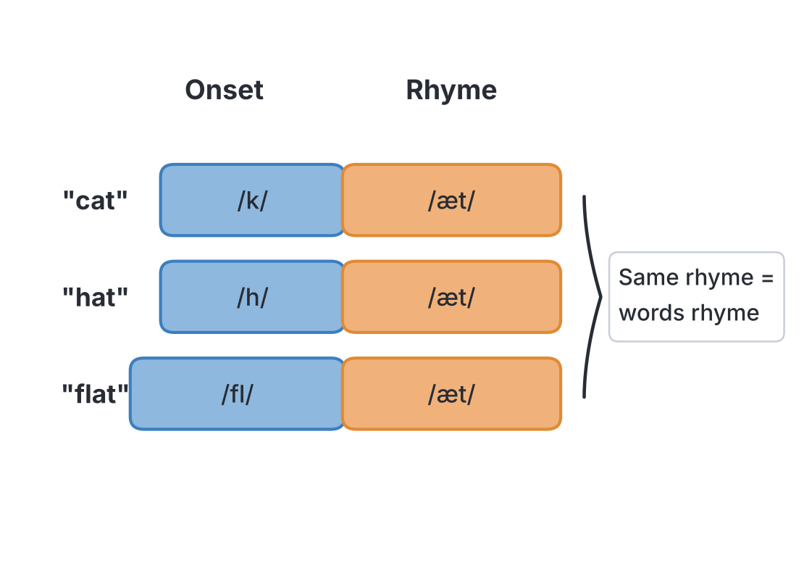
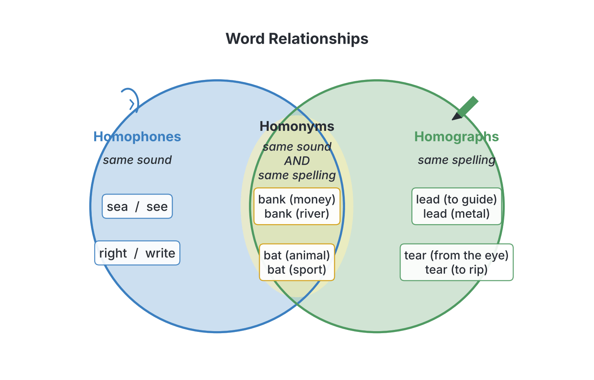

# JAMB Use of English Notes: Rhymes and Homophones

## What JAMB expects

This topic is Section C (Oral Forms), content item (c) of the JAMB Use of English syllabus: **Rhymes (including homophones)**. In the examination, Section C has 10 questions, and **2 of them are on rhymes**. Rhyme questions usually test homophones too.

The objectives for Section C say candidates should be able to:

1. Make distinctions among vowel types (objective i).
2. Differentiate among consonant types (objective ii).
3. Identify correct pronunciation of individual words and articulation of connected speech (objective iii).

Rhymes test all three. To decide whether two words rhyme, you must hear the **vowel** correctly (objective i), hear the **final consonants** correctly (objective ii), and know the **correct pronunciation** of each word, not the pronunciation suggested by its spelling (objective iii).

By the end of these notes, you should be able to:

1. Explain what a rhyme is and find the "rhyming part" of any word.
2. Recognise words that rhyme even though they are spelt differently (e.g. *through* and *blue*).
3. Recognise words that look alike but do NOT rhyme (e.g. *cough*, *rough*, *though*, *through*).
4. Identify homophones and give their meanings.
5. Tell homophones, homographs and homonyms apart.
6. Avoid the traps caused by common Nigerian pronunciations, where words that are different in the exam's model accent sound the same.

### The accent JAMB tests and the symbols used here

JAMB's oral English questions follow the "standard" British model accent usually called **RP (Received Pronunciation)**. This is the accent described in the *Cambridge English Pronouncing Dictionary*, one of the recommended texts in the syllabus. All the sound symbols in these notes are **IPA (International Phonetic Alphabet)** symbols as used in that dictionary. Symbols are written between slashes, e.g. *cat* /kæt/.

Quick reminder of the RP vowel symbols (fully explained in notes C1a and C1b):

| Symbol | Example | Symbol | Example |
| --- | --- | --- | --- |
| /iː/ | s**ee** | /ɜː/ | b**ir**d |
| /ɪ/ | s**i**t | /ə/ | **a**go (the "schwa") |
| /e/ | b**e**d | /eɪ/ | d**ay** |
| /æ/ | c**a**t | /aɪ/ | m**y** |
| /ʌ/ | c**u**p | /ɔɪ/ | b**oy** |
| /ɑː/ | f**a**ther | /əʊ/ | g**o** |
| /ɒ/ | h**o**t | /aʊ/ | n**ow** |
| /ɔː/ | s**aw** | /ɪə/ | h**ere** |
| /ʊ/ | b**oo**k | /eə/ | th**ere** |
| /uː/ | f**oo**d | /ʊə/ | t**our** (see the note on /ʊə/ below) |

The mark /ː/ means the vowel is long. Where a word has more than one syllable, **stress** is shown in two ways in these notes: the stressed syllable is written in CAPITALS in ordinary spelling (e.g. MOney), and the symbol ˈ is placed before the stressed syllable in IPA (e.g. /ˈmʌni/).

**Textbook variation:** some Nigerian textbooks use slightly different symbols for the same sounds. For example, /e/ may be written /ɛ/, /ɒ/ may be written /ɔ/, and /eə/ may be written /ɛə/ or /ɛː/. The sounds are the same; only the symbols differ. JAMB questions use ordinary spelling for rhymes, so the symbols matter less here than in vowel and consonant questions.

## What is a rhyme?

Two words **rhyme** when they end with the **same sounds**, starting from the **last stressed vowel**. The sounds before that vowel can be different.

Every syllable can be split into two parts:

- the **onset**: the consonant sound or sounds at the beginning (it can be empty);
- the **rhyme** (also called the rime): the vowel and everything after it.

| Word | Onset | Rhyme part |
| --- | --- | --- |
| cat /kæt/ | /k/ | /æt/ |
| hat /hæt/ | /h/ | /æt/ |
| flat /flæt/ | /fl/ | /æt/ |
| at /æt/ | (none) | /æt/ |

*Cat*, *hat*, *flat* and *at* all rhyme because their rhyme part is the same: /æt/.

### Rhyme depends on sound, not spelling

This is the most important rule for JAMB. **Ignore the spelling. Say the words in RP and listen.**

- *said* /sed/ and *bed* /bed/ **rhyme**, although one is spelt -aid and the other -ed.
- *paid* /peɪd/ and *said* /sed/ **do not rhyme**, although both are spelt -aid.

JAMB chooses options that look alike on paper but sound different, and options that look different but sound alike. If you choose by spelling, you will fall into the trap almost every time.

### Rhymes in longer words

In a word with more than one syllable, the rhyme starts from the vowel of the **stressed** syllable and includes everything to the end of the word.

| Word | IPA | Rhyming part |
| --- | --- | --- |
| MOney | /ˈmʌni/ | /ʌni/ |
| FUNny | /ˈfʌni/ | /ʌni/ |
| HOney | /ˈhʌni/ | /ʌni/ |
| NAtion | /ˈneɪʃn/ | /eɪʃn/ |
| STAtion | /ˈsteɪʃn/ | /eɪʃn/ |
| reLAtion | /rɪˈleɪʃn/ | /eɪʃn/ |

So *money*, *funny* and *honey* rhyme; *nation*, *station* and *relation* rhyme. But *money* /ˈmʌni/ and *many* /ˈmeni/ do **not** rhyme: the stressed vowels are different (/ʌ/ and /e/).

### What does NOT count as a rhyme

1. **Same vowel, different final consonant:** *cat* /kæt/ and *cap* /kæp/ do not rhyme. The final consonants /t/ and /p/ are different.
2. **Same final consonant, different vowel:** *cat* /kæt/ and *cut* /kʌt/ do not rhyme.
3. **Same spelling, different sound:** *home* /həʊm/ and *come* /kʌm/ do not rhyme.
4. **Only the unstressed ending is the same:** *TAble* /ˈteɪbl/ and *CAble* /ˈkeɪbl/ rhyme, but *TAble* and *BUBble* /ˈbʌbl/ do not, because the stressed vowels are different.

### Why poets and JAMB use rhyme

In poetry and songs, rhyme gives a pleasing musical sound, usually at the ends of lines. In JAMB, rhyme is used as a test of pronunciation: you can only find the rhyming word if you know how each option is really pronounced.

**Textbook variation:** poetry books sometimes accept "half rhymes" or "eye rhymes" (words that only look as if they rhyme, like *love* and *move*). For JAMB, only **full rhymes in RP** count. Treat eye rhymes as NOT rhyming.

## Words that rhyme but are spelt differently

English spelling often shows the same sound in many ways. The groups below all rhyme in RP. Learn them, and say each one aloud.

### Groups with long vowels

| Rhyming sound | Words that rhyme |
| --- | --- |
| /uː/ | through /θruː/, blue /bluː/, shoe /ʃuː/, crew /kruː/, two /tuː/, flu /fluː/, too /tuː/, who /huː/ |
| /iː/ | key /kiː/, sea /siː/, tree /triː/, ski /skiː/, quay /kiː/, me /miː/ |
| /ɔː/ | saw /sɔː/, more /mɔː/, four /fɔː/, door /dɔː/, war /wɔː/, roar /rɔː/, floor /flɔː/ |
| /ɑː/ | car /kɑː/, far /fɑː/, star /stɑː/, bar /bɑː/, are /ɑː/ (strong form) |
| /ɜː/ | word /wɜːd/, bird /bɜːd/, heard /hɜːd/, herd /hɜːd/, curd /kɜːd/ |
| /uːv/ | move /muːv/, groove /ɡruːv/, prove /pruːv/, you've /juːv/ |
| /ɑːt/ | heart /hɑːt/, part /pɑːt/, start /stɑːt/, cart /kɑːt/ |

Notice how the /ɜː/ group is spelt: **or** (word), **ir** (bird), **ear** (heard), **er** (herd), **ur** (curd). In RP the letter "r" is not pronounced before a consonant, so all of these have the same pure long vowel /ɜː/.

### Groups with short vowels

| Rhyming sound | Words that rhyme |
| --- | --- |
| /ed/ | said /sed/, bed /bed/, head /hed/, red /red/, bread /bred/, fed /fed/ |
| /ʌm/ | come /kʌm/, sum /sʌm/, dumb /dʌm/, some /sʌm/, thumb /θʌm/, drum /drʌm/ |
| /ʌn/ | done /dʌn/, sun /sʌn/, won /wʌn/, one /wʌn/, none /nʌn/, son /sʌn/, ton /tʌn/ |
| /ʌv/ | love /lʌv/, glove /ɡlʌv/, dove (the bird) /dʌv/, above /əˈbʌv/, shove /ʃʌv/ |
| /ʌd/ | blood /blʌd/, flood /flʌd/, mud /mʌd/, bud /bʌd/ |
| /ʊd/ | good /ɡʊd/, could /kʊd/, would /wʊd/, should /ʃʊd/, wood /wʊd/, stood /stʊd/ |
| /ʌf/ | rough /rʌf/, stuff /stʌf/, tough /tʌf/, enough /ɪˈnʌf/, cuff /kʌf/ |
| /ɒf/ | cough /kɒf/, off /ɒf/, scoff /skɒf/ |
| /es/ | guess /ɡes/, less /les/, dress /dres/, bless /bles/ |
| /ʌtʃ/ | much /mʌtʃ/, such /sʌtʃ/, touch /tʌtʃ/, hutch /hʌtʃ/ |

### Groups with diphthongs

| Rhyming sound | Words that rhyme |
| --- | --- |
| /eɪt/ | great /ɡreɪt/, late /leɪt/, weight /weɪt/, eight /eɪt/, bait /beɪt/, straight /streɪt/ |
| /eɪ/ | they /ðeɪ/, day /deɪ/, weigh /weɪ/, grey /ɡreɪ/, obey /əˈbeɪ/ |
| /aɪ/ | buy /baɪ/, high /haɪ/, tie /taɪ/, eye /aɪ/, lie /laɪ/, sky /skaɪ/ |
| /aɪt/ | height /haɪt/, white /waɪt/, bite /baɪt/, light /laɪt/, kite /kaɪt/ |
| /əʊ/ | though /ðəʊ/, go /ɡəʊ/, sew /səʊ/, toe /təʊ/, low /ləʊ/, dough /dəʊ/ |
| /əʊm/ | home /həʊm/, foam /fəʊm/, comb /kəʊm/, roam /rəʊm/ |
| /aʊ/ | bough /baʊ/, cow /kaʊ/, how /haʊ/, now /naʊ/, plough /plaʊ/ |
| /ɪə/ | here /hɪə/, beer /bɪə/, dear /dɪə/, pier /pɪə/, fear /fɪə/ |
| /eə/ | there /ðeə/, wear /weə/, air /eə/, care /keə/, prayer (the words said to God) /preə/ |

**Note on "prayer":** *prayer* meaning "words said to God" is /preə/ (one syllable) in RP. *Prayer* meaning "a person who prays" is /ˈpreɪə/ (two syllables). Most exam questions mean the first.

## Words that look alike but do NOT rhyme

These are JAMB's favourite traps. The words share spelling but the sounds are different.

### The famous -ough family

| Word | IPA | Rhymes with |
| --- | --- | --- |
| cough | /kɒf/ | off |
| rough | /rʌf/ | stuff |
| tough | /tʌf/ | stuff |
| though | /ðəʊ/ | go |
| dough | /dəʊ/ | go |
| through | /θruː/ | blue |
| bough | /baʊ/ | cow |
| plough | /plaʊ/ | cow |
| thought | /θɔːt/ | short |
| bought | /bɔːt/ | sort |
| thorough | /ˈθʌrə/ | borough /ˈbʌrə/ |

So *cough*, *rough*, *though*, *through* and *bough* all end in "-ough", but no two of them rhyme.

### The -ome and -ove families

| Word | IPA | Comment |
| --- | --- | --- |
| home | /həʊm/ | rhymes with *foam* |
| come | /kʌm/ | rhymes with *sum* |
| some | /sʌm/ | rhymes with *come* |
| tomb | /tuːm/ | rhymes with *room*; the b is silent |
| womb | /wuːm/ | rhymes with *room* |
| bomb | /bɒm/ | rhymes with *Tom* |
| comb | /kəʊm/ | rhymes with *home* |
| move | /muːv/ | rhymes with *groove* |
| love | /lʌv/ | rhymes with *glove* |
| drove | /drəʊv/ | rhymes with *stove* |

### The -ood, -ead, -ear and -eat families

| Word | IPA | Comment |
| --- | --- | --- |
| food | /fuːd/ | long /uː/ |
| good | /ɡʊd/ | short /ʊ/ |
| blood | /blʌd/ | /ʌ/ as in *cup* |
| head | /hed/ | rhymes with *bed* |
| bead | /biːd/ | rhymes with *seed* |
| heard | /hɜːd/ | rhymes with *bird* |
| beard | /bɪəd/ | rhymes with *feared* |
| heart | /hɑːt/ | rhymes with *part* |
| hear | /hɪə/ | rhymes with *beer* |
| bear | /beə/ | rhymes with *care* |
| great | /ɡreɪt/ | rhymes with *late* |
| treat | /triːt/ | rhymes with *meet* |
| threat | /θret/ | rhymes with *bet* |
| sweat | /swet/ | rhymes with *bet* |

### Other common traps

| Pair | Why they do not rhyme |
| --- | --- |
| paid /peɪd/, said /sed/ | Different vowels: /eɪ/ and /e/ |
| word /wɜːd/, sword /sɔːd/ | Different vowels; the w in *sword* is silent |
| ward /wɔːd/, hard /hɑːd/ | /ɔː/ and /ɑː/: after /w/, "ar" usually sounds /ɔː/ |
| warm /wɔːm/, farm /fɑːm/ | Same reason |
| work /wɜːk/, fork /fɔːk/ | After /w/, "or" usually sounds /ɜː/ |
| worm /wɜːm/, form /fɔːm/ | Same reason |
| put /pʊt/, but /bʌt/ | /ʊ/ and /ʌ/ |
| pull /pʊl/, dull /dʌl/ | /ʊ/ and /ʌ/ |
| have /hæv/, gave /ɡeɪv/ | /æ/ and /eɪ/ |
| give /ɡɪv/, five /faɪv/ | /ɪ/ and /aɪ/ |
| live (verb) /lɪv/, live (adjective) /laɪv/ | /ɪ/ and /aɪ/ |
| gone /ɡɒn/, bone /bəʊn/ | /ɒ/ and /əʊ/ |
| done /dʌn/, bone /bəʊn/ | /ʌ/ and /əʊ/ |
| shoe /ʃuː/, toe /təʊ/ | /uː/ and /əʊ/ |
| does /dʌz/, goes /ɡəʊz/ | /ʌ/ and /əʊ/ |
| says /sez/, pays /peɪz/ | /e/ and /eɪ/ |
| food /fuːd/, flood /flʌd/ | /uː/ and /ʌ/ |

**Pattern to remember:** after the sound /w/, the spelling "ar" usually gives /ɔː/ (*war, warm, ward, quarter*), and "or" usually gives /ɜː/ (*word, work, world, worm, worse*). This explains many rhyme traps.

## How to answer a JAMB rhyme question (step by step)

The usual instruction is: *"Choose the option that rhymes with the given word."*

1. **Say the given word aloud (quietly) in its correct pronunciation.** If you are not sure, think of a word you know that sounds like it.
2. **Find its rhyme part:** the last stressed vowel and everything after it. Write it down in symbols if it helps, e.g. *said* → /ed/.
3. **Say each option** and find its rhyme part in the same way.
4. **Cross out options with a different vowel**, even if the spelling looks the same.
5. **Cross out options with a different final consonant.**
6. The option left is the answer. Check that you did not choose because of spelling.

### Worked example 1

*Choose the option that rhymes with **said**:* A. paid B. raid C. bed D. seed

- *said* = /sed/, rhyme part /ed/.
- *paid* /peɪd/ → /eɪd/. Wrong vowel.
- *raid* /reɪd/ → /eɪd/. Wrong vowel.
- *bed* /bed/ → /ed/. Same.
- *seed* /siːd/ → /iːd/. Wrong vowel.

**Answer: C.** Options A and B are the spelling trap.

### Worked example 2

*Choose the option that rhymes with **word**:* A. sword B. bird C. lord D. ward

- *word* = /wɜːd/, rhyme part /ɜːd/.
- *sword* /sɔːd/, *lord* /lɔːd/, *ward* /wɔːd/ all have /ɔː/.
- *bird* /bɜːd/ has /ɜː/.

**Answer: B.**

### Worked example 3

*Choose the option that rhymes with **through**:* A. though B. rough C. threw D. thorough

- *through* = /θruː/.
- *threw* = /θruː/. It is not just a rhyme; it is a homophone (same sound exactly). A homophone always rhymes.

**Answer: C.**

### Worked example 4 (longer words)

*Choose the option that rhymes with **station**:* A. question B. nation C. ration D. mention

- *station* /ˈsteɪʃn/: rhyme part /eɪʃn/.
- *question* /ˈkwestʃən/: /estʃən/. No.
- *nation* /ˈneɪʃn/: /eɪʃn/. Yes.
- *ration* /ˈræʃn/: /æʃn/. No. (In RP, *ration* has the short vowel /æ/, so it does not rhyme with *nation*. **Note:** a pronunciation /ˈreɪʃn/ is heard in some American speech, but RP uses /ˈræʃn/.)
- *mention* /ˈmenʃn/: /enʃn/. No.

**Answer: B.**

## Homophones

**Homophones** are words that have the **same pronunciation** but **different meanings**, and usually **different spellings**. The word comes from Greek: *homo* = same, *phone* = sound.

Examples: *sea* and *see* are both /siː/. *Right*, *write* and *rite* are all /raɪt/.

Homophones are tested in two ways:

1. *"Choose the option that is a homophone of X."*
2. *"Choose the word that rhymes with X"*, where the answer is X's homophone (as in worked example 3 above).

### A big table of homophones (RP)

Learn these in groups. Say each pair aloud.

| Homophones | IPA | Meanings |
| --- | --- | --- |
| air / heir | /eə/ | the gas we breathe / a person who will inherit property (the h is silent) |
| allowed / aloud | /əˈlaʊd/ | permitted / out loud, so others can hear |
| altar / alter | /ˈɔːltə/ | the table in a church or shrine / to change |
| bare / bear | /beə/ | uncovered, naked / a large animal; to carry or endure |
| berry / bury | /ˈberi/ | a small fruit / to put in the ground |
| board / bored | /bɔːd/ | a flat piece of wood; a committee / not interested |
| brake / break | /breɪk/ | a device to stop a vehicle / to smash; a rest |
| buy / by / bye | /baɪ/ | to purchase / near, through / short for goodbye |
| cell / sell | /sel/ | a small room; a unit of life / to exchange for money |
| cereal / serial | /ˈsɪəriəl/ | grain food, e.g. maize, rice / happening in a series |
| check / cheque | /tʃek/ | to examine / a written order to a bank to pay money |
| cite / sight / site | /saɪt/ | to quote / the power of seeing / a place where something is built |
| coarse / course | /kɔːs/ | rough / a programme of study; a route |
| colonel / kernel | /ˈkɜːnl/ | an army officer / the inner part of a seed or nut |
| complement / compliment (nouns) | /ˈkɒmplɪmənt/ | something that completes / praise |
| council / counsel | /ˈkaʊnsl/ | a group that governs, e.g. a local government council / advice; a lawyer in court |
| currant / current | /ˈkʌrənt/ | a small dried grape / a flow of water or electricity; present-day |
| dear / deer | /dɪə/ | loved; expensive / an animal with antlers |
| dew / due | /djuː/ | water drops on grass in the morning / owed, expected |
| die / dye | /daɪ/ | to stop living / to colour cloth (e.g. adire cloth is dyed) |
| dual / duel | /ˈdjuːəl/ | double, having two parts / a fight between two people |
| fair / fare | /feə/ | just; light in colour; a market show / money paid for a journey (e.g. bus fare) |
| flour / flower | /ˈflaʊə/ | powder from grain, used for bread / the bloom of a plant |
| for / four / fore | /fɔː/ | (preposition, strong form) / the number 4 / the front |
| grate / great | /ɡreɪt/ | to shred (e.g. grate coconut); a metal frame / very big, very good |
| guessed / guest | /ɡest/ | past tense of guess / a visitor |
| hair / hare | /heə/ | it grows on the head / an animal like a rabbit |
| heal / heel / he'll | /hiːl/ | to make well / the back of the foot / he will |
| hear / here | /hɪə/ | to perceive sound / in this place |
| hole / whole | /həʊl/ | an opening / complete, entire |
| hour / our | /ˈaʊə/ | 60 minutes / belonging to us (see note below) |
| idle / idol | /ˈaɪdl/ | lazy, not working / an image worshipped; a famous person admired |
| key / quay | /kiː/ | used to open a lock / a landing place for ships (as at a port) |
| knew / new | /njuː/ | past tense of know / not old |
| knight / night | /naɪt/ | a soldier of high rank in old Europe / the dark part of the day |
| know / no | /nəʊ/ | to have knowledge / not any; the opposite of yes |
| lessen / lesson | /ˈlesn/ | to reduce / a period of teaching |
| made / maid | /meɪd/ | past tense of make / a female servant |
| mail / male | /meɪl/ | letters, post / man or boy; of the sex that does not bear young |
| meat / meet | /miːt/ | animal flesh used as food / to come together |
| minor / miner | /ˈmaɪnə/ | small; a person under 18 / a person who digs for coal, tin, etc. (e.g. tin miners of Jos) |
| missed / mist | /mɪst/ | past tense of miss / fine water drops in the air |
| muscle / mussel | /ˈmʌsl/ | body tissue that contracts / a shellfish |
| naval / navel | /ˈneɪvl/ | to do with the navy / the belly button |
| none / nun | /nʌn/ | not any / a woman in a religious order |
| one / won | /wʌn/ | the number 1 / past tense of win |
| pail / pale | /peɪl/ | a bucket / light in colour, without colour |
| pair / pear / pare | /peə/ | two of a kind / a fruit / to cut the skin off (e.g. pare a yam) |
| passed / past | /pɑːst/ | past tense of pass / gone by in time |
| peace / piece | /piːs/ | calm, no war / a part of something |
| plain / plane | /pleɪn/ | simple; flat land / an aeroplane; a flat surface; a carpenter's tool |
| principal / principle | /ˈprɪnsəpl/ | head of a school; main / a rule or belief |
| profit / prophet | /ˈprɒfɪt/ | gain from business / a person who speaks for God |
| rain / reign / rein | /reɪn/ | water from clouds / the rule of a king / a strap to control a horse |
| right / write / rite | /raɪt/ | correct; the opposite of left / to put words on paper / a ceremony |
| road / rode / rowed | /rəʊd/ | a way for vehicles / past tense of ride / past tense of row (a boat) |
| sail / sale | /seɪl/ | cloth on a boat / the act of selling |
| scene / seen | /siːn/ | a view; a part of a play / past participle of see |
| sea / see | /siː/ | a large body of salt water / to use the eyes |
| sew / so / sow (seeds) | /səʊ/ | to stitch / therefore / to plant seeds |
| sole / soul | /səʊl/ | only; the bottom of the foot or shoe; a fish / the spirit |
| son / sun | /sʌn/ | a male child / the star that gives us light |
| stair / stare | /steə/ | a step / to look at for a long time |
| stationary / stationery | /ˈsteɪʃənri/ | not moving / writing materials (pens, paper) |
| steal / steel | /stiːl/ | to take without permission / a strong metal (e.g. Ajaokuta Steel) |
| storey / story | /ˈstɔːri/ | a floor of a building (British spelling) / a tale |
| tail / tale | /teɪl/ | the end part of an animal / a story |
| their / there / they're | /ðeə/ | belonging to them / in that place / they are |
| threw / through | /θruː/ | past tense of throw / from one side to the other |
| to / too / two | /tuː/ | (preposition, strong form) / also; excessively / the number 2 |
| vain / vane / vein | /veɪn/ | proud; useless / a blade that turns in the wind / a blood vessel |
| waist / waste | /weɪst/ | the middle of the body / to use carelessly; rubbish |
| wait / weight | /weɪt/ | to stay until something happens / how heavy something is |
| weak / week | /wiːk/ | not strong / seven days |
| wood / would | /wʊd/ | material from trees / (modal verb, strong form) |

**Notes on the table:**

- **Strong forms:** *for*, *to* and *would* are function words. In fast speech they are usually said in a **weak form** (*for* /fə/, *to* /tə/, *would* /wəd/). They are homophones of *four*, *two* and *wood* only in their **strong form** (when said alone or stressed). See note C4 on strong and weak forms.
- **dew / due, knew / new:** RP has /j/ in these words (/djuː/, /njuː/). Many speakers today say /dʒuː/ for *due* and *dew*. Either way, the two words in each pair sound the same.
- **hour / our:** RP *hour* is /ˈaʊə/. *Our* is /ˈaʊə/ in the dictionary, but many British speakers say *our* as /ɑː/. The CEPD lists both. JAMB treats *hour* and *our* as homophones.
- **council / counsel** are pronounced the same, but do not confuse the related words *councillor* (a member of a council) and *counsellor* (an adviser). These are also homophones: /ˈkaʊnsələ/.
- **complement / compliment:** the nouns are homophones. As verbs, some dictionaries give the last syllable a fuller vowel (/ˈkɒmplɪment/), but the two verbs still sound the same as each other.
- **stationary / stationery:** RP also allows /ˈsteɪʃənəri/ for both. The two words always sound the same as each other.

### Homophones that exist because RP drops "r"

RP is a **non-rhotic** accent: the letter "r" is NOT pronounced unless a vowel sound follows it. So *car* is /kɑː/, not /kɑːr/, and *court* is /kɔːt/. This creates many homophones that do **not** exist in accents that pronounce "r" (American English, Scottish English, and many Nigerian speakers who pronounce every written "r").

| Homophones in RP | IPA | Meanings |
| --- | --- | --- |
| caught / court | /kɔːt/ | past tense of catch / a place of law; a playing area |
| sort / sought | /sɔːt/ | a kind; to arrange / past tense of seek |
| saw / sore / soar | /sɔː/ | past tense of see; a cutting tool / painful / to fly high |
| law / lore | /lɔː/ | a rule / traditional knowledge |
| source / sauce | /sɔːs/ | origin / a liquid served with food (e.g. pepper sauce) |
| father / farther | /ˈfɑːðə/ | male parent / more far |
| aunt / aren't | /ɑːnt/ | your parent's sister / are not |
| stork / stalk | /stɔːk/ | a long-legged bird / the stem of a plant |
| taught / taut | /tɔːt/ | past tense of teach / stretched tight |
| paw / pore / pour | /pɔː/ | an animal's foot / a tiny hole in the skin / to make liquid flow |

**JAMB uses RP, so these are homophones in the exam.** If you pronounce the "r" in *court*, you may wrongly think *caught* and *court* sound different. In RP they are the same.

### Words where RP is changing: the /ʊə/ problem

The vowel /ʊə/ (as in *tour*, *poor*, *sure*) is changing in modern RP. Many speakers now say /ɔː/ instead. So:

- *poor* is /pʊə/ or /pɔː/;
- *sure* is /ʃʊə/ or /ʃɔː/;
- *tour* is /tʊə/ or /tɔː/.

For speakers who use /ɔː/, *poor* sounds the same as *pour* and *paw*, and *sure* sounds the same as *shore*. For speakers who keep /ʊə/, they are different.

**Textbook variation:** most Nigerian oral English textbooks keep /ʊə/ as a separate diphthong and treat *poor* /pʊə/ and *pour* /pɔː/ as **different** words. The *Cambridge English Pronouncing Dictionary* lists both pronunciations. In JAMB, if you see *poor* in a rhyme or homophone question, the safest answer uses /ʊə/: *poor* rhymes with *tour* and *moor*. Avoid choosing *pour* as its homophone unless no other answer is possible.

### "where" and "wear", "which" and "witch"

In RP, words spelt with **wh** (*where, which, whether, while, white*) begin with plain /w/. So:

| Homophones in RP | IPA |
| --- | --- |
| where / wear / ware | /weə/ |
| which / witch | /wɪtʃ/ |
| whether / weather | /ˈweðə/ |
| whine / wine | /waɪn/ |
| whale / wail | /weɪl/ |

**Note:** some older or regional accents (for example, in Scotland and Ireland) say *wh* with a breathy sound written /ʍ/ or /hw/. RP does not. Also note that *who*, *whom*, *whose* and *whole* start with /h/: *who* /huː/, *whole* /həʊl/.

### Silent letters that create homophones

Many homophones exist because one word has a **silent letter**:

| Silent letter | Examples |
| --- | --- |
| silent k | knew / new, knight / night, know / no, knot / not |
| silent w | write / right, wrap / rap, wring / ring |
| silent h | heir / air, hour / our |
| silent b | (no common homophone pair, but note *comb*, *tomb*, *thumb*, *debt*, *doubt*) |
| silent gh | weigh / way, night / knight |
| silent l | (no common pair, but note *walk*, *talk*, *calm*, *half*, *could*) |

**Trap:** the word *who'll* (who will) is /huːl/. It is not a homophone of *hole* /həʊl/ or *hull* /hʌl/. It is a homophone of nothing common.

### How to answer a homophone question (step by step)

*"Choose the option that is a homophone of the given word."*

1. Say the given word in RP. Write its sounds if you can.
2. Say each option. The correct option has **exactly** the same sounds: same consonants, same vowel, same length, same number of syllables, same stress.
3. Watch for options that differ in only **one** sound, often a long/short vowel (*sheep*/*ship*) or a silent letter that you might wrongly pronounce.
4. Remember that the answer will almost always have a **different spelling** and **different meaning**.

#### Worked example 5

*Choose the homophone of **quay**:* A. kway B. key C. quack D. way

- *quay* is /kiː/ (it is a famous spelling trap; it does not start with /kw/).
- *key* is /kiː/.

**Answer: B.**

#### Worked example 6

*Choose the homophone of **colonel**:* A. colonial B. kernel C. column D. corner

- *colonel* /ˈkɜːnl/. The spelling has no "r", but it sounds like "KER-nl".
- *kernel* /ˈkɜːnl/.
- *colonial* /kəˈləʊniəl/, *column* /ˈkɒləm/, *corner* /ˈkɔːnə/. All different.

**Answer: B.**

#### Worked example 7

*Choose the homophone of **caught**:* A. cot B. coat C. court D. cut

- *caught* /kɔːt/.
- *cot* /kɒt/ (short vowel), *coat* /kəʊt/ (diphthong), *cut* /kʌt/.
- *court* /kɔːt/ in RP, because the "r" is silent.

**Answer: C.**

## Homographs

**Homographs** are words with the **same spelling** but **different meanings**. Many of them also have **different pronunciations**. (*homo* = same, *graph* = writing.)

Homographs are very useful for oral English, because the spelling cannot tell you how to say them; only the meaning (from the sentence) can.

### Homographs with different pronunciations

| Word | Pronunciation 1 | Meaning 1 | Pronunciation 2 | Meaning 2 |
| --- | --- | --- | --- | --- |
| lead | /liːd/ | to guide | /led/ | a heavy metal |
| tear | /tɪə/ | water from the eye | /teə/ | to rip |
| wind | /wɪnd/ | moving air | /waɪnd/ | to turn, twist (e.g. wind a clock) |
| bow | /baʊ/ | to bend forward; the front of a ship | /bəʊ/ | a weapon for arrows; a knot with loops |
| row | /rəʊ/ | a line; to move a boat with oars | /raʊ/ | a noisy quarrel |
| live | /lɪv/ | (verb) to be alive, to reside | /laɪv/ | (adjective) living; broadcast as it happens |
| read | /riːd/ | (present tense) | /red/ | (past tense and past participle) |
| close | /kləʊs/ | (adjective) near | /kləʊz/ | (verb) to shut |
| use | /juːs/ | (noun) the purpose | /juːz/ | (verb) to employ |
| house | /haʊs/ | (noun) a building | /haʊz/ | (verb) to give shelter |
| wound | /wuːnd/ | an injury | /waʊnd/ | past tense of *wind* /waɪnd/ |
| sow | /səʊ/ | to plant seeds | /saʊ/ | a female pig |
| minute | /ˈmɪnɪt/ | 60 seconds | /maɪˈnjuːt/ | very small |
| does | /dʌz/ | (verb) he does | /dəʊz/ | plural of *doe* (female deer) |
| desert | /ˈdezət/ | (noun) dry sandy land, e.g. the Sahara | /dɪˈzɜːt/ | (verb) to abandon |
| object | /ˈɒbdʒɪkt/ | (noun) a thing | /əbˈdʒekt/ | (verb) to protest |
| record | /ˈrekɔːd/ | (noun) a written account | /rɪˈkɔːd/ | (verb) to write down; to store sound |
| present | /ˈpreznt/ | (noun) a gift; (adjective) here | /prɪˈzent/ | (verb) to give formally |

**Link with homophones:** *desert* (verb, "abandon") /dɪˈzɜːt/ is a homophone of *dessert* (the sweet course after a meal) /dɪˈzɜːt/. *Desert* (noun, the Sahara) /ˈdezət/ is NOT. JAMB can test this.

**Link with stress:** the last four words (*desert, object, record, present*) change their stress as well as their meaning. This is explained fully in note C4 (word stress).

### Homographs with the same pronunciation

Some homographs are pronounced the same in both meanings. These are also called **homonyms** (see below).

| Word | Meaning 1 | Meaning 2 |
| --- | --- | --- |
| bank | a place that keeps money | the side of a river (e.g. the bank of the River Niger) |
| bat | a flying mammal | a stick for hitting a ball |
| bark | the outer covering of a tree | the sound a dog makes |
| match | a stick for making fire | a football game |
| fair | just | a market show; light-coloured |
| spring | the season | a coil of metal; a source of water |
| rose | a flower | past tense of rise |
| left | the opposite of right | past tense of leave |

## Homonyms

The word **homonym** is used in two ways, and textbooks do not agree:

1. **Narrow meaning (most dictionaries):** a homonym is a word with the **same spelling AND the same pronunciation** as another word, but a **different meaning**. Examples: *bank* (money) and *bank* (river); *bat* (animal) and *bat* (for sport).
2. **Wide meaning (some school textbooks):** "homonym" is used as an umbrella term for **any** words that share spelling or pronunciation. In this use, homophones and homographs are both types of homonym.

**For JAMB:** the questions in the oral section ask about **homophones** (same sound) by name. If a question uses "homonym", read the options carefully to see which meaning the setter intends. Most often it means narrow meaning 1.

## Comparing homophones, homographs and homonyms

| Feature | Homophones | Homographs | Homonyms (narrow meaning) |
| --- | --- | --- | --- |
| Same pronunciation? | Yes | Not always | Yes |
| Same spelling? | Usually no | Yes | Yes |
| Same meaning? | No | No | No |
| Greek root | *phone* = sound | *graph* = writing | *onym* = name |
| Example | *sea* / *see* | *lead* /liːd/ / *lead* /led/ | *bank* (money) / *bank* (river) |
| Tested in JAMB as | Oral form (rhymes and homophones) | Oral form (pronunciation, stress) and lexis | Lexis (meaning in context) |

A handy way to remember:

- homo**PHONE** → same **sound** (think of a tele**phone**: it carries sound);
- homo**GRAPH** → same **writing** (think of a para**graph**);
- homo**NYM** → same **name**, i.e. same word form.

## Nigerian pronunciation traps

Nigerian English is a respected variety of English, and it is normal for Nigerian speakers to have a Nigerian accent. However, JAMB marks oral questions according to **RP**. In some Nigerian accents, pairs of RP sounds are merged into one sound, so words that are **different** in RP sound **the same**. If you rely on your own pronunciation, you may think two words rhyme or are homophones when they are not.

The exact merges depend on a speaker's first language (Yoruba, Igbo, Hausa, Ijaw, Efik, Tiv and many others) and on education, so not every Nigerian speaker has every merge below. Check yourself honestly.

### Long and short vowels

Many Nigerian languages do not distinguish long and short vowels the way English does. In RP, the following are **not** homophones and **do not** rhyme with each other:

| RP pair | Sounds | Nigerian trap |
| --- | --- | --- |
| sheep / ship | /ʃiːp/ – /ʃɪp/ | often both said like "ship" with one vowel |
| feet / fit | /fiːt/ – /fɪt/ | same problem |
| leave / live | /liːv/ – /lɪv/ | same problem |
| beat / bit | /biːt/ – /bɪt/ | same problem |
| full / fool | /fʊl/ – /fuːl/ | often both said with one /u/ vowel |
| pull / pool | /pʊl/ – /puːl/ | same problem |
| look / Luke | /lʊk/ – /luːk/ | same problem |
| cot / caught | /kɒt/ – /kɔːt/ | often both said with one /ɔ/ vowel |
| shot / short | /ʃɒt/ – /ʃɔːt/ | same problem |
| cat / cart | /kæt/ – /kɑːt/ | often both said with one /a/ vowel |
| hat / heart | /hæt/ – /hɑːt/ | same problem |

So: *sheep* rhymes with *cheap* /tʃiːp/ but **not** with *ship*. *Full* rhymes with *pull* and *wool* but **not** with *fool* or *pool*.

### The /ɜː/ vowel

RP /ɜː/ (as in *bird, work, nurse, hurt*) does not exist in most Nigerian languages. Many Nigerian speakers replace it with a vowel like /ɔ/ or /e/ or /a/. This creates false "homophones":

| RP words | RP sounds | They are different because |
| --- | --- | --- |
| hurt / hot / heart | /hɜːt/ – /hɒt/ – /hɑːt/ | three different vowels |
| work / walk | /wɜːk/ – /wɔːk/ | /ɜː/ and /ɔː/ |
| bird / bored / bed | /bɜːd/ – /bɔːd/ – /bed/ | three different vowels |
| firm / farm / form | /fɜːm/ – /fɑːm/ – /fɔːm/ | three different vowels |
| shirt / short | /ʃɜːt/ – /ʃɔːt/ | /ɜː/ and /ɔː/ |
| turn / tone | /tɜːn/ – /təʊn/ | /ɜː/ and /əʊ/ |
| learn / lane | /lɜːn/ – /leɪn/ | /ɜː/ and /eɪ/ |

So *word* rhymes with *bird* and *heard* (all /ɜːd/) but **not** with *ward* /wɔːd/ or *bored* /bɔːd/.

### Diphthongs said as single vowels

Many Nigerian speakers say RP /eɪ/ and /əʊ/ as pure vowels /e/ and /o/. This does not usually create rhyme traps (because the same vowel is used in all the rhyming words), but it can make *get* /ɡet/ and *gate* /ɡeɪt/ sound alike. In RP they do **not** rhyme and are **not** homophones.

### The "th" sounds

| RP pair | Sounds | Nigerian trap |
| --- | --- | --- |
| thin / tin | /θɪn/ – /tɪn/ | /θ/ often said as /t/ |
| three / tree | /θriː/ – /triː/ | same problem |
| thought / taught | /θɔːt/ – /tɔːt/ | same problem |
| then / den | /ðen/ – /den/ | /ð/ often said as /d/ |
| they / day | /ðeɪ/ – /deɪ/ | same problem |
| breathe / breed | /briːð/ – /briːd/ | same problem |

In RP, *taught* is a homophone of *taut* (/tɔːt/), **not** of *thought* (/θɔːt/).

### Other consonant merges

| RP pair | Sounds | Who often merges them |
| --- | --- | --- |
| ship / sip | /ʃɪp/ – /sɪp/ | some speakers whose first language has no /ʃ/–/s/ contrast in that position |
| shoe / chew | /ʃuː/ – /tʃuː/ | some speakers say /tʃ/ for /ʃ/ (and the reverse) |
| share / chair | /ʃeə/ – /tʃeə/ | same problem |
| fan / pan | /fæn/ – /pæn/ | some speakers whose first language lacks /f/ (e.g. some Hausa speakers) |
| van / fan | /væn/ – /fæn/ | some speakers whose first language lacks /v/ |
| light / right | /laɪt/ – /raɪt/ | some speakers whose first language does not contrast /l/ and /r/ |
| zoo / Sue | /zuː/ – /suː/ | some speakers whose first language lacks /z/ |

**Textbook variation:** books on Nigerian English (for example, Jowitt's work on Nigerian English usage) describe these patterns in different detail, and they link them to different language groups. The patterns above are the most widely reported, but they are general tendencies, not rules about every speaker.

### How to protect yourself in the exam

1. **Learn the RP vowel of key words by heart**, especially words with /ɜː/, /ɑː/, /ɔː/, /iː/, /uː/.
2. **Use minimal pairs to practise:** say *sheep–ship*, *full–fool*, *cot–caught* until you can hear and make the difference.
3. **When two options both seem right**, one of them is probably a Nigerian merge. Choose the one that matches in RP.
4. **Remember silent "r"**: in RP, *court* = *caught*, *sore* = *saw*, *father* = *farther*.

## Practice drill: which pairs rhyme in RP?

Try these yourself before looking at the answers in the right-hand column.

| Pair | Rhyme? | Reason |
| --- | --- | --- |
| blood / food | No | /ʌ/ vs /uː/ |
| blood / mud | Yes | both /ʌd/ |
| move / prove | Yes | both /uːv/ |
| move / love | No | /uː/ vs /ʌ/ |
| great / eight | Yes | both /eɪt/ |
| great / treat | No | /eɪ/ vs /iː/ |
| word / heard | Yes | both /ɜːd/ |
| work / fork | No | /ɜː/ vs /ɔː/ |
| height / white | Yes | both /aɪt/ |
| height / weight | No | /aɪ/ vs /eɪ/ |
| bough / cow | Yes | both /aʊ/ |
| bough / though | No | /aʊ/ vs /əʊ/ |
| come / dumb | Yes | both /ʌm/ |
| come / home | No | /ʌ/ vs /əʊ/ |
| said / red | Yes | both /ed/ |
| says / pays | No | /e/ vs /eɪ/ |
| full / wool | Yes | both /ʊl/ |
| full / pool | No | /ʊ/ vs /uː/ |
| court / sort | Yes | both /ɔːt/ in RP |
| heart / hurt | No | /ɑː/ vs /ɜː/ |

## Key terms

| Term | Meaning |
| --- | --- |
| Rhyme | The sameness of the end sounds of words, from the last stressed vowel to the end (e.g. *said* /sed/ and *bed* /bed/) |
| Onset | The consonant sound(s) at the start of a syllable, before the vowel |
| Rhyme part (rime) | The vowel of a syllable and any consonants after it |
| Eye rhyme | Words that look as if they rhyme because of spelling but do not (e.g. *love* / *move*); not a true rhyme in JAMB |
| Homophone | A word with the same pronunciation as another but a different meaning and usually a different spelling (e.g. *peace* / *piece*) |
| Homograph | A word with the same spelling as another but a different meaning, and often a different pronunciation (e.g. *lead* /liːd/, *lead* /led/) |
| Homonym | Usually: a word with the same spelling and pronunciation as another but a different meaning (e.g. *bank*); some books use it for all three types |
| RP | Received Pronunciation, the British model accent used for JAMB oral English |
| Non-rhotic | An accent in which "r" is pronounced only before a vowel, as in RP (*car* /kɑː/) |
| Silent letter | A letter written but not pronounced (e.g. k in *know*, h in *hour*) |
| Minimal pair | Two words that differ in only one sound (e.g. *sheep* /ʃiːp/ and *ship* /ʃɪp/) |
| Strong form | The full pronunciation of a function word when stressed or said alone (e.g. *to* /tuː/) |

## Exam tips and common mistakes

- **Never judge by spelling.** *Said* rhymes with *bed*, not *paid*. *Word* rhymes with *bird*, not *sword*. Say the words, don't look at them.
- **Find the stressed vowel first** in longer words: *MOney* rhymes with *FUNny*, not *MAny*.
- **Silent "r":** in RP, *court* = *caught*, *sore* = *saw*, *source* = *sauce*, *father* = *farther*. Many candidates miss these because they pronounce the "r".
- **The -ough words don't rhyme with each other:** *cough* /ɒf/, *rough* /ʌf/, *though* /əʊ/, *through* /uː/, *bough* /aʊ/.
- **After /w/:** "ar" usually = /ɔː/ (*war, warm, ward*); "or" usually = /ɜː/ (*word, work, worm*).
- **Long vs short vowels:** *sheep* ≠ *ship*, *full* ≠ *fool*, *cot* ≠ *caught*, *cat* ≠ *cart*. A Nigerian accent may merge them; RP does not.
- **Famous spelling traps:** *quay* = *key*; *colonel* = *kernel*; *heir* = *air*; *one* = *won*; *dessert* = *desert* (the verb).
- **Homophone means exactly the same sounds.** An option that is "nearly the same" (e.g. *bean* / *been* for some speakers, *poor* / *pour*) is risky. *Been* is /biːn/ in its strong form but often /bɪn/ in RP speech, so don't rely on it as a homophone of *bean*.
- **A homophone always rhymes** with the given word. If one option is a homophone of the given word, it is a strong candidate in a rhyme question.
- **Function words** (*for, to, would*) are homophones of *four, two, wood* only in their strong forms.

## Quick summary

1. Two words rhyme when they have the same sounds from the last stressed vowel to the end of the word; the beginning can differ.
2. Rhyme is about sound, not spelling: *through / blue / shoe* rhyme, but *cough / rough / though / through* do not.
3. Homophones have the same pronunciation but different meanings and usually different spellings (*sea / see*, *right / write / rite*).
4. Homographs have the same spelling but different meanings, often with different pronunciations (*lead* /liːd/ and /led/; *tear* /tɪə/ and /teə/).
5. Homonyms (narrow meaning) share both spelling and pronunciation but differ in meaning (*bank*, *bat*); some books use the word for all three types.
6. RP is non-rhotic, so pairs like *caught / court* and *father / farther* are homophones in the exam.
7. Many Nigerian accents merge pairs that RP keeps apart (*sheep / ship*, *full / fool*, *hurt / hot*, *thin / tin*); JAMB follows RP, so these are not rhymes or homophones.

## Practice questions

**1. Choose the option that rhymes with "blue".**

- A. though
- B. through
- C. cough
- D. bough

**Answer: B.** *Blue* is /bluː/ and *through* is /θruː/; both end in /uː/. *Though* /ðəʊ/, *cough* /kɒf/ and *bough* /baʊ/ only look similar to *through*.

**2. Choose the option that rhymes with "said".**

- A. paid
- B. raid
- C. bed
- D. seed

**Answer: C.** *Said* is /sed/ and *bed* is /bed/. *Paid* and *raid* have /eɪ/; *seed* has /iː/.

**3. Choose the option that is a homophone of "quay".**

- A. way
- B. key
- C. quack
- D. bay

**Answer: B.** *Quay* (a landing place for ships) is pronounced /kiː/, exactly like *key*.

**4. Choose the option that rhymes with "word".**

- A. sword
- B. ward
- C. bird
- D. lord

**Answer: C.** *Word* /wɜːd/ and *bird* /bɜːd/ share /ɜːd/. *Sword* /sɔːd/, *ward* /wɔːd/ and *lord* /lɔːd/ have /ɔː/.

**5. Choose the option that is a homophone of "colonel".**

- A. colonial
- B. column
- C. corner
- D. kernel

**Answer: D.** *Colonel* and *kernel* are both /ˈkɜːnl/.

**6. Choose the option that rhymes with "love".**

- A. move
- B. glove
- C. drove
- D. stove

**Answer: B.** *Love* /lʌv/ and *glove* /ɡlʌv/ share /ʌv/. *Move* has /uː/; *drove* and *stove* have /əʊ/. These are eye rhymes only.

**7. In RP, which of the following pairs are homophones?**

- A. sheep and ship
- B. full and fool
- C. caught and court
- D. hot and heart

**Answer: C.** RP does not pronounce "r" before a consonant, so *court* is /kɔːt/, the same as *caught*. The other pairs differ in RP: /iː/–/ɪ/, /ʊ/–/uː/, /ɒ/–/ɑː/.

**8. Choose the option that is a homophone of "whole".**

- A. howl
- B. hull
- C. hole
- D. who'll

**Answer: C.** *Whole* and *hole* are both /həʊl/. *Howl* is /haʊl/, *hull* is /hʌl/ and *who'll* is /huːl/.

**9. Choose the option that rhymes with "great".**

- A. treat
- B. threat
- C. greet
- D. weight

**Answer: D.** *Great* /ɡreɪt/ and *weight* /weɪt/ share /eɪt/. *Treat* and *greet* have /iː/; *threat* has /e/.

**10. Which of the following is a homophone of "dessert" (the sweet course after a meal)?**

- A. desert, meaning "to abandon"
- B. desert, meaning "a dry sandy region"
- C. decent
- D. dissent

**Answer: A.** *Dessert* and the verb *desert* are both /dɪˈzɜːt/, stressed on the second syllable. The noun *desert* is /ˈdezət/, stressed on the first syllable, so it is not a homophone.
