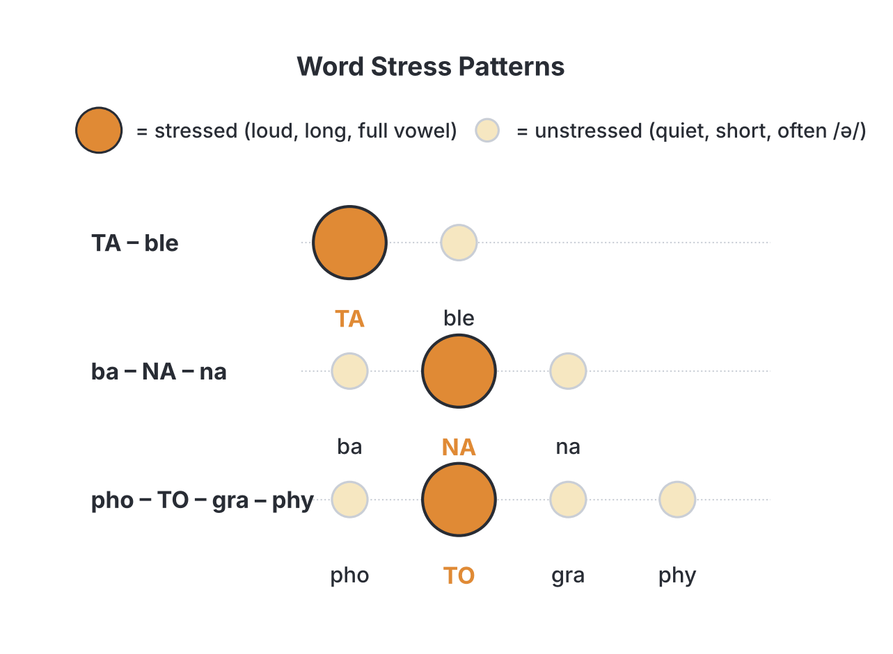
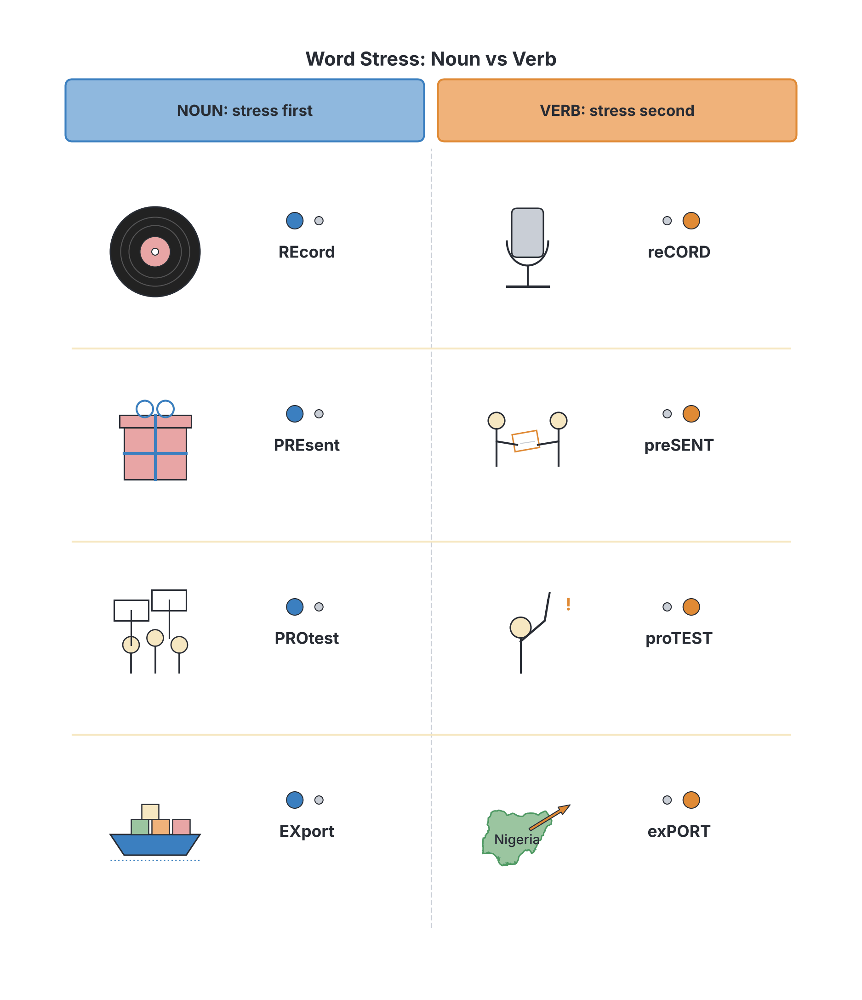
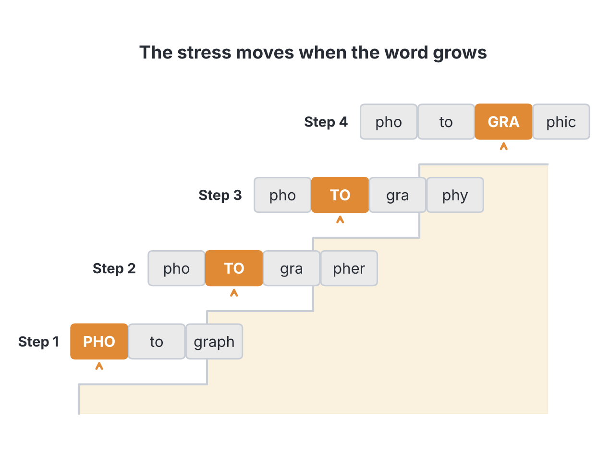

# JAMB Use of English Notes: Word Stress

## What JAMB expects

This topic is Section C (Oral Forms), content item (d) of the JAMB Use of English syllabus: **Word stress (monosyllabic and polysyllabic)**. In the examination, Section C has 10 questions, and **2 of them are on word stress**.

The objectives for Section C say candidates should be able to:

1. Make distinctions among vowel types (objective i).
2. Differentiate among consonant types (objective ii).
3. Identify correct pronunciation of individual words and articulation of connected speech (objective iii).

Word stress belongs mainly to **objective iii**: correct pronunciation of a word includes putting the stress on the right syllable. It also links to objective i, because stressed syllables have full vowels while unstressed syllables often have the weak vowel /ə/.

By the end of these notes, you should be able to:

1. Count the syllables in a word.
2. Explain what stress is and how a stressed syllable sounds different.
3. Explain stress in **monosyllabic** words, including strong and weak forms of function words.
4. Place stress correctly in **polysyllabic** words, using the main patterns and their exceptions.
5. Tell apart noun–verb pairs like *REcord* and *reCORD*, and compounds like *BLACKboard* and *black BOARD*.
6. Use suffixes to predict stress, and follow stress changes in word families.
7. Avoid stress patterns commonly heard in Nigeria that differ from RP.
8. Answer JAMB's two main types of stress question.

### How stress is marked in these notes

Stress is marked in **two** ways in these notes:

1. **CAPITALS in ordinary spelling.** The stressed syllable is written in capital letters, e.g. *phoTOgraphy*, *eduCAtion*, *TAble*. This is the method JAMB uses in its questions.
2. **The ˈ symbol in IPA.** In phonetic transcriptions, the mark ˈ is placed **before** the stressed syllable, e.g. /fəˈtɒɡrəfi/. Where a long word also has a weaker **secondary** stress, it is marked with ˌ (a low mark), e.g. *examination* /ɪɡˌzæmɪˈneɪʃn/. JAMB questions only ask about the **primary** (main) stress, so the capitals in these notes show primary stress only.

Pronunciations follow **RP (Received Pronunciation)**, the British model accent described in the *Cambridge English Pronouncing Dictionary*, which is a recommended text in the syllabus. Where RP allows more than one stress pattern, or where British and American English differ, the notes say so.

**Textbook variation:** where syllable boundaries fall is not always agreed. One book may write *TEAcher*, another *TEACHer*. This does not matter for JAMB: what matters is **which** syllable is stressed, not exactly where the capitals stop.

## Syllables

A **syllable** is a unit of sound organised around **one vowel sound** (or, sometimes, a syllabic consonant). When you clap out a word, each clap is one syllable.

| Word | Syllables | Number |
| --- | --- | --- |
| book | book | 1 |
| teacher | tea-cher | 2 |
| banana | ba-na-na | 3 |
| education | e-du-ca-tion | 4 |
| university | u-ni-ver-si-ty | 5 |
| examination | e-xa-mi-na-tion | 5 |
| responsibility | re-spon-si-bi-li-ty | 6 |

**Count vowel sounds, not vowel letters.** *Make* has two vowel letters (a, e) but only one vowel sound /eɪ/: one syllable. *Boat* has two vowel letters but one sound /əʊ/: one syllable.

### Tricky syllable counts

| Word | IPA | Syllables | Why it is tricky |
| --- | --- | --- | --- |
| asked | /ɑːskt/ | 1 | The -ed is not a separate syllable after /k/ |
| walked | /wɔːkt/ | 1 | Same reason |
| wanted | /ˈwɒntɪd/ | 2 | -ed after /t/ or /d/ IS a syllable: /ɪd/ |
| clothes | /kləʊðz/ | 1 | Not "clo-thes" |
| business | /ˈbɪznəs/ | 2 | The middle "i" is silent |
| chocolate | /ˈtʃɒklət/ | 2 | Usually two in RP (three in careful speech) |
| every | /ˈevri/ | 2 | Not "e-ve-ry" in normal RP |
| vegetable | /ˈvedʒtəbl/ | 3 | Usually three in RP |
| little | /ˈlɪtl/ | 2 | The second syllable is a syllabic /l/ with no vowel |
| button | /ˈbʌtn/ | 2 | The second syllable is a syllabic /n/ |
| fire | /ˈfaɪə/ | 1 or 2 | Textbooks disagree (see below) |

**Syllabic consonants:** in words like *little* /ˈlɪtl/, *bottle* /ˈbɒtl/, *button* /ˈbʌtn/ and *garden* /ˈɡɑːdn/, the final /l/ or /n/ forms a syllable on its own, without a vowel. A syllabic consonant is never stressed.

**Textbook variation (triphthongs):** words like *fire* /faɪə/, *hour* /aʊə/ and *player* /ˈpleɪə/ contain three vowel qualities together (a triphthong, see note C1b). Some books count *fire* and *hour* as **one** syllable (a triphthong), others as **two** (a diphthong + /ə/). JAMB rarely asks for the syllable count of these words. If it does, read all the options carefully.

## What is stress?

In a word of two or more syllables, one syllable is said with **more force** than the others. This is the **stressed** syllable. A stressed syllable is usually:

1. **louder**;
2. **longer**;
3. said on a **different pitch** (often higher);
4. said with a **full, clear vowel**.

Unstressed syllables are quieter and shorter, and their vowels often weaken to /ə/ (the schwa) or /ɪ/.

Compare the two *a*'s in *banana* /bəˈnɑːnə/: only the middle one is stressed, with a full /ɑː/. The first and last are weak /ə/.

### Why stress matters

1. **Wrong stress can make a word hard to understand**, even if every sound is right.
2. **Stress can change the meaning or word class:** *REcord* (noun) vs *reCORD* (verb); *DEsert* (dry land) vs *deSERT* (to abandon).
3. **Stress affects the vowels:** in *PHOtograph* /ˈfəʊtəɡrɑːf/ the first vowel is /əʊ/, but in *phoTOgraphy* /fəˈtɒɡrəfi/ the same letter is weak /ə/.

### Primary and secondary stress

In long words there may be two stressed syllables: one **primary** (the strongest) and one **secondary** (weaker, but still stronger than unstressed syllables).

| Word | IPA | Primary | Secondary |
| --- | --- | --- | --- |
| examination | /ɪɡˌzæmɪˈneɪʃn/ | NA | zam |
| university | /ˌjuːnɪˈvɜːsəti/ | VER | u |
| education | /ˌedʒuˈkeɪʃn/ | CA | e |
| photographic | /ˌfəʊtəˈɡræfɪk/ | GRAPH | pho |

JAMB asks only about primary stress. Never choose an option that puts the capitals on the secondary stress: *EXamination* and *Education* are wrong; *examiNAtion* and *eduCAtion* are right.

## Stress in monosyllabic words

A **monosyllabic** word has **one** syllable: *book*, *go*, *school*, *strength*, *through*. A **polysyllabic** word has **two or more** syllables. (Some books use "disyllabic" for two syllables and keep "polysyllabic" for three or more; the syllabus uses "polysyllabic" for all words of more than one syllable.)

### When a monosyllabic word is said alone

When you say a one-syllable word on its own, its one syllable carries the stress. There is no choice to make, so JAMB cannot ask "which syllable is stressed" in *book*. Instead, monosyllabic words are tested in **sentences**, where some are stressed and others are not.

### Content words and function words

In a sentence, one-syllable words fall into two groups:

| Content words (usually stressed) | Function words (usually unstressed) |
| --- | --- |
| Nouns: *book, man, school* | Articles: *a, an, the* |
| Main verbs: *go, eat, write* | Prepositions: *at, for, from, of, to* |
| Adjectives: *big, red, good* | Conjunctions: *and, but, or, that* |
| Adverbs: *fast, now, well* | Auxiliary verbs: *am, is, are, was, can, have, do* |
| Question words: *who, what, where* | Personal pronouns: *I, he, she, them, us* |
| Demonstratives: *this, that* (used as pronouns) | Relative pronouns: *who, that* (introducing a clause) |
| Negative words: *not, no, can't* | |

Example (stressed words in capitals):

> I WENT to the SHOP to BUY some BREAD.

*Went, shop, buy* and *bread* are content words and are stressed. *I, to, the, to, some* are function words and are unstressed.

### Strong and weak forms

Many function words have **two pronunciations**:

- a **strong form**, used when the word is said alone, is stressed for emphasis, or comes at the end of a sentence;
- a **weak form**, used in normal connected speech, usually with /ə/.

| Word | Strong form | Weak form | Example of weak form |
| --- | --- | --- | --- |
| a | /eɪ/ | /ə/ | I want **a** pen. |
| an | /æn/ | /ən/ | It's **an** orange. |
| the | /ðiː/ | /ðə/ (before consonants), /ði/ (before vowels) | **the** book, **the** egg |
| and | /ænd/ | /ənd/, /ən/ | rice **and** beans |
| but | /bʌt/ | /bət/ | small **but** strong |
| to | /tuː/ | /tə/ (before consonants) | I want **to** go. |
| for | /fɔː/ | /fə/ | This is **for** you. |
| of | /ɒv/ | /əv/ | a cup **of** tea |
| at | /æt/ | /ət/ | Look **at** me. |
| from | /frɒm/ | /frəm/ | She came **from** Ilorin. |
| can | /kæn/ | /kən/ | I **can** swim. |
| was | /wɒz/ | /wəz/ | He **was** late. |
| were | /wɜː/ | /wə/ | They **were** here. |
| have | /hæv/ | /həv/, /əv/ | They **have** gone. |
| has | /hæz/ | /həz/, /əz/ | She **has** left. |
| do | /duː/ | /də/ | Where **do** you live? |
| does | /dʌz/ | /dəz/ | What **does** it mean? |
| are | /ɑː/ | /ə/ | They **are** coming. |
| them | /ðem/ | /ðəm/ | Tell **them**. |
| us | /ʌs/ | /əs/ | Help **us**. |
| some | /sʌm/ | /səm/ | Buy **some** bread. |
| that (conjunction) | /ðæt/ | /ðət/ | I know **that** he's here. |

**When the strong form is used:**

1. **At the end of a sentence:** "Who are you waiting *for*?" (/fɔː/). "Yes, I *can*." (/kæn/).
2. **When the word is stressed for emphasis or contrast:** "I said *TO* the market, not *FROM* the market." (/tuː/, /frɒm/).
3. **When the word is quoted or spoken alone:** "The word *and* is a conjunction." (/ænd/).

**Important:** *that* as a demonstrative ("I want *that* one") is always strong /ðæt/. Only *that* as a conjunction or relative pronoun has the weak form /ðət/. Negative forms (*can't, wasn't, don't*) are never weak.

**Nigerian trap:** many Nigerian speakers use the strong form of every function word ("I want TO go TO THE market AND buy rice"). This makes speech sound heavy and is described in many studies as part of the **syllable-timed** rhythm of Nigerian English. RP is **stress-timed**: stressed syllables come at roughly regular intervals, and the unstressed syllables between them are squeezed and weakened. Using weak forms is part of "correct articulation of connected speech" (objective iii).

**Textbook variation:** the exact list of words with weak forms, and the exact weak vowels, differ slightly between books. The forms in the table are those given in standard RP dictionaries.

## Stress in polysyllabic words

English stress is not fully predictable. There are **patterns** that work for most words, and **exceptions** that must be learnt. The patterns below are those taught in standard oral English textbooks; each is followed by its main exceptions.

**Golden rule:** a syllable with the weak vowel /ə/ is **never** stressed. If you know a syllable has /ə/, you can rule it out.

### Pattern 1: two-syllable nouns and adjectives are usually stressed on the FIRST syllable

| Word | IPA | Word | IPA |
| --- | --- | --- | --- |
| TAble | /ˈteɪbl/ | HAPpy | /ˈhæpi/ |
| WAter | /ˈwɔːtə/ | CLEver | /ˈklevə/ |
| MOther | /ˈmʌðə/ | YELlow | /ˈjeləʊ/ |
| PAper | /ˈpeɪpə/ | PREtty | /ˈprɪti/ |
| DOCtor | /ˈdɒktə/ | BUsy | /ˈbɪzi/ |
| MARket | /ˈmɑːkɪt/ | SIMple | /ˈsɪmpl/ |
| TEAcher | /ˈtiːtʃə/ | ANgry | /ˈæŋɡri/ |

**Exceptions (stressed on the second syllable):**

| Word | IPA | Word | IPA |
| --- | --- | --- | --- |
| hoTEL | /həʊˈtel/ | poLITE | /pəˈlaɪt/ |
| poLICE | /pəˈliːs/ | corRECT | /kəˈrekt/ |
| maCHINE | /məˈʃiːn/ | comPLETE | /kəmˈpliːt/ |
| guiTAR | /ɡɪˈtɑː/ | aLIVE | /əˈlaɪv/ |
| balLOON | /bəˈluːn/ | aLONE | /əˈləʊn/ |
| giRAFFE | /dʒəˈrɑːf/ | aWAKE | /əˈweɪk/ |
| deSIGN | /dɪˈzaɪn/ | sinCERE | /sɪnˈsɪə/ |
| eVENT | /ɪˈvent/ | | |
| sucCESS | /səkˈses/ | | |
| misTAKE | /mɪˈsteɪk/ | | |
| adVICE | /ədˈvaɪs/ | | |

Notice that many exceptions start with a weak syllable (/ə/ or /ɪ/): *hotel* is the main exception with a full first vowel. Adjectives beginning with *a-* (*alive, alone, asleep, awake, afraid*) are stressed on the second syllable.

### Pattern 2: two-syllable verbs are usually stressed on the SECOND syllable, if it has a strong vowel

| Word | IPA | Word | IPA |
| --- | --- | --- | --- |
| beGIN | /bɪˈɡɪn/ | deNY | /dɪˈnaɪ/ |
| deCIDE | /dɪˈsaɪd/ | preFER | /prɪˈfɜː/ |
| forGET | /fəˈɡet/ | arRIVE | /əˈraɪv/ |
| reLAX | /rɪˈlæks/ | alLOW | /əˈlaʊ/ |
| exPLAIN | /ɪkˈspleɪn/ | reTURN | /rɪˈtɜːn/ |
| beLIEVE | /bɪˈliːv/ | comPLAIN | /kəmˈpleɪn/ |

**Exceptions (verbs stressed on the first syllable):** when the second syllable has a weak vowel, the stress goes on the first.

| Word | IPA | Word | IPA |
| --- | --- | --- | --- |
| OPen | /ˈəʊpən/ | FOLlow | /ˈfɒləʊ/ |
| ENter | /ˈentə/ | LISten | /ˈlɪsn/ |
| ANswer | /ˈɑːnsə/ | MARry | /ˈmæri/ |
| VIsit | /ˈvɪzɪt/ | OFfer | /ˈɒfə/ |
| HAPpen | /ˈhæpən/ | STUdy | /ˈstʌdi/ |
| PROmise | /ˈprɒmɪs/ | WORry | /ˈwʌri/ |

*Follow* /ˈfɒləʊ/ is an exception with a full second vowel (/əʊ/), but the stress is still on the first syllable.

### Pattern 3: noun–verb pairs (same spelling, stress changes)

This is one of JAMB's favourite stress topics. A group of two-syllable words can be a **noun** (or adjective) or a **verb**. The **noun** is stressed on the **first** syllable; the **verb** on the **second**. A useful memory aid: **"NOUN first, verb second"** (or "n before v", just as in the alphabet).

| Word | Noun (first syllable) | Verb (second syllable) |
| --- | --- | --- |
| record | REcord /ˈrekɔːd/: a written account | reCORD /rɪˈkɔːd/: to write down; to store sound |
| present | PREsent /ˈpreznt/: a gift; (adj.) here now | preSENT /prɪˈzent/: to give formally, to show |
| object | OBject /ˈɒbdʒɪkt/: a thing; an aim | obJECT /əbˈdʒekt/: to protest |
| conduct | CONduct /ˈkɒndʌkt/: behaviour | conDUCT /kənˈdʌkt/: to lead, to carry out |
| contract | CONtract /ˈkɒntrækt/: a written agreement | conTRACT /kənˈtrækt/: to shrink; to catch (a disease) |
| export | EXport /ˈekspɔːt/: goods sold abroad | exPORT /ɪkˈspɔːt/: to sell abroad |
| import | IMport /ˈɪmpɔːt/: goods bought from abroad | imPORT /ɪmˈpɔːt/: to bring in from abroad |
| increase | INcrease /ˈɪŋkriːs/: a rise | inCREASE /ɪnˈkriːs/: to rise, to make bigger |
| decrease | DEcrease /ˈdiːkriːs/: a fall | deCREASE /dɪˈkriːs/: to fall, to make smaller |
| produce | PROduce /ˈprɒdjuːs/: farm products | proDUCE /prəˈdjuːs/: to make |
| progress | PROgress /ˈprəʊɡres/: improvement | proGRESS /prəˈɡres/: to move forward |
| protest | PROtest /ˈprəʊtest/: a demonstration | proTEST /prəˈtest/: to object |
| rebel | REbel /ˈrebl/: a person who fights authority | reBEL /rɪˈbel/: to fight authority |
| suspect | SUSpect /ˈsʌspekt/: a person thought guilty | susPECT /səˈspekt/: to think likely |
| contrast | CONtrast /ˈkɒntrɑːst/: a clear difference | conTRAST /kənˈtrɑːst/: to compare differences |
| permit | PERmit /ˈpɜːmɪt/: a written permission | perMIT /pəˈmɪt/: to allow |
| insult | INsult /ˈɪnsʌlt/: a rude remark | inSULT /ɪnˈsʌlt/: to be rude to |
| transport | TRANSport /ˈtrænspɔːt/: a system of carrying | transPORT /trænˈspɔːt/: to carry |
| conflict | CONflict /ˈkɒnflɪkt/: a fight, a disagreement | conFLICT /kənˈflɪkt/: to clash |
| convict | CONvict /ˈkɒnvɪkt/: a person in prison | conVICT /kənˈvɪkt/: to find guilty |
| desert | DEsert /ˈdezət/: dry sandy land | deSERT /dɪˈzɜːt/: to abandon |

**Note:** *desert* changes its vowels as well as its stress (/ˈdezət/ vs /dɪˈzɜːt/). The verb *desert* sounds the same as *dessert* (the sweet course after a meal). For *contract*, the verb meaning "to make a formal agreement" is also often stressed CONtract; the second-syllable stress is safest for the meaning "to shrink" or "to catch a disease".

**Same pattern for adjectives:** *PREsent* (adjective, "here") and *ABsent* (adjective) are stressed on the first syllable; the verbs *preSENT* and *abSENT* (yourself) on the second.

**Exceptions: words that do NOT change stress**

Some words are spelt the same as noun and verb but keep the same stress.

| Stressed on the second syllable (noun and verb) | Stressed on the first syllable (noun and verb) |
| --- | --- |
| conTROL /kənˈtrəʊl/ | PROmise /ˈprɒmɪs/ |
| reGRET /rɪˈɡret/ | VIsit /ˈvɪzɪt/ |
| reSPECT /rɪˈspekt/ | PICture /ˈpɪktʃə/ |
| conCERN /kənˈsɜːn/ | COMfort /ˈkʌmfət/ |
| deBATE /dɪˈbeɪt/ | ANswer /ˈɑːnsə/ |
| deSIGN /dɪˈzaɪn/ | COMment /ˈkɒment/ |
| reQUEST /rɪˈkwest/ | |
| reSULT /rɪˈzʌlt/ | |
| rePORT /rɪˈpɔːt/ | |
| reVIEW /rɪˈvjuː/ | |
| surPRISE /səˈpraɪz/ | |
| supPORT /səˈpɔːt/ | |
| adDRESS /əˈdres/ | |

**British vs American:** in RP, *address* is /əˈdres/ (second syllable) as both noun and verb. In American English the noun is often *ADdress*. JAMB uses RP, so choose *adDRESS*.

### Pattern 4: compound nouns are usually stressed on the FIRST part

A **compound noun** is made of two words joined to name one thing. It is usually stressed on the **first** part. A noun phrase made of an **adjective + noun** is stressed on the **noun** (the second word). The stress tells you which one is meant.

| Compound noun (first part stressed) | Meaning | Adjective + noun phrase (second word stressed) | Meaning |
| --- | --- | --- | --- |
| BLACKboard | a board for writing on with chalk (it may be green!) | a black BOARD | any board that is black |
| GREENhouse | a glass building for growing plants | a green HOUSE | a house painted green |
| BLACKbird | a particular species of bird | a black BIRD | any bird that is black |
| DARKroom | a room for developing photographs | a dark ROOM | any room without light |
| ENGlish teacher | a teacher of English | an English TEAcher | a teacher who is English (from England) |
| HOT dog | a sausage in a bread roll | a hot DOG | a dog that feels hot |

More compound nouns stressed on the first part:

| Word | IPA | Word | IPA |
| --- | --- | --- | --- |
| CLASSroom | /ˈklɑːsruːm/ | AIRport | /ˈeəpɔːt/ |
| BEDroom | /ˈbedruːm/ | TOOTHbrush | /ˈtuːθbrʌʃ/ |
| FOOTball | /ˈfʊtbɔːl/ | SUNlight | /ˈsʌnlaɪt/ |
| NEWSpaper | /ˈnjuːzpeɪpə/ | HANDbag | /ˈhændbæɡ/ |
| BOOKshop | /ˈbʊkʃɒp/ | BUS stop | /ˈbʌs stɒp/ |

(*Classroom* and *bedroom* can also end in /rʊm/; *newspaper* can begin /ˈnjuːs-/. The stress is the same either way.)

**Exceptions:** some compounds are stressed on the second part. A well-known one is *headmaster*, which the *Cambridge English Pronouncing Dictionary* gives as /ˌhedˈmɑːstə/ (head-MAS-ter), with secondary stress on *head*. Others include *home-MADE* and *bad-TEMpered* (these are compound adjectives). Compound adjectives are often stressed on the second part when they come after the noun ("The bread is home-MADE").

### Pattern 5: phrasal verbs and the nouns made from them

A **phrasal verb** (verb + particle) is usually stressed on the **particle**. The **noun** made from it is stressed on the **first** part.

| Phrasal verb (particle stressed) | Noun (first part stressed) |
| --- | --- |
| The plane will take OFF. | The TAKEoff was smooth. |
| The car broke DOWN. | We had a BREAKdown. |
| Please check IN early. | The CHECK-in desk is closed. |
| Hand OUT the papers. | Read the HANDout. |
| Don't make UP stories. | She wears no MAKE-up. |
| They set BACK the plan. | It was a SETback. |

(When a phrasal verb has an object noun after it, the object usually takes the main stress of the sentence: "Hand out the PAPERS". The particle is still stronger than the verb.)

### Pattern 6: suffixes that attract or fix the stress

Some endings (suffixes) tell you exactly where the stress goes. These are very useful in JAMB.

#### Group A: the suffix itself is stressed

| Suffix | Examples (IPA) | Exceptions and notes |
| --- | --- | --- |
| -ee | refuGEE /ˌrefjuˈdʒiː/, trainEE /ˌtreɪˈniː/, absenTEE /ˌæbsənˈtiː/, guaranTEE /ˌɡærənˈtiː/, nomiNEE /ˌnɒmɪˈniː/ | comMITtee /kəˈmɪti/, COFfee /ˈkɒfi/, TOFfee /ˈtɒfi/ are NOT stressed on -ee. *Employee* has two RP forms: /ɪmˈplɔɪiː/ (emPLOYee) and /ˌemplɔɪˈiː/ (employEE). |
| -eer | engiNEER /ˌendʒɪˈnɪə/, volunTEER /ˌvɒlənˈtɪə/, pioNEER /ˌpaɪəˈnɪə/, mountaiNEER /ˌmaʊntɪˈnɪə/, caREER /kəˈrɪə/ | Very reliable |
| -ese | JapaNESE /ˌdʒæpəˈniːz/, ChiNESE /ˌtʃaɪˈniːz/, PortuGUESE /ˌpɔːtʃuˈɡiːz/, VietnaMESE /ˌvjetnəˈmiːz/ | Before a noun the stress may shift forward: "a CHInese RESTaurant". When said alone: chiNESE. |
| -ette | cigaRETTE /ˌsɪɡəˈret/, casSETTE /kəˈset/, kitcheNETTE /ˌkɪtʃɪˈnet/ | *Cigarette* is often first-stressed in American English. RP: cigaRETTE. |
| -ique | unIQUE /juˈniːk/, techNIQUE /tekˈniːk/, anTIQUE /ænˈtiːk/, bouTIQUE /buːˈtiːk/ | Very reliable |
| -oon | balLOON /bəˈluːn/, carTOON /kɑːˈtuːn/, monSOON /mɒnˈsuːn/ | Very reliable |
| -ade | lemoNADE /ˌleməˈneɪd/, paRADE /pəˈreɪd/, crusADE /kruːˈseɪd/ | |

#### Group B: the stress falls on the syllable just BEFORE the suffix

| Suffix | Examples (IPA) | Exceptions and notes |
| --- | --- | --- |
| -tion, -sion | inforMAtion /ˌɪnfəˈmeɪʃn/, eduCAtion /ˌedʒuˈkeɪʃn/, deCIsion /dɪˈsɪʒn/, reVIsion /rɪˈvɪʒn/, examiNAtion /ɪɡˌzæmɪˈneɪʃn/ | Almost no exceptions. A very safe rule. |
| -ic | eLECtric /ɪˈlektrɪk/, draMAtic /drəˈmætɪk/, scienTIfic /ˌsaɪənˈtɪfɪk/, ecoNOmic /ˌiːkəˈnɒmɪk/, photoGRAphic /ˌfəʊtəˈɡræfɪk/ | Exceptions: ARabic /ˈærəbɪk/, CAtholic /ˈkæθlɪk/, POlitics /ˈpɒlətɪks/, LUnatic /ˈluːnətɪk/, RHEtoric /ˈretərɪk/, aRIthmetic /əˈrɪθmətɪk/ (noun) |
| -ical | poLItical /pəˈlɪtɪkl/, geoGRAphical /ˌdʒiːəˈɡræfɪkl/, hiSTOrical /hɪˈstɒrɪkl/ | Same position as -ic |
| -ity | abiLIty /əˈbɪləti/, uniVERsity /ˌjuːnɪˈvɜːsəti/, elecTRIcity /ɪˌlekˈtrɪsəti/, natioNAlity /ˌnæʃəˈnæləti/, curiOsity /ˌkjʊəriˈɒsəti/ | Very reliable |
| -ian | muSIcian /mjuˈzɪʃn/, poliTIcian /ˌpɒləˈtɪʃn/, elecTRIcian /ɪˌlekˈtrɪʃn/, liBRArian /laɪˈbreəriən/, niGErian /naɪˈdʒɪəriən/, caNAdian /kəˈneɪdiən/ | Very reliable |
| -ial | esSENtial /ɪˈsenʃl/, ofFIcial /əˈfɪʃl/, inDUStrial /ɪnˈdʌstriəl/, comMERcial /kəˈmɜːʃl/ | Very reliable |
| -ious, -eous | reLIgious /rɪˈlɪdʒəs/, amBItious /æmˈbɪʃəs/, deLIcious /dɪˈlɪʃəs/, couRAgeous /kəˈreɪdʒəs/, advanTAgeous /ˌædvənˈteɪdʒəs/ | Exception: MIschievous /ˈmɪstʃɪvəs/ is stressed on the FIRST syllable (MIS-chie-vous). It has three syllables, not four: there is no "mis-CHIE-vi-ous". |
| -graphy, -logy, -nomy, -sophy | geOgraphy /dʒiˈɒɡrəfi/, biOlogy /baɪˈɒlədʒi/, techNOlogy /tekˈnɒlədʒi/, aSTROnomy /əˈstrɒnəmi/, phiLOsophy /fəˈlɒsəfi/ | Very reliable |
| -cracy | deMOcracy /dɪˈmɒkrəsi/, buREAUcracy /bjʊəˈrɒkrəsi/ | Very reliable |
| -meter (measuring instruments) | therMOmeter /θəˈmɒmɪtə/, baROmeter /bəˈrɒmɪtə/, speeDOmeter /spiːˈdɒmɪtə/ | *Kilometre* has two RP forms: KIlometre /ˈkɪləmiːtə/ and kiLOmetre /kɪˈlɒmɪtə/. Avoid relying on it. |

#### Group C: the stress falls on the THIRD syllable from the end

| Suffix | Examples (IPA) |
| --- | --- |
| -ate (verbs of 3 or more syllables) | CONcentrate /ˈkɒnsntreɪt/, CELebrate /ˈselɪbreɪt/, DEmonstrate /ˈdemənstreɪt/, EDucate /ˈedʒukeɪt/, INdicate /ˈɪndɪkeɪt/, OPerate /ˈɒpəreɪt/, comMUnicate /kəˈmjuːnɪkeɪt/, apPREciate /əˈpriːʃieɪt/, parTIcipate /pɑːˈtɪsɪpeɪt/ |
| -ise / -ize (keep the stress of the base word, usually third from the end) | ORganise /ˈɔːɡənaɪz/, REcognise /ˈrekəɡnaɪz/, CRIticise /ˈkrɪtɪsaɪz/, aPOlogise /əˈpɒlədʒaɪz/ |

**Textbook variation:** British spelling allows both *-ise* and *-ize* (*organise* / *organize*). The stress is the same.

#### Group D: neutral suffixes (they do NOT move the stress)

These endings leave the stress where it was in the base word.

| Suffix | Base word | New word |
| --- | --- | --- |
| -ness | HAPpy | HAPpiness /ˈhæpinəs/ |
| -ment | deVElop | deVElopment /dɪˈveləpmənt/ |
| -ment | GOvern | GOvernment /ˈɡʌvənmənt/ |
| -ment | enJOY | enJOYment /ɪnˈdʒɔɪmənt/ |
| -ful | BEAUty | BEAUtiful /ˈbjuːtɪfl/ |
| -ful | WONder | WONderful /ˈwʌndəfl/ |
| -less | CARE | CAREless /ˈkeələs/ |
| -ly | QUICK | QUICKly /ˈkwɪkli/ |
| -er | TEACH | TEAcher /ˈtiːtʃə/ |
| -ing | reMEMber | reMEMbering /rɪˈmembərɪŋ/ |
| -ship | FRIEND | FRIENDship /ˈfrendʃɪp/ |
| -hood | CHILD | CHILDhood /ˈtʃaɪldhʊd/ |

**Exceptions with -able:** usually neutral (*reLY → reLIable*, *COMfort → COMfortable*), but a few words move the stress forward: *adMIRE → ADmirable* /ˈædmərəbl/, *preFER → PREferable* /ˈprefrəbl/. (*Comparable* is usually *COMparable* /ˈkɒmpərəbl/ in RP; some speakers say *comPARable*.)

### Pattern 7: prefixes are usually NOT stressed

Prefixes like *un-, in-, dis-, re-, pre-, mis-, be-* are usually unstressed in verbs and adjectives. The stress stays on the root.

| Word | IPA |
| --- | --- |
| unHAPpy | /ʌnˈhæpi/ |
| disaGREE | /ˌdɪsəˈɡriː/ |
| misunderSTAND | /ˌmɪsʌndəˈstænd/ |
| reWRITE | /ˌriːˈraɪt/ |
| beCOME | /bɪˈkʌm/ |
| incorRECT | /ˌɪnkəˈrekt/ |

(The last one keeps the stress on *-RECT*, just like *corRECT*.)

Prefixes may be stressed in some nouns (*PREview*, *REfill* as a noun), following the noun–verb pattern.

### Pattern 8: numbers in -teen and -ty

| -teen (second syllable) | -ty (first syllable) |
| --- | --- |
| thirTEEN /ˌθɜːˈtiːn/ | THIRty /ˈθɜːti/ |
| fourTEEN /ˌfɔːˈtiːn/ | FORty /ˈfɔːti/ |
| fifTEEN /ˌfɪfˈtiːn/ | FIFty /ˈfɪfti/ |
| sixTEEN /ˌsɪksˈtiːn/ | SIXty /ˈsɪksti/ |

The stress helps listeners hear the difference between *thirteen* and *thirty*. **Stress shift:** when a -teen number comes before a stressed noun, the stress often moves forward to avoid two stresses side by side: "THIRteen BOOKS". Said alone, it is *thirTEEN*.

## Stress in word families

When you add suffixes to a word, the stress often moves. This changes the vowels too. JAMB likes to test word families because candidates assume the stress stays in the same place.

| Base word | Related word 1 | Related word 2 | Related word 3 |
| --- | --- | --- | --- |
| PHOtograph /ˈfəʊtəɡrɑːf/ | phoTOgrapher /fəˈtɒɡrəfə/ | phoTOgraphy /fəˈtɒɡrəfi/ | photoGRAphic /ˌfəʊtəˈɡræfɪk/ |
| eCOnomy /ɪˈkɒnəmi/ | eCOnomist /ɪˈkɒnəmɪst/ | ecoNOmic /ˌiːkəˈnɒmɪk/ | ecoNOmics /ˌiːkəˈnɒmɪks/ |
| POlitics /ˈpɒlətɪks/ | poLItical /pəˈlɪtɪkl/ | poliTIcian /ˌpɒləˈtɪʃn/ | |
| DIplomat /ˈdɪpləmæt/ | diPLOmacy /dɪˈpləʊməsi/ | diploMAtic /ˌdɪpləˈmætɪk/ | |
| aCAdemy /əˈkædəmi/ | acaDEmic /ˌækəˈdemɪk/ | | |
| DEmocrat /ˈdeməkræt/ | deMOcracy /dɪˈmɒkrəsi/ | demoCRAtic /ˌdeməˈkrætɪk/ | |
| NAtion /ˈneɪʃn/ | NAtional /ˈnæʃnəl/ | natioNAlity /ˌnæʃəˈnæləti/ | |
| eLECtric /ɪˈlektrɪk/ | elecTRIcian /ɪˌlekˈtrɪʃn/ | elecTRIcity /ɪˌlekˈtrɪsəti/ | |
| ORigin /ˈɒrɪdʒɪn/ | oRIginal /əˈrɪdʒənl/ | origiNAlity /əˌrɪdʒəˈnæləti/ | |
| HIStory /ˈhɪstri/ | hiSTOrian /hɪˈstɔːriən/ | hiSTOrical /hɪˈstɒrɪkl/ | |
| ADvertise /ˈædvətaɪz/ | adVERtisement /ədˈvɜːtɪsmənt/ | | |

**Notes:**

- *Economic* and *economics* can also begin with /ˌekə-/ in RP. The stress (on *-NO-*) is the same.
- In *nation* /ˈneɪʃn/ → *national* /ˈnæʃnəl/, the stress stays on the first syllable but the **vowel changes** from /eɪ/ to /æ/.
- *Advertisement* is a famous trap. In RP it is *adVERtisement* /ədˈvɜːtɪsmənt/. In American English it is often *adverTISEment* /ˌædvərˈtaɪzmənt/. JAMB follows RP.

## Stress patterns often heard in Nigeria

Nigerian English has its own stress patterns, which are widely studied. Many Nigerian speakers put the stress on a different syllable from RP in some common words. In everyday Nigerian speech these forms are understood, but **JAMB marks stress by RP**, so you must know the RP pattern.

The words below are often stressed differently in Nigerian speech. The RP pattern is the one to choose in the exam. (Not every Nigerian speaker uses every form in the third column; these are forms you may hear.)

| Word | RP (choose this) | IPA | Form you may hear in Nigeria |
| --- | --- | --- | --- |
| hotel | hoTEL | /həʊˈtel/ | HO-tel |
| police | poLICE | /pəˈliːs/ | PO-lice |
| success | sucCESS | /səkˈses/ | SUC-cess |
| event | eVENT | /ɪˈvent/ | E-vent |
| committee | comMITtee | /kəˈmɪti/ | com-mit-TEE |
| challenge | CHALlenge | /ˈtʃælɪndʒ/ | chal-LENGE |
| indicate | INdicate | /ˈɪndɪkeɪt/ | in-DI-cate |
| comfortable | COMfortable | /ˈkʌmftəbl/ | com-FORT-able |
| calendar | CAlendar | /ˈkælɪndə/ | ca-LEN-dar |
| industry | INdustry | /ˈɪndəstri/ | in-DUS-try |
| management | MAnagement | /ˈmænɪdʒmənt/ | ma-NAGE-ment |
| percentage | perCENTage | /pəˈsentɪdʒ/ | PER-cen-tage |
| certificate | cerTIficate | /səˈtɪfɪkət/ | CER-ti-fi-cate or cer-ti-fi-CATE |
| interpret | inTERpret | /ɪnˈtɜːprɪt/ | IN-ter-pret |
| character | CHAracter | /ˈkærəktə/ | cha-RAC-ter |
| salad | SAlad | /ˈsæləd/ | sa-LAD |
| interesting | INteresting | /ˈɪntrəstɪŋ/ | in-te-RES-ting |
| determine | deTERmine | /dɪˈtɜːmɪn/ | DE-ter-mine |
| advertisement | adVERtisement | /ədˈvɜːtɪsmənt/ | ad-ver-TISE-ment |
| address | adDRESS | /əˈdres/ | AD-dress |

**Why this happens:** many Nigerian languages are tone languages, and research describes Nigerian English as tending towards **syllable timing** (each syllable given similar length) and towards placing stress later or earlier than RP in certain words. Textbooks such as those in the syllabus list explain this in more detail. The point for JAMB is simple: **learn the RP pattern**.

### Words with more than one RP stress (avoid relying on them)

Some words have two accepted stress patterns even in British English. JAMB is unlikely to test them, but if one appears, both patterns may be defended. Be careful.

| Word | Two accepted RP forms |
| --- | --- |
| controversy | CONtroversy /ˈkɒntrəvɜːsi/ and conTROversy /kənˈtrɒvəsi/ |
| kilometre | KIlometre /ˈkɪləmiːtə/ and kiLOmetre /kɪˈlɒmɪtə/ |
| harass | HArass /ˈhærəs/ and haRASS /həˈræs/ |
| television | TElevision /ˈtelɪvɪʒn/ and teleVIsion /ˌtelɪˈvɪʒn/ |
| finance (noun) | FInance /ˈfaɪnæns/ and fiNANCE /faɪˈnæns/ |
| research (noun) | reSEARCH /rɪˈsɜːtʃ/ and REsearch /ˈriːsɜːtʃ/ |
| contribute | conTRIbute /kənˈtrɪbjuːt/ and CONtribute /ˈkɒntrɪbjuːt/ |
| adult | ADult /ˈædʌlt/ and aDULT /əˈdʌlt/ |

## How to answer JAMB word stress questions

JAMB uses two main formats.

### Format 1: "Choose the option that has the correct stress"

The question says something like: *"In the options below, the letters in capitals carry the stress. Choose the option that has the correct stress."*

**Steps:**

1. Look at each option separately. Ignore the capitals at first and **say the word naturally** in RP, thinking of the patterns above.
2. Ask: "Which syllable is strongest?" Then compare with the capitals.
3. Check for a **suffix rule** (-tion, -ic, -ity, -ian, -ee, -eer, -ese, -ique). These are the quickest to judge.
4. Check for a **noun–verb pair**. If the word could be either, see if the question gives a sentence that shows which it is.
5. Watch for **Nigerian-pattern traps** (e.g. *HOtel*, *SUCcess*, *comMITTEE*, *chalLENGE*).
6. Choose the one option that is correct.

#### Worked example 1

*Choose the option with the correct stress:* A. HOtel B. SUCcess C. poLICE D. Event (here "Event" means the first syllable is stressed).

- *hotel* is hoTEL in RP. A is wrong.
- *success* is sucCESS. B is wrong.
- *police* is poLICE. C is right.
- *event* is eVENT. D is wrong.

**Answer: C.**

### Format 2: "Which word is stressed on the first / second / third syllable?"

**Steps:**

1. Count the syllables of each option (clap them).
2. Find the stressed syllable of each.
3. Number the syllables from the beginning and compare with the question.

#### Worked example 2

*Which of the following words is stressed on the second syllable?* A. calendar B. industry C. committee D. management

- CAlendar: first.
- INdustry: first.
- comMITtee: second.
- MAnagement: first.

**Answer: C.**

### Format 3: "Choose the word with a different stress pattern"

Sometimes JAMB asks which word is stressed differently from the others.

#### Worked example 3

*Which word has a different stress pattern from the others?* A. musician B. magician C. physician D. politician

- muSIcian /mjuˈzɪʃn/: second syllable.
- maGIcian /məˈdʒɪʃn/: second.
- phySIcian /fɪˈzɪʃn/: second.
- poliTIcian /ˌpɒləˈtɪʃn/: third.

All follow the -ian rule (stress just before *-ian*), but *politician* has one more syllable before the ending, so its stress falls on the third syllable.

**Answer: D.**

### Format 4: noun–verb pairs in a sentence

*"Choose the correct stress for the word in italics: The farmers will **export** their cocoa to Europe."*

The word is a **verb** here (*will export*), so: exPORT. If the sentence were "Cocoa is a major **export** of Nigeria", it would be the noun: EXport.

## Key terms

| Term | Meaning |
| --- | --- |
| Syllable | A unit of sound built around one vowel sound (or a syllabic consonant) |
| Stress | Extra force on a syllable: louder, longer, higher in pitch and with a full vowel |
| Primary stress | The strongest stress in a word; marked ˈ in IPA and in capitals in JAMB questions |
| Secondary stress | A weaker stress in a long word; marked ˌ in IPA |
| Monosyllabic | Having one syllable (*book*, *strength*) |
| Polysyllabic | Having more than one syllable (*teacher*, *education*) |
| Content word | A word with real meaning (noun, main verb, adjective, adverb); usually stressed in speech |
| Function word | A grammatical word (article, preposition, conjunction, auxiliary, pronoun); usually unstressed |
| Strong form | The full pronunciation of a function word, used when stressed or at the end of a sentence |
| Weak form | The reduced pronunciation of a function word in normal speech, usually with /ə/ |
| Schwa /ə/ | The weak, central vowel found only in unstressed syllables |
| Syllabic consonant | An /l/ or /n/ that forms a syllable on its own, as in *little*, *button* |
| Compound noun | A noun made of two words, usually stressed on the first part (BLACKboard) |
| Stress-timed | A rhythm (as in RP) where stressed syllables come at regular intervals and unstressed ones are squeezed |

## Exam tips and common mistakes

- **JAMB uses capitals for the stressed syllable.** Look at where the capitals fall, not at how the word is spelt.
- **The schwa /ə/ is never stressed.** If an option capitalises a syllable you know has /ə/ (e.g. *poLICE* has /ə/ in "po"), the other syllable is stressed.
- **Learn the safe suffix rules:** -tion, -ic, -ity, -ian, -ial, -ious, -logy, -graphy stress the syllable before; -ee, -eer, -ese, -ique, -oon are stressed themselves.
- **Remember the -ee exceptions:** comMITtee, COFfee, TOFfee.
- **Noun first, verb second:** REcord / reCORD, PREsent / preSENT, OBject / obJECT, PROtest / proTEST. But conTROL, reSPECT, reGRET, adDRESS stay on the second syllable for both.
- **Common Nigerian-pattern traps:** hoTEL (not HOtel), sucCESS, eVENT, comMITtee, CHALlenge, INdicate, COMfortable, CAlendar, INdustry, MAnagement, perCENTage, cerTIficate, inTERpret.
- **Primary, not secondary:** examiNAtion, not EXamination; eduCAtion, not EDucation.
- **Word families move the stress:** PHOtograph → phoTOgraphy → photoGRAphic. Do not copy the stress of the base word.
- **Weak forms are normal, not lazy:** in RP connected speech, *to*, *for*, *and*, *of*, *can*, *was* are usually weak (/tə, fə, ən, əv, kən, wəz/).
- **Don't trust your ear alone** if your accent places stress differently; trust the rules and the words you have learnt.

## Quick summary

1. A syllable is built around one vowel sound; count sounds, not letters (*asked* has one syllable, *wanted* has two).
2. A stressed syllable is louder, longer, higher and has a full vowel; JAMB marks it with capitals, and IPA marks it with ˈ before the syllable.
3. Monosyllabic content words are usually stressed in sentences, while function words are usually said in weak forms with /ə/.
4. Two-syllable nouns and adjectives are usually stressed on the first syllable, and two-syllable verbs on the second, with learnt exceptions (hoTEL, poLICE; Open, VIsit).
5. In noun–verb pairs the noun is stressed first and the verb second (REcord / reCORD); compound nouns are stressed on the first part (BLACKboard).
6. Suffixes guide stress: -tion, -ic, -ity, -ian, -ial, -ious, -logy stress the syllable before; -ee, -eer, -ese, -ique, -oon take the stress; -ness, -ment, -ful, -less are neutral.
7. Stress moves within word families (PHOtograph, phoTOgraphy, photoGRAphic), and JAMB tests the RP pattern, not common Nigerian patterns.

## Practice questions

**1. In the options below, the syllable in capital letters carries the stress. Choose the option with the correct stress.**

- A. HOtel
- B. SUCcess
- C. poLICE
- D. CERtificate

**Answer: C.** *Police* is /pəˈliːs/, stressed on the second syllable. RP has hoTEL, sucCESS and cerTIficate.

**2. Which of the following words is stressed on the first syllable?**

- A. event
- B. comfortable
- C. percentage
- D. design

**Answer: B.** *Comfortable* is COMfortable /ˈkʌmftəbl/. *Event* (eVENT), *percentage* (perCENTage) and *design* (deSIGN) are stressed on the second syllable.

**3. Which of the following words is stressed on the second syllable?**

- A. calendar
- B. industry
- C. committee
- D. management

**Answer: C.** *Committee* is comMITtee /kəˈmɪti/. The others are stressed on the first syllable: CAlendar, INdustry, MAnagement.

**4. Which of the following has a different stress pattern from the others?**

- A. present (noun: a gift)
- B. object (noun: a thing)
- C. conduct (verb: to lead)
- D. import (noun: goods brought in)

**Answer: C.** The verb *conduct* is conDUCT, stressed on the second syllable. The three nouns are stressed on the first: PREsent, OBject, IMport.

**5. Choose the option with the correct stress for "photography".**

- A. PHOtography
- B. phoTOgraphy
- C. photoGRAphy
- D. photograPHY

**Answer: B.** *Photography* is /fəˈtɒɡrəfi/, stressed on the second syllable, just before the ending *-graphy*.

**6. Which of the following words is stressed on the third syllable?**

- A. electricity
- B. democracy
- C. vegetable
- D. advertisement

**Answer: A.** *Electricity* is e-lec-TRI-ci-ty /ɪˌlekˈtrɪsəti/: the stress falls just before *-ity*, on the third syllable. deMOcracy and adVERtisement are stressed on the second syllable; VEgetable on the first.

**7. Choose the option with the correct stress for "engineer".**

- A. ENgineer
- B. enGIneer
- C. engiNEER
- D. ENGINeer

**Answer: C.** Words ending in *-eer* are stressed on that ending: engiNEER /ˌendʒɪˈnɪə/.

**8. Which of the following words has a different stress pattern from the others?**

- A. musician
- B. magician
- C. physician
- D. politician

**Answer: D.** *Politician* is poliTIcian, stressed on the third syllable. The others (muSIcian, maGIcian, phySIcian) are stressed on the second.

**9. In normal connected speech, which word is said in its weak form in the sentence "I went to the market"?**

- A. went
- B. to
- C. market
- D. I

**Answer: B.** *To* is a function word and is normally reduced to /tə/ before a consonant. *Went* and *market* are content words and are stressed; *I* has no weak form.

**10. Which of the following words is stressed on the second syllable?**

- A. challenge
- B. indicate
- C. interpret
- D. comfortable

**Answer: C.** *Interpret* is inTERpret /ɪnˈtɜːprɪt/. CHALlenge, INdicate and COMfortable are all stressed on the first syllable.
