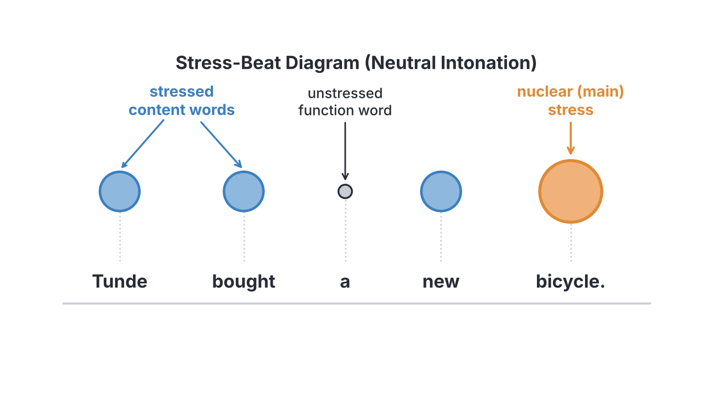
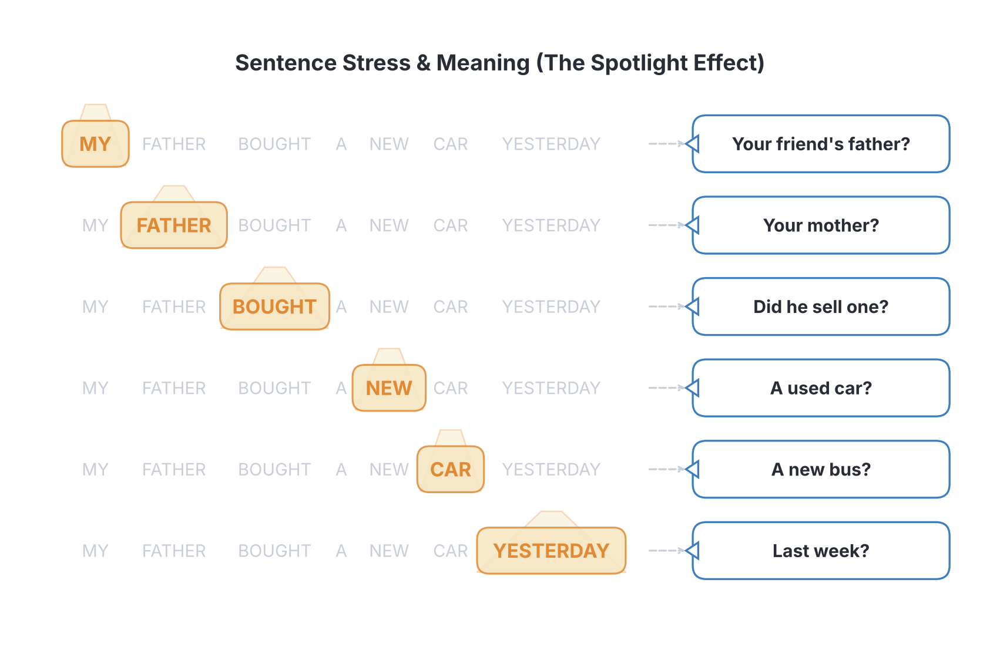
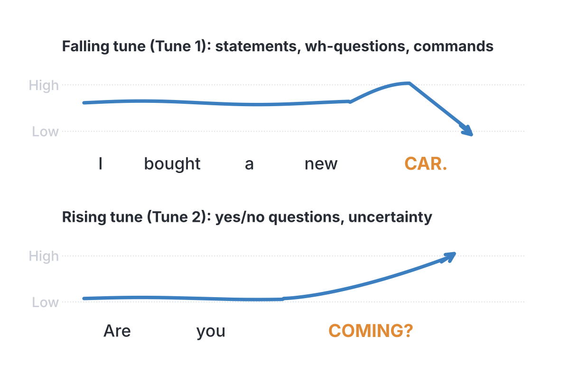

# JAMB Use of English Notes: Emphatic Stress

## What JAMB expects

This topic is Section C (Oral Forms), content item (e) of the JAMB Use of English syllabus: **Emphatic stress (in connected speech)**. The syllabus adds a note:

> Emphatic stress involves the placement of stress on words in an utterance for the purpose of emphasis.

In the examination, Section C has 10 questions, and **2 of them are on emphatic stress**.

The objectives for Section C say candidates should be able to:

1. Make distinctions among vowel types (objective i).
2. Differentiate among consonant types (objective ii).
3. Identify correct pronunciation of individual words and **articulation of connected speech** (objective iii).

Emphatic stress belongs to **objective iii**: it is about how words are said together in a sentence (connected speech), not how a single word is pronounced.

By the end of these notes, you should be able to:

1. Explain what connected speech and sentence stress are.
2. Tell content words from function words and know which are normally stressed.
3. Find the normal (unmarked) main stress in a sentence.
4. Explain what emphatic (contrastive) stress is and why speakers use it.
5. Work out what a sentence means when a particular word carries emphatic stress.
6. Answer JAMB emphatic stress questions quickly and correctly, step by step.
7. Understand the basics of intonation (falling and rising tunes) that support emphatic stress.

### How stress is marked in these notes

- In sentences, the word with **emphatic stress** is written in **CAPITALS**, exactly as JAMB does: *My FATHER bought the car.*
- Inside single words, the stressed syllable is also shown in capitals (e.g. *reCORD*), and in IPA the symbol ˈ is placed before the stressed syllable (e.g. /rɪˈkɔːd/), as in note C4.

## Connected speech

**Connected speech** is the way we speak in real life: words run together in phrases and sentences, not one by one. In connected speech:

1. Not every word is stressed. Some words are strong and others are weak.
2. The stressed words carry the important meaning.
3. One word in each phrase or short sentence carries the **main** stress. This is the word the listener's attention goes to.
4. The speaker can **move** the main stress to any word to show what is important or what is being contrasted. This is **emphatic stress**.

## Sentence stress: content words and function words

In ordinary speech, the words that carry meaning are stressed, and the grammar words are not.

| Content words (normally stressed) | Function words (normally unstressed) |
| --- | --- |
| Nouns: *Tunde, book, market* | Articles: *a, an, the* |
| Main verbs: *buy, write, sell* | Prepositions: *to, at, in, of, for, from* |
| Adjectives: *new, old, red* | Conjunctions: *and, but, or* |
| Adverbs: *quickly, yesterday, here* | Auxiliary verbs: *is, are, was, has, can, will, do* |
| Question words: *who, what, where, why* | Personal pronouns: *I, you, he, she, it, we, they* |
| Negatives: *not, never, can't* | Possessive determiners: *my, your, his, her* |
| Demonstrative pronouns: *this, that* | Relative pronouns: *who, which, that* |

Example, with the normally stressed words written in capitals:

> TUNDE BOUGHT a NEW BICYCLE.

*Tunde, bought, new* and *bicycle* are content words. *A* is a function word and is said in its weak form /ə/.

### The nuclear (main) stress

Among the stressed words, one is the strongest. This is called the **nuclear stress** or **tonic** (some books call it the **sentence stress** or **focus**). In a sentence said in a **neutral** way, with no special emphasis, the nuclear stress usually falls on the **last content word**. (In the table below, the capitals show this normal nuclear stress, not emphatic stress.)

| Sentence (neutral) | Nuclear stress on |
| --- | --- |
| I'm going to the MARKET. | market |
| She bought a new BICYCLE. | bicycle |
| Tunde is reading a NOVEL. | novel |
| The children are playing FOOTBALL. | football |
| We'll travel to ABUJA. | Abuja |

**Exceptions to the "last content word" rule:**

- If the last word is a **pronoun** or other old (already known) information, it is not stressed: "I've already SEEN it." (not "seen IT").
- **Phrasal verbs** take the stress on the particle: "The plane has taken OFF."
- **Compound nouns** take the stress on their first part: "She bought a new TOOTHbrush."

**Textbook variation:** different books use different names for the same thing: "nucleus", "nuclear stress", "tonic syllable", "sentence stress", "focus" or "prominence". Some books keep "sentence stress" for the stressing of all content words and use "nucleus" or "tonic" for the strongest one. JAMB questions simply say "emphatic stress" and show the word in capitals.

## What is emphatic stress?

**Emphatic stress** (also called **contrastive stress**) is extra stress placed on a particular word in a sentence to **emphasise** it. It moves the nuclear stress away from its normal position to the word the speaker wants to highlight.

Speakers use emphatic stress to:

1. **Correct** a wrong idea: "No, my FATHER bought it" (not my mother).
2. **Contrast** two things: "I said BLUE, not black."
3. **Answer a specific question**: "WHO bought it?" "My FATHER bought it."
4. **Insist** that something is true: "I DID lock the door!"
5. **Express strong feeling**: "That was a WONDERFUL match!"

Any word can carry emphatic stress, **including function words** that are normally unstressed: "I said TO the market, not FROM the market." When a function word is stressed this way, it is said in its **strong form** (*to* /tuː/, *from* /frɒm/).

### What happens to the voice

The word with emphatic stress is:

- **louder**;
- **longer**;
- said with a **clear change of pitch**, usually a high pitch falling sharply (in statements);
- often followed by words that are said **low and quiet**, because they are "old" or less important.

The stress goes on the **stressed syllable** of the emphasised word. For example, in "She ate the baNANA, not the mango", the emphatic stress falls on *-NA-* in *banana*, not on the whole word equally.

## How emphatic stress changes meaning

The **same words** can have **different meanings** depending on where the emphatic stress falls. Each placement answers a different question or corrects a different wrong idea.

Take the sentence: **"My father bought a new car yesterday."**

| Sentence with emphatic stress | What it emphasises | The question it answers / idea it corrects |
| --- | --- | --- |
| MY father bought a new car yesterday. | whose father | "Did **your friend's** father buy a new car yesterday?" → No, MY father did. |
| My FATHER bought a new car yesterday. | which person | "Did your **mother** buy a new car yesterday?" → No, my FATHER did. |
| My father BOUGHT a new car yesterday. | the action | "Did your father **sell** a new car yesterday?" / "Did he **rent** one?" → No, he BOUGHT one. |
| My father bought a NEW car yesterday. | the kind / condition | "Did your father buy a **used** (second-hand) car yesterday?" → No, a NEW one. |
| My father bought a new CAR yesterday. | the thing | "Did your father buy a new **bus** yesterday?" → No, a new CAR. |
| My father bought a new car YESTERDAY. | the time | "Did your father buy a new car **last week**?" → No, YESTERDAY. |

**Key idea:** the word with emphatic stress is the part of the sentence that is **new information** or a **correction**. Everything else in the sentence is **already agreed**. So the matching question must:

1. **question or get wrong** exactly the word that is stressed; and
2. **agree with** all the other parts of the sentence.

## How to answer JAMB emphatic stress questions

### The usual JAMB format

The instruction is usually like this:

> *In the following question, the word in capital letters has the emphatic stress. Choose the option to which the given sentence is the appropriate answer.*

Then a sentence is given with one word in capitals, followed by four questions. You must choose the question that the sentence correctly answers.

### Step-by-step method

1. **Find the word in capitals.** This is the focus: the new, corrected or contrasted information.
2. **Ask yourself: "If this word is the answer, what was wrong in the question?"** The correct question will contain a **different** word in the same position (or will ask about it with a question word like *who*, *what*, *when*).
3. **Look at each option.** Compare it with the given sentence, word by word.
4. **The correct option differs from the sentence in the stressed position only.** The question gets the stressed part "wrong" (or asks about it), and gets everything else right.
5. **Reject options that question a different part of the sentence**, even if they look similar.
6. If two options seem possible, choose the one where **all other parts match** the given sentence exactly.

### Worked example 1

*The word in capitals has emphatic stress. Choose the option to which the given sentence is the appropriate answer.*

**My BROTHER sold the old car.**

- A. Did your brother sell the new car?
- B. Did your sister sell the old car?
- C. Did your brother buy the old car?
- D. Did your brother sell the old house?

**Working:**

- The stressed word is BROTHER: the speaker is correcting **who** sold the car.
- A questions *new* (the speaker would stress OLD).
- B questions *sister*: the speaker answers "No, my BROTHER sold it." ✔
- C questions *buy* (the speaker would stress SOLD).
- D questions *house* (the speaker would stress CAR).

**Answer: B.**

### Worked example 2

**My brother SOLD the old car.**

- A. Did your brother sell the new car?
- B. Did your sister sell the old car?
- C. Did your brother buy the old car?
- D. Did your brother sell the old house?

**Working:** the stressed word is SOLD, the **action**. The matching question gets the action wrong: *buy*. Everything else (*your brother*, *the old car*) matches.

**Answer: C.**

### Worked example 3: stress on a number

**Ada bought THREE books yesterday.**

- A. Did Ada buy three pens yesterday?
- B. Did Ada buy two books yesterday?
- C. Did Ada borrow three books yesterday?
- D. Did Ada buy three books today?

**Working:** THREE is the focus, so the question must get the **number** wrong: B (*two books*).

**Answer: B.**

### Worked example 4: stress on a place

**The match will be played in ABUJA.**

- A. Will the match be watched in Abuja?
- B. Will the race be played in Abuja?
- C. Will the match be played in Lagos?
- D. Was the match played in Abuja?

**Working:** ABUJA is the focus, so the question must get the **place** wrong: C (*Lagos*). Option A questions *played*; B questions *match*; D questions the tense (*will be* vs *was*), which would need stress on WILL.

**Answer: C.**

### Worked example 5: stress on an auxiliary verb (insisting)

**I DID submit the form.**

- A. Did you submit the letter?
- B. You didn't submit the form, did you?
- C. Did your friend submit the form?
- D. Will you submit the form?

**Working:** stressing the auxiliary *DID* insists that something really happened. It answers someone who doubts it or says it did **not** happen: B. Option D asks about the future; a matching answer would be "I WILL submit it" or "I have ALREADY submitted it", not "I DID".

**Answer: B.**

**Note:** "I DID submit the form" uses the auxiliary *did* for emphasis (called **emphatic *do***). In a neutral statement we would just say "I submitted the form." Adding a stressed *do/does/did* is a common way to insist or contradict.

### Worked example 6: stress on a pronoun

**SHE told the principal.**

- A. Did she tell the teacher?
- B. Did he tell the principal?
- C. Did she write to the principal?
- D. Did she tell the principal yesterday?

**Working:** SHE is the focus: **who** told. The matching question gets the person wrong: B (*he*).

**Answer: B.**

### Worked example 7: stress on a function word

**The book is ON the table.**

- A. Is the pen on the table?
- B. Is the book under the table?
- C. Is the book on the chair?
- D. Was the book on the table?

**Working:** ON is the focus: the **position**. The matching question gets the preposition wrong: B (*under*).

**Answer: B.**

### Worked example 8: stress on a negative

**Emeka has NOT finished his homework.**

- A. Has Emeka finished his homework?
- B. Has Chidi finished his homework?
- C. Has Emeka started his homework?
- D. Has Emeka finished his classwork?

**Working:** stressing NOT denies something. It answers a question that assumes or asks whether the action has happened: A. (Compare: if it were "EMEKA has not finished", the matching question would ask about another person; if "his HOMEWORK", the question would ask about different work.)

**Answer: A.**

### The reverse format: choose the correctly stressed answer

Sometimes JAMB gives a **question** and asks you to choose the **answer** with the right word stressed.

*Choose the option that correctly answers the question:* **Who wrote the letter to the principal?**

- A. CHIDI wrote the letter to the principal.
- B. Chidi WROTE the letter to the principal.
- C. Chidi wrote the LETTER to the principal.
- D. Chidi wrote the letter to the PRINCIPAL.

**Working:** the question word is *who*, so the answer must stress the **person**: A.

**Answer: A.**

**Rule for the reverse format:** the answer stresses the word that **replaces the question word** (*who* → person, *what* → thing, *where* → place, *when* → time, *how many* → number), or the word that **corrects** the wrong part of a yes/no question.

| Question | Stressed word in the answer |
| --- | --- |
| **Who** broke the plate? | **AMAKA** broke the plate. |
| **What** did Amaka break? | Amaka broke the **PLATE**. |
| **Where** did you see him? | I saw him at the **MARKET**. |
| **When** is the exam? | The exam is on **MONDAY**. |
| **How many** pupils came? | **TWENTY** pupils came. |
| Did Amaka break the **cup**? | No, she broke the **PLATE**. |
| Did **Musa** break the plate? | No, **AMAKA** broke the plate. |

## Common JAMB traps in emphatic stress questions

1. **Two parts changed:** an option may change the stressed part AND another part. For example, for "My FATHER bought a new car", the option "Did your mother buy an old car?" questions both *father* and *new*. This is not the best answer; the best answer changes only the stressed part. (Real JAMB questions are usually designed so that each option changes exactly one part.)
2. **Tense traps:** an option may change *bought* to *will buy* or *is buying*. This questions the **time** or the **action**, not the stressed word.
3. **Pronoun switch:** in questions, *my* becomes *your* and *I* becomes *you* naturally. "My FATHER bought..." matches "Did your mother buy...?" The change from *my* to *your* is normal and is NOT the point being tested (unless MY itself is in capitals).
4. **Function words in capitals:** don't panic if a small word like *ON*, *TO*, *DID* or *NOT* is stressed. The same method works: the question gets that word wrong or doubts it.
5. **Synonyms in options:** a question using a different but similar word (e.g. *purchase* instead of *buy*) usually does not test that part; the setters normally keep the other words identical.

## Intonation: the tunes that go with stress

**Intonation** is the rise and fall of the voice (pitch) in speech. It works together with emphatic stress: the emphasised word is where the main pitch movement happens. The syllabus does not list intonation as a separate item, but it helps you understand emphatic stress and "articulation of connected speech".

Most Nigerian textbooks describe two main tunes:

| Tune | Also called | Movement | Used for | Example |
| --- | --- | --- | --- | --- |
| Falling tune | Tune 1, the glide-down | The pitch falls on the nuclear (stressed) word | Ordinary statements; wh-questions; commands; exclamations; question tags when the speaker is sure | "I bought a new CAR. ↘" "Where do you LIVE? ↘" "Close the DOOR. ↘" |
| Rising tune | Tune 2, the glide-up | The pitch rises on the nuclear word | Yes/no questions; uncertain or unfinished statements; polite requests; question tags when the speaker is unsure; items in a list before the last | "Are you COMING? ↗" "Is this your BAG? ↗" |

### Question tags

| Sentence | Tune on the tag | Meaning |
| --- | --- | --- |
| You're coming tomorrow, AREN'T you? ↘ | Falling | The speaker is sure and expects agreement |
| You're coming tomorrow, AREN'T you? ↗ | Rising | The speaker is not sure and is really asking |

### Lists

In a list, each item before the last has a **rising** tune and the last item has a **falling** tune:

> I bought YAM ↗, RICE ↗, BEANS ↗ and GARRI ↘.

(*Garri* is a Nigerian food word; its spelling varies, e.g. *gari*.)

### Emphatic stress and intonation together

In a statement with emphatic stress, the pitch usually jumps **up** on the emphasised word and then **falls**; the words after it stay low.

> My FATHER ↘ bought the car. (*father* is high and falling; "bought the car" is low and level)

**Textbook variation:** British intonation books (e.g. those by O'Connor and Arnold, or Roach) describe more tunes (fall, rise, fall-rise, rise-fall, level) and use different names. Nigerian school texts usually simplify these into "Tune 1 (falling)" and "Tune 2 (rising)". JAMB's emphatic stress questions do not usually require you to name tunes; they test **which word** is stressed.

## Emphatic stress and Nigerian speech

Research on Nigerian English describes some features that affect emphatic stress:

1. **Syllable timing:** many Nigerian speakers give every syllable a similar length and loudness. This can make it harder to hear which word is emphasised. In RP, the emphasised word stands out clearly, and the rest is reduced.
2. **Few weak forms:** function words are often said in their strong forms all the time. In RP, function words are weak unless they are emphasised; when one is emphasised (*I said TO the market*), the change to the strong form makes the emphasis clear.
3. **Other ways of emphasising:** Nigerian speakers often show emphasis by adding words (e.g. *"It was my father himself who bought it"*, or by repeating words) rather than by stress alone. This is good English too (see "Other ways to show emphasis" below), but JAMB questions test **stress**.
4. **Final-word stress:** some speakers tend to stress the last word of every sentence. In JAMB, read the capitals carefully: the stressed word may be early in the sentence.

These are general tendencies reported in studies; individual speakers vary.

## Other ways to show emphasis (for comparison)

English can also show emphasis with **grammar**. These structures are worth knowing because they help you understand what emphatic stress does, and they appear in lexis and structure questions.

| Structure | Example | Same meaning with emphatic stress |
| --- | --- | --- |
| It-cleft: *It was ... who/that ...* | It was my FATHER who bought the car. | My FATHER bought the car. |
| What-cleft: *What ... was ...* | What my father bought was a CAR. | My father bought a CAR. |
| Emphatic *do/does/did* | I DID lock the door. | (already uses stress) |
| Reflexive for emphasis | The principal HIMSELF came. | The PRINCIPAL came. |
| Fronting | That book I have NEVER read. | I have NEVER read that book. |

## A full practice walkthrough

Read this sentence and match each version to the right question.

**Base sentence:** *Ngozi is travelling to Kano by bus on Friday.*

| Stressed version | Matching question |
| --- | --- |
| NGOZI is travelling to Kano by bus on Friday. | Is Bola travelling to Kano by bus on Friday? |
| Ngozi IS travelling to Kano by bus on Friday. | Ngozi isn't travelling to Kano by bus on Friday, is she? |
| Ngozi is TRAVELLING to Kano by bus on Friday. | Is Ngozi sending a parcel to Kano by bus on Friday? |
| Ngozi is travelling to KANO by bus on Friday. | Is Ngozi travelling to Kaduna by bus on Friday? |
| Ngozi is travelling to Kano by BUS on Friday. | Is Ngozi travelling to Kano by train on Friday? |
| Ngozi is travelling to Kano by bus on FRIDAY. | Is Ngozi travelling to Kano by bus on Thursday? |

Notice that in every row the question is identical to the sentence except for the **one** part that is stressed.

## Key terms

| Term | Meaning |
| --- | --- |
| Connected speech | Natural speech in which words run together in phrases and sentences |
| Content word | A word with real meaning (noun, main verb, adjective, adverb), normally stressed |
| Function word | A grammatical word (article, preposition, auxiliary, pronoun, conjunction), normally unstressed |
| Sentence stress | The pattern of stressed and unstressed words in a sentence |
| Nuclear stress (tonic, nucleus, focus) | The strongest stress in a phrase or sentence; in neutral speech, usually on the last content word |
| Emphatic stress | Extra stress placed on a word to emphasise, contrast or correct it |
| Contrastive stress | Another name for emphatic stress used to show a contrast |
| Emphatic *do* | Stressed *do/does/did* used to insist that something is true (*I DID tell him*) |
| Intonation | The rise and fall of the pitch of the voice in speech |
| Falling tune (Tune 1) | A pitch fall on the nuclear word: statements, wh-questions, commands |
| Rising tune (Tune 2) | A pitch rise on the nuclear word: yes/no questions, uncertainty, lists |
| Cleft sentence | A sentence split to emphasise one part (*It was Tunde who called*) |

## Exam tips and common mistakes

- **The capitalised word is the answer to the question.** It is the new, corrected or contrasted information.
- **The correct question gets the capitalised part wrong and everything else right.** Compare the options word by word with the sentence.
- **Don't be distracted by *my → your* and *I → you*.** These changes are normal in questions and answers.
- **Function words can carry emphatic stress:** *ON the table* (not under), *TO the market* (not from), *I DID go* (contradicting "you didn't").
- **Stressed DID, DOES, DO, IS, HAS** usually answer a doubt or a denial: "You didn't...", "Did you really...?"
- **Stressed NOT** usually answers a question that assumes the action happened, or a yes/no question about it.
- **In the reverse format,** match the question word to the stressed answer word: who → person, where → place, when → time, how many → number.
- **Neutral sentences** put the main stress on the last content word, not on pronouns at the end.
- **Read every option fully** before choosing. Setters often make the four options differ in four different parts of the sentence.

## Quick summary

1. In connected speech, content words are normally stressed and function words are normally unstressed and weak.
2. In a neutral sentence, the main (nuclear) stress falls on the last content word.
3. Emphatic (contrastive) stress moves the main stress to the word the speaker wants to emphasise, contrast or correct; any word, even a function word, can carry it.
4. The emphasised word is new or corrected information; the rest of the sentence is treated as already known.
5. To answer JAMB questions, choose the question that gets the capitalised part wrong (or asks about it) and agrees with everything else.
6. Stressed auxiliaries (DID, IS) insist or contradict; stressed NOT denies.
7. Intonation supports stress: a falling tune for statements, wh-questions and commands, a rising tune for yes/no questions and uncertainty.

## Practice questions

In questions 1 to 8, the word in capital letters has emphatic stress. Choose the option to which the given sentence is the appropriate answer.

**1. My BROTHER sold the old car.**

- A. Did your brother sell the new car?
- B. Did your sister sell the old car?
- C. Did your brother buy the old car?
- D. Did your brother sell the old house?

**Answer: B.** BROTHER is stressed, so the question must get the person wrong. Option B asks about *your sister*; everything else matches.

**2. My brother sold the OLD car.**

- A. Did your brother sell the new car?
- B. Did your sister sell the old car?
- C. Did your brother buy the old car?
- D. Did your brother sell the old house?

**Answer: A.** OLD is stressed, so the question must get the description wrong: *new car*.

**3. Ada bought three BOOKS yesterday.**

- A. Did Ada buy two books yesterday?
- B. Did Ada buy three pens yesterday?
- C. Did Ada borrow three books yesterday?
- D. Did Ada buy three books today?

**Answer: B.** BOOKS is stressed, so the question must get the thing bought wrong: *pens*.

**4. Ada bought three books YESTERDAY.**

- A. Did Ada buy two books yesterday?
- B. Did Ada buy three pens yesterday?
- C. Did Ada borrow three books yesterday?
- D. Did Ada buy three books today?

**Answer: D.** YESTERDAY is stressed, so the question must get the time wrong: *today*.

**5. The new teacher comes from KANO.**

- A. Does the old teacher come from Kano?
- B. Does the new teacher come from Jos?
- C. Does the new principal come from Kano?
- D. Did the new teacher go to Kano?

**Answer: B.** KANO is stressed, so the question must get the place wrong: *Jos*.

**6. I DID submit the assignment.**

- A. Did your friend submit the assignment?
- B. Will you submit the assignment?
- C. You didn't submit the assignment, did you?
- D. Did you submit the project?

**Answer: C.** A stressed *DID* insists that the action really happened. It answers someone who says or suspects it did not happen.

**7. The keys are ON the table.**

- A. Are the keys under the table?
- B. Are the books on the table?
- C. Are the keys on the chair?
- D. Were the keys on the table?

**Answer: A.** ON is stressed, so the question must get the position wrong: *under*.

**8. SHE told the principal.**

- A. Did she tell the teacher?
- B. Did he tell the principal?
- C. Did she write to the principal?
- D. Did she tell the principal yesterday?

**Answer: B.** SHE is stressed, so the question must get the person wrong: *he*.

**9. Choose the option that correctly answers the question: "Who wrote the letter to the principal?"**

- A. CHIDI wrote the letter to the principal.
- B. Chidi WROTE the letter to the principal.
- C. Chidi wrote the LETTER to the principal.
- D. Chidi wrote the letter to the PRINCIPAL.

**Answer: A.** The question asks *who*, so the answer must stress the person: CHIDI.

**10. When the sentence "Tunde is reading a novel" is said without any special emphasis, which word normally carries the main stress?**

- A. Tunde
- B. is
- C. reading
- D. novel

**Answer: D.** In a neutral sentence, the main (nuclear) stress normally falls on the last content word, *novel*.
